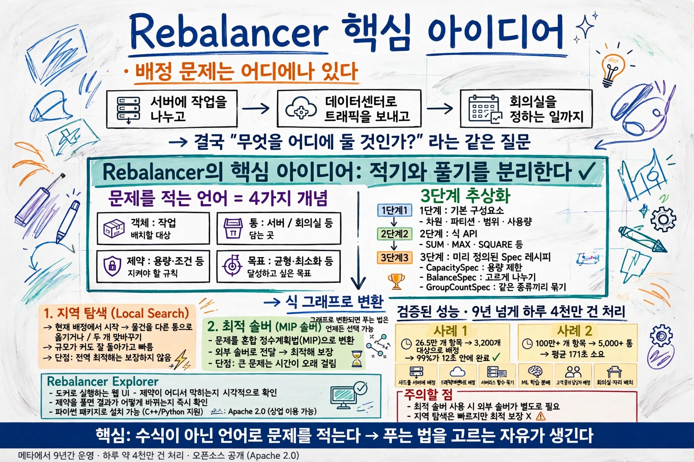
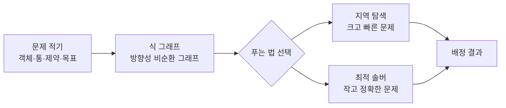
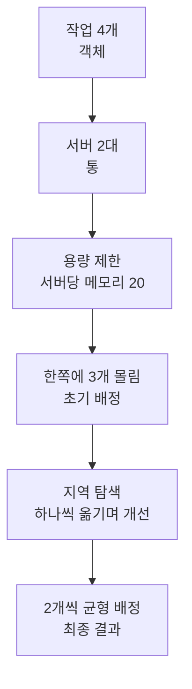

# Rebalancer: 26만 5천 개를 12초에 나누는 비결은 배정 문제를 말로 적는 것입니다

> **Summary**
> Rebalancer는 객체·통·제약·목표로 배정 문제를 표현하고, 문제 규모와 요구에 따라 지역 탐색이나 최적 솔버를 선택해 풉니다. 메타에서 하루 약 4천만 건을 처리하며, 관련 도구와 함께 공개되어 서버 작업부터 회의실 배정까지 다양한 분야에서 활용할 수 있습니다.

---

- 배정 문제는 어디에나 있습니다. 서버에 작업을 나누고, 데이터센터로 트래픽을 보내고, 회의실을 정하는 일까지, 결국 "무엇을 어디에 둘 것인가"라는 같은 질문입니다.
- Rebalancer는 이 질문을 푸는 방법을 바꿨습니다. 문제를 수식으로 적는 대신 객체·통·제약·목표라는 언어로 적으면, 푸는 법은 따로 고릅니다.
- 9년 넘게 하루 4천만 건을 처리해 온 검증된 도구이고, 이제 누구나 쓸 수 있게 공개됐습니다.

회의실 배정표 짜 본 적 있으시죠? 팀마다 원하는 시간은 다르고, 방 크기는 다르고, 이동 시간까지 따져야 합니다. 겨우 몇십 개 방인데도 머리가 아픕니다. 그런데 이걸 수십만 개 단위로, 매일 수천만 번 해야 한다면 어떨까요?

🎥 [동영상 보기](https://www.youtube.com/watch?v=iG-8AGFTA5s)

## 배정 문제, 왜 이렇게 어려울까요?

배정 문제는 겉보기엔 단순합니다. 물건들을 통에 나누어 담는 일입니다. 그런데 통마다 담을 수 있는 양이 다르고, 물건마다 조건이 다르고, 목표까지 여러 개면 이야기가 달라집니다. 서버에 작업을 나눌 때는 CPU와 메모리 한도를 지켜야 하고, 장애가 나도 한쪽에만 몰리면 안 됩니다. 트래픽을 나눌 때는 지연 시간은 줄이면서 데이터센터 부하는 고르게 맞춰야 합니다.

어려운 점은 두 가지입니다. 첫째, 현장의 규칙을 정확한 수식으로 옮기기가 어렵습니다. 둘째, 문제는 대부분 NP-난해라서 상용 솔버로도 풀리지 않을 만큼 큽니다. 그래서 배정 문제는 매번 새로, 어렵게 풀어야 하는 문제로 남았습니다!

## 문제는 말로 적고, 푸는 법은 따로 고릅니다

Rebalancer의 핵심 아이디어는 이겁니다. **문제를 어떻게 적을지와 어떻게 풀지를 분리한다!** 문제를 적는 언어는 객체·통·제약·목표, 네 가지 개념으로 이루어졌습니다. 작업은 객체, 서버는 통입니다. CPU와 메모리 같은 속성은 차원으로 적고, 서버가 모인 랙은 범위로 묶습니다.

언어는 세 단계로 추상화를 높여갑니다. 먼저 차원·파티션·범위·사용량 같은 기본 구성 요소를 정의합니다. 다음으로 `SUM`·`MAX`·`SQUARE` 같은 식 API로 이 요소들을 합치고 변환합니다. 마지막으로 수십 가지 미리 정의된 스펙이 나옵니다. 용량 제한은 `CapacitySpec`, 고르게 나누기는 `BalanceSpec`, 같은 종류끼리 묶기는 `GroupCountSpec`처럼, 레시피를 고르듯 적으면 됩니다.

문제를 적고 나면 Rebalancer가 식 그래프로 바꿉니다. 잎 노드는 서버의 메모리 사용량 같은 사용량 식이고, 위쪽 노드가 `SUM`·`MAX`로 합쳐지면서 전체 목표와 제약이 하나의 그래프가 됩니다. 이 그래프만 있으면 푸는 법은 언제든 바꿀 수 있습니다. 오늘은 빠르게, 내일은 정확하게, 같은 문제를 다시 적을 필요가 없습니다!

## 두 가지 푸는 법, 어떻게 다를까요?

**지역 탐색**은 지금 배정에서 출발합니다. 물건 하나를 다른 통으로 옮기거나, 두 개를 맞바꾸면서 조금씩 나아집니다. 더 좋아지지 않을 때까지, 또는 정한 시간이 다 될 때까지 반복합니다. 전역 최적이라는 보장은 없지만, 규모가 커져도 잘 돌아갑니다. 이웃을 탐색하는 비용이 물건 수와 통 수의 합 수준이라, 백만 개 단위 문제도 메모리에 올릴 수 있습니다. 초당 수백만 번 평가가 가능할 만큼 병렬화도 잘 되어 있습니다.

**최적 솔버**는 문제를 혼합 정수 계획법(MIP)으로 바꿔 외부 솔버에 넘깁니다. 상용 솔버와 오픈소스 솔버를 모두 쓸 수 있습니다. 시간이 충분하면 최적해를 보장합니다. 다만 모델 크기가 최악의 경우 물건 수와 통 수의 곱만큼 커져서, 큰 문제는 아예 못 풉니다. 그래서 현장에서는 작은 문제는 최적 솔버로, 큰 문제는 지역 탐색으로 푸는 경우가 많습니다. 최적 솔버로 기준 해법을 만들고 지역 탐색으로 옮겨가는 방식도 자주 쓰입니다.

## 숫자로 보는 규모, 어느 정도일까요?

메타에서 Rebalancer는 하루 약 **4천만 건**의 배정 문제를 풉니다. 문제 형태만 30가지가 넘습니다. 26만 5천 개 항목을 3,200개 대상으로 나누는 문제도 99%가 **12초** 안에 끝납니다. 백만 개가 넘는 항목과 5천 개 통이 넘는 문제는 평균 171초가 걸리는데, 그런 실행만 3,400번이 넘습니다.

쓰이는 곳도 다양합니다. 샤드를 서버에 나누는 일, 서버를 서비스에 배정하는 일, 전 세계 엣지 데이터센터에서 오는 트래픽을 본 데이터센터로 보내는 일, 서버리스 함수를 묶어 지역성을 높이는 일, 온라인 머신러닝 학습을 지역마다 우선순위에 맞춰 나누는 일까지 이어집니다. 인프라 밖에서도 쓰입니다. 회의실을 배정해 이동 시간을 줄이고, 고객 문의 담당자를 나누고, 자리 배치까지 최적화합니다.

## 디버깅이 절반입니다?

문제를 쉽게 적을 수 있게 되자, 시간이 드는 곳이 바뀌었습니다. 모델을 만드는 사람의 시간 대부분이 솔버의 동작을 디버깅하는 데 쓰이기 시작했습니다. 왜 이 물건이 이 통에 들어갔는지, 어떤 제약이 발목을 잡는지, 제약을 하나 풀면 어떻게 달라지는지, 솔버 내부를 깊이 알아야만 답할 수 있었습니다.

그래서 함께 공개된 도구가 **Rebalancer Explorer**입니다. 도커로 띄우는 웹 UI인데, 문제를 들여다보고 빠르게 디버깅하는 도구입니다. 어떤 제약이 binding 상태인지, 제약을 완화하면 어떻게 되는지, 왜 이 물건이 저 통이 아니라 이 통에 들어갔는지 바로 확인할 수 있습니다. 문제를 적는 일이 쉬워진 만큼, 푸는 과정을 들여다보는 일도 쉬워져야 한다는 생각이 들어간 도구입니다.

## 우리 일에도 쓸 수 있을까요?

배정 문제는 데이터센터만의 문제가 아닙니다. 병원·에너지·물류·교육·재난 대응처럼, 나누는 일이 있는 곳에는 어디에나 있습니다. 설치도 가볍습니다. 파이썬 패키지로 바로 설치할 수 있고, C++와 파이썬 인터페이스를 모두 제공합니다. 핵심은 C++로 짜여 있고, 한 프로세스 안에서 여러 스레드로 돕니다. 라이선스는 Apache 2.0이라 상업 이용에도 열려 있습니다.

다만 주의할 점도 있습니다. 최적 솔버를 쓰려면 외부 솔버가 따로 필요합니다. 오픈소스 솔버도 있지만, 상용 솔버는 별도 라이선스가 필요합니다. 그리고 지역 탐색은 빠르지만 최적해를 보장하지 않습니다. 문제에 따라 어떤 푸는 법이 맞는지, 직접 돌려보고 가늠하는 과정이 필요합니다!

배정 문제는 결국 "무엇을 어디에 둘 것인가"라는 질문입니다. 이 질문을 수식이 아니라 언어로 적을 수 있게 되자, 푸는 법을 고르는 자유가 생겼습니다. 9년 동안 매일 4천만 번 검증된 도구가 이제 열려 있습니다. 나누는 일이 있는 곳이라면, 한 번쯤 들여다볼 만합니다.

