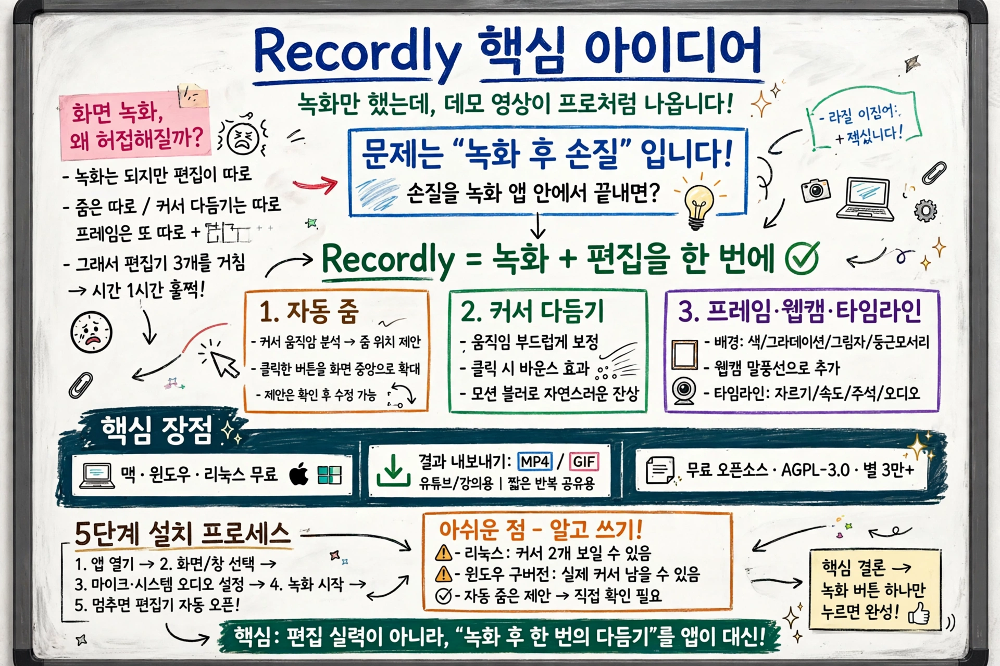
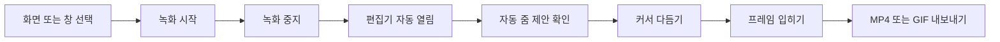
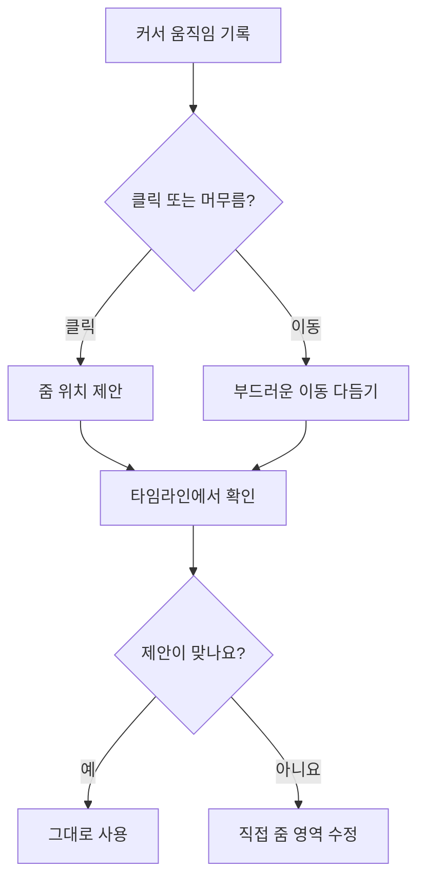
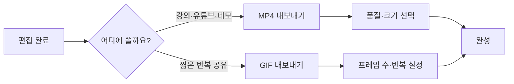

# Recordly: 그냥 녹화만 해도, 데모 영상이 프로처럼 나옵니다

> **Summary**
> Recordly는 화면 녹화와 편집을 한곳에서 처리하는 무료 오픈소스 도구입니다. 커서 움직임을 바탕으로 자동 줌을 제안하고 커서 효과, 프레임, 웹캠, 타임라인 편집을 지원하며 MP4와 GIF로 내보낼 수 있습니다. 자동 줌은 직접 확인하고 수정해야 하며, 운영체제별 최소 조건과 일부 제한 사항도 있습니다.

---

- 녹화만 했는데, 데모 영상이 프로처럼 나옵니다.
- 커서 움직임을 보고 줌을 제안하고, 커서를 다듬고, 프레임을 입혀줍니다.
- 맥·윈도우·리눅스에서 무료로 쓸 수 있고, 결과는 MP4나 GIF로 내보낼 수 있습니다.

제품 데모 영상을 찍어본 적 있으시죠? 화면은 녹화했는데, 다시 보면 어딘가 허접합니다. 커서는 떨리고, 중요한 버튼은 작게 보이고, 화면 가장자리는 텅 비어 있습니다. 그래서 편집을 시작하면 한 시간이 훌쩍 갑니다. 그런데 녹화만으로 이 과정을 끝내는 방법이 있습니다!

🎥 [동영상 보기](https://www.youtube.com/watch?v=SLAhD0OtOik)

## 화면 녹화, 왜 자꾸 허접해 보일까요?

원인은 기술이 아니라 순서입니다. 보통 녹화 도구는 화면만 담고 끝냅니다. 줌은 따로, 커서 다듬기는 따로, 프레임은 또 따로 손봐야 합니다. 그래서 데모 영상 한 편에 편집기 세 개를 거치는 일이 생깁니다.

> 문제는 녹화가 아니라, 녹화 뒤에 붙는 손질입니다!

이 손질을 녹화 앱 안에서 끝내면 어떨까요? 그 질문에 답하는 도구가 이번 글의 주인공입니다.

## Recordly는 무엇이 다를까요?

`Recordly`는 화면 녹화와 편집을 한 앱에 합친 무료 오픈소스 도구입니다. 녹화를 멈추면 바로 편집기가 열립니다. 커서 움직임을 보고 줌을 제안하고, 커서를 다듬고, 프레임을 입혀 데모 영상을 완성합니다. 따로 편집기를 열 필요가 없습니다!

처음에는 다른 오픈소스 녹화 도구의 갈래로 시작했지만, 지금은 코드의 80% 이상이 달라진 독립적인 프로젝트입니다. 라이선스는 AGPL-3.0이고, 기본 기능은 무료입니다. 최근 기준 별이 3만 개를 넘겼습니다.

## 자동 줌, 커서는 어떻게 다듬어질까요?

핵심은 커서입니다. `Recordly`는 커서가 어디에서 머물고, 어디를 클릭했는지 보고 줌 위치를 제안합니다. 클릭한 버튼이 화면 가운데로 커지면서, 보는 사람의 시선이 자연스럽게 따라갑니다.

커서 효과도 세 가지 갈래로 다듬을 수 있습니다. 움직임은 부드럽게 다듬고, 클릭할 때는 바운스로 눌린 느낌을 주고, 빠르게 움직일 때는 모션 블러로 잔상을 남깁니다. 크기 조절, 흔들림, 반복 재생용 루프 모드까지 고를 수 있습니다. 떨리는 커서가 차분한 안내자로 바뀌는 순간입니다!

다만 한 가지는 짚고 넘어가야 합니다. 자동 줌은 제안입니다. 클릭했다고 그곳이 설명의 중심은 아닐 수 있습니다. 타임라인에서 제안을 확인하고, 필요 없는 줌은 지우고, 직접 줌 영역을 그리는 과정이 필요합니다. 자동이 결정을 대신하지는 않습니다.

## 프레임과 웹캠, 타임라인은요?

데모 영상의 첫인상은 프레임이 정합니다. `Recordly`는 배경화면, 색상, 그라데이션, 흐림, 여백, 그림자, 둥근 모서리를 골라 화면을 감쌀 수 있습니다. 비율 프리셋도 있어서 세로 영상이나 정사각형 영상도 같은 프로젝트에서 만들 수 있습니다.

웹캠은 화면 위에 동그란 말풍선으로 얹습니다. 위치는 프리셋이나 직접 좌표로 정하고, 거울 반전, 그림자, 둥글기까지 조절할 수 있습니다. 줌에 반응해서 크기가 따라 움직이는 설정도 있습니다. 설명하는 얼굴이 버튼을 가리는 일은 줄일 수 있습니다.

타임라인에서는 자르기, 속도 조절, 주석 넣기, 추가 오디오, 자르기를 드래그로 처리합니다. 작업은 `.recordly` 프로젝트 파일로 저장해서 나중에 다시 열 수 있습니다. 내보내기는 MP4와 GIF 두 가지입니다. MP4는 유튜브나 강의용, GIF는 짧은 반복 공유용으로 고르면 됩니다.

## 설치는 어떻게 할까요?

시작은 다섯 단계입니다. 앱을 열고, 화면이나 창을 고르고, 마이크와 시스템 오디오를 정하고, 녹화를 시작하고, 멈추면 편집기가 열립니다. 설치는 미리 빌드된 파일을 받는 방법이 가장 빠릅니다. 윈도우는 ZIP을 풀어 실행 파일을 열고, 리눅스는 `AppImage`에 실행 권한을 주고 실행합니다. 아치 리눅스라면 `yay -S recordly-bin` 명령으로 받을 수도 있습니다.

| 플랫폼 | 최소 조건 |
| --- | --- |
| macOS | 14.0 이상 |
| Windows | 10 빌드 19041 이상 |
| Linux | 최신 배포판, 시스템 오디오는 PipeWire 필요 |

맥은 네이티브 캡처를 쓰고, 윈도우는 네이티브 그래픽 캡처와 오디오를 씁니다. 리눅스는 전자 앱 캡처로 녹화합니다.

## 아쉬운 점은 없을까요?

세 가지는 알고 쓰는 게 좋습니다. 첫째, 리눅스에서는 실제 커서를 숨길 수 없어서, 꾸민 커서를 켜면 두 개의 커서가 보일 수 있습니다. 둘째, 윈도우 빌드가 19041보다 오래되면 대체 캡처로 돌아가 실제 커서가 남을 수 있습니다. 셋째, 자동 줌은 어디까지나 제안이라, 확인 없이 내보내면 엉뚱한 곳이 커질 수 있습니다.

그래도 방향은 분명합니다. 데모 영상의 품질은 편집 실력이 아니라, 녹화 뒤에 붙는 한 번의 다듬기로 갈립니다. 그 다듬기를 앱이 대신해 주는 게 `Recordly`의 자리입니다. 다음 데모 영상을 찍을 때, 녹화 버튼 하나만 눌러보시면 어떨까요?

