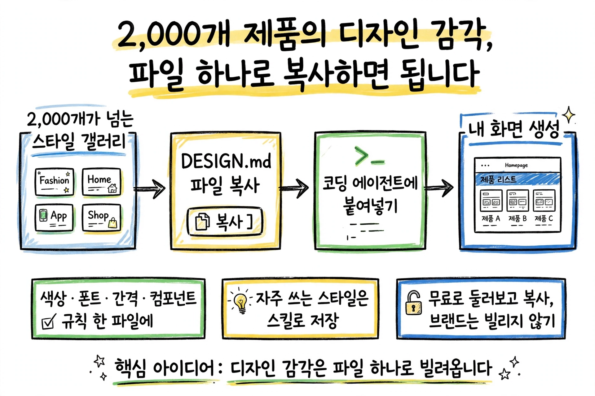
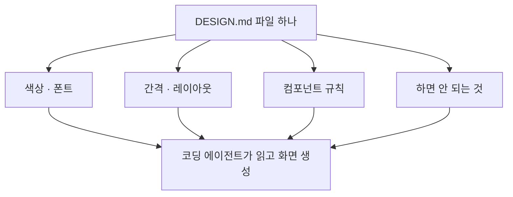
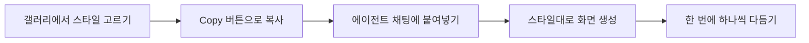
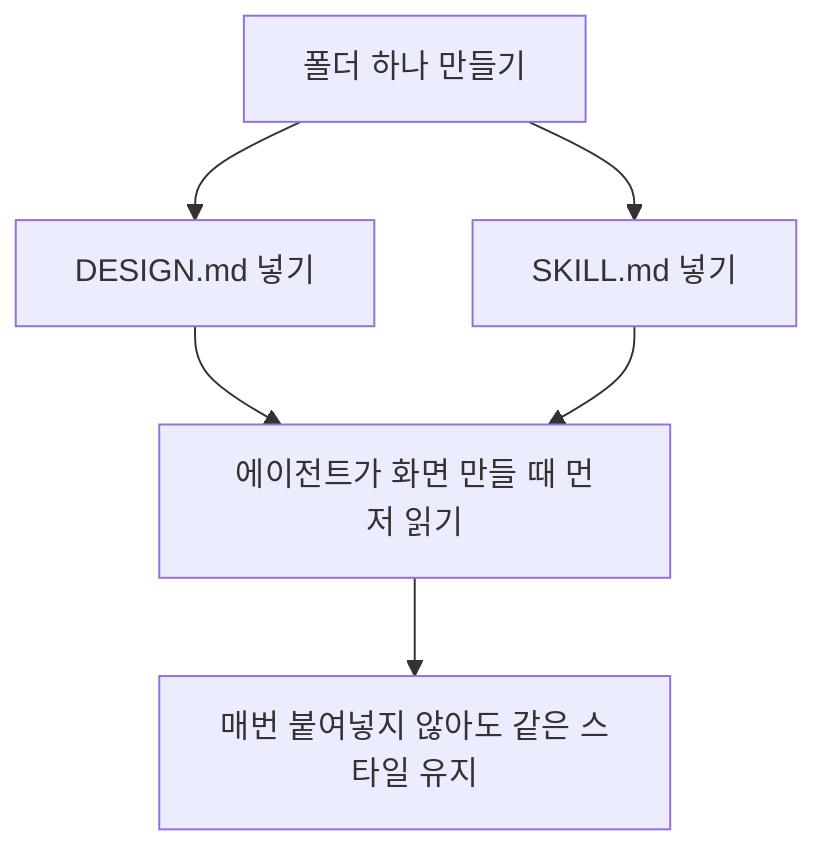

# Refero Styles: 2,000개 제품의 디자인 감각을 파일 하나로 복사하면, AI 화면이 달라집니다

> **Summary**
> Refero Styles는 2,000개가 넘는 제품의 색상, 타이포그래피, 간격, 레이아웃, 컴포넌트 규칙을 담은 무료 DESIGN.md 갤러리로, 파일을 복사해 AI 코딩 에이전트에 제공하면 원하는 스타일의 화면을 만들 수 있습니다. 자주 쓰는 스타일은 스킬로 저장할 수 있으며, 디자인 언어만 참고하고 브랜드명·로고·이미지·문구는 사용하지 않도록 주의해야 합니다.

---

- 유명 제품 2,000개가 넘는 디자인 시스템이 `DESIGN.md` 파일로 모여 있습니다. 골라서 복사하면 끝입니다.
- 색상·폰트·간격·컴포넌트 규칙이 한 파일에 들어 있어, 코딩 에이전트에게 붙여넣기만 하면 그 제품의 느낌이 화면에 이어집니다.
- 갤러리를 둘러보고 파일을 복사하는 건 무료입니다. 다만 브랜드를 통째로 베끼는 건 안 됩니다.

AI에게 화면을 맡겼는데, 결과가 늘 비슷하게 나오지 않으시나요? 버튼은 늘 보라색 그라데이션, 레이아웃은 늘 가운데 정렬 카드 세 장. 프롬프트를 아무리 다듬어도 "AI가 만든 것 같은" 화면에서 벗어나기 어렵습니다.

이럴 때 필요한 건 더 긴 설명이 아니라, 참고할 실물입니다. 유명 제품 2,000개가 넘는 디자인 시스템을 파일 하나로 모아둔 갤러리가 있습니다. 마음에 드는 스타일을 골라 복사하고, 코딩 에이전트에게 넘기면 됩니다.

🎥 [동영상 보기](https://www.youtube.com/watch?v=_SVU3oC4JX8)

## 2,000개면 뭐가 달라지나요?

규모가 다릅니다! 깃허브에 공개된 무료 모음은 파일이 84개 수준입니다. 이 갤러리는 2,000개가 넘습니다. 20배가 넘는 차이입니다.

파일 수가 많다는 건, 고를 수 있는 분위기가 많다는 뜻입니다. 차분한 편집 스타일부터 화려한 제품 페이지까지, 내 서비스와 결이 맞는 참고 자료를 찾을 확률이 훨씬 높습니다. 홈페이지에 올라온 예시만 봐도 애플, 피그마, 버셀, 리니어, 오픈AI처럼 결이 전혀 다른 제품들이 나란히 있습니다.

파일 하나에는 뭐가 들어 있을까요? 색상과 타이포그래피, 간격과 레이아웃, 컴포넌트 규칙, 그리고 하면 안 되는 것까지. AI가 읽고 그대로 따를 수 있게 평문으로 정리돼 있습니다.

## 어떻게 쓰나요?

방법은 다섯 단계로 끝납니다. 어렵지 않습니다.

1. 갤러리를 열고 마음에 드는 스타일을 고릅니다. 브랜드 이름으로 검색해도 됩니다.
1. 스타일 페이지에서 `Copy` 버튼을 누릅니다. 파일로 받고 싶으면 옆의 `.md` 버튼을 누르면 됩니다.
1. 클로드나 코딩 에이전트 채팅에 붙여넣습니다. 내 사업 설명과 만들고 싶은 페이지 구성을 함께 적습니다.
1. 에이전트가 그 스타일로 화면을 만듭니다. 미리보기가 열리면 확인합니다.
1. 마음에 안 드는 부분은 한 번에 하나씩, 평범한 말로 고쳐달라고 합니다.

이 장면이 저는 가장 인상 깊었습니다. "디자인 감각"이라는 추상적인 요구가 파일 복사 한 번으로 바뀌는 순간이니까요!

## 스킬로 저장하면 매번 붙여넣지 않아도 되나요?

됩니다! 자주 쓰는 스타일은 스킬로 만들어두면 편합니다.

폴더 하나를 만들고 `DESIGN.md`와 짧은 `SKILL.md`를 함께 넣습니다. `SKILL.md`에는 "웹사이트나 화면을 만들 때마다 이 폴더의 `DESIGN.md`를 먼저 읽고, 모든 시각적 결정의 기준으로 삼으라"는 지시를 적습니다. 클로드 코드에서는 스킬 폴더에, 코덱스에서는 프로젝트 안의 스킬 폴더에 넣어두면 됩니다. 스킬이 없어도 파일 첨부만으로 같은 효과를 낼 수 있지만, 매번 다시 첨부해야 합니다.

## 무료로 어디까지 되나요?

갤러리를 둘러보고 `DESIGN.md`를 복사하는 건 무료입니다. 베타 기간이라 매주 새 스타일이 추가되고 있습니다.

다만 알아둘 점이 있습니다. 이 갤러리의 모체가 되는 전체 화면 라이브러리는 14만 장이 넘는데, 무료로는 그중 약 3%만 열립니다. MCP 연결이나 피그마 플러그인처럼 에이전트가 직접 라이브러리를 뒤지는 기능은 유료 Pro 영역입니다. 파일 몇 개를 복사해서 쓰는 용도라면 무료만으로 충분합니다. 본격적으로 라이브러리를 뒤지려면 유료 전환을 따져봐야 합니다.

## 베끼는 것과 참고하는 건 어떻게 다른가요?

이 질문이 이 글에서 가장 중요합니다. 스타일만 빌리고, 브랜드는 빌리지 않습니다!

색상·폰트·간격·레이아웃 같은 디자인 언어는 참고해도 됩니다. 하지만 상대의 브랜드 이름, 로고, 사진, 문구는 쓰면 안 됩니다. 내 사업 이름과 내 문구, 내 버튼 문장을 넣어야 합니다. 스타일 파일에 적힌 회사 이름이 그대로 화면에 남아 있지 않은지, 복사한 뒤 한 번 확인하는 습관이 필요합니다.

또 하나, 이 갤러리의 파일들은 각 브랜드의 공식 디자인 시스템이 아니라 실제 사이트를 분석해 정리한 파일입니다. 스냅샷이라 지금 사이트와 값이 조금 다를 수도 있고, 베타라 제공 방식이 바뀔 수도 있습니다. 참고 자료로 쓰고, 최종 판단은 내 눈으로 하는 게 맞습니다.

2,000개의 파일이 있다는 사실보다 중요한 건, 그중 하나를 골라 내 화면에 붙여보는 일입니다. 오늘은 어떤 제품의 느낌을 빌려오시겠어요?

