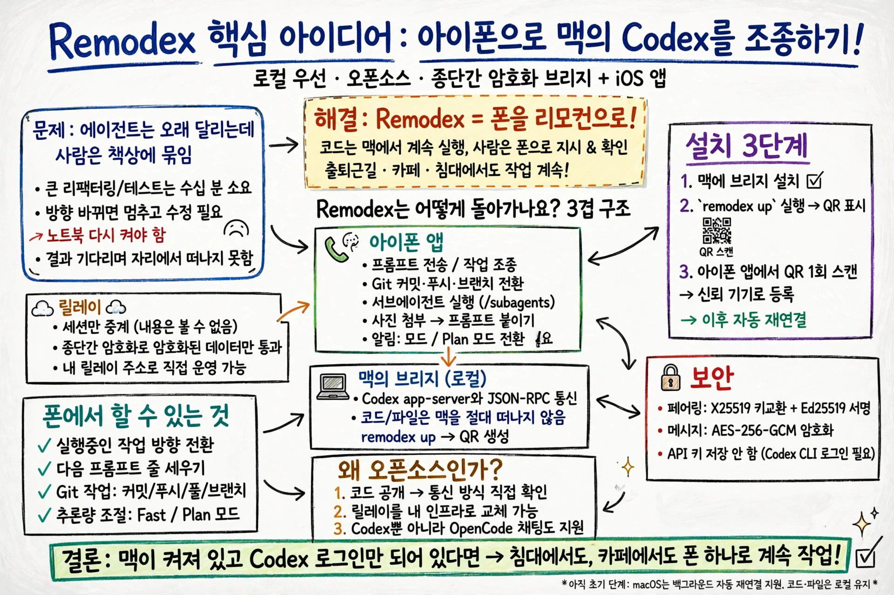
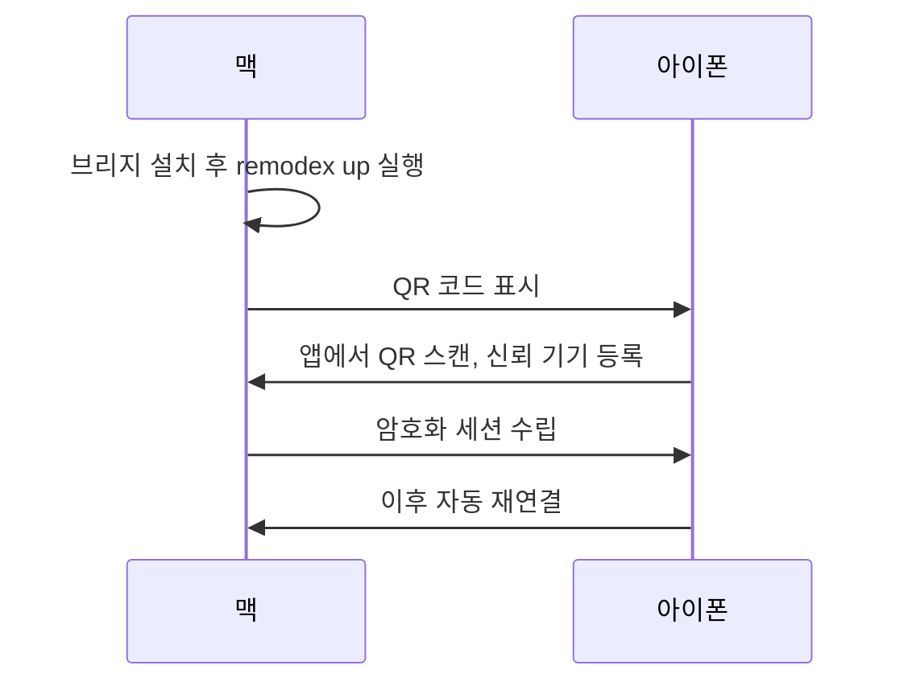
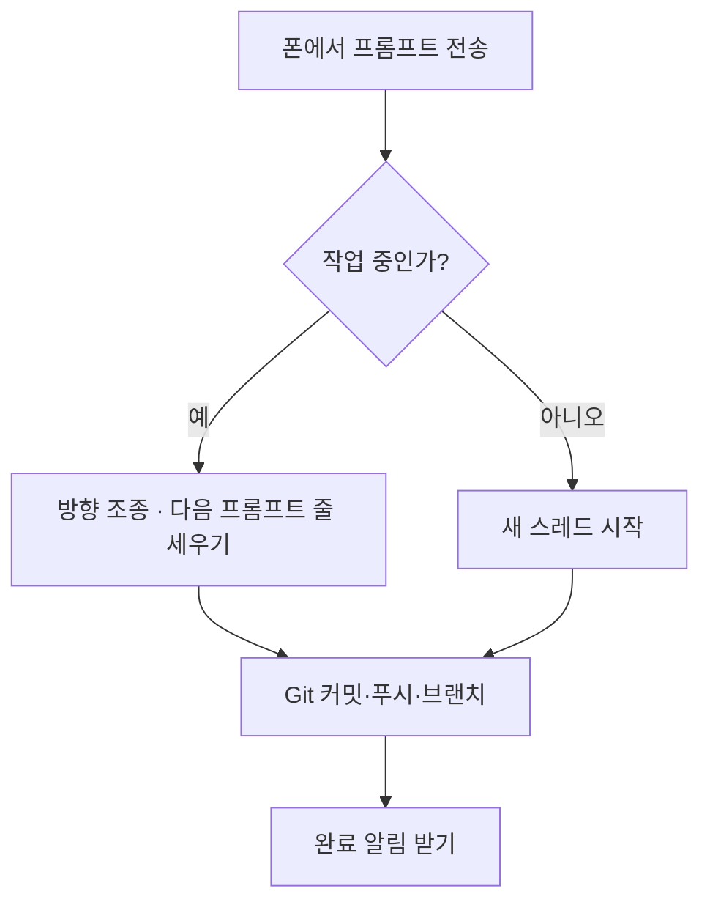

# Remodex: Codex는 맥에 두고, 손은 아이폰으로 움직이면 됩니다

> **Summary**
> Remodex는 아이폰으로 맥에서 실행 중인 Codex 작업을 원격 조종하는 로컬 우선 오픈소스 앱입니다. 암호화된 연결로 프롬프트 전송, 작업 조정, Git 작업 등을 할 수 있고, 코드는 맥에 남습니다. 설치와 QR 페어링이 간단하며, 릴레이를 직접 운영할 수도 있지만 아직 초기 단계라 버그와 일부 기능 제한을 고려해야 합니다.

---

- Remodex는 맥에서 도는 Codex를 아이폰에서 조종하는 로컬 우선 오픈소스 브리지와 iOS 앱입니다.
- 맥에 브리지를 설치하고 `remodex up`으로 QR을 띄우면, 아이폰에서 한 번만 스캔해 신뢰 기기로 등록하고 이후에는 자동으로 다시 연결됩니다.
- 프롬프트 전송부터 실행 중인 작업 조종, Git 커밋·푸시, 서브에이전트 실행까지 폰에서 되며, 통신은 종단간 암호화로 보호됩니다.

긴 작업 하나를 Codex에 맡기고 자리를 떴는데, 중간에 방향을 바꿔야 할 때가 있으시죠? 집에 돌아갈 때까지 기다리거나, 노트북을 다시 펼쳐야 했습니다. 이제는 침대에 누워서도, 카페에서도 폰 하나로 그 작업을 이어갈 수 있습니다!

🎥 [동영상 보기](https://www.youtube.com/watch?v=tk9qrk5G4RQ)

## 왜 코딩 에이전트를 폰으로 부리려고 할까요?

코딩 에이전트는 오래 돕니다. 큰 리팩터링이나 테스트 돌리기는 몇십 분씩 걸리기도 합니다. 그런데 에이전트가 일하는 동안 사람은 책상에 묶여 있습니다. 질문이 생기면 답해야 하고, 방향이 틀어지면 멈춰야 하니까요.

폰으로 부리는 방식은 이 묶인 시간을 풉니다. 코드는 맥에서 계속 돌고, 사람은 폰으로 지시하고 결과를 봅니다. 출퇴근길, 점심시간, 소파 위에서도 작업이 이어집니다. 이게 바로 Remodex가 푸는 문제입니다!

## Remodex는 어떻게 돌아가나요?

구조는 세 겹입니다. 아이폰 앱, 맥의 브리지, 그리고 둘을 이어주는 릴레이입니다. 코드는 절대 맥을 떠나지 않습니다. 폰은 리모컨일 뿐입니다.

브리지는 `codex app-server`와 JSON-RPC로 대화합니다. 아이폰에서 보낸 지시는 릴레이를 거쳐 브리지로 가고, Codex의 응답은 실시간으로 폰에 스트리밍됩니다. 릴레이는 세션만 중계할 뿐, 프롬프트 내용은 볼 수 없습니다. 이 구조가 저는 가장 인상 깊었습니다. 클라우드에 코드를 올리지 않고도 원격이 됩니다.

## 설치는 얼마나 쉬울까요?

설치는 세 단계입니다. 맥에 브리지를 설치하고, `remodex up`을 실행하고, 아이폰 앱에서 QR을 한 번 스캔하면 됩니다. 처음 한 번만 스캔하면 아이폰이 맥을 신뢰 기기로 저장하고, 다음부터는 자동으로 다시 연결됩니다.

준비물은 세 가지입니다. Node.js 18 이상, 설치되고 로그인된 Codex CLI, 그리고 아이폰에 설치된 Remodex 앱입니다. 맥에서 백그라운드 브리지가 돌아가려면 macOS가 필요하고, 그 외 운영체제에서는 브리지가 포그라운드로 돕니다.

## 폰에서 뭘 할 수 있나요?

폰에서 할 수 있는 일은 생각보다 많습니다. 새 스레드를 만들고, 실행 중인 작업을 멈추지 않고 방향을 바꾸고, 턴이 도는 동안 다음 프롬프트를 줄 세워 둘 수 있습니다. 서브에이전트도 `/subagents` 명령으로 폰에서 띄웁니다!

Git 작업도 폰에서 됩니다. 커밋, 푸시, 풀, 브랜치 전환까지요. 사진 첨부도 됩니다. 카메라로 찍은 화면이나 도면을 그대로 프롬프트에 붙일 수 있습니다. 작업이 끝나거나 주의가 필요하면 알림이 옵니다.

빠른 반복에는 Fast 모드, 실행 전에 계획을 세울 때는 Plan 모드로 바꿀 수 있습니다. 추론량을 조절하는 컨트롤도 있습니다. 이 대목이 저는 가장 와닿았습니다. 폰이 단순한 뷰어가 아니라, 책상 앞과 같은 조작판이라는 점입니다.

## 보안은 어떻게 믿을까요?

원격 조종에서 가장 먼저 물어야 할 건 보안입니다. Remodex의 답은 암호화와 로컬 우선입니다. 페어링은 X25519 임시 키 교환, Ed25519 서명, AES-256-GCM 메시지 암호화로 이뤄집니다. QR에는 연결 정보와 브리지의 공개키가 들어 있습니다.

릴레이는 세션을 중계만 합니다. 프롬프트, 도구 호출, Git 출력 같은 내용은 암호화된 채로 지나가므로 중간에서는 볼 수 없습니다. 릴레이를 직접 운영하고 싶으면 환경 변수로 내 릴레이 주소를 지정하면 됩니다. API 키도 Remodex에 저장하지 않습니다. Codex CLI가 맥에 이미 로그인돼 있어야 브리지가 돕니다.

## 공식 앱이 있는데 왜 오픈소스를 쓸까요?

여기서 한 가지 짚을 점이 있습니다. OpenAI도 ChatGPT 모바일 앱에서 Codex를 다루는 공식 경로를 내놨습니다. 그런데도 Remodex 같은 오픈소스 대안이 의미 있는 이유는 세 가지입니다.

첫째, 코드가 열려 있습니다. 통신 방식과 릴레이 동작을 직접 확인할 수 있습니다. 둘째, 릴레이를 내 인프라로 바꿀 수 있습니다. 셋째, Codex뿐 아니라 OpenCode 채팅도 같은 앱에서 다룰 수 있습니다. 모델을 골라서 시작하고, 맥과 세션을 공유합니다.

물론 아직 초기 프로젝트라는 점은 알아둬야 합니다. 저장소 안내에도 "아직 매우 초기 단계라 버그를 예상하라"는 문장이 있습니다. 백그라운드 자동 재연결은 macOS에서만 되고, 기여도 아직 적극적으로 받지 않습니다. 그래도 방향은 분명합니다. 에이전트는 맥에 두고, 손은 폰으로 움직이는 겁니다!

마지막으로 하나만 확인하면 됩니다. 맥이 켜져 있고 Codex가 로그인돼 있는지요. 그 두 가지만 맞으면, 침대에서도 카페에서도 Codex는 계속 일합니다!

