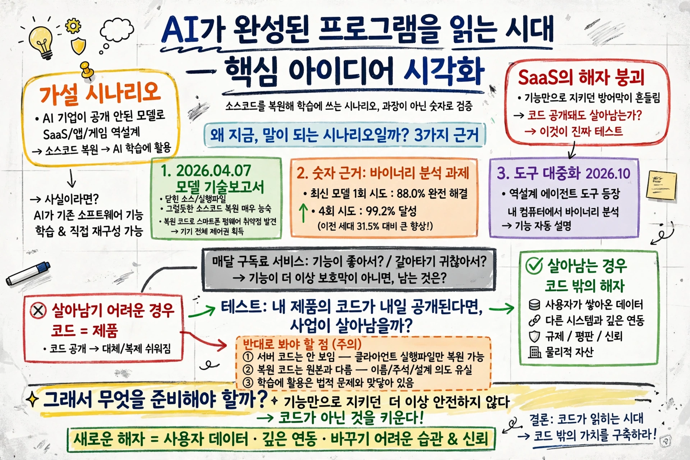
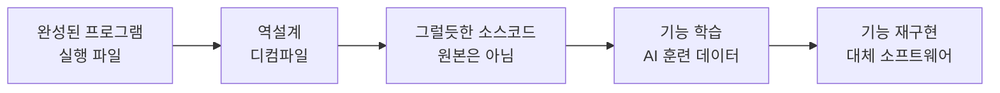
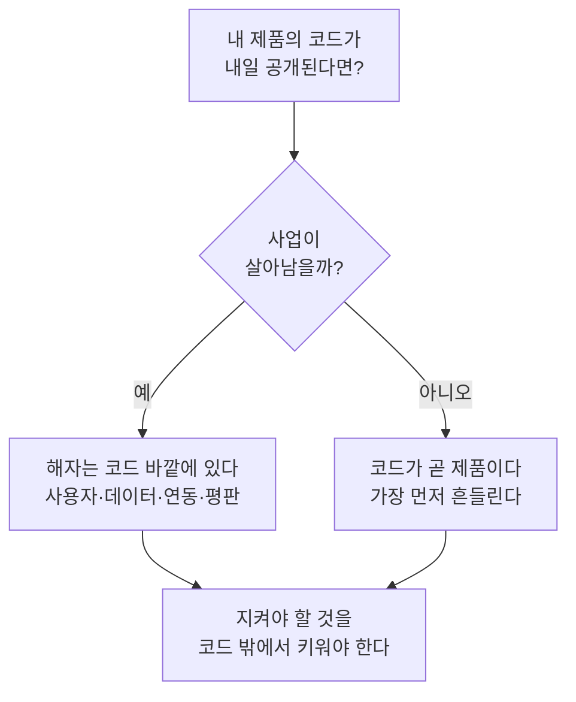

# SaaS의 해자는 기능이 아닙니다. 코드가 읽히는 시대, 무엇이 남을까요?

> **Summary**
> AI가 실행 파일을 분석해 기능을 재현하는 능력이 발전하면서 기능만으로 지켜온 SaaS의 해자는 약해질 수 있다. 다만 서버 코드에 접근할 수 없고 복원 코드는 원본이 아니며, 학습에는 법적 쟁점도 따른다. 코드가 공개돼도 살아남으려면 사용자 데이터, 연동, 신뢰, 습관처럼 코드 밖의 가치를 키워야 한다.

---

- AI가 완성된 프로그램을 읽는 시대가 왔습니다. 소스코드를 복원해 학습에 쓴다는 시나리오, 과장이 아니라 숫자로 따져봐야 합니다.
- 기능만으로 지키던 SaaS의 해자는 흔들립니다. 코드가 공개돼도 살아남는지가 이제 진짜 테스트입니다.
- 단, 이 글의 시나리오는 아직 가설입니다. 서버 코드는 안 보이고, 복원된 코드는 원본과 다릅니다.

매달 구독료를 내는 서비스가 있습니다. 기능이 좋아서 쓰는 걸까요, 아니면 갈아타기가 귀찮아서 쓰는 걸까요? 아마 둘 다일 겁니다. 그런데 기능 자체가 더 이상 보호막이 되지 않는다면, 그 서비스는 무엇으로 남을까요?

🎥 [동영상 보기](https://www.youtube.com/watch?v=h5zkzon0gM4)

## 시나리오가 던진 질문은 무엇일까요?

한 AI 보안 연구자가 던진 시나리오는 이렇습니다. AI 기업들이 공개하지 않은 모델로 인터넷의 SaaS, 앱, 게임을 역설계해 소스코드를 복원하고, 이를 다시 AI 학습에 활용한다는 겁니다. 사실이라면 AI는 기존 소프트웨어의 기능을 배우고 직접 다시 만들 수 있게 됩니다. 결국 SaaS는 기능만으로 해자가 없습니다. 모든 기업이 AI를 도입해 기존 소프트웨어를 대체하거나 직접 개발하는 방향으로 갈 거라는 전망입니다.

Threads 원문은 로그인 벽 뒤에 있어 직접 읽지 못했고, 이 글은 노션에 남은 제목과 요약, 그리고 공개된 근거 자료를 교차 확인해 재구성했습니다. 시나리오 자체는 아직 검증된 사실이 아닙니다. 다만 "말이 되느냐"는 따로 따져볼 수 있습니다. 근거가 쌓이고 있기 때문입니다!

## 왜 지금, 말이 되는 시나리오일까요?

첫 번째 근거는 2026년 4월 7일에 공개된 한 모델의 기술 보고서입니다. 보고서에는 모델이 "닫힌 소스 코드의, 이름표까지 떼어낸 실행 파일을 가져와 그럴듯한 소스코드로 복원하는 데 매우 능하다"는 문장이 들어 있습니다. 같은 모델은 복원한 코드로 스마트폰 펌웨어의 취약점을 찾아 기기의 전체 제어권을 얻는 수준까지 갔다고 합니다.

두 번째 근거는 숫자입니다. 바이너리 분석 과제 모음인 `SRE-Bench`에서 한 최신 모델은 한 번의 시도로 88.0%를 완전히 풀었고, 네 번 안에는 99.2%까지 풀었다고 보고됐습니다. 이전 세대 모델이 31.5%에 머물렀던 것과 비교하면 큰 차이입니다. 단, 이 평가는 실제 서비스의 안전장치를 끄고, 큰 추론 예산을 쓴 조건에서 나온 결과라는 점은 함께 봐야 합니다.

세 번째 근거는 도구의 대중화입니다. 2026년 10월 공개된 한 역설계 도구는 에이전트가 내 컴퓨터에서 직접 바이너리를 뜯어 기능을 설명하게 해줍니다. 전문가의 전유물이던 일이 이제 일반 개발자의 작업대 위로 내려왔습니다. 다만 이 도구의 문서도 원본 소스를 통째로 복원하거나 앱 전체를 복제한다고 주장하지는 않습니다. 증거와 한계를 함께 붙이는 도구입니다.

## SaaS의 해자, 정말 기능이었을까요?

2026년 2월, 소프트웨어 주가가 크게 흔들린 적이 있습니다. 시장이 에이전트가 유료 좌석을 대체할 거라고 가격에 반영한 파동이었습니다. 이번 시나리오는 그 다음 파동입니다. 프로그램을 만드는 비용이 떨어진 데 이어, 프로그램을 지키는 비용까지 떨어진다면 어떻게 될까요?

여기서 한 가지 테스트가 나옵니다. 내 제품의 코드가 내일 공개된다면, 사업이 살아남을까요? 코드가 곧 제품이던 사업은 답이 어렵습니다. 반대로 코드가 공개돼도 살아남는 사업이 있습니다. 사용자와 데이터, 깊은 연동, 규제, 평판, 물리적 자산처럼 코드 안에 있지 않은 것들이 지키는 사업입니다. 해자는 기능이 아니라, 기능 바깥에 있었던 겁니다!

## 그런데, 반대로 봐야 할 점도 있습니다

시나리오를 곧이곧대로 받아들이면 안 되는 이유가 세 가지 있습니다.

첫째, 서버 코드는 안 보입니다. 클라이언트에 내려오는 실행 파일만 읽을 수 있고, 서버 안에 있는 코드는 손댈 수 없습니다. SaaS의 핵심이 서버에 있다면, 역설계로 가져올 수 있는 건 일부에 불과합니다.

둘째, "그럴듯한 코드"는 원본이 아닙니다. 이름과 주석, 설계 의도는 컴파일 과정에서 사라집니다. 복원된 코드는 같은 일을 하는 읽을 만한 버전이지, 원본 그대로가 아닙니다. 흉내와 복제는 다릅니다!

셋째, 학습에 쓰는 일은 법의 문제와 맞닿아 있습니다. 남의 소프트웨어를 뜯어 기능을 배우는 것과, 그 결과를 학습 데이터로 쓰는 것은 다른 층위의 문제입니다. 시나리오가 기술적으로 가능해 보여도, 법과 계약의 벽은 따로 있습니다.

## 그래서 무엇을 준비해야 할까요?

시나리오가 사실이든 아니든, 방향은 하나입니다. 기능만으로 지키던 사업은 더 이상 안전하지 않습니다. 대신 사용자가 쌓아온 데이터, 다른 시스템과의 깊은 연동, 바꾸기 어려운 습관과 신뢰가 해자가 됩니다. 코드가 읽히는 시대에, 코드가 아닌 것을 키우는 일이 남았습니다!

이 글의 시나리오는 한 연구자의 전망이지 확인된 사실이 아닙니다. 다만 그 전망을 뒷받침하는 숫자와 도구가 이미 공개돼 있다는 점, 그리고 그 숫자가 가리키는 방향이 분명하다는 점은 따로 기억할 만합니다. 기능은 이제 누구나 다시 만들 수 있습니다. 그래서 질문은 달라졌습니다. 내 제품에서, 코드가 아닌 것은 무엇일까요?

