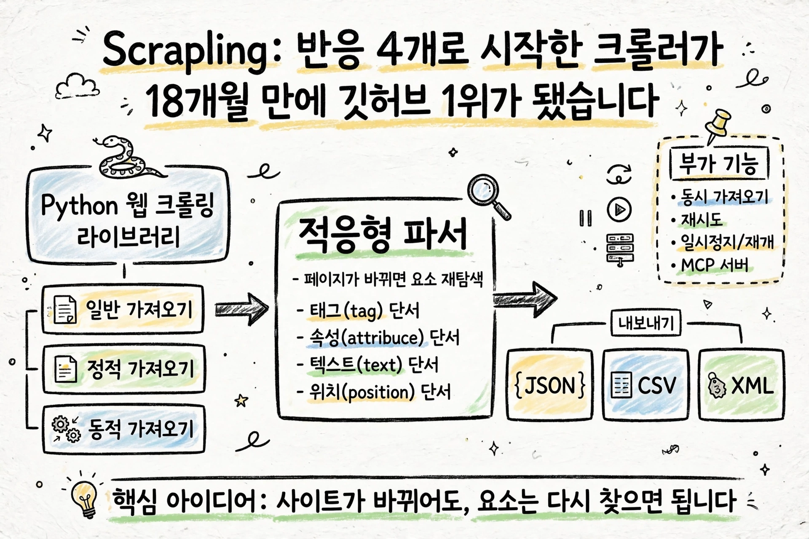
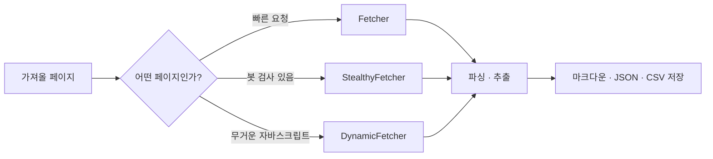
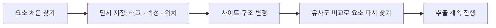

# Scrapling: 반응 4개로 시작한 크롤러가 18개월 만에 깃허브 1위가 됐습니다

> **Summary**
> Scrapling은 적응형 파서와 스텔스 브라우저 기능을 갖춘 파이썬 크롤링 프레임워크로, 사이트 구조가 바뀌어도 요소를 다시 찾고 다양한 웹페이지에서 데이터를 추출합니다. AI 에이전트 시대와 맞물려 빠르게 성장했지만, 봇 방지 우회가 항상 보장되는 것은 아니며 사용자는 사이트 약관과 저작권을 고려해야 합니다.

---

- 이집트에서 혼자 만든 파이썬 크롤링 라이브러리입니다. 처음 공개했을 때 달린 반응은 4개뿐이었습니다.
- 18개월 뒤 깃허브 전체 1위에 올랐고, 별 38,700개를 찍었습니다. 대형 기술 매체가 기사로 다뤘습니다.
- 비결은 두 가지입니다. 사이트가 바뀌어도 요소를 스스로 다시 찾는 적응형 파서, 그리고 사람처럼 보여서 봇 검사를 통과하는 스텔스 가져오기 기능입니다.

웹에서 자료를 모으려다 "로봇이 아닙니다" 확인 화면 앞에서 막힌 적 있으시죠? 버튼을 눌러도, 기다려도, 결국 빈 페이지가 돌아온 그 순간 말입니다.

🎥 [동영상 보기](https://www.youtube.com/watch?v=q-uj7wk0LRI)

## 크롤러가 뭐길래, 1위가 됐을까요?

`Scrapling`은 파이썬 웹 크롤링 프레임워크입니다. 빠른 HTTP 요청, 스텔스 브라우저, 강력한 파싱, 동시 크롤링을 하나의 라이브러리에 담았습니다. 정적 페이지를 긁는 건 기본이고, 자바스크립트를 그려내고, 사이트 뒤의 API 호출에서 데이터를 뽑아내고, 결과를 마크다운으로 정리합니다. 파이썬 코드로도, 터미널 명령으로도, AI 에이전트의 MCP 서버로도 쓸 수 있습니다.

그런데 기술만 보면 새롭지 않습니다. 비슷한 도구는 이미 많았습니다. 진짜 이야기는 다른 데 있습니다.

## 4개에서 38,700개까지, 무엇이 바뀌었을까요?

처음 공개했을 때 반응은 4개였습니다. 1년 넘게 묻혀 있었습니다. 그러다 자율 AI 에이전트 시대가 왔습니다. 24시간 돌아가는 에이전트들이 웹 데이터를 끊임없이 필요로 하게 됐고, 그 에이전트들과 짝을 이루면서 폭발했습니다. 기술이 가치를 만든 게 아니라, 타이밍이 가치를 만들었습니다!

숫자가 말해줍니다. 클립이 나올 당시 별 38,700개, 직접 확인한 2026년 11월 22일 기준으로는 104,959개까지 늘었습니다. 포크도 10,980개입니다. 혼자 만든 저장소가 이 정도까지 커진 겁니다.

## 방패를 어떻게 뚫을까요?

웹의 약 20%는 한 보안 업체의 방패 뒤에 있습니다. 그 방패는 브라우저 지문과 행동 신호로 사람과 봇을 가릅니다. 확인 화면이 바로 그 관문입니다.

`StealthyFetcher`는 사람처럼 보이게 만듭니다. 실제 브라우저 지문을 흉내 내고, 확인 화면을 통과하고, 토큰을 받아낸 뒤 진짜 HTML을 돌려줍니다. 세 가지 가져오기 방식이 있습니다. 빠른 HTTP 요청은 `Fetcher`, 봇 검사가 있는 곳은 `StealthyFetcher`, 무거운 자바스크립트 페이지는 `DynamicFetcher`가 맡습니다.

## 사이트가 바뀌면, 크롤러는 어떻게 될까요?

보통은 부서집니다. 클래스 이름 하나만 바뀌어도 선택자가 요소를 못 찾습니다. 그래서 크롤러 유지보수가 끝없이 이어졌습니다.

`Scrapling`의 파서는 다릅니다. 요소를 처음 찾을 때 태그, 속성, 텍스트, DOM 위치 같은 단서를 함께 저장합니다. 사이트 구조가 바뀌면 이 단서들의 유사도를 비교해 요소를 다시 찾아냅니다. 선택자가 스스로 고쳐지는 셈입니다!

## 왜 혼자서 더 빠를까요?

기업 보안팀은 분기 로드맵을 따라갑니다. 한 사람의 저장소는 다릅니다. 방패가 바뀌면 며칠 안에 패치가 나옵니다. 의사결정 회의도, 승인 절차도 없습니다. 이 속도가 승부처입니다. 방패를 만드는 쪽의 수장조차 "우리가 바꾸면 저쪽도 바꾼다"고 말했습니다. 추격전이 공식화된 겁니다!

## 쓰기 전에, 꼭 짚어야 할 점이 있습니다

뚫린다고 해서 써도 되는 건 아닙니다. 공개 데이터를 긁는 것 자체는 판례상 문제가 되지 않을 수 있지만, 약관과 저작권, 그리고 용도에 따라 책임은 쓰는 사람에게 넘어갑니다. "할 수 있다"와 "해도 된다"는 다른 문제입니다!

또 하나, 식별을 전제로 한 통제는 한계가 있습니다. `robots.txt`나 AI 크롤 통제 기능은 크롤러가 정체를 밝힌다는 가정이 있어야 동작합니다. 정체를 숨기는 도구가 그 가정을 무너뜨립니다.

그리고 우회가 항상 보장되는 것도 아닙니다. 독립 테스트에서는 데모 페이지 하나를 통과하는 데 3분 반이 걸렸고, 재시도도 필요했습니다. 데모가 아닌 실제 고보안 페이지는 더 까다롭습니다. 마법이 아니라, 조건이 맞는 도구입니다.

다음에 웹에서 자료를 모을 일이 생기면, 도구를 고르기 전에 한 가지를 먼저 물어보시면 어떨까요? "이 도구는 사이트가 바뀌어도 살아남을까요?" 혼자 만든 도구 하나가 인프라의 균형을 흔들었습니다. 회사 크기가 아니라 속도와 타이밍이 승부를 가르는 시대입니다!

