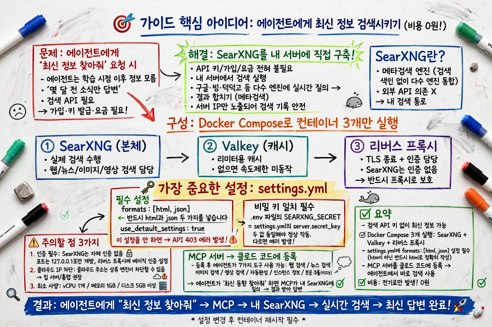
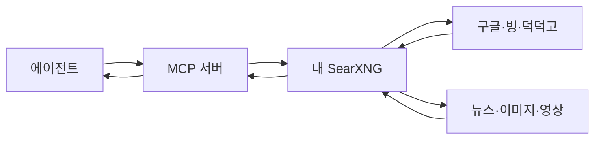
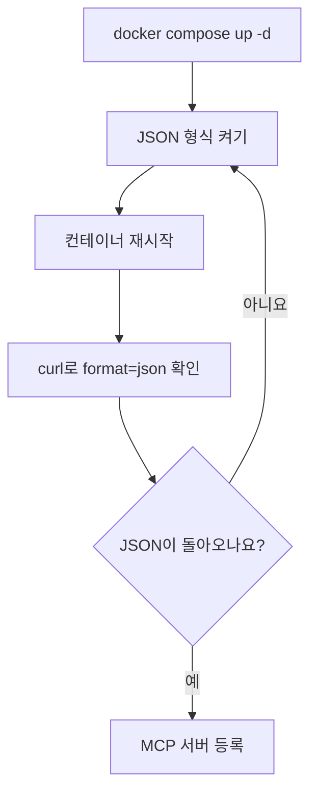

# SearXNG: 에이전트 검색, API 키 없이 내 서버에서 직접 해결합니다

> **Summary**
> SearXNG를 직접 띄우면 검색 API 키 없이 에이전트에게 최신 정보 검색을 시킬 수 있습니다. Docker Compose로 SearXNG와 Valkey, 리버스 프록시 3개 컨테이너를 올리고 settings.yml에 JSON 형식을 켜면 에이전트 연동 준비가 됩니다. MCP 서버를 클로드 코드에 등록하면 웹·뉴스·이미지·영상 검색과 본문 추출을 에이전트가 직접 쓰고, 비용은 들지 않습니다.

---

- 에이전트에게 최신 정보를 물으려면 검색 API 키가 필요한데, SearXNG를 직접 띄우면 키 없이 내 서버에서 검색을 돌릴 수 있습니다.
- Docker Compose로 컨테이너 3개만 올리면 됩니다. 핵심은 `settings.yml`에 JSON 형식을 켜는 것, 이걸 빼먹으면 API가 403을 뱉습니다.
- MCP 서버를 클로드 코드에 등록하면 에이전트가 웹·뉴스·이미지·영상 검색과 본문 추출을 직접 씁니다. 비용은 0원입니다.


## 에이전트에게 "최신 정보 찾아줘"라고 했는데, 검색 API가 없다고요?

에이전트에게 요즘 소식을 물어본 적 있으시죠? "이 주제 최신 동향 정리해줘"라고 시켰는데, 돌아온 답이 몇 달 전 얘기였습니다. 에이전트는 학습한 시점 이후의 일을 모릅니다. 검색을 붙이면 해결되는데, 여기서 막힙니다. 검색 API는 가입하고 키를 발급받고 요금을 내야 합니다!

그래서 검색엔진을 직접 띄우는 방법이 있습니다. SearXNG입니다. 내 서버에서 돌아가는 검색엔진에 에이전트가 직접 물어보게 하는 겁니다. API 키도, 가입도, 요금도 없습니다.

🎥 [동영상 보기](https://www.youtube.com/watch?v=FFDSy3TX3YI)

## SearXNG가 뭐길래, 직접 띄우나요?

SearXNG는 메타검색 엔진입니다. 자체 검색 색인을 만들지 않고, 구글이나 빙, 덕덕고 같은 수십 개 상류 엔진에 실시간으로 물어본 뒤 결과를 합쳐서 돌려줍니다. 상류 엔진이 보는 건 서버 IP뿐이라, 내 검색 기록이 프로필로 쌓이지 않습니다!

직접 띄우는 이유는 딱 하나입니다. 검색이 내 서버에서 일어나면, 에이전트가 쓸 검색 통로도 내 것이 됩니다. 외부 API에 의존하지 않으니 키 발급도, 사용량 한도도, 요금도 없습니다.

## 직접 구축, 뭐가 필요할까요?

컨테이너 3개면 됩니다. SearXNG 본체, 캐시용 Valkey, 그리고 앞단의 리버스 프록시입니다.

```yaml
services:
  searxng:
    image: searxng/searxng:latest
    restart: unless-stopped
    environment:
      - SEARXNG_BASE_URL=https://search.example.com/
    volumes:
      - ./searxng:/etc/searxng:rw
  valkey:
    image: valkey/valkey:8-alpine
    restart: unless-stopped
```

Valkey는 속도 제한(리미터)용 캐시입니다. 없으면 리미터가 안 돕니다. 리버스 프록시는 TLS 종료와 인증을 맡습니다. SearXNG 자체에는 인증이 아예 없기 때문입니다.

설정 파일은 `settings.yml` 하나입니다. 처음 띄우면 자동 생성되고, `use_default_settings: true` 한 줄이면 기본값이 그대로 살아납니다.



## 비밀 키, 두 곳이 일치해야 합니다

SearXNG는 서명에 쓸 비밀 키가 필요합니다. `.env` 파일의 `SEARXNG_SECRET`와 `settings.yml`의 `server.secret_key`가 똑같아야 합니다. 다르면 경고가 뜨고 동작이 꼬입니다.

```bash
openssl rand -hex 32
```

위 명령으로 키를 만들고 두 파일에 똑같이 넣습니다. 이 키는 절대 공유하지 않습니다. 설정 파일은 백업 대상이지만, 키가 들어 있으니 저장소에는 올리지 않습니다.

## 에이전트가 쓰려면 JSON을 켜야 합니다

여기가 이 글의 핵심입니다! SearXNG는 기본적으로 JSON 응답을 꺼둡니다. 에이전트와 MCP 서버는 HTML이 아니라 JSON으로 결과를 받으니까, 이 설정을 안 켜면 API가 403을 뱉습니다.

```yaml
search:
  formats:
    - html
    - json
```

`settings.yml`에 위 내용을 넣고 컨테이너를 다시 시작합니다. 확인은 한 줄이면 됩니다.

```bash
curl 'http://localhost:8080/search?q=test&format=json' | head -c 200
```

JSON이 돌아오면 에이전트 준비가 끝난 겁니다. 안 돌아오면 설정을 저장했는지, 재시작했는지부터 확인합니다.



## MCP 서버, 클로드 코드에 어떻게 붙이나요?

MCP 서버가 에이전트와 SearXNG 사이를 잇습니다. 설치는 한 줄입니다.

```bash
claude mcp add --scope user searxng -- npx -y searxng-mcp-server
```

서버 주소는 기본값이 `http://localhost:8888`이라, 내 인스턴스가 다른 포트면 환경 변수로 알려줍니다. 등록이 끝나면 에이전트가 검색 도구 7가지를 씁니다. 웹 검색, 뉴스 검색, 이미지 검색, 영상 검색, 자동 완성, 인스턴스 정보, 그리고 본문 추출입니다. 본문 추출은 페이지에서 헤더·푸터·광고를 걷어내고 마크다운으로 돌려줍니다!

에이전트 입장에선 이게 전부입니다. "최신 동향 찾아줘"라고 하면, MCP 서버가 내 SearXNG에 물어보고, SearXNG가 상류 엔진들을 훑어서 결과를 모아옵니다. 키 발급도, 가입도 없습니다.

## 조심할 점, 세 가지가 있습니다

첫째, 인증입니다. SearXNG 자체에는 인증이 없습니다. 포트를 `127.0.0.1`에만 묶고, 외부 노출은 리버스 프록시가 베이직 인증 뒤에 두게 합니다. 그대로 열어두면 몇 시간 안에 낯선 사람이 내 검색엔진을 씁니다.

둘째, 클라우드 IP 차단입니다. 상류 엔진이 클라우드 주소에서 오는 요청을 막는 일이 있습니다. 이건 설정으로 해결되지 않습니다. 집 서버나 홈랩에서 돌리는 편이 덜 막힙니다.

셋째, 최소 사양입니다. 1개 vCPU에 메모리 1GB, 디스크 5GB면 돌아갑니다. 512MB 아래에서는 메모리가 모자라 컨테이너가 죽습니다. 가볍게 돌리려면 이 선은 지켜야 합니다.

## 맺음말

검색 API 키 없이 에이전트에게 검색을 시키는 방법은, 검색엔진을 내 서버에 두는 것입니다. SearXNG를 띄우고 JSON을 켜고 MCP 서버를 붙이면, 에이전트는 내 검색 통로로 최신 정보를 가져옵니다. 비용은 전기료뿐입니다!

