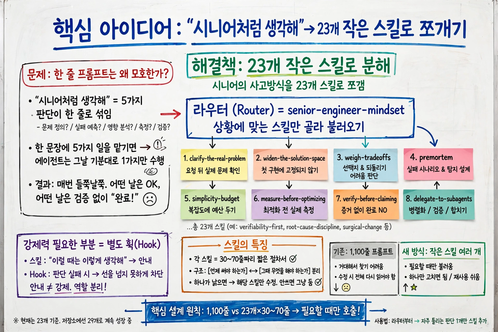
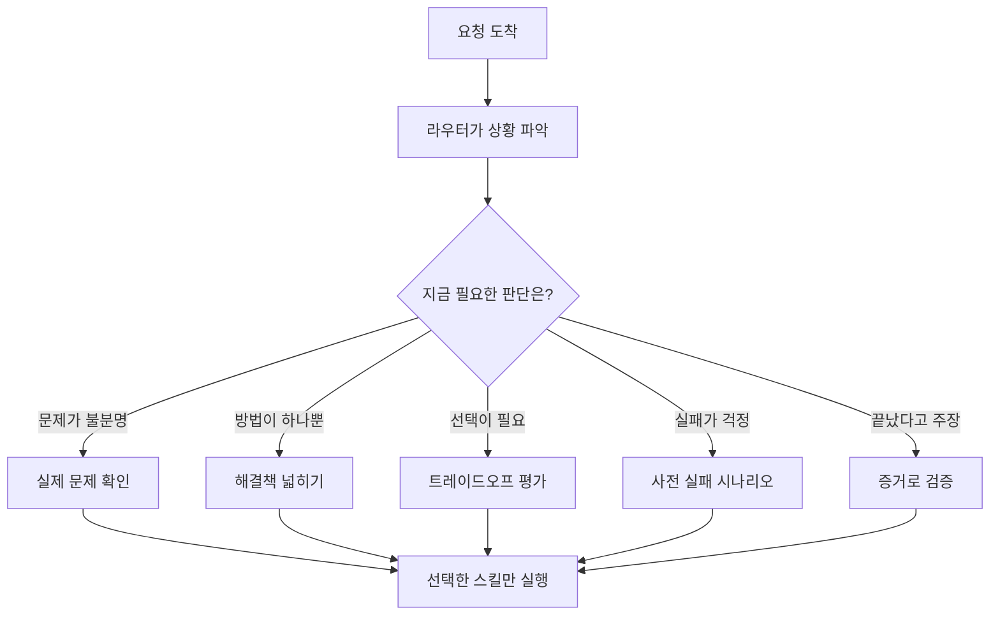
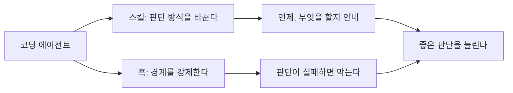

# Senior-thinking-skills: "시니어처럼 생각해" 대신, 판단 과정을 23개 스킬로 쪼갰습니다

> **Summary**
> "시니어처럼 생각해"라는 한 문장은 너무 모호해서, 엔지니어의 판단 과정을 23개 작은 스킬로 쪼갠 묶음이 나왔습니다. 라우터 하나가 상황에 맞는 스킬만 골라 불러오고, 각 스킬은 30~70줄짜리 짧은 절차서이며 설명에는 언제, 본문에는 무엇을만 둡니다. 스킬은 판단 방식을 바꾸고 강제력이 필요한 부분은 별도 훅이 경계를 지키며, 지금은 스킬이 29개로 늘었지만 이 글은 원문이 정리한 23개 구조를 기준으로 썼습니다.

---

- "시니어처럼 생각해"라는 한 문장은 너무 모호해서, 엔지니어의 판단 과정을 23개 작은 스킬로 쪼갠 묶음이 나왔습니다.
- 라우터 하나가 상황에 맞는 스킬만 골라 불러오고, 각 스킬은 30~70줄짜리 짧은 절차서입니다.
- 스킬은 판단 방식을 바꾸고, 강제력이 필요한 부분은 별도 훅이 경계를 지킵니다.

코딩 에이전트에게 "시니어처럼 생각해"라고 적어본 적 있으시죠? 한 줄이면 될 것 같았는데, 결과는 매번 달랐습니다. 어떤 날은 문제를 제대로 정의했고, 어떤 날은 검증 없이 "완료했습니다"라고 말했습니다. 같은 문장인데 왜 이렇게 들쭉날쭉할까요?

🎥 [동영상 보기](https://www.youtube.com/watch?v=IoqpBKrNaZI)

## "시니어처럼"은 왜 모호할까요?

"시니어처럼 생각해"라는 문장 안에는 사실 여러 가지 판단이 겹쳐 있습니다. 문제를 제대로 정의하는 것인지, 구현 전에 실패 가능성을 찾는 것인지, 인터페이스 변경의 영향을 따지는 것인지, 성능을 추측하지 않고 측정하는 것인지, 아니면 끝났다고 말하기 전에 실제로 검증하는 것인지 알 수 없습니다!

한 문장에 다섯 가지 일을 시키면, 에이전트는 그날 기분대로 하나만 골라 합니다. 그래서 이 묶음은 판단 과정을 통째로 맡기지 않고, 작은 단위로 쪼갰습니다. 시니어의 사고방식을 23개 스킬로 나눈 겁니다.

## 라우터 하나, 스킬 23개?

구조는 단순합니다. 라우터 하나와 스킬 여러 개입니다. `senior-engineer-mindset`이 라우터 역할을 하고, 지금 작업에 필요한 스킬만 골라 불러옵니다. 나머지는 잠자코 기다립니다.

이 대목이 저는 가장 인상 깊었습니다. 스킬이 23개나 되는데도 한 번에 다 읽지 않는다는 점입니다! 필요한 것만 그때그때 꺼내 쓰는 구조라서, 컨텍스트가 스킬 설명으로 가득 차지 않습니다.

## 스킬 하나는 어떻게 생겼을까요?

각 스킬은 30~70줄짜리 짧은 절차서입니다. 설명에는 "언제 이 스킬을 써야 하는가"만 두고, 본문에는 "그때 무엇을 해야 하는가"만 넣었습니다. 언제와 무엇을이 분리돼 있으니, 스킬을 고르는 일과 스킬을 실행하는 일이 섞이지 않습니다.

대표적인 스킬들을 보면, 시니어의 하루가 그대로 보입니다. `clarify-the-real-problem`은 요청 뒤에 있는 실제 문제를 먼저 확인합니다. `widen-the-solution-space`는 처음 떠오른 구현 하나에 바로 고정되지 않게 합니다. `weigh-tradeoffs`는 선택지와 되돌리기 어려운 정도를 함께 판단합니다. `premortem`은 구현 전에 실패 시나리오와 탐지 방법을 생각합니다. `simplicity-budget`은 복잡도에 예산을 둡니다. `interface-contracts`는 노출한 인터페이스가 어떤 약속이 되는지 확인합니다.

뒷부분도 만만치 않습니다. `verifiability-first`는 성공 조건부터 정의합니다. `root-cause-discipline`은 수정부터 하지 않고 원인과 증거부터 확인합니다. `surgical-change`는 요청과 관계없는 변경을 최대한 만들지 않습니다. `measure-before-optimizing`은 성능 최적화 전에 실제 측정부터 합니다. `verify-before-claiming`은 증거 없이 완료를 말하지 않습니다. `adversarial-review`는 결과를 증명하려 하기보다 틀렸음을 찾아봅니다.

서브에이전트를 쓰는 방법도 별도 스킬로 분리했습니다. `delegate-to-subagents`는 언제 병렬화할지, 작업자에게 어느 정도 맥락을 줄지, 검토자에게 쓰기 권한을 줄지, 보내기 직전에 기준 커밋을 왜 기록해야 하는지, 여러 에이전트의 결과를 어떻게 다시 합칠지를 다룹니다.

## 1,100줄짜리 프롬프트 대신 작은 스킬 여러 개?

핵심 설계 원칙은 한 줄입니다. **1,100줄짜리 완벽한 엔지니어 프롬프트 하나보다, 필요할 때만 불러오는 30~70줄짜리 작은 스킬 여러 개를 쓰자!**

거대한 프롬프트는 처음에는 든든해 보입니다. 그런데 쓰다 보면 어디에 뭐가 있는지 찾기 어려워지고, 고칠 때마다 전체를 다시 읽어야 합니다. 작은 스킬은 반대입니다. 하나가 낡으면 그 하나만 고치면 됩니다. 안 쓰는 스킬은 그냥 두면 됩니다. 팀에 맞게 다시 쓰는 것도 한 파일만 건드리면 됩니다.

## 스킬이 못하는 일은 따로 빼두었습니다

이 묶음에서 가장 정직하다고 느낀 부분은 빠진 것들입니다. 스킬 문서만으로는 실제 구현할 수 없는 기능은 일부러 넣지 않았습니다. 에이전트가 자동으로 기억한다거나, 문서 하나만 설치하면 보안 강제력이 생긴다는 식으로, 실제 동작이 없는 기능을 있는 것처럼 설명하지 않았습니다!

실제 강제력이 필요한 부분은 별도 훅 프로젝트로 분리했습니다. 역할 분담은 명확합니다.

스킬은 에이전트에게 "이럴 때는 이렇게 생각해"라고 알려줍니다. 훅은 그 판단이 실패했을 때 선을 넘지 못하게 막습니다. 안내와 강제, 두 가지가 따로 있어야 각자 제 역할을 합니다.

## 지금은 23개가 아닙니다?

한 가지 시점 차이를 밝혀둡니다. 원문이 정리된 시점에는 스킬이 23개였는데, 지금 저장소를 보면 29개로 늘었습니다. `bite-sized-plan`이나 `plan-on-disk`, `fresh-context-review`, `security-review` 같은 스킬이 더해졌고, 모델별로 파일을 나눈 구조도 갖춰졌습니다. 숫자가 달라진 건 묶음이 계속 자라고 있다는 뜻입니다. 이 글은 원문이 정리한 23개 구조를 기준으로 썼습니다.

아이디어의 출처도 숨기지 않았습니다. 여러 스킬 모음에서 영향을 받았고, 어떤 스킬이 어디에서 왔는지 스킬별 출처 기록을 저장소에 남겼습니다. 그대로 복사하기보다 작은 스킬 구조에 맞게 다시 구성했습니다. 출처를 밝히는 건 겸손이 아니라 유지보수입니다. 나중에 원본이 바뀌면 어디를 따라가야 할지 알 수 있으니까요.

## 그래서 어떻게 쓰면 될까요?

설치는 어렵지 않습니다. 스킬 마켓플레이스에서 검색해 설치하거나, 필요한 스킬 폴더만 골라 에이전트의 스킬 디렉터리에 복사하면 됩니다. 처음부터 23개를 다 쓸 필요는 없습니다. `senior-engineer-mindset` 라우터부터 시작해, 자주 틀리는 판단 하나를 골라 해당 스킬만 붙여보는 게 순서입니다.

거대한 프롬프트를 계속 키우는 방식과 작은 스킬로 나누는 방식, 어느 쪽이 맞을까요? 정답은 하나가 아닙니다. 다만 프롬프트가 1,000줄을 넘었다면, 한 번쯤 쪼개볼 때가 됐다는 신호입니다. 판단 과정을 이름 붙여 나눠두면, 에이전트도 사람도 그 판단을 다시 찾을 수 있습니다!

