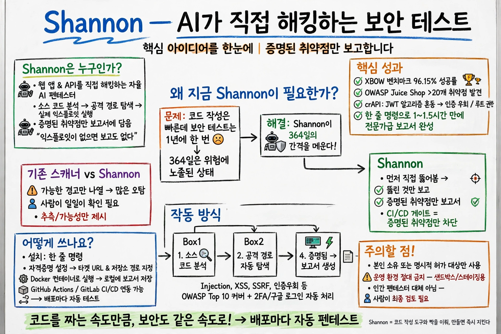
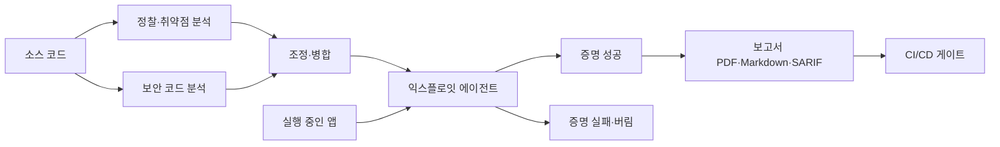
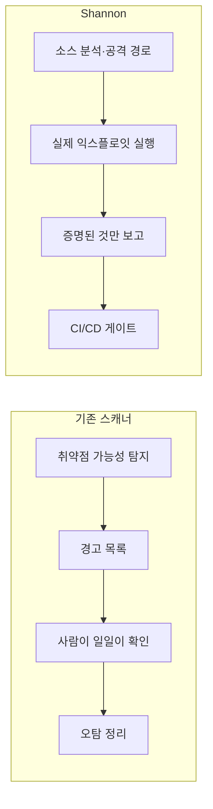

# Shannon: 경고가 아니라 익스플로잇으로 증명하는 AI 보안 테스트입니다

> **Summary**
> Shannon은 웹 앱과 API를 실제로 공격해 취약점을 입증하고, 확인된 결과만 보고하는 오픈소스 자율 AI 펜테스터입니다. XBOW 벤치마크에서 96.15%의 성공률을 기록했으며 CI/CD에 연동할 수 있지만, 허가된 비운영 환경에서만 사용하고 결과는 사람이 검토해야 합니다.

---

- Shannon은 웹 앱과 API를 직접 해킹해서 취약점을 증명하는 자율 AI 펜테스터입니다.
- 소스 코드를 분석해 공격 경로를 찾고, 실제 익스플로잇을 실행합니다. 증명된 취약점만 보고서에 담습니다.
- XBOW 벤치마크에서 96.15%의 성공률을 기록했고, 한 줄 명령으로 실행하면 1~1.5시간 만에 전문가급 보고서가 완성됩니다.


## 주말에 앱을 완성했는데, 보안은 누가 확인하나요?

AI 코딩 도구로 주말에 앱 하나를 완성했습니다. 동작도 잘 됩니다. 그런데 이 앱, 보안은 괜찮을까요? 누가 뚫어보기 전에는 모릅니다. 이런 적 있으시죠?

코드를 짜는 속도는 빨라졌습니다. 그런데 보안 테스트는 여전히 1년에 한 번입니다. 그 사이 364일은 위험한 상태로 돌아간다는 뜻입니다. Shannon은 바로 이 간격을 메우는 도구입니다!

🎥 [동영상 보기](https://www.youtube.com/watch?v=sy-8YLVzPyk)

## Shannon, AI가 직접 해킹하는 보안 테스트입니다

Shannon은 웹 애플리케이션과 API를 대상으로 하는 자율 AI 펜테스터입니다. 오픈소스로 공개되어 있고, 누구나 직접 실행할 수 있습니다.

방식이 다릅니다. 소스 코드를 분석해 공격 경로를 찾고, 브라우저 자동화와 명령줄 도구로 실제 익스플로잇을 실행합니다. 취약점이 정말 뚫리는지 직접 증명하는 것입니다. 증명에 성공한 것만 보고서에 담습니다. "익스플로잇이 없으면 보고도 없다"는 원칙입니다!

이름은 정보이론의 아버지 클로드 섀넌에서 왔습니다. 코드 작성 도구와 짝을 이뤄, 코드를 짜는 쪽과 취약점을 찾는 쪽이 함께 돌아간다는 뜻이 담겼습니다.



## 숫자가 말해주는 증거가 있습니다

XBOW 벤치마크에서 96.15%의 성공률을 기록했습니다. 힌트 없이, 소스 코드를 보고 평가한 결과입니다.

의도적으로 취약하게 만든 OWASP Juice Shop 테스트에서는 20개가 넘는 취약점을 찾아냈습니다. crAPI 테스트에서는 JWT 알고리즘 혼동 공격으로 인증을 우회했고, 숨겨진 디버그 엔드포인트를 통해 루트 권한을 탈취한 사례도 있습니다.

실행 시간은 1~1.5시간이면 전문가급 보고서가 완성됩니다. Injection, XSS, SSRF, 인증 우회 등 OWASP Top 10을 커버합니다. 2FA와 구글 로그인 같은 인증 절차도 자동으로 처리합니다.

## 기존 스캐너와 뭐가 다를까요?

기존 스캐너는 가능성이 있는 경고를 잔뜩 늘어놓습니다. 사람이 일일이 확인해야 하고, 오탐도 많습니다. 경고만으로는 취약점이 진짜인지 알 수 없습니다.

Shannon은 순서가 반대입니다. 먼저 뚫어보고, 뚫린 것만 보고합니다. CI/CD 게이트도 증명된 취약점만 셉니다. 추측이 아니라 증거로 말하는 방식입니다!



## 어떻게 쓰나요?

설치는 한 줄입니다. 마법사 안내를 따라 자격 증명을 설정하고, 타겟 URL과 저장소 경로를 지정하면 실행됩니다.

```bash
npx @keygraph/shannon@latest setup

npx @keygraph/shannon@latest start \
  -u https://your-app.com \
  -r /path/to/your/repo
```

Docker 컨테이너 안에서 실행되고, 결과는 로컬에 저장됩니다. 모델은 직접 키를 가져와서 씁니다. GitHub Actions와 GitLab CI/CD 연동도 공식으로 지원해서, 배포마다 자동으로 테스트를 돌릴 수 있습니다.

## 주의할 점이 있습니다

Shannon은 실제로 공격을 실행하는 도구입니다. 자기 소유이거나 명시적인 허가를 받은 대상에만 사용해야 합니다. 운영 환경에는 절대 쓰지 않습니다. 샌드박스·스테이징·로컬 개발 환경이 대상입니다.

그리고 인간 펜테스터를 대체하는 도구가 아닙니다. 전문가는 비즈니스 맥락을 이해하고, 예상 밖의 공격을 엮어내고, 오랜 판단력을 발휘합니다. Shannon이 맡는 건 사람이 미처 챙기지 못하는 긴 꼬리입니다. 내부 앱, API, 빠르게 바뀌는 서비스처럼 테스트가 닿지 않던 곳입니다. 결과는 사람이 검토해야 합니다. 보고서에 근거가 약한 내용이 섞일 수 있기 때문입니다.

## 코드를 짜는 속도만큼, 보안도 빨라져야 합니다

코드를 짜는 속도가 빨라졌으면, 보안 테스트도 같은 속도로 돌아가야 합니다. 1년에 한 번 받는 보안 점검이 아니라, 배포마다 자동으로 뚫어보는 테스트 말입니다. Shannon은 그 빈자리를 메우는 시도입니다. 경고가 아니라 증명으로 말하는 보안 테스트, 그게 이 도구가 던지는 질문입니다!

