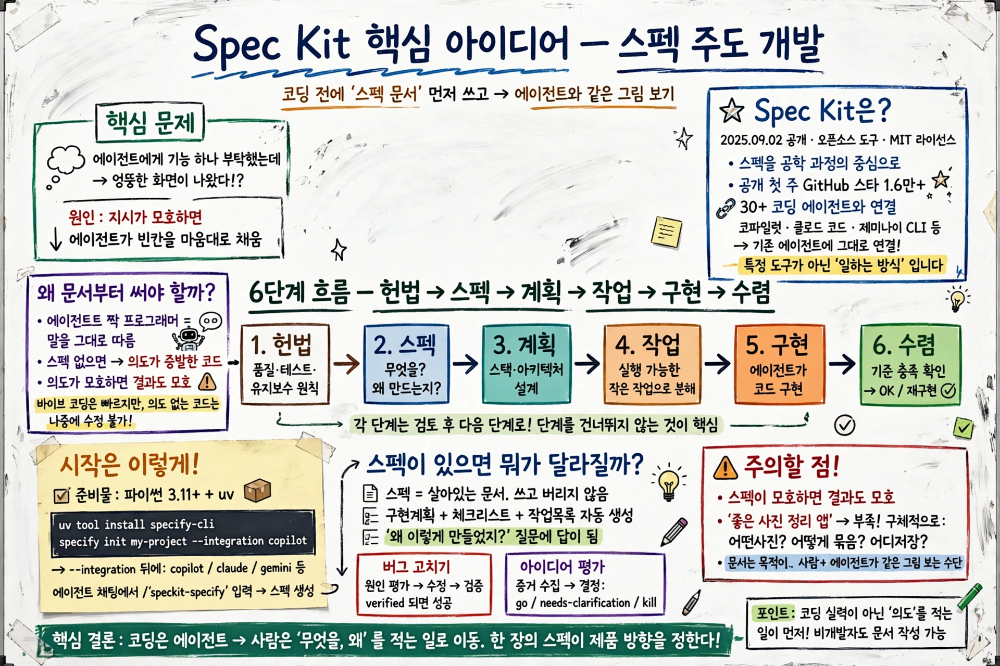
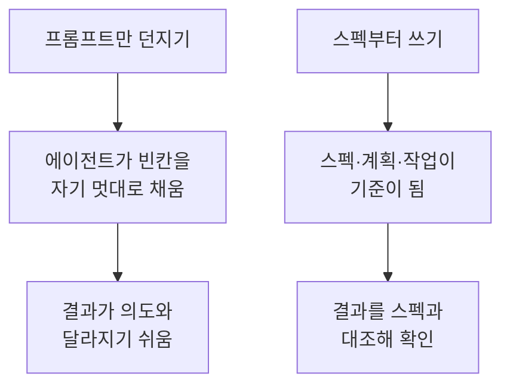

# Spec Kit: 코딩 전에 문서를 쓰면, 에이전트가 엉뚱한 코드를 짜지 않습니다

> **Summary**
> Spec Kit은 코딩 전에 헌법·스펙·계획·작업을 작성하고, 구현 결과를 기준에 맞게 검토·수렴하도록 돕는 오픈소스 도구입니다. 명확한 의도와 요구사항을 문서로 정리하면 에이전트의 임의 해석을 줄이고, 스펙을 구현과 검증의 지속적인 기준으로 활용할 수 있습니다.

---

- Spec Kit은 코딩 전에 스펙 문서를 먼저 쓰게 만드는 오픈소스 도구입니다.
- 헌법·스펙·계획·작업·구현·수렴 순서로 에이전트를 굴리면, 에이전트가 마음대로 해석할 틈이 줄어듭니다.
- 코딩 실력이 아니라 의도를 적는 일이 먼저입니다. 문서 작성이 비개발자도 할 수 있는 이유가 여기에 있습니다.


에이전트에게 기능 하나 만들어달라고 했는데, 엉뚱한 화면이 나온 적 있으시죠? 분명히 말은 했는데, 결과물은 딴판이었습니다. 어디서 틀어졌을까요?

🎥 [동영상 보기](https://www.youtube.com/watch?v=2IArMAhkJcE)

### 왜 문서부터 써야 할까요?

에이전트는 검색 엔진이 아닙니다. 말을 그대로 받아들이는 짝 프로그래머에 가깝습니다. 지시가 모호하면 결과도 모호해집니다. 스펙이 없으면 에이전트가 빈칸을 자기 멋대로 채웁니다. 그래서 "말로 시켰는데 왜 이렇게 됐지?"라는 일이 반복됩니다.

바이브 코딩은 빠릅니다. 그런데 빠르다는 게 전부는 아닙니다. 의도가 증발한 코드는 나중에 손대기 어렵습니다. 뭘 만들려고 했는지 아무도 모르게 되니까요!

### Spec Kit은 뭘까요?

2025년 9월 2일에 공개된 오픈소스 도구입니다. MIT 라이선스로 누구나 쓸 수 있습니다. 스펙을 공학 과정의 중심에 두는 구조입니다. 공개 첫 주에 스타가 1만 6천 개를 넘겼을 만큼 관심이 컸습니다.

연결되는 코딩 에이전트가 30개가 넘습니다. 코파일럿, 클로드 코드, 제미나이 CLI처럼 이미 쓰는 에이전트에 그대로 얹습니다. 에이전트를 갈아탈 일이 없습니다. 스펙 주도 개발은 특정 도구의 기능이 아니라, 일하는 방식입니다!

### 흐름은 어떻게 될까요?

기능을 만들 때는 여섯 단계를 밟습니다. 헌법을 한 번 정하고, 기능마다 나머지를 반복합니다. 각 단계의 결과를 검토한 뒤에야 다음으로 넘어갑니다. 단계를 건너뛰지 않는 게 핵심입니다.


헌법은 품질·테스트·유지보수 같은 원칙을 적는 곳입니다. 스펙은 "무엇을 만들지, 왜 만드는지"를 적습니다. 계획은 스택과 아키텍처를 정합니다. 작업은 계획서를 실행 가능한 작은 일로 나눕니다. 구현이 끝나면 수렴 단계에서 기준에 맞는지 확인하고, 맞지 않으면 구현으로 돌아갑니다.


### 시작은 어떻게 할까요?

준비물은 파이썬 3.11 이상과 `uv`입니다. 터미널에서 두 줄이면 시작합니다.

```bash
uv tool install specify-cli
specify init my-project --integration copilot
```

`--integration` 뒤에는 쓰는 에이전트에 맞는 값을 넣습니다. 초기화가 끝나면 에이전트를 프로젝트 폴더에서 실행합니다. 명령은 터미널이 아니라 에이전트 채팅 안에서 한 번에 하나씩 입력합니다. 채팅에서 `/speckit-specify` 같은 명령을 치면 에이전트가 스펙을 만들어줍니다.

### 스펙이 있으면 뭐가 달라질까요?

스펙은 쓰고 버리는 문서가 아닙니다. 스펙에서 구현 계획이 나오고, 체크리스트가 나오고, 작업 목록이 나옵니다. 나중에 "왜 이렇게 만들었지?"라는 질문이 나오면 스펙이 답을 합니다. 스펙이 살아 있는 문서가 되는 겁니다!

기능 만들기 말고도 두 가지 갈래가 더 있습니다. 버그 고치기는 원인 평가부터 시작합니다. 원인을 찾고, 고치고, 원래 증상이 해결됐는지 검증합니다. 판정이 `verified`일 때만 성공입니다. 아이디어 평가는 증거를 모아서 결정합니다. 결론은 `go`, `needs-clarification`, `kill` 중 하나입니다. 멈추는 것도 기록된 결론입니다!



### 주의할 점은 뭘까요?

스펙을 쓴다고 코드가 저절로 좋아지지 않습니다. 스펙이 모호하면 결과도 모호합니다. "좋은 사진 정리 앱" 같은 한 줄로는 부족합니다. 어떤 사진을, 어떻게 묶고, 어디에 저장하는지까지 적어야 합니다. 명확하게 적는 연습이 필요합니다.

그리고 문서가 목적이 아닙니다. 문서는 에이전트와 사람이 같은 그림을 보게 만드는 수단입니다. 문서만 쌓고 코드를 안 짜면 아무 일도 일어나지 않습니다!

코딩은 이제 에이전트가 합니다. 사람이 할 일은 "무엇을, 왜"를 적는 일로 옮겨갔습니다. 그 한 장의 문서가 제품의 방향을 정합니다.

