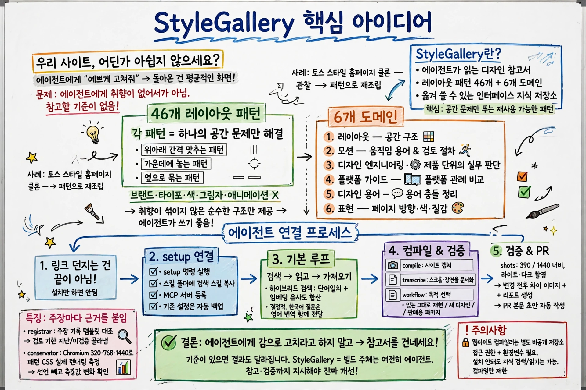
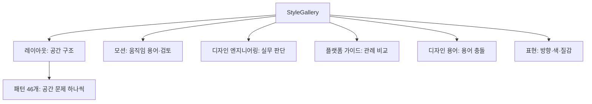
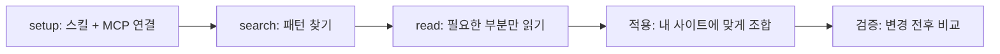
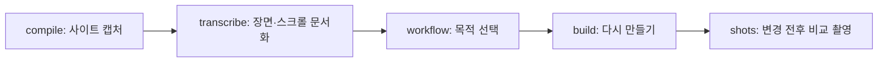

# StyleGallery: 에이전트에게 깃허브 링크 하나 던지면, 웹사이트가 참고서대로 고쳐집니다

> **Summary**
> StyleGallery는 에이전트가 활용할 수 있도록 46개의 레이아웃 패턴과 여섯 개 디자인 영역의 참고 지식을 제공하며, 검색·읽기·검증 절차를 통해 웹사이트 개선을 돕습니다. 웹사이트 컴파일 기능은 별도 비공개 저장소에 대한 접근 권한이 필요합니다.

---

- StyleGallery는 레이아웃 패턴 46개와 여섯 개 도메인으로 정리된, 에이전트가 읽는 디자인 참고서입니다.
- 링크를 던지는 게 끝이 아닙니다. 에이전트에 스킬과 MCP를 연결하고, 패턴을 검색해서 읽힌 뒤, 컴파일과 검증까지 이어져야 합니다.
- 다만 웹사이트 컴파일러는 별도 비공개 저장소라, 누구나 바로 쓸 수 있는 건 아니라는 점은 알고 써야 합니다.


"우리 사이트, 어딘가 아쉽지 않으세요?"

에이전트에게 "예쁘게 고쳐줘"라고 시켜본 적 있으시죠? 돌아온 화면은 멀쩡한데, 어디서 본 듯한 평균적인 화면이었습니다. 문제는 에이전트에게 취향이 없어서가 아닙니다. 참고할 기준이 없었기 때문입니다!

🎥 [동영상 보기](https://www.youtube.com/watch?v=TErjuicvK_c)

## StyleGallery, 도대체 뭘까요?

StyleGallery는 옮겨 쓸 수 있는 인터페이스 지식을 모아둔, 거버넌스가 있는 갤러리입니다. 핵심은 레이아웃 패턴 46개입니다. 각 패턴은 하나의 공간 문제만 풉니다. 위아래 간격을 맞추는 패턴, 가운데에 놓는 패턴, 옆으로 묶는 패턴처럼, 작고 단단한 조각들입니다.

여섯 개 도메인으로 나뉩니다. 공간 구조를 맡는 레이아웃, 움직임 용어와 검토 절차를 맡는 모션, 제품 단위 실무 판단을 맡는 디자인 엔지니어링, 플랫폼 관례 비교를 맡는 플랫폼 가이드, 디자인 시스템끼리 용어가 충돌하는 경우를 다루는 디자인 용어, 완성된 페이지의 방향과 색·질감을 맡는 표현까지입니다.

여기서 눈여겨볼 원칙이 하나 있습니다. 재사용 가능한 레이아웃 패턴은 브랜드·타이포·색·그림자·애니메이션을 소유하지 않습니다. 공간 문제만 풉니다. 그래서 에이전트가 갖다 쓰기 좋습니다. 취향이 섞이지 않은 순수한 구조만 건네주니까요!



## 링크를 던지면 끝일까요?

아닙니다. 설치만으로는 에이전트가 쓰지 않습니다. 한 번 연결하는 과정이 필요합니다. `stylegallery setup`을 실행하면 검색 스킬이 에이전트 스킬 폴더에 복사되고, MCP 서버가 등록됩니다. 다시 실행해도 결과는 같고, 건드린 설정 파일은 먼저 백업됩니다.

연결이 끝나면 기본 루프는 단순합니다. 검색하고, 읽고, 필요한 부분만 가져옵니다.

```bash
npx stylegallery search "sticky header"
npx stylegallery search "헤더 고정" --query-en "sticky header"
stylegallery read sg:layout/sticky-header --outline
stylegallery read sg:layout/sticky-header --section css
```

검색은 하이브리드 방식입니다. 단어 일치 순위와 작은 임베딩 모델의 유사도를 합칩니다. 결정적이라 같은 질문에는 같은 순서가 나옵니다. 한국어 질문은 영어 번역을 `--query-en`으로 함께 넘겨야 합니다. 한국어 단어는 별칭으로 등록된 문서에만 걸리니까요.



## 웹사이트를 통째로 고치는 길은요?

지식만 읽는 게 전부가 아닙니다. 웹사이트 컴파일이라는 별도 갈래가 있습니다. `compile`로 사이트를 캡처하고, `transcribe`로 장면과 스크롤 동작을 문서로 만들고, `workflow`로 목적을 고릅니다. 있는 그대로 다시 만들기, 새 디자인에 맞게 바꾸기, 판매용 패키지 만들기 중 하나입니다.

변경 전후 확인도 명령 하나로 됩니다. `shots`는 390과 1440 너비, 라이트와 다크에서 변경 전후를 촬영해 차이 이미지와 리포트를 뽑아줍니다. PR 본문 초안까지 만들어줍니다.

구체적인 사례도 있습니다. 토스 스타일 홈페이지 클론 예제는 외부 홈페이지를 관찰해 섹션별 작업으로 나누고, 기존 레이아웃 패턴으로 조합했습니다. 브랜드 스타일은 예제 층에 따로 두었습니다. 데스크톱·모바일·키보드·오버플로·모션 감소까지 체크를 기록했습니다. 관찰한 것을 그대로 베끼는 게 아니라, 패턴으로 다시 조립하는 방식입니다!



## 믿고 맡겨도 될까요? 검증은요?

이 저장소의 특징은 주장마다 근거를 붙인다는 점입니다. `registrar`는 주장 기록을 템플릿과 대조해, 검토 기한이 지난 기록과 아직 자동 검증이 안 된 기록을 골라냅니다. `conservator`는 크로미움에서 320·768·1440 너비로 패턴 CSS를 직접 렌더링해, 문서가 주장한 공간 동작이 실제로 일어나는지 측정합니다. 선언 하나를 빼고 측정값이 바뀌는지까지 확인합니다.

정직하게 짚을 단서도 있습니다. 웹사이트 컴파일러는 별도 비공개 저장소입니다. 접근 권한이 있는 계정으로 한 번 설치하고, `SG_COMPILER_ROOT`를 지정해야 합니다. 설치가 안 돼 있어도 지식 검색과 읽기는 그대로 쓸 수 있습니다. 컴파일 갈래만 잠기는 구조입니다.

또 하나, 이 저장소는 기준을 주는 곳이지 에이전트 대신 만들어주는 곳이 아닙니다. 빌드 주체는 지금 쓰는 에이전트 그대로입니다. 링크를 던지는 행위는 시작일 뿐, 무엇을 참고하고 어떻게 검증할지까지 지시해야 진짜 개선이 됩니다!

그래서 이 글의 결론은 단순합니다. 에이전트에게 웹사이트를 맡길 때, 감으로 고치라고 하지 말고 참고서를 건네세요. 기준이 있으면 결과도 달라집니다.

