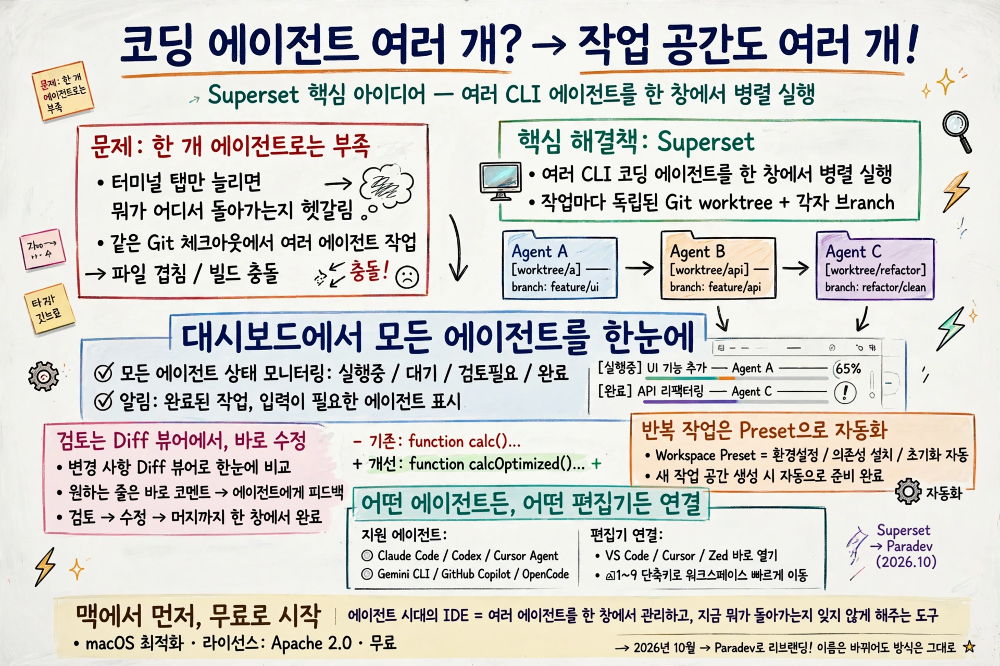
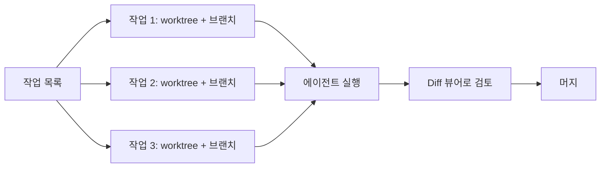
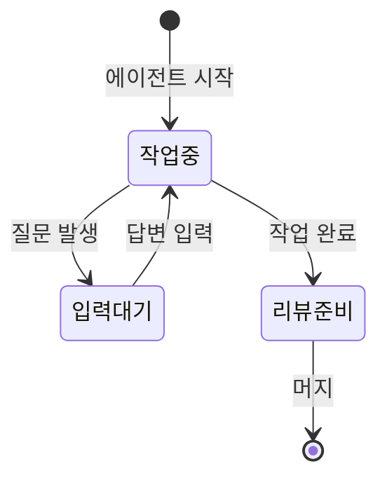

# Superset: 에이전트 한 명이 아니라 여러 명을 한 창에서 굴립니다

> **Summary**
> Superset은 여러 CLI 코딩 에이전트를 한 창에서 병렬로 실행하는 확장 터미널입니다. 작업마다 독립된 Git worktree와 브랜치를 줘 에이전트끼리 파일을 겹치지 않게 하고, 대시보드에서 모든 에이전트 상태를 한눈에 봅니다. 내장 Diff 뷰어로 변경을 검토하고 Workspace Preset으로 반복 준비를 자동화하며, macOS에서 무료로 쓸 수 있습니다.

---

- 코딩 에이전트 한 개로는 부족합니다. 여러 작업을 동시에 돌리려면, 에이전트마다 자기만의 작업 공간이 필요합니다.
- Superset은 여러 CLI 코딩 에이전트를 한 창에서 병렬로 굴리는 확장 터미널입니다. 작업마다 독립된 `Git worktree`와 브랜치를 줍니다.
- 대시보드에서 모든 에이전트 상태를 한눈에 보고, 내장 Diff 뷰어로 변경을 검토한 뒤 머지하면 됩니다.

클로드 코드로 기능 하나를 맡겨두고, 다른 터미널에서 또 다른 작업을 시킨 적 있으시죠? 터미널이 늘어나면 뭐가 어디서 돌아가는지 헷갈립니다. 브랜치를 잘못 건드리면 두 에이전트가 같은 파일을 고치고, 나중에 머지할 때 충돌이 터집니다!

🎥 [동영상 보기](https://www.youtube.com/watch?v=YWDHn7gUwfg)

## 에이전트가 여럿이면, 작업 공간도 여럿이어야 하지 않을까요?

에이전트 한 개는 터미널 하나면 충분합니다. 그런데 일이 늘어나면 이야기가 달라집니다. 이슈 트리아지, UI 기능 추가, PR 리뷰, 리팩터링 조사까지 동시에 시키고 싶어집니다. 터미널 탭을 늘리는 것만으로는 안 됩니다. 같은 체크아웃에서 여러 에이전트가 일하면, 파일이 겹치고 빌드가 꼬입니다.

Superset의 답은 단순합니다. **작업마다 독립된 **`**Git worktree**`**를 주는 것**입니다. 각 에이전트는 자기만의 작업 폴더, 자기만의 브랜치, 자기만의 터미널에서 일합니다. 파일이 겹칠 일이 없습니다. 두 가지 접근법을 한 문제에 동시에 시도해보고, 더 나은 쪽을 고를 수도 있습니다.

## 대시보드에서 모든 에이전트를 한눈에 봅니다

에이전트가 다섯 개, 열 개가 되면 병목은 따로 생깁니다. 누가 뭘 하고 있는지, 어떻게 다 기억할까요? Superset은 **중앙 모니터링 대시보드**를 둡니다. 모든 에이전트의 상태를 한 화면에서 추적하고, 변경이 생기면 알림을 받습니다. 끝난 에이전트는 바로 보이고, 입력이 필요한 에이전트도 눈에 띕니다.

## 검토는 Diff 뷰어에서, 바로 고칩니다

에이전트가 일을 마쳤다고 끝이 아닙니다. 사람이 검토해야 합니다. Superset에는 **내장 Diff 뷰어와 코드 편집기**가 들어 있습니다. 변경 사항을 빠르게 훑어보고, 마음에 안 드는 부분은 그 자리에서 고칩니다. Diff의 특정 줄에 코멘트를 달아 에이전트에게 피드백을 보낼 수도 있습니다. 검토부터 머지까지 한 창에서 끝납니다!

## 반복 작업은 Preset으로 자동화합니다

새 작업 공간을 만들 때마다 같은 준비를 반복한다면, 그건 컴퓨터가 할 일입니다. **Workspace Preset** 기능이 환경 설정, 의존성 설치, 초기화 작업을 자동화합니다. 작업 공간이 생길 때마다 정해진 준비가 알아서 돌아갑니다. 매번 손으로 입력할 필요가 없습니다!

## 어떤 에이전트든, 어떤 편집기든 연결됩니다

Superset은 에이전트 자체가 아닙니다. 이미 쓰는 에이전트를 가져와서 굴리는 공간입니다. 에이전트를 바꾸고 싶으면 어떻게 할까요? 그냥 다른 에이전트를 고르면 됩니다! `Claude Code`, `Codex`, `Cursor Agent`, `Gemini CLI`, `GitHub Copilot`, `OpenCode` 같은 CLI 기반 에이전트와 통합됩니다. 에이전트의 구독과 API 키는 그대로 씁니다. 모델 호출은 중간을 거치지 않고 제공자에게 바로 갑니다.

편집기도 마찬가지입니다. 내장 IDE 연동 기능으로 `VS Code`, `Cursor`, `Zed` 같은 외부 편집기에서 프로젝트를 바로 열 수 있습니다. 단축키도 바꿀 수 있습니다. `⌘1-9`로 워크스페이스를 빠르게 오가며 터미널과 레이아웃을 제어합니다.

## 맥에서 먼저, 무료로 시작합니다

Superset은 **macOS 환경에 최적화**됐습니다. 윈도우와 리눅스는 당시 기준으로 테스트되지 않았습니다. 라이선스는 Apache 2.0입니다. 앱은 무료로 쓸 수 있습니다.

에이전트 시대의 IDE는 코드를 더 잘 짜는 도구가 아닙니다. 여러 에이전트를 한 창에서 굴리고, 뭐가 어디서 돌아가는지 잊지 않게 해주는 도구입니다. 참고로 이 글의 주인공은 나중에 이름을 바꿨습니다. 2026년 10월에 Paradev라는 이름으로 다시 태어났고, 기능은 그대로 이어집니다. 이름이 바뀌어도, 일하는 방식은 같습니다!

