# Synology NAS 외부 포트오픈이 안되는 환경에서 서버 운영하기 2탄 (Feat. 클라우드플레어 터널)

> **Summary**
> 외부 포트오픈이 불가능한 환경에서 Cloudflare 터널을 이용해 내부 서버를 안전하게 운영하는 방법을 소개합니다. Cloudflare Tunnel을 통해 공개 IP 없이 리소스를 연결하고, nginx 서버를 설정하여 트래픽을 안전하게 라우팅하는 과정을 설명합니다. 터널 생성 및 어플리케이션 연결 방법도 포함되어 있습니다.

---

[https://svrforum.com/svr/1029447](https://svrforum.com/svr/1029447)

안녕하세요. 달소입니다.

이번에 소개해드릴 가이드는 외부 포트오픈이 안되는 환경(인터넷은 되야합니다)에서 서버를 구축해서 운영하는방법입니다.

기본적으로 홈서버를 운영할때는 포트포워딩을 통해서 내부서버에 트래픽을 연계해서 연결하는방식을 주로 사용하는데요.

(반대로 외부에 집 공인 IP를 노출하기 싫을때)

통신사의 환경이나 공유 네트워크를 사용하는 환경에서는 이러한 포트포워딩이 불가능하고 그런경우에 외부에서 접속할 방법이 막막해집니다.

하지만 언제나,, 방법은 있죠? 바로 Cloudflare에서 제공해주는 Tunnel을 이용해서 진행하는것입니다.

터널을 이용해서 내부서버에서 클라우드플레어와 네트워크 구간을 연결해서 외부사용자가 요청이 왔을때 내부 서버로 통신을 연계해주는방식입니다.

이왕 진행하는거 좀더 깊이 알아봅시다 ㅎㅎ

## Cloudflare 터널이란?

Cloudflare Tunnel은 공개적으로 라우팅 가능한 IP 주소 없이 리소스를 Cloudflare에 연결하는 안전한 
방법을 제공합니다. Tunnel을 사용하면 트래픽을 외부 IP로 보내지 않습니다. 대신 인프라의 경량 데몬( 
cloudflared)이 Cloudflare의 글로벌 네트워크에 대한 아웃바운드 전용 연결을 생성합니다. Cloudflare 
Tunnel은 HTTP 웹 서버, SSH 서버 , 원격 데스크톱 및 기타 프로토콜을 Cloudflare에 안전하게 연결할 수 
있습니다 . 이렇게 하면 원본이 Cloudflare를 우회하는 공격에 취약하지 않고 Cloudflare를 통해 트래픽을 제공할 수
 있습니다.

### 작동 원리

Cloudflared는 리소스와 Cloudflare의 글로벌 네트워크 간에 아웃바운드 연결(터널)을 설정합니다. 터널은 트래픽을 DNS 레코드로 라우팅하는 영구 개체입니다. 동일한 터널 내에서 `cloudflared`필요한 만큼 많은 프로세스(커넥터)를 실행할 수 있습니다. 이러한 프로세스는 Cloudflare에 대한 연결을 설정하고 가장 가까운 Cloudflare 데이터 센터로 트래픽을 보냅니다.

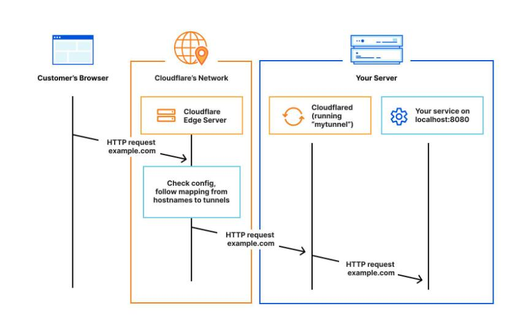

뭐,, 그렇다고하네요

## 진행환경

### Cloudflare

클라우드 플레어의 기능을 사용하기때문에 반드시 필요합니다.

Ubuntu 22.04

nginx 내부접속용 생성. apt install nginx // 80번포트로 접속

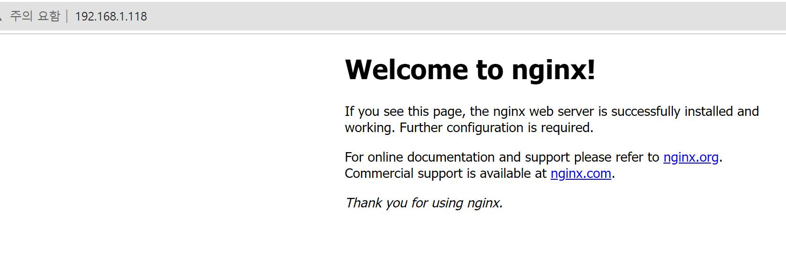

## 터널 생성하기

클플 대시보드에 로그인하고

**제로트러스트 -> Access -> Tunnel**로 이동합니다.

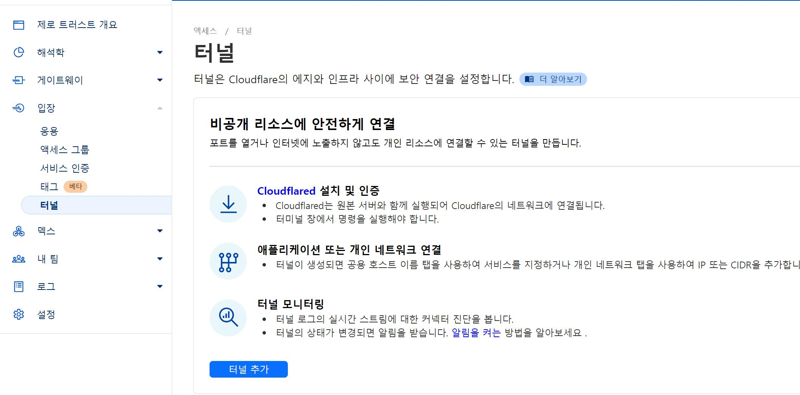

기본양식에 맞춰서 터널을 생성해줘야합니다.

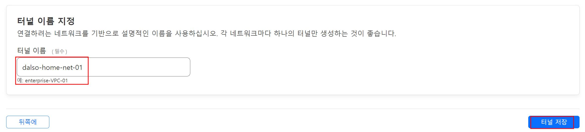

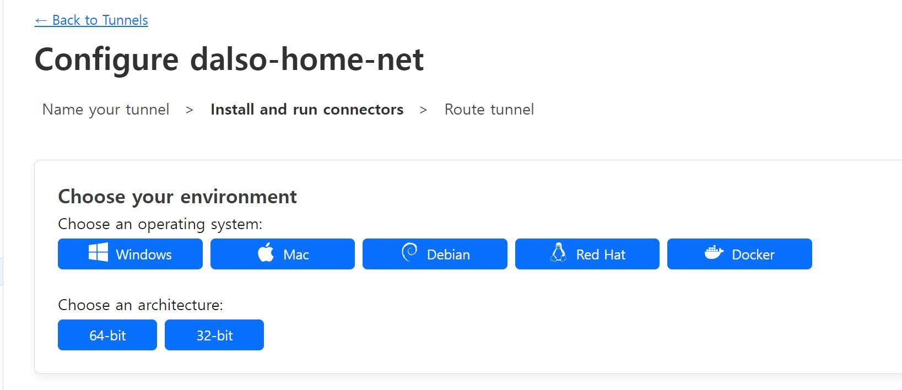

위처럼 터널이 생성되었으면 앱을 연결해봅시다.

여기서는 예제이기때문에 linux 서버에서 nginx를 구동해서 연결해보겠습니다.

사용하시는 운영체제별로 설치파일을 받고 커넥터 연결과정입니다. 설치부터라면 좌측 네모부터해주세요.

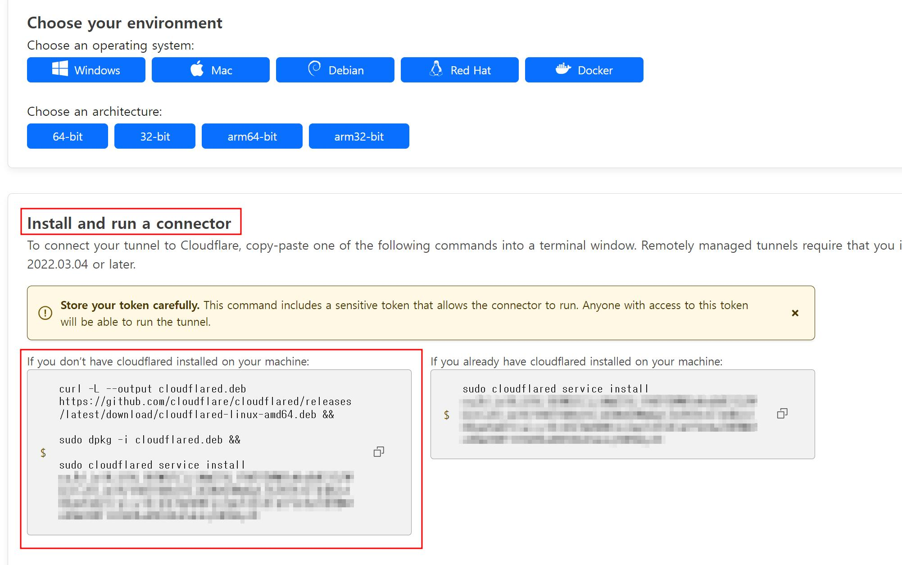

복붙하면 잘 됩니다 ㅎㅎ

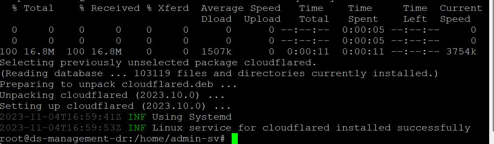

커넥터를 보면 연결되신것도 확인가능합니다.

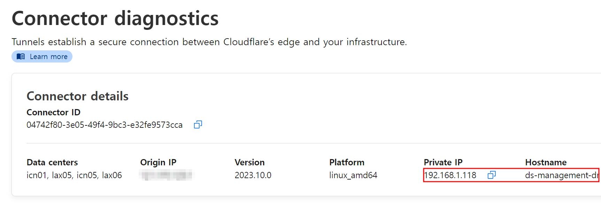

## 어플리케이션 연결하기

이제 커넥터와 클플간 연결이 되었으니 어플리케이션을 연결해보겠습니다.

터널의 Public Hostname으로 가서 새로운것을 추가해줍니다.

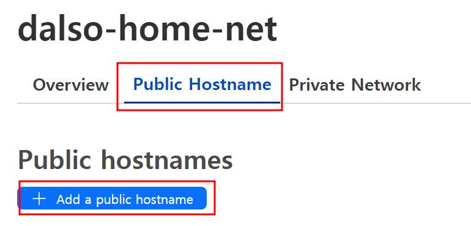

아래처럼 작성해줬습니다.

cf-test.dalso.org로 연결을 시도하면 해당 커넥터의 80번포트로 연결해준다는 뜻입니다.

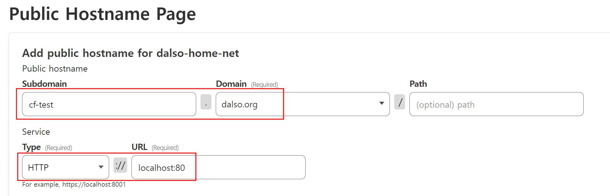

실제로 접속도 해보면 잘됩니다!

인증서까지 달아주네요 ㄷㄷㄷ

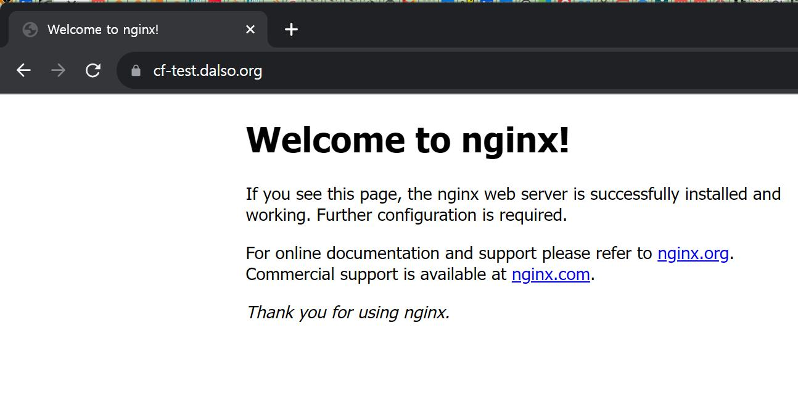

참 쉽죠?

