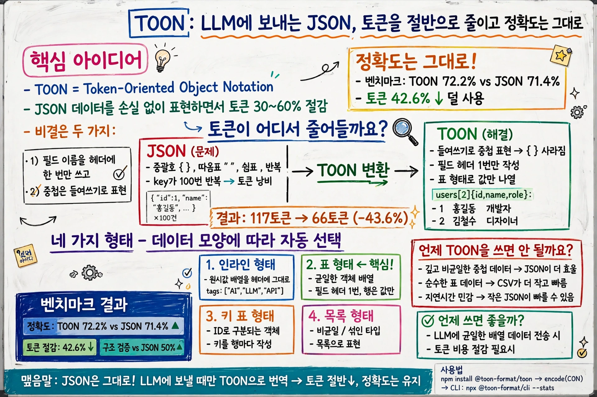
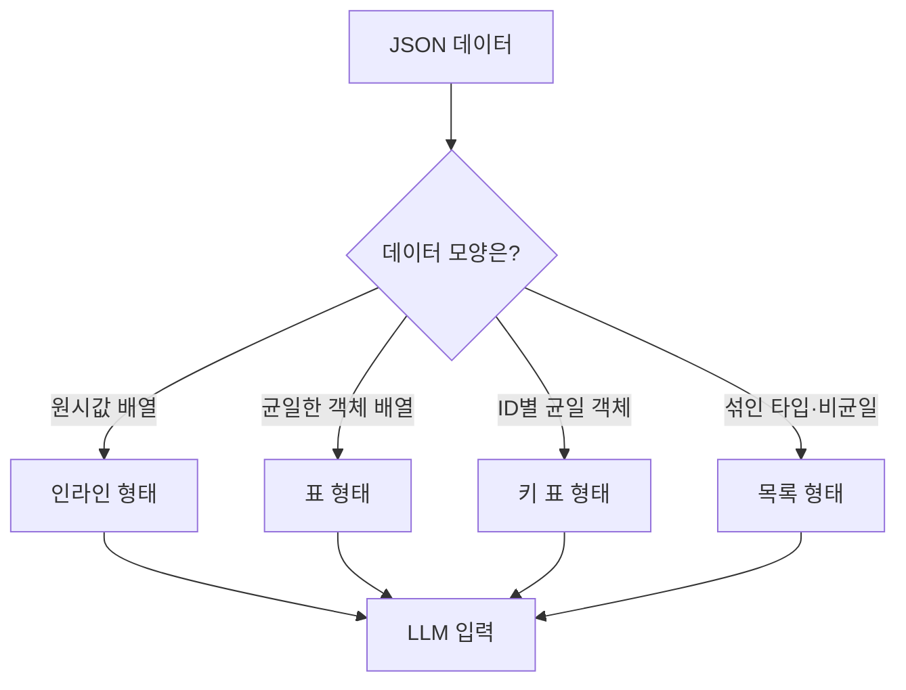
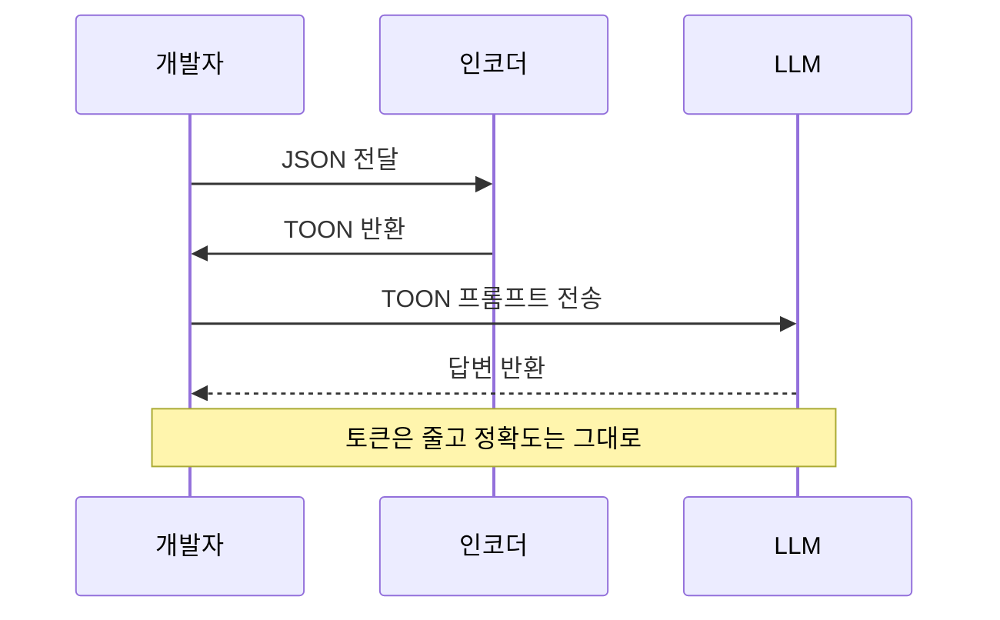

# TOON: LLM에 보내는 JSON, 토큰을 절반으로 줄이고 정확도는 그대로 가져갑니다

> **Summary**
> TOON은 JSON 데이터를 손실 없이 표현하면서 토큰을 크게 줄이는 직렬화 포맷입니다. 필드 이름을 헤더에 한 번만 쓰고 중첩은 들여쓰기로 표현해, 균일한 배열에서 30~60%의 토큰을 절감합니다. 벤치마크에서 정확도 72.2%로 JSON(71.4%)보다 높으면서 토큰은 42.6% 덜 썼고, 구조 검증은 100%를 달성했습니다. CLI와 encode/decode API로 JSON과 양방향 변환을 지원합니다.

---

- TOON은 JSON 데이터를 손실 없이 표현하면서 토큰을 크게 줄이는 직렬화 포맷입니다. 균일한 배열에서 토큰이 30~60% 줄어듭니다.
- 비결은 두 가지입니다. 필드 이름을 헤더에 한 번만 쓰고, 중첩은 들여쓰기로 표현합니다.
- 정확도는 그대로입니다. 벤치마크에서 TOON은 JSON보다 토큰 42.6%를 덜 쓰면서 정확도는 72.2%로 오히려 조금 높았습니다.


LLM에 고객 목록 100건을 JSON으로 붙여넣어 본 적 있으시죠? `"id"`, `"name"`, `"role"` 같은 키가 100번 반복되는 걸 보면서, 토큰이 아깝다는 생각이 들었을 겁니다. 그런데 데이터를 바꾸지 않고, 포맷만 바꿔서 토큰을 절반 가까이 줄이는 방법이 있습니다!

🎥 [동영상 보기](https://www.youtube.com/watch?v=r5u3ViTbWyc)

## TOON이 뭔가요?

TOON은 Token-Oriented Object Notation의 약자입니다. LLM에 보내는 구조화 데이터를 위해 만든 텍스트 직렬화 포맷입니다. YAML의 들여쓰기 구조와 CSV의 표 형식을 합친 하이브리드입니다. JSON 데이터를 손실 없이 표현하면서, 토큰 효율성과 가독성을 동시에 노렸습니다. 핵심은 이렇습니다. JSON은 프로그램이 쓰기 좋은 포맷이고, TOON은 LLM이 읽기 좋은 포맷입니다. 그래서 데이터를 바꾸는 게 아니라, LLM에 보낼 때만 TOON으로 번역해서 보내는 겁니다. JSON은 그대로 두고, 번역 계층을 하나 얹는 방식입니다!

## 토큰이 어디서 줄어들까요?

JSON의 토큰은 대부분 구조에 쓰입니다. 중괄호, 따옴표, 쉼표, 그리고 반복되는 키가 토큰을 먹습니다. TOON은 이 세 가지를 줄입니다.

첫째, 중첩은 들여쓰기로 표현합니다. 중괄호가 사라집니다. 둘째, 균일한 배열은 표 형태로 바꿉니다. 필드 이름을 헤더에 한 번만 쓰고, 각 행은 값만 나열합니다. 키가 100번 반복되던 자리에, 키가 한 번만 나옵니다! 셋째, 배열 길이와 필드 정의를 명시합니다. `users[2]{id,name,role}:`처럼, 몇 행인지, 어떤 필드인지 헤더에 적어 둡니다. 이 명시적 구조 정보 덕분에 LLM이 데이터를 안정적으로 파싱하고 검증할 수 있습니다.

예시를 하나 보겠습니다. 날씨 예보 데이터입니다. JSON은 약 117토큰, TOON은 약 66토큰입니다. 43.6%가 줄었습니다.

```yaml
location:
  city: Berlin
  country: DE
  units: metric
alerts[2]: frost,wind
forecast[3]{day,temp{min,max},condition,rainChance}:
  Mon,-2,4,snow,80
  Tue,1,7,cloudy,20
  Wed,3,11,sunny,5
```

## 네 가지 형태, 데이터 모양에 따라 달라집니다

TOON은 데이터 모양에 따라 네 가지 형태 중 하나를 자동으로 고릅니다. 인라인 형태는 원시값 배열을 헤더 줄에 그대로 적습니다. `alerts[2]: frost,wind`처럼요. 표 형태는 균일한 객체 배열은 필드를 헤더에 한 번 선언하고, 행마다 값만 나열합니다. 토큰 절감의 대부분이 여기서 나옵니다! 키 표 형태는 ID로 구분되는 균일한 객체들(설정 맵, 기능 플래그)은 `environments[2:]{region,replicas,debug}:`처럼 키를 행마다 적습니다. 목록 형태는 섞인 타입이나 비균일한 객체는 `- `로 시작하는 목록으로 표현합니다.



## 숫자로 확인해볼까요?

벤치마크 결과를 보겠습니다. 244개 데이터 질의, 4개 모델, 5,856번의 호출로 측정한 결과입니다. 정확도는 TOON 72.2%, JSON 71.4%였습니다. 토큰은 42.6% 덜 썼습니다. 토큰을 줄였는데 정확도가 떨어지지 않았습니다. 오히려 조금 올랐습니다! 구조 검증은 TOON 100%, JSON 50%였습니다. 배열이 잘렸거나 행이 더 들어간 경우, TOON은 헤더의 길이를 보고 알아챕니다. JSON은 못 알아챕니다. 균일한 직원 기록은 JSON 대비 60.7% 절감, 기능 플래그는 54.6% 절감, 연락처는 66.5% 절감이었습니다. CSV보다 약간 큽니다. 평평한 데이터에서는 TOON이 CSV보다 5.9% 더 큽니다. 하지만 CSV는 중첩 구조를 표현하지 못합니다. TOON의 작은 오버헤드는 길이와 필드를 명시해 주는 신뢰성의 대가입니다.

이 숫자를 보고 가장 먼저 든 생각은, 토큰을 아끼는 게 정확도를 깎는 일이 아니었다는 점이었습니다. 절감과 정확도가 같이 가는 경우가 있다는 게, 이 포맷의 가장 큰 매력입니다.

## 그럼 CSV면 충분하지 않을까요?

CSV가 더 작다면, CSV를 쓰면 되지 않을까요? 평평한 표 데이터라면 맞습니다. CSV가 가장 작습니다. 하지만 CSV는 중첩 구조를 표현하지 못합니다. 중첩된 객체가 있으면 CSV는 정보를 잃어버리면서 평평하게 만들어야 합니다. TOON은 중첩도 표현하면서, CSV에 가까운 크기를 유지합니다. 그래서 TOON은 CSV의 대체품이 아니라, JSON과 CSV 사이의 선택지입니다. 순수한 표는 CSV, 중첩이 있는 구조화 데이터는 TOON이 맡는 겁니다.

## 언제 TOON을 쓰면 안 될까요?

TOON이 만능은 아닙니다. 깊게 중첩되거나 비균일한 데이터에서는 JSON이 더 효율적일 수 있습니다. 표 형태를 쓸 수 없는 데이터에서는 절감 효과가 작아집니다. 순수한 표 데이터라면 CSV가 더 작고, 지연 시간이 중요한 환경에서는 작은 JSON이 더 빠를 수 있습니다. TOON은 LLM에 보내는 균일한 배열 데이터에 쓰는 게 맞습니다. API나 저장소, 시스템 간 교환에는 JSON을 그대로 쓰면 됩니다.



## 써보는 방법

설치는 간단합니다. TypeScript 기준 구현체가 있고, CLI도 있습니다.

```bash
npm install @toon-format/toon
```

```typescript
import { encode } from '@toon-format/toon'

const data = {
  users: [
    { id: 1, name: 'Ada', role: 'admin' },
    { id: 2, name: 'Bob', role: 'user' }
  ]
}

console.log(encode(data))
// users[2]{id,name,role}:
//   1,Ada,admin
//   2,Bob,user
```

CLI로 바로 변환하고 토큰 절감량도 확인할 수 있습니다. 설치 없이 내 데이터로 시험해 볼 수도 있습니다.

```bash
cat data.json | npx @toon-format/cli --stats
```

이 명령은 TOON 변환 결과와 함께 절감된 토큰 수를 보여줍니다. 위에 나온 날씨 예보는 이렇게 하면 117토큰에서 66토큰으로, 51토큰이 줄었다고 나옵니다.

## 맺음말

JSON을 버릴 필요는 없습니다. LLM에 보낼 때만 TOON으로 번역하면 됩니다. 토큰은 절반 가까이 줄고, 정확도는 그대로입니다. 균일한 배열 데이터를 LLM에 자주 보낸다면, 한 번쯤 시험해 볼 만한 선택지입니다.

