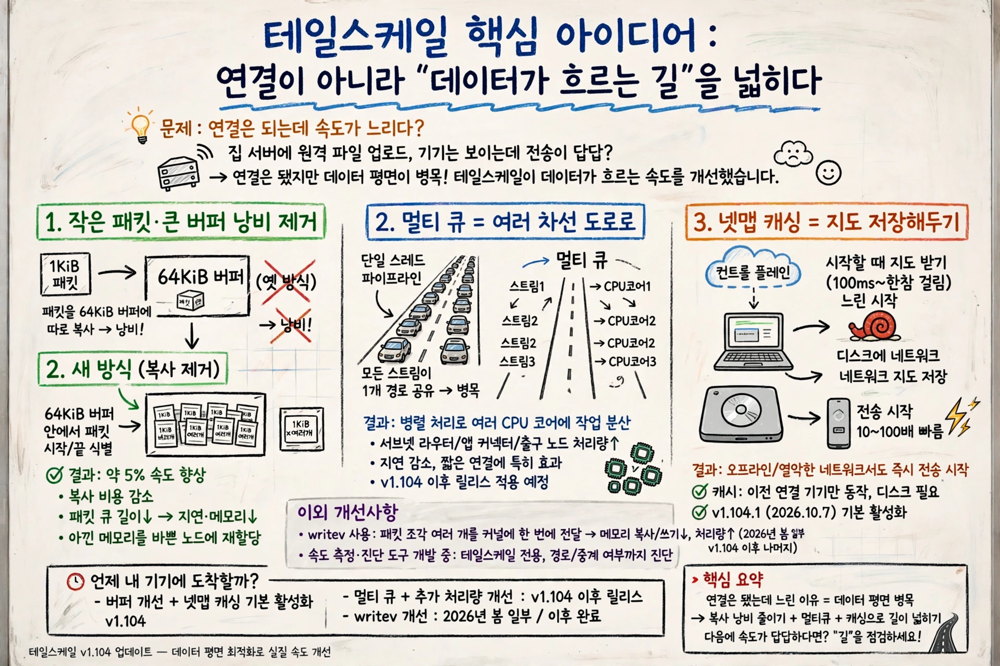
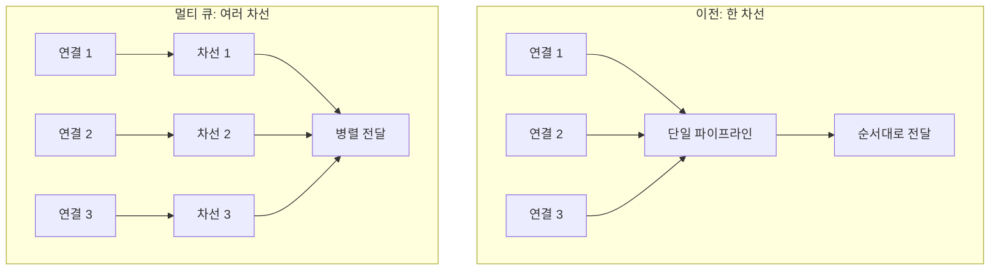
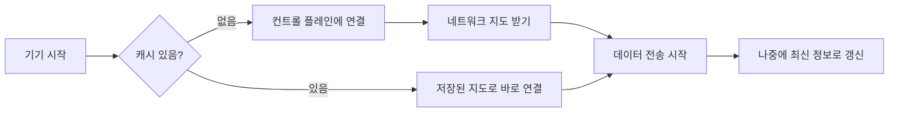

# Tailscale: 연결은 이미 됩니다. 이제는 패킷이 흐르는 길을 넓힙니다

> **Summary**
> 테일스케일이 다음으로 손본 것은 연결이 아니라 데이터가 흐르는 속도입니다. 1 KiB짜리 작은 패킷을 64 KiB 버퍼에 따로 복사하던 낭비를 없애 약 5% 빨라졌고, 멀티 큐로 여러 CPU 코어에 일을 나눕니다. 시작할 때 쓸 네트워크 지도를 디스크에 저장해 두면, 연결이 안 좋은 곳에서도 데이터 전송 시작이 10~100배 빨라집니다.

---

- 테일스케일이 다음으로 손본 것은 연결이 아니라 데이터가 흐르는 속도입니다.
- 1 KiB짜리 작은 패킷을 64 KiB 버퍼에 따로 복사하던 낭비를 없애 약 5% 빨라졌고, 멀티 큐로 여러 CPU 코어에 일을 나눕니다.
- 시작할 때 쓸 네트워크 지도를 디스크에 저장해 두면, 연결이 안 좋은 곳에서도 데이터 전송 시작이 10~100배 빨라집니다.

집에 있는 서버에 원격으로 파일을 올리는데, 연결은 되는데 속도가 영 시원치 않았던 적 있으시죠? 기기는 다 보이는데 전송이 굼뜨면 답답합니다. 테일스케일이 바로 이 지점을 파고들었습니다!

🎥 [동영상 보기](https://www.youtube.com/watch?v=TvB6HBcyKU4)

## 연결은 됐는데, 왜 속도가 문제였을까요?

테일스케일은 원래 연결의 달인이었습니다. 까다로운 네트워크에서도 NAT를 뚫고 길을 찾았고, 리눅스 TCP 처리량을 올리고, 베어메탈에서 10Gb/s를 넘겼으며, UDP 앱 처리량을 4배 이상 높였습니다. 그런데 연결이 돼도 데이터가 흐르는 길 자체가 좁으면 체감 속도는 그대로입니다. 그래서 이번에는 데이터 평면을 손보기로 했습니다.

## 작은 패킷, 큰 버퍼의 낭비부터 줄였습니다

대부분의 네트워크 패킷은 1 KiB 정도로 작습니다. 그런데 리눅스의 빠른 수신 기능인 `GRO`를 쓰려면 한 번에 64 KiB를 받을 준비가 필요합니다. 문제는 기존 구현이 패킷을 풀어 담을 버퍼로 64 KiB 크기만 제공했다는 점입니다. 1 KiB짜리 패킷 하나가 매번 자기만의 64 KiB 버퍼에 복사됐습니다. 컨테이너선에 작은 상자 하나만 싣고 보내는 셈입니다!

리눅스와 안드로이드에서는 이제 패킷을 다른 곳으로 복사하지 않습니다. 큰 수신 버퍼 안에서 각 패킷의 시작과 끝을 식별하는 방식으로 바꿨습니다. 여러 작은 패킷이 하나의 메모리 할당을 공유하고, 복사에 쓰는 시간도 줄었습니다. 이 변경 하나만으로 여러 네트워크 구성에서 약 5% 속도 향상을 얻었습니다. 처리 단계 사이에서 급증을 흡수하는 패킷 큐의 길이도 줄였습니다. 테스트에서 큐 깊이 대부분이 쓰이지 않았고, 짧은 큐는 대기 시간과 메모리 부담을 함께 낮췄습니다. 아낀 메모리는 어디로 갔을까요? 가장 바쁜 노드들에게 돌아갔습니다.

## 한 차선이던 길을 여러 차선으로 나눴습니다

서브넷 라우터, 앱 커넥터, 출구 노드는 여러 독립 스트림을 순서가 보장되는 단일 스레드 파이프라인에서 처리했습니다. 받는 쪽 앱이 자기 스트림의 패킷을 순서대로 받아야 하니까, 여러 연결이 하나의 처리 경로를 공유했습니다. 한 차선 도로에 차가 다 몰리는 모습입니다.

새로운 멀티 큐는 피어 수가 아니라 기기의 자원에 맞춰 여러 처리 경로를 만듭니다. 각 패킷 스트림은 하나의 경로에 고정돼 순서를 지키고, 경로들은 병렬로 돌아가 여러 CPU 코어에 작업을 나눕니다. 서브넷 라우터와 앱 커넥터는 총처리 용량이 늘고 수신부터 전달까지의 지연이 줄어듭니다. 이미 있는 하드웨어를 더 효율적으로 쓰는 셈입니다! 짧은 연결을 많이 처리하는 앱 커넥터와 출구 노드에서 효과가 특히 큽니다. 멀티 큐는 v1.104 이후 릴리스에 적용될 예정입니다.

## 커널에 한 번에 넘기는 `writev`도 있습니다

리눅스의 `writev` 기능을 활용하면, 패킷 데이터 조각 여러 개를 커널에 한 번에 넘길 수 있습니다. 미리 합쳐서 복사할 필요가 없습니다. 메모리 복사와 쓰기 횟수가 줄고 처리량이 올라갑니다. 2026년 봄에 일부가 이미 적용됐고, 나머지 개선은 v1.104 이후 릴리스에 이어집니다.

## 시작이 느린 건, 지도를 매번 새로 받기 때문입니다

기기가 테일스케일에 연결할 때는 보통 컨트롤 플레인에 먼저 닿아 네트워크 지도(`netmap`)를 받습니다. 좋은 네트워크에서는 100밀리초 정도면 끝나지만, 비행기 와이파이나 호텔의 까다로운 필터 뒤에서는 한참 걸릴 수 있습니다. 아예 닿지 않을 때도 있습니다. 그런데 시작이 느리면 그만큼 일을 못 시작합니다.

넷맵 캐싱은 이 지도를 디스크에 저장해 두는 기능입니다. 시작할 때 저장된 지도를 이용해 다른 기기들과 먼저 연결하고, 컨트롤 플레인에 닿으면 최신 정보로 갱신합니다. 컨트롤 플레인에 닿기 어려운 테일넷에서는 웜 캐시로 시작한 데이터 전송이 콜드 스타트보다 10~100배 훨씬 빨라졌습니다. 이 장면이 저는 가장 인상 깊었습니다. "아직 컨트롤 플레인과 얘기 전이지만, 일단 일을 시작할 수 있다"는 태도가 네트워크 도구의 본질을 잘 보여주니까요!

물론 조건이 있습니다. 캐시는 이전에 테일넷에 한 번이라도 연결해 지도를 받아본 기기에서만 동작하고, 디스크 공간도 필요합니다. 아주 큰 테일넷에서는 캐시 갱신에 디스크 작업이 많이 들고, SD카드처럼 마모에 민감한 저장장치를 쓰는 기기는 꺼 두는 편이 낫습니다. 넷맵 캐싱은 v1.104에서 기본 활성화될 예정이었고, 실제로 2026년 10월 7일에 나온 v1.104.1에 들어갔습니다.

## 언제 내 기기에 도착할까요?

- 버퍼 개선과 넷맵 캐싱 기본 활성화: v1.104
- 멀티 큐와 추가 처리량 개선: v1.104 이후 릴리스
- `writev` 처리량 개선: 2026년 봄 일부 적용, 나머지 이후 릴리스
## 속도 재는 도구도 새로 만듭니다

빠르다고 말만 해서는 안 됩니다. 사용자가 직접 재고 진단할 수 있어야 합니다. 그런데 기존 성능 측정 도구에는 빈틈이 있습니다. 대부분 점대점 측정이라 모든 끝점에 뭔가를 설치해야 하고, 잘못된 테스트를 돌리기 쉬우며, QUIC나 HTTP/3 같은 새 프로토콜을 지원하지 않는 경우도 많습니다. 무엇보다 테일스케일을 모릅니다. 연결이 직접 연결인지 중계(`DERP`)를 거치는지, 피어 릴레이가 도움이 될지, 경로가 시간에 따라 어떻게 바뀌는지 알려주지 못합니다. 그래서 테일스케일 전용 측정·진단 도구를 탐색 중이라고 합니다.

연결이 되는 것과 연결이 빠른 것은 다른 문제입니다. 테일스케일은 작은 패킷의 메모리 낭비부터, 한 차선이던 처리 경로, 시작할 때의 지도까지, 데이터가 흐르는 길 전체를 넓히고 있습니다. 다음에 속도가 답답하면, 연결이 아니라 이 길들을 한 번 떠올려 보시면 어떨까요?

