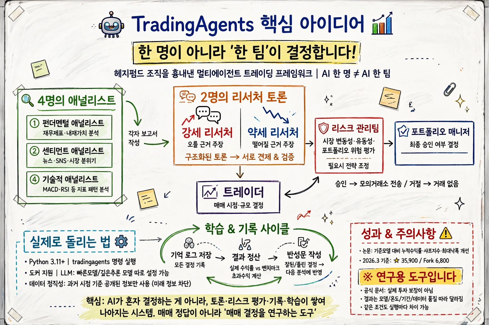
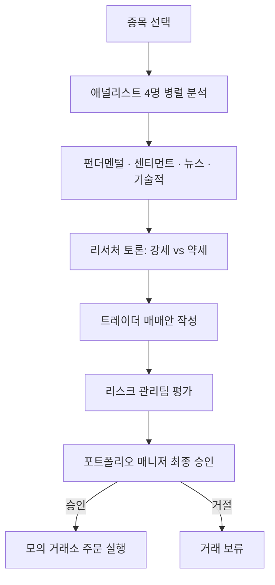
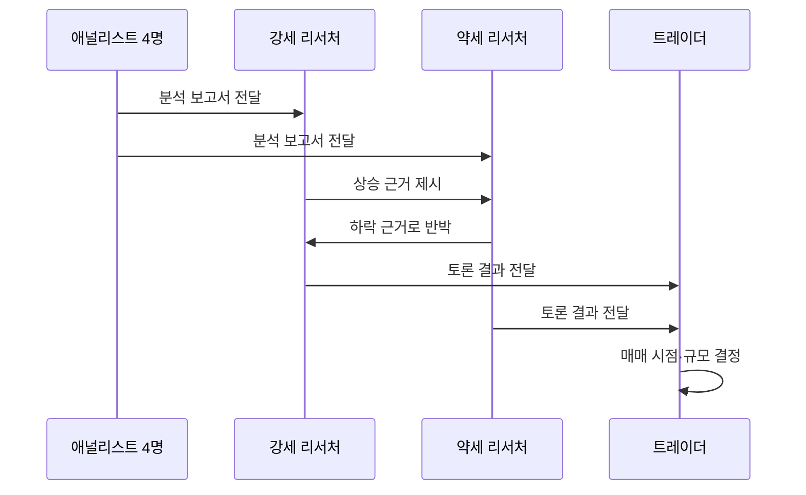
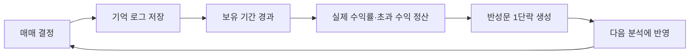

# TradingAgents: 헤지펀드 한 팀을 통째로 흉내 내면, 매매 결정이 달라집니다

> **Summary**
> TradingAgents는 애널리스트, 강세·약세 리서처, 트레이더, 리스크 관리팀, 포트폴리오 매니저 역할을 나눈 멀티에이전트 트레이딩 프레임워크입니다. 분석과 토론, 위험 평가를 거쳐 모의 매매를 결정하고 결과를 기록해 다음 판단에 반영합니다. 연구 결과는 일부 성과 지표의 개선을 보고했지만, 결과는 모델과 데이터 등에 따라 달라지며 공식적으로 연구용 도구로 안내됩니다.

---

- TradingAgents는 헤지펀드 조직을 통째로 흉내 낸 멀티에이전트 트레이딩 프레임워크입니다.
- 애널리스트 4명, 강세·약세 리서처 2명, 트레이더, 리스크 관리팀, 포트폴리오 매니저가 토론과 위험 평가를 거쳐 매매를 결정합니다.
- 논문은 기준 모델보다 누적 수익률·샤프 지수·최대 낙폭이 나아졌다고 보고했지만, 공식 문서는 연구용 도구라고 분명히 밝히고 있습니다.

주식 뉴스를 보고 "이 종목, 지금 사야 하나요?" 하고 망설인 적 있으시죠? 차트는 오를 것 같고, 뉴스는 불안하고, 주변 의견은 갈립니다. 한 사람의 판단으로는 정보가 너무 많습니다. 그래서 실제 트레이딩 회사는 한 명이 아니라 한 팀이 결정을 내립니다.

🎥 [동영상 보기](https://www.youtube.com/watch?v=90gr5lwjIho)

## 한 명이 아니라 한 팀이 일합니다

TradingAgents의 출발점은 단순합니다. AI 한 명에게 매매를 맡기지 않고, 실제 헤지펀드처럼 역할을 나눈 것입니다. 애널리스트가 4명, 리서처가 2명, 트레이더 1명, 리스크 관리팀과 포트폴리오 매니저까지 한 팀을 이룹니다!

애널리스트 4명은 각자 다른 렌즈로 종목을 봅니다. 재무제표와 내재가치를 따지는 펀더멘털 애널리스트, 뉴스와 소셜 반응을 모아 시장 분위기를 읽는 센티먼트 애널리스트, 글로벌 뉴스와 거시지표를 해석하는 뉴스 애널리스트, `MACD`와 `RSI` 같은 지표로 패턴을 찾는 기술적 애널리스트입니다. 네 명이 동시에 각자 도구를 들고 분석하고, 보고서가 다 모인 뒤에야 토론이 시작됩니다.

## 왜 토론을 시킬까요?

분석 보고서가 좋다고 매매가 바로 정해지지 않습니다. 리서처 2명이 강세와 약세로 나뉘어 보고서를 정면으로 검증하기 때문입니다. 강세 리서처는 오를 근거를, 약세 리서처는 떨어질 근거를 들고 맞섭니다. 구조화된 토론이 끝나야 트레이더가 보고서를 종합해 매매 시점과 규모를 정합니다.

이 장면이 저는 가장 인상 깊었습니다. AI가 혼자 결론을 내는 게 아니라, 반대 입장이 서로를 견제하는 구조라서요! 한 모델의 확신이 아니라 토론의 결과가 결정이 됩니다.

## 리스크 관리는 누가 하나요?

트레이더가 매매안을 내면 리스크 관리팀이 바로 검사를 시작합니다. 시장 변동성, 유동성, 포트폴리오 위험을 평가하고, 필요하면 전략을 조정합니다. 평가 보고서는 포트폴리오 매니저에게 넘어가고, 최종 승인 여부는 매니저가 정합니다. 승인된 주문만 모의 거래소로 보내집니다. 거절되면 거래는 일어나지 않습니다!

결정이 끝나도 시스템은 멈추지 않습니다. 모든 결정은 기억 로그에 남고, 보유 기간이 지나면 실제 수익률과 지역 벤치마크 대비 초과 수익으로 정산됩니다. 잘된 결정과 틀린 결정이 한 줄 반성문으로 정리돼 다음 분석에 반영됩니다. 포트폴리오 매니저는 같은 종목의 최근 결정과 다른 종목의 교훈을 함께 읽고 판단합니다. 한 번의 승부가 아니라, 결정이 쌓이며 나아지는 구조입니다.

## 실제로 돌리려면 무엇이 필요할까요?

설치는 `Python` 3.11 이상 환경에서 패키지를 설치하고 `tradingagents` 명령을 실행하는 흐름입니다. 도커로 돌릴 수도 있습니다. 언어 모델은 여러 제공자를 고를 수 있고, 빠른 작업용 모델과 깊은 추론용 모델을 따로 정할 수 있습니다. 매니저는 한 제공자의 모델로, 애널리스트는 다른 제공자의 모델로 돌리는 식의 조합도 됩니다. 로컬 모델도 연결할 수 있습니다.

데이터 정직성도 신경을 썼습니다. 미국 기업 재무제표는 증권 당국 공시에서 제출된 그대로 가져옵니다. 과거 날짜로 돌리면 그날 기준으로는 아직 공개되지 않은 수치는 보여주지 않습니다. 예를 들어 2008년 한 기업의 총자산은 처음 제출된 396억 달러로 읽히고, 2010년에 정정된 362억 달러로는 읽히지 않습니다. 미래 정보를 슬쩍 빌려오는 일을 막는 장치입니다!

백테스트도 같은 철학입니다. 종목과 날짜 격자 위로 파이프라인을 돌리고, 결정은 그 날짜 다음 거래일의 첫 종가로 진입한 것으로 채점합니다. 결과는 지역 벤치마크 대비 초과 수익으로 묶어 보여줍니다.

## 그래서, 써보면 어떨까요?

2026년 3월 클립 시점에는 저장소 스타가 3만 5,900개, 포크가 6,800개를 넘겼습니다. 논문은 2024년 12월에 나왔고, 2025년 6월에 고쳐졌습니다. 이후에도 새 버전이 계속 나오고 있고, 2026년 11월에는 후속 연구 도구도 공개 접근을 열었습니다.

다만 한 가지는 분명히 짚고 넘어가야 합니다. 공식 문서는 이 프레임워크가 연구용이라고 밝히고 있습니다. 성과는 고른 모델과 온도, 기간, 데이터 품질에 따라 달라집니다. 같은 종목, 같은 날짜를 두 번 돌려도 결과가 다를 수 있습니다. 헤지펀드 조직을 흉내 낸다고 해서, 헤지펀드 수익이 그대로 따라오는 것은 아닙니다!

AI 한 명이 아니라 AI 한 팀이 토론하고, 위험을 따지고, 결정을 기록하며 배우는 모습. 매매의 정답을 주는 도구가 아니라, 매매 결정을 연구하는 도구로 보는 편이 맞습니다.

