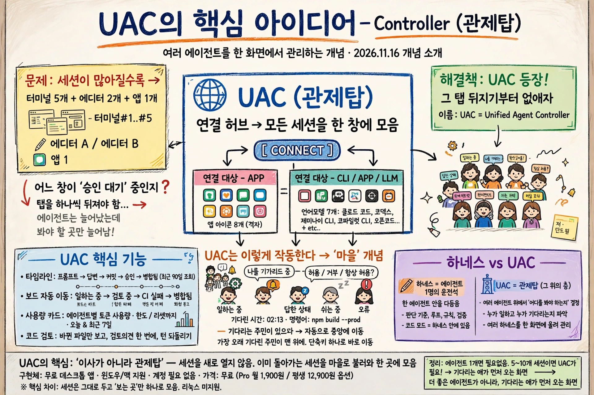
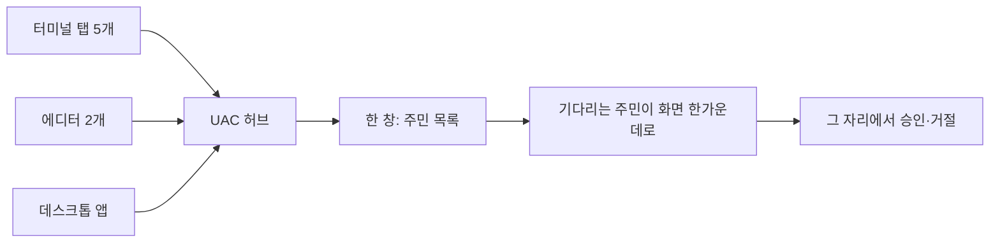
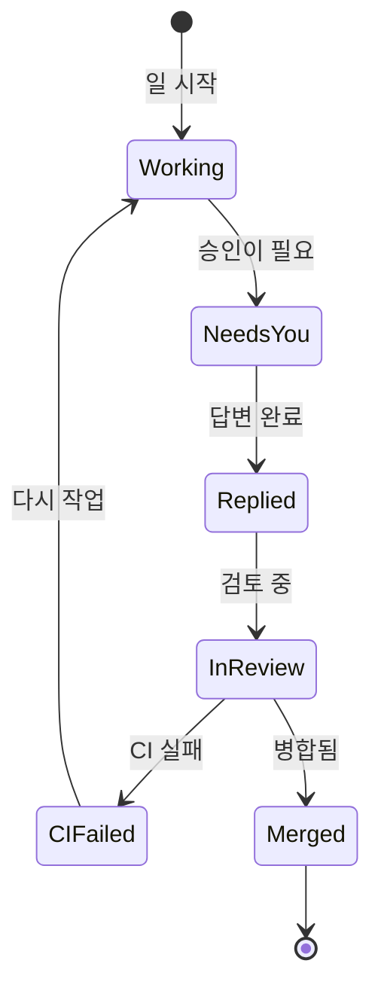

# UAC: IDE로 이사 가지 마세요. 에이전트 열 개가 기다리는 곳으로 옵니다

> **Summary**
> UAC는 터미널·IDE·앱에 흩어진 여러 에이전트 세션을 한 화면에서 관리하는 관제 도구입니다. 세션을 주민처럼 보여주고, 승인이 필요한 에이전트를 먼저 띄워 바로 응답할 수 있으며, 타임라인·작업 보드·사용량·코드 검토도 제공합니다. 세션 간 작업을 나누거나 대화를 이어주지는 않으며, 에이전트가 하나뿐이라면 굳이 필요하지 않습니다.

---

- UAC는 여러 에이전트를 한 화면에서 관리하는 개념입니다. 터미널·IDE·앱에 흩어진 세션을 한 창에 모읍니다.
- 구현체인 한 무료 데스크톱 앱은 세션을 마을 주민처럼 보여주고, 승인이 필요하면 그 주민이 화면 한가운데로 걸어옵니다.
- 하네스가 한 에이전트 안을 다듬는 일이라면, UAC는 에이전트들 위에서 "어디를 봐야 하는지"를 정하는 층입니다.

터미널 탭 다섯 개, 에디터 두 개, 앱 하나. 어느 창이 승인을 기다리는지 찾느라 탭을 하나씩 뒤져본 적 있으시죠? 에이전트는 늘렸는데, 정작 봐야 할 곳이 늘어난 셈입니다. 그 탭 뒤지기부터 없애자는 제안이 나왔습니다. 이름은 UAC, Unified Agent Controller입니다!

🎥 [동영상 보기](https://www.youtube.com/watch?v=VE66JDHoS6Y)

## UAC, 뭐가 다른가요?

UAC는 2026년 11월 16일에 올라온 개념 소개 글에서 처음 제시됐습니다. 글에 붙은 목업 이미지가 개념을 한눈에 보여줍니다. 맨 위에 지구본 아이콘이 `UAC`라고 적혀 있고, 그 아래 `CONNECT` 버튼이 있습니다. 아래쪽 두 패널은 연결 대상입니다. 위 패널은 `APP`, 앱 아이콘 8개가 격자로 놓여 있습니다. 아래 패널은 `CLI / APP`, 언어 모델 아이콘 7개에 `etc..` 자리까지 있습니다. 중앙 허브 하나가 앱과 언어 모델을 한 번에 연결하는 그림입니다.

여기서 "IDE의 개념을 무너트린다"는 말의 뜻이 중요합니다. 기존 대시보드 도구들은 대개 자기 안에 세션을 열게 합니다. UAC는 반대로 갑니다. 터미널도, 에디터도, 앱도 그대로 둡니다. 세션이 있는 곳은 그대로 두고, 보는 곳만 하나로 모읍니다. 이사가 아니라 관제탑입니다!

## 세션이 주민이 되면?

이 개념의 구현체는 무료 데스크톱 앱으로 나와 있습니다. 윈도우와 맥에서 돌아가고, 계정이 필요 없습니다. 앱은 모든 에이전트 세션을 작은 마을의 주민으로 보여줍니다. 클로드 코드, 코덱스, 제미나이 CLI, 코파일럿 CLI, 오픈코드 같은 도구가 한 마을에 삽니다.

주민에게는 상태가 있습니다. 일하는 중, 나를 기다리는 중, 답한 상태, 쉬는 중, 오류. 기다리는 주민이 있으면 어떻게 될까요? 다른 창에서 일하고 있어도 그 주민이 화면 한가운데로 걸어옵니다. 정확한 명령어와 기다린 시간을 들고 말풍선을 띄웁니다. 그 자리에서 허용, 거부, 항상 허용을 고릅니다. 터미널의 프롬프트도 그대로 남아 있어서, 어느 쪽에서 답해도 양쪽이 닫힙니다.

> 세션이 열 개면, 기다리는 순서가 먼저입니다!

가장 오래 기다린 주민이 맨 위에 옵니다. 단축키 하나로 그 주민에게 바로 이동합니다. 메시지·터미널·둘 다 보기를 한 번에 바꿉니다. 프로젝트별로 묶여서, 같은 저장소의 세션은 함께 있습니다.

## 한 창에서 끝까지

승인만 모으는 게 아닙니다. 한 창에서 일의 끝까지 봅니다.

**타임라인**이 있습니다. 프롬프트, 답변, 커밋, 승인이 순서대로 쌓입니다. 최근 90일 중 아무 턴이나 다시 볼 수 있습니다. 대기 시간과 비용, 결정 기록이 옆에 붙습니다.

**보드**는 스스로 움직입니다. 일하는 중, 나를 기다리는 중, 답한 상태, 검토 중, CI 실패, 병합됨. 주민 상태와 깃, 깃허브가 카드를 알아서 옮깁니다. CI가 실패하면 실패한 검사를 그대로 에이전트에게 돌려줍니다.

**사용량 카드**도 있습니다. 에이전트마다 한도를 얼마나 썼는지, 리셋까지 얼마나 남았는지 한눈에 봅니다. 오늘과 최근 7일의 토큰도 나옵니다. 한도에 가장 가까운 에이전트는 맥 메뉴 막대에 서 있습니다.

**코드 검토**도 그 창에서 합니다. 이번 턴에 바뀐 파일만 보고, 검토 의견을 한 번에 보내고, 턴 전체를 되돌릴 수도 있습니다. 대화 옆에는 작은 IDE가 있습니다. 브랜치, 커밋, 푸시, 풀, 블레임까지 됩니다. 저장소와 브랜치는 마을의 집이 됩니다.

## 무엇과 다른가요?

비슷한 도구와 비교한 공식 비교표가 있습니다. 2026년 11월 기준, 각 프로젝트의 공개 문서와 사용자 후기를 바탕으로 정리한 표입니다.

| 무엇이 다른가 | UAC 구현체 | 다른 도구들 |
| --- | --- | --- |
| 자기 터미널·IDE에서 시작한 세션 | 그대로 들어옵니다 | 안에서 연 세션만 보거나, 자기가 시작한 것만 봅니다 |
| 앱 채팅 | 클로드·코덱스 앱 채팅도 들어옵니다 | 해당 없음 |
| 기다리는 세션 알림 | 주민이 화면으로 걸어옵니다 | 상태·알림만 표시합니다 |
| 분석 도구 | 앱 안에 없음 | 해당 없음 |

차이의 핵심은 한 줄입니다. 세션을 새로 열지 않습니다. 이미 돌아가는 세션이 마을로 걸어 들어옵니다. 클로드와 코덱스 앱 채팅까지 주민이 됩니다. 버전 0.20에서 앱 채팅 지원이 새로 들어갔습니다.

## 안 되는 것도 분명합니다

UAC가 모든 걸 대신하지는 않습니다. 워크트리를 만들지 않고, 세션끼리 일을 나눠주지도 않습니다. 한 에이전트의 일을 다른 에이전트에게 넘기지도 않고, 대화도 이어주지 않습니다. 누가 뭘 하는지는 사람이 정합니다. UAC는 그 세션들을 보고 답하는 곳입니다.

리눅스 앱은 아직 없습니다. 윈도우 앱은 코드 서명이 아직 안 돼서, 첫 실행 때 스마트스크린 질문이 한 번 뜹니다. 맥 앱은 애플 서명과 공증을 받았습니다.

가격은 무료이고 계정이 필요 없습니다. 회원제는 코인 옷장·상점·커뮤니티가 붙고, Pro는 공식 아트 팩과 주민 수를 더 늘려줍니다. 30일 체험이 있습니다. 월 2달러, 한국에서는 1,900원(세금 별도)이고, 평생은 7.99달러, 한국에서는 12,900원을 한 번 냅니다. 베타 첫 100명에게 평생 무료를 약속했다는 말은 개념 소개 글의 댓글에서 확인됐습니다. 글쓴이가 직접 등록을 확인해 준다는 답도 있었습니다.

## 하네스와 뭐가 다른가요?

하네스 글을 여러 편 썼습니다. 하네스 일반 이론, 6계층 가이드, 디자인 하네스까지요. 그런데 UAC는 하네스와 층이 다릅니다.

하네스는 한 에이전트 안을 다듬습니다. 판단 기준, 루프, 규칙, 검증이 그 안에 있습니다. UAC는 그 위의 층입니다. 여러 에이전트가 동시에 돌아갈 때, 누가 일하고 누가 기다리는지, 어디에 답해야 하는지를 정합니다. 하네스가 에이전트 한 명의 운전석이라면, UAC는 관제탑입니다.

하네스의 끝자락에 있는 코드 모드도 같은 맥락입니다. 코드 모드는 하네스 안에서 에이전트가 코드를 직접 다루는 방식입니다. UAC는 하네스 바깥에서, 여러 하네스를 한 화면에 올리는 일입니다. 그래서 이 글은 하네스 사용법이 아니라, 하네스들을 어떻게 한눈에 보는지 다룹니다.

에이전트를 하나만 쓴다면 UAC는 필요 없습니다. 터미널 하나면 충분합니다. 그런데 세션이 다섯 개, 열 개가 되면 이야기가 달라집니다. 기다리는 애를 찾는 일이 일이 되기 때문입니다. 그때 필요한 건 더 좋은 에이전트가 아니라, 기다리는 애가 먼저 오는 화면입니다. UAC는 그 화면을 만들자는 제안입니다!

