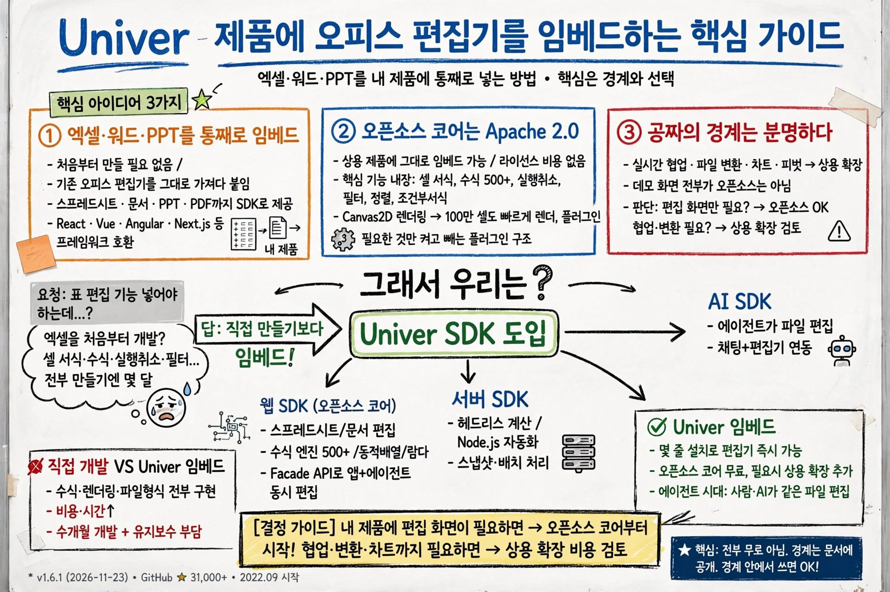
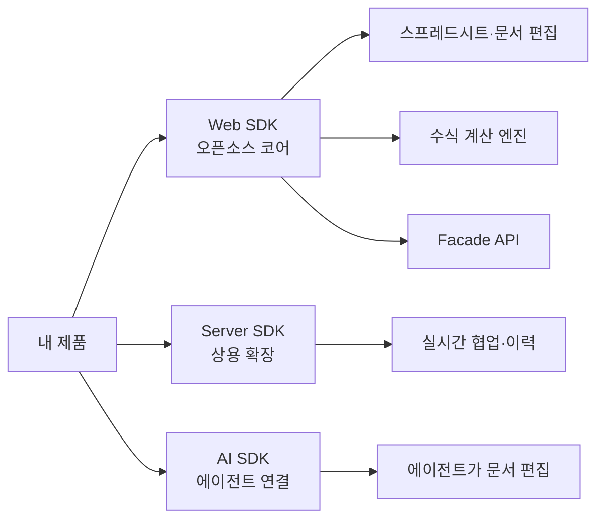
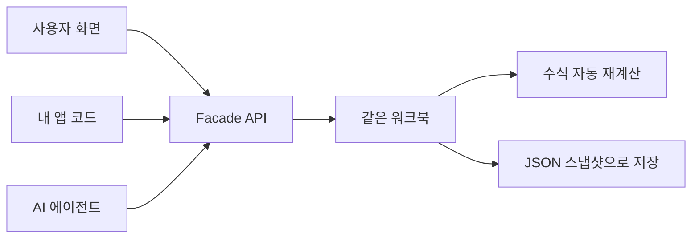

# Univer: 엑셀·워드·PPT, 내 제품 안에 통째로 넣습니다. 직접 만들지 말고 임베드부터 보세요

> **Summary**
> Univer는 스프레드시트·문서 편집기와 수식 계산을 제품에 임베드할 수 있는 오픈소스 SDK로, Facade API와 헤드리스 실행을 통해 앱과 AI 에이전트가 같은 워크북을 편집할 수 있습니다. 실시간 협업, 파일 변환, 차트 등은 상용 확장이므로 필요한 기능과 라이선스 범위를 확인한 뒤 도입해야 합니다.

---

- 엑셀·워드·PPT를 내 제품 안에 통째로 넣을 수 있습니다. 처음부터 만들 필요가 없습니다.
- 오픈소스 코어는 Apache 2.0이라, 상용 제품에 그대로 임베드할 수 있습니다. 스프레드시트·문서 편집, 수식 계산까지 들어 있습니다.
- 단, 공짜의 경계는 분명합니다. 실시간 협업·파일 변환·차트는 상용 확장이고, 데모 화면이 보여주는 전부가 오픈소스는 아닙니다.


우리 제품에 표 편집 기능 하나 넣어야 하는데, 엑셀을 처음부터 만들라는 얘기인가요? 이런 요청을 받으면 머리가 아픕니다. 셀 서식, 수식, 실행 취소, 필터까지. 하나하나가 다 만만치 않으니까요!

🎥 [동영상 보기](https://www.youtube.com/watch?v=1p-SMEiK6Kg)

## Univer, 도대체 뭘까요?

**Univer**는 오피스 앱을 내 제품 안에 만드는 SDK입니다. 엑셀·워드·PPT 같은 편집기를 통째로 가져다 붙이는 도구라고 보시면 됩니다. 스프레드시트, 문서, 프레젠테이션, 관계형 테이블, 캔버스, PDF까지 제품군으로 묶여 있습니다.

구성은 세 갈래입니다. 웹 SDK가 바탕이고, 서버 SDK와 AI SDK가 그 위에 얹힙니다. 이 글의 주인공은 웹 SDK, 즉 오픈소스 코어입니다. 2022년 9월에 시작된 프로젝트인데, 별이 클립 시점 2만 4천 개에서 11월 23일 기준 3만 1천 개를 넘겼습니다. 일주일 남짓 만에 7천 개 가까이 늘어난 셈입니다. 에이전트 시대 오피스에 대한 관심이 얼마나 뜨거운지, 숫자가 말해줍니다!



## 오픈소스로 뭐가 되나요?

오픈소스 코어는 생각보다 알찹니다. 스프레드시트는 셀 서식, 셀 병합, 셀 안 서식 있는 텍스트, 틀 고정, 떠다니는 이미지, 실행 취소·다시 실행, 수식, 이름 정의, 필터, 정렬, 데이터 유효성 검사, 조건부 서식, 하이퍼링크, 메모, 찾기·바꾸기를 품고 있습니다. 문서는 서식 있는 텍스트 편집, 단락 서식, 목록, 하이퍼링크, 메모, 그리기 연동까지 됩니다.

수식 엔진은 내장 함수 500개가 넘습니다. 동적 배열 함수와 람다까지 돌아갑니다. 외부에서 직접 돌려본 감사에서는 40개 함수 중 36개가 헤드리스로 계산됐고, 실패한 건 구글 전용 함수와 상용 계층 함수였다고 합니다. 홈페이지가 내건 성능 목표도 있습니다. 셀 100만 개 로딩, 셀 600만 개 스크롤 50~60 FPS, 수식 2만 개 계산입니다. 다만 이 수치는 만든 쪽이 내건 목표라서, 그대로 믿기보다 참고 수치로 보시는 게 맞습니다.

구조도 눈여겨볼 만합니다. 모든 기능이 플러그인으로 조립됩니다. 필요한 것만 켜고, 필요 없는 건 빼면 됩니다. 렌더링은 `Canvas2D` 기반이라 큰 표에서도 DOM 셀 방식보다 버팁니다. 그리고 편집과 실행 취소를 묶는 방식이 영리합니다. 필터 범위 안에 행을 넣으면 본문 내용과 필터 상태가 함께 바뀌는데, 실행 취소도 둘을 함께 되돌립니다!

## 몇 줄이면 붙나요?

빠른 시작은 짧습니다. 번들러를 쓰는 브라우저 앱에서 두 패키지를 설치하고, 컨테이너를 만든 뒤, 프리셋 하나로 편집기를 띄웁니다.

```bash
pnpm add @univerjs/presets @univerjs/preset-sheets-core
```

```typescript
import { UniverSheetsCorePreset } from '@univerjs/preset-sheets-core'
import { createUniver, LocaleType } from '@univerjs/presets'

const { univerAPI } = createUniver({
  locale: LocaleType.EN_US,
  presets: [UniverSheetsCorePreset({ container: 'app' })],
})

univerAPI.createWorkbook({})
```

이게 끝입니다. 상용 라이선스도, 서버 SDK도 필요 없습니다. 화면에 스프레드시트 편집기가 뜹니다. 프레임워크는 `React`, `Vue`, `Angular`, `Next.js`, `Astro`, 웹 컴포넌트, 순수 자바스크립트까지 붙습니다.

## 에이전트와 같은 파일을 볼 수 있을까요?

여기가 이 SDK가 요즘 주목받는 이유입니다. 편집기와 내 앱이 같은 워크북을 봅니다. `Facade API`로 범위에 값을 넣으면 수식이 알아서 다시 계산됩니다. 견적 예시를 보면, 수량 셀을 2에서 4로 바꾸면 합계 셀이 200으로 바뀝니다. 앱의 버튼이 바꾼 것과 에이전트가 바꾼 것이 같은 길로 들어갑니다!



브라우저 없이 `Node.js`에서 돌리는 헤드리스 방식도 있습니다. 편집기 화면 없이 내용 플러그인, 모델, 명령, 계산을 재사용해서 편집·스냅샷·자동화 작업을 처리합니다. 에이전트용 CLI도 따로 있습니다. 코딩 에이전트에 로컬 오피스 기능을 붙여주는 도구인데, 오픈소스 웹앱인 오피스 코파일럿도 함께 공개돼 있습니다. 채팅 옆에 편집기를 두고, 대화하면서 문서를 고치고 검토하는 출발점으로 쓰면 됩니다.

## 공짜의 경계는 어디까지일까요?

이 질문에 답하지 않으면 글이 반쪽입니다. 오픈소스 코어는 스프레드시트·문서 편집이 중심입니다. 실시간 협업, 편집 이력, 파일 가져오기·내보내기, 인쇄, 차트, 피벗 테이블, 서버 쪽 계산은 상용 확장으로 넘어갑니다. 프레젠테이션과 보드도 별도 상용 제품으로 나뉩니다.

비교 페이지 기준으로 오픈소스로 표시된 기능이 448개 중 52개라는 외부 감사도 있습니다. 숫자의 엄밀함보다 중요한 건 방향입니다. 데모 화면이 보여주는 전부가 오픈소스 기본값은 아니라는 점, README 스스로도 그렇게 밝히고 있습니다. 파일 변환도 기본값이 아닙니다. 저장 스냅샷은 JSON이고, 엑셀 파일로 내보내는 건 별도 파일 변환 기능입니다.

그래서 판단 기준은 단순합니다. 내 제품에 편집 화면이 필요하면 오픈소스 코어부터 만져보시면 됩니다. 협업·변환·차트까지 필요하면 상용 확장을 얼마에 쓰는지 따져보고 결정하시면 됩니다. "전부 공짜"도 아니고, "핵심만 미끼"도 아닙니다. 경계가 문서로 공개돼 있으니, 경계 안에서 쓰면 됩니다.

## 직접 만드는 게 답일까요, 가져다 쓰는 게 답일까요?

오피스 편집을 처음부터 만드는 건 몇 달짜리 일입니다. 수식, 실행 취소, 렌더링, 파일 형식까지. Univer는 그 덩어리를 통째로 가져다 붙이는 선택지를 줍니다. 에이전트 시대에는 의미가 더 큽니다. 사람이 고치는 파일과 에이전트가 고치는 파일이 같아지니까요.

다만 버전이 빠르게 움직입니다. 최신 릴리스가 2026년 11월 23일 v1.6.1이었고, 패키지들은 같은 버전으로 맞춰 써야 합니다. 붙이기 전에 비교 페이지를 한 번 읽고, 내게 필요한 기능이 어느 쪽에 있는지 확인하시면 됩니다. 편집기 하나가 필요하다면, 만드는 것보다 임베드부터 검토해보는 게 빠릅니다!

