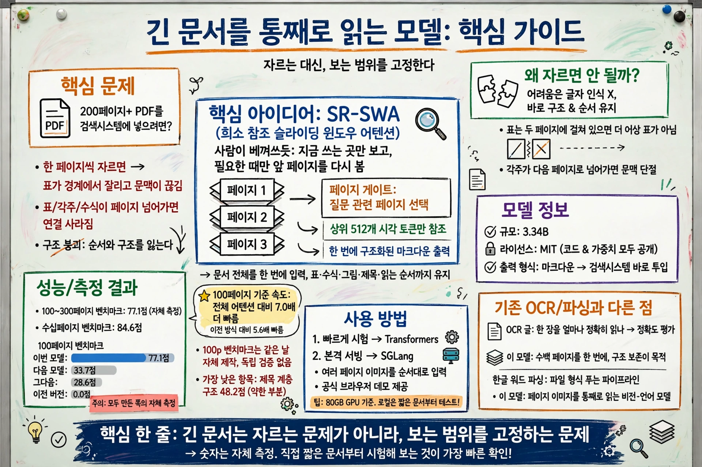
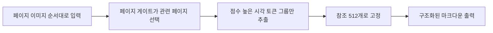
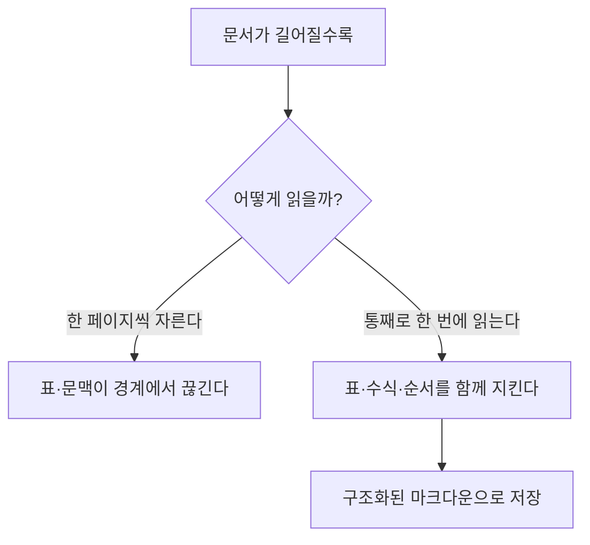

# Unlimited OCR 2: 수백 페이지 논문, 자르지 않고 한 번에 읽습니다

> **Summary**
> 수백 페이지 문서를 자르지 않고 한 번에 읽어 표·수식·읽는 순서 등 구조를 유지하는 OCR 모델이 공개됐습니다. SR-SWA로 관련 페이지와 시각 토큰만 선택해 처리 비용을 일정하게 유지하며, 코드와 가중치는 MIT 라이선스로 공개됐습니다. 성능 수치는 제작자 자체 측정으로 독립 검증이 필요하고, 제목 계층 인식은 약점으로 나타났습니다.

---

- 수백 페이지짜리 논문·보고서를 페이지별로 자르지 않고, 한 번의 요청으로 끝까지 읽는 모델이 나왔습니다.
- 비결은 보는 범위를 고정하는 것입니다. 지금 베끼는 곳만 보고, 앞 페이지는 필요할 때만 다시 봅니다.
- 3.34B 규모에 MIT 라이선스로 코드와 가중치가 모두 공개됐습니다. 다만 77.1점이라는 숫자는 만든 쪽의 자체 측정입니다.

논문 한 편을 검색 시스템에 넣으려고 PDF를 열었는데, 200페이지가 넘으면 어떻게 하시나요? 한 페이지씩 잘라 넣으면 표가 페이지 경계에서 잘리고, 앞뒤 문맥이 끊깁니다. 그런데도 대부분 도구는 그렇게 해왔습니다. 자르는 게 당연했으니까요!

🎥 [동영상 보기](https://www.youtube.com/watch?v=azd2H0Riid4)

## 왜 긴 문서는 자르면 안 될까요?

긴 문서를 읽는 일의 어려움은 글자 인식이 아닙니다. 순서와 구조를 지키는 일입니다. 표가 두 페이지에 걸쳐 있으면 잘린 표는 표가 아니고, 각주가 다음 페이지로 넘어가면 문맥이 끊깁니다. 페이지마다 따로 읽으면 이런 연결이 사라집니다.

그래서 이 모델은 문서를 통째로 봅니다. 페이지 이미지들을 순서대로 한 번에 넣으면, 표·수식·그림·제목·읽는 순서까지 담은 구조화된 텍스트가 나옵니다. 출력은 마크다운 형태라 검색 시스템에 바로 넣을 수 있습니다.

> 페이지를 자르는 순간, 문서의 구조는 이미 깨집니다.

## 보는 범위를 고정하면 뭐가 달라질까요?

핵심은 희소 참조 슬라이딩 윈도우 어텐션, 줄여서 SR-SWA입니다. 사람이 책을 베껴 쓸 때를 떠올려 보시면 됩니다. 베끼는 사람은 앞 페이지를 처음부터 다시 읽지 않습니다. 지금 쓰는 곳만 보고, 필요할 때만 앞을 다시 봅니다. 이 모델도 같은 방식을 씁니다!

동작 방식은 이렇습니다. 페이지 게이트가 먼저 질문에 맞는 페이지를 고르고, 그 안에서 점수가 높은 시각 토큰 그룹만 골라옵니다. 참조하는 토큰 수는 512개 수준으로 고정됩니다. 그래서 문서가 길어져도 한 단계씩 해독하는 비용은 거의 그대로입니다. 100페이지 규모에서 전체 어텐션보다 단계당 7.0배, 이전 방식보다 5.6배 빠르다는 게 만든 쪽의 측정입니다.

## 숫자는 어디까지 믿을 수 있을까요?

만든 쪽이 공개한 점수는 이렇습니다. 수십 페이지 문서 벤치마크에서 84.6점, 100~300페이지 문서 벤치마크에서 77.1점을 기록했습니다. 100페이지 벤치마크에서 다음 모델은 33.7점, 그다음은 28.6점이었습니다. 이전 버전은 같은 벤치마크에서 0.0점이었습니다. 일곱 권 합쳐 3,600페이지가 넘는 책 한 질을 한 번의 요청으로 읽는 시연도 공개됐습니다.

그런데 이 숫자는 어디까지 믿어야 할까요? 점수는 전부 만든 쪽의 자체 측정입니다. 게다가 100페이지 벤치마크는 모델과 같은 날 만든 쪽이 새로 내놓은 것이라, 아직 독립적인 검증이 없습니다. 세부 점수 중 제목 계층 구조는 48.2점으로 가장 낮았습니다. 순위가 아니라, 약한 부분부터 보는 게 순서입니다!

## 내 컴퓨터에서 돌리려면 어떻게 해야 할까요?

써보는 방법은 두 가지입니다. 빠르게 시험해 보려면 `Transformers`로, 본격적으로 서빙하려면 `SGLang`으로 돌립니다. 여러 페이지를 한 번에 넣는 호출이 따로 있고, 페이지 순서대로 이미지를 넘기면 됩니다. 브라우저에서 바로 시험해 볼 수 있는 공식 데모도 있습니다. 공식 문서에 나온 테스트 환경은 80GB 데이터센터 GPU라, 내 그래픽카드에서 얼마나 돌아갈지는 짧은 문서부터 시험해 보는 게 안전합니다!

## 이 글과 비슷한 OCR 글과는 뭐가 다를까요?

한국 은행 양식 60장을 읽어 오류율을 재는 OCR 모델 글과는 결이 다릅니다. 그 글은 한 장을 얼마나 정확히 읽느냐가 주제였습니다. 이 글은 수백 페이지를 한 번에, 구조까지 지켜서 읽느냐가 주제입니다. 한글 워드 파일을 파싱하는 도구 글과도 다릅니다. 그쪽은 파일 형식을 푸는 파이프라인이고, 이쪽은 페이지 이미지를 통째로 읽는 비전 언어 모델입니다.

긴 문서를 통째로 읽는 일, 이제는 자르는 게 아니라 보는 범위를 고정하는 문제입니다. 숫자는 만든 쪽의 측정이라는 단서를 달고, 직접 짧은 문서부터 시험해 보는 게 가장 빠른 확인입니다.

