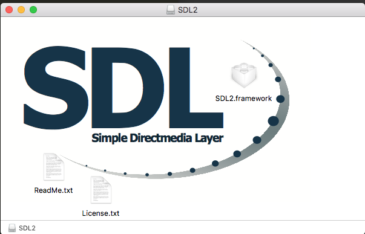

# VScode C++ SDL2 세팅

> **Summary**
> Mac에서 OpenGL 프로그래밍을 시작하기 위한 SDL2와 VSCode 설정 방법에 대한 가이드가 포함되어 있으며, 관련된 유튜브 영상과 블로그 링크가 제공됩니다.

---

🔗 [https://www.youtube.com/watch?v=Dyz9O7s7B8w](https://www.youtube.com/watch?v=Dyz9O7s7B8w)

🔗 [https://velog.io/@arais/VSCode-에서-SDL2-와-C로-게임개발환경-구축하기](https://velog.io/@arais/VSCode-에서-SDL2-와-C로-게임개발환경-구축하기)

