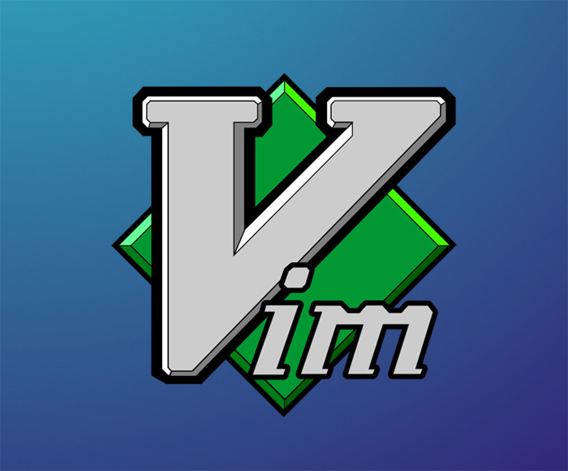

# Vim 설정을 플랫폼간 동기화 해봅시다

> **Summary**
> git을 이용해 플랫폼 간에 Vim 설정 파일을 동기화하는 방법에 대해 설명합니다.

---

🔗 [https://dev.to/kaiwalter/share-neovim-configuration-between-linux-and-windows-4gh8](https://dev.to/kaiwalter/share-neovim-configuration-between-linux-and-windows-4gh8)

즉, git을 이용해 플랫폼마다 confg 파일을 옮겨주는 방식입니다

