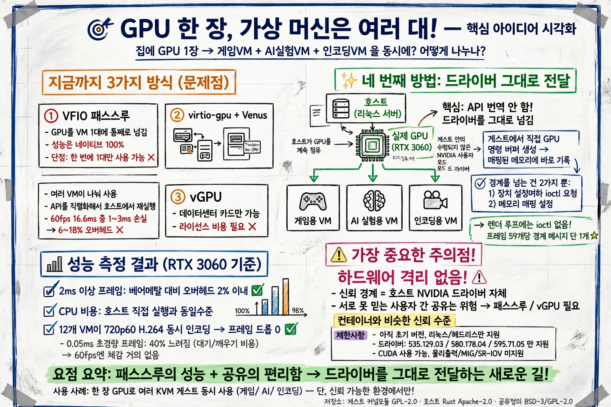
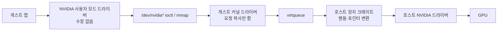
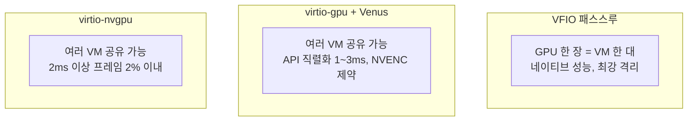

# Virtio-nvgpu: GPU 한 장을 가상 머신 12개가 나눠 씁니다. 베어메탈과 2% 차이입니다

> **Summary**
> virtio-nvgpu는 GPU 드라이버를 번역하지 않고 가상 머신에 직접 전달해 여러 게스트가 GPU 한 장을 공유하도록 하는 실험적 방식입니다. RTX 3060 테스트에서 12개 VM이 동시에 720p60 인코딩을 수행했고, 2ms 이상 걸리는 프레임의 성능은 베어메탈 대비 2% 이내였습니다. 다만 하드웨어 격리가 없어 서로 신뢰할 수 없는 사용자의 공유에는 적합하지 않으며, 지원 환경과 하드웨어도 제한적입니다.

---

- GPU 한 장을 가상 머신 하나에 통째로 넘기지 않고, 여러 대가 나눠 씁니다.
- 그래픽 API를 번역하는 대신 드라이버 요청을 그대로 전달해, 2ms 넘는 프레임은 베어메탈과 2% 이내입니다.
- 다만 하드웨어 격리는 없습니다. 서로 못 믿는 사용자끼리 나눠 쓰려면 패스스루나 vGPU가 필요합니다.

집에 GPU 한 장 꽂힌 리눅스 서버가 있습니다. 게임용 가상 머신 하나, AI 실험용 하나, 인코딩용 하나를 띄우고 싶은데 GPU는 한 장뿐입니다. 어떻게 나누시겠습니까?

🎥 [동영상 보기](https://www.youtube.com/watch?v=KMNS_JoHFhg)

## GPU 한 장, 가상 머신은 여러 대인데요?

지금까지 선택지는 세 가지였습니다. 첫째, VFIO 패스스루입니다. GPU 전체를 가상 머신 하나에 통째로 넘기는 방식이라 성능은 네이티브 그대로지만, 한 번에 한 대만 쓸 수 있습니다. 둘째, `virtio-gpu`와 Venus입니다. 여러 대가 나눠 쓸 수 있지만 그래픽 API 호출을 하나씩 직렬화해 호스트에서 다시 실행합니다. 60fps 프레임 예산 16.6ms 중 직렬화에만 1~3ms가 들면, GPU 작업 전에 6~18%가 사라집니다. 셋째, vGPU입니다. 데이터센터 카드에서만 되고 라이선스 비용도 듭니다.

그래서 나온 네 번째 길이 이 프로젝트입니다. 호스트가 GPU를 계속 쥐고 있으면서, 여러 KVM 게스트가 함께 쓰는 실험적인 프로젝트입니다. 목표는 모니터 없는 헤드리스 스트리밍입니다. 게스트 안에서 게임·애플리케이션, Wayland 컴포지터, 하드웨어 인코더를 돌리고, 밖으로는 프레임당 약 100KB짜리 압축 영상만 내보냅니다.

## API를 번역하지 않고 드라이버를 그대로 넘깁니다

핵심 아이디어는 단순합니다. 그래픽 API를 번역하지 않습니다. 드라이버를 그대로 넘깁니다! 게스트 안에서는 수정되지 않은 진짜 NVIDIA 사용자 모드 드라이버가 돕니다. 그 드라이버가 만드는 GPU 명령 버퍼는 게스트 안에서 직접 만들어져, 이미 매핑된 메모리에 그대로 씁니다. 렌더링 중인 프레임은 가상 머신 경계를 넘지 않습니다.

경계를 넘는 것은 두 가지뿐입니다. 장치 설정 때 오가는 `ioctl` 요청, 그리고 한 번 맺어두면 계속 쓰는 메모리 매핑입니다. 렌더 루프에는 전달할 `ioctl`이 없습니다. 그래서 CPU 비용도 들지 않습니다. 이 구조가 저는 가장 인상 깊었습니다. 프레임 59개당 경계를 넘는 메시지가 단 1개라니, 사실상 게스트가 GPU를 직접 만지는 셈입니다!

## 숫자는 어느 정도 나왔을까요?

측정 결과는 RTX 3060 기준입니다. 2ms 이상 걸리는 프레임은 베어메탈 대비 2% 이내였습니다. CPU 비용도 호스트에서 직접 돌릴 때와 같았습니다. 12개 가상 머신이 720p60 H.264 인코딩을 동시에 돌려도 빠진 프레임이 없었습니다!

다만 가벼운 프레임은 이야기가 다릅니다. 0.05ms짜리 프레임은 40% 느려졌습니다. GPU를 기다리며 잠들었다 깨우는 비용이 프레임 자체보다 크기 때문입니다. 그래도 60fps 프레임 예산이 16.6ms인 것을 생각하면, 실제 게임 프레임에서는 거의 느껴지지 않는 차이입니다.

## 그런데 격리는 없습니다!

여기서 꼭 짚고 넘어가야 할 점이 있습니다. 이 프로젝트는 하드웨어 격리를 제공하지 않습니다. 신뢰 경계는 호스트 NVIDIA 드라이버 그 자체입니다. 서로 못 믿는 사용자의 가상 머신을 한 GPU에 올리려면, VFIO 패스스루나 vGPU를 써야 합니다. 컨테이너와 비슷한 신뢰 경계라고 보시면 됩니다.

아직 초기 버전이라는 점도 알아두셔야 합니다. 테스트한 카드는 두 장뿐이고, CUDA는 동작하지만 벤치마크는 없습니다. 리눅스 게스트와 호스트만 지원하고, 드라이버는 535.129.03 이상이 필요합니다. 물리 화면 출력, MIG, SR-IOV는 범위 밖입니다. 드라이버 ABI는 버전마다 구조가 바뀌기 때문에, 535.129.03·580.178.04·595.71.05 세 프로필로 구간을 나눠 관리하고, 그보다 오래된 버전은 거부합니다.

저장소 구조도 깔끔합니다. 게스트 커널 모듈은 GPL-2.0, 호스트 장치 크레이트는 Apache-2.0 러스트 코드, 양쪽이 공유하는 정의는 BSD-3-Clause와 GPL-2.0 이중 라이선스입니다. 참고한 출발점은 샌드박스 컨테이너의 NVIDIA `ioctl`을 호스트 드라이버로 전달하던 기존 프록시 구현입니다.

GPU 한 장을 여러 가상 머신이 나눠 쓰는 길이, 이제 하나 더 열렸습니다. 패스스루의 독점도 아니고, API 번역의 느림도 아닌, 드라이버를 그대로 넘기는 길이 말입니다!

