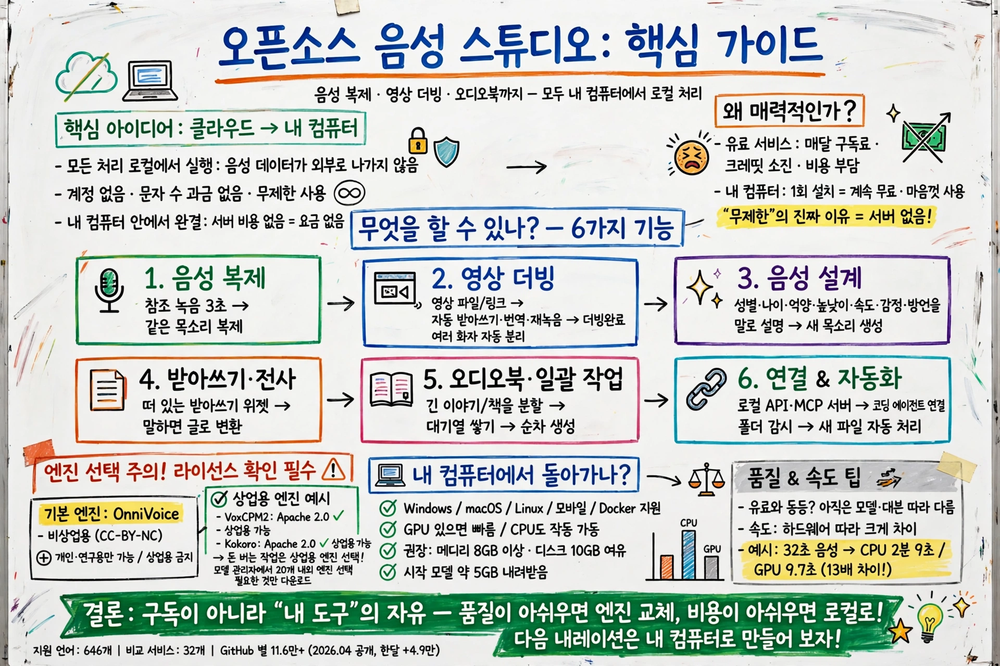
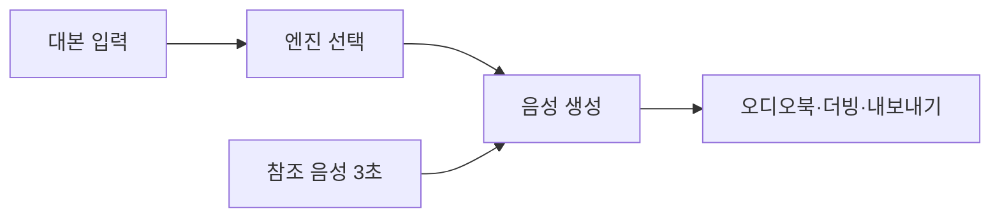
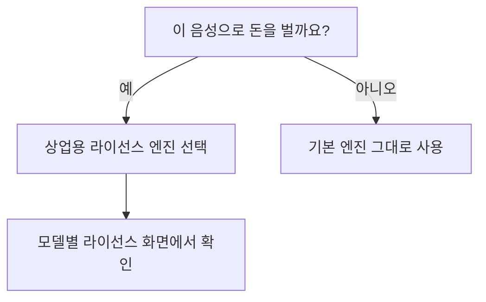

# VoiceStudio: 월 22달러 음성 요금제, 내 컴퓨터에서 0원으로 끝냅니다

> **Summary**
> VoiceStudio는 음성 복제, 영상 더빙, 받아쓰기, 오디오북 제작 등을 내 컴퓨터에서 처리하는 오픈소스 음성 스튜디오로, 계정이나 문자 수 과금 없이 음성 데이터를 로컬에 보관할 수 있습니다. 다양한 음성·전사 엔진과 자동화 기능을 지원하며 CPU에서도 실행되지만, 속도와 품질은 엔진과 하드웨어에 따라 달라집니다. 기본 엔진은 비상업용이므로 유료 작업에는 상업용 라이선스 엔진을 선택해야 합니다.

---

- 음성 복제부터 영상 더빙, 오디오북까지 유료 음성 서비스의 일을 내 컴퓨터에서 처리하는 오픈소스 음성 스튜디오입니다.
- 모든 처리가 로컬에서 이뤄져 음성 데이터가 외부로 나가지 않고, 문자 수 과금도 계정도 없습니다.
- 기본 음성 모델은 비상업용이라, 돈 버는 일에 쓸 때는 상업용 라이선스의 엔진을 골라야 합니다.

영상 내레이션 하나 만들려고 유료 요금제에 가입해 본 적 있으시죠? 매달 빠져나가는 요금, 글자 수를 세어가며 아끼는 크레딧, 짧은 대본 하나에도 결제 화면이 먼저 뜨는 경험 말입니다. 목소리 하나 만드는 데 구독이 필요한 구조, 이상하지 않으셨나요?

🎥 [동영상 보기](https://www.youtube.com/watch?v=1qoVC1dS42I)

## 클라우드 대신 내 컴퓨터, 무엇이 달라질까요?

핵심은 처리 위치입니다. 음성 생성·복제·더빙이 전부 내 컴퓨터 안에서 돌아갑니다. 음성 데이터가 서버로 올라가지 않으니, 녹음 파일이 외부에 남을 걱정이 없습니다. 계정도 필요 없고, 문자 수 기반 과금도 없습니다. "무제한"이라는 말의 실체는 바로 이 구조입니다. 서버 비용이 없으니 쓸 때마다 요금이 쌓이지 않습니다!

지원 언어는 646개입니다. 비교 대상 유료 서비스의 32개 언어와 대비되는 숫자라고 소개 글은 설명합니다. 한국어 안내 문서도 마련돼 있어, 설치와 사용법을 한국어로 확인할 수 있습니다. 2026년 4월에 공개된 뒤 별이 11만 6천 개를 넘겼습니다. 한 달 새 4만 9천 개가 늘었다는 기록도 있습니다. 숫자가 전부는 아니지만, 관심을 끄는 속도만큼은 분명합니다.

## 무엇을 할 수 있을까요?

할 일은 여섯 가지로 갈립니다. 먼저 **음성 복제**입니다. 깨끗한 참조 녹음 3초면 그 목소리를 닮은 음성을 만듭니다. 다음은 **영상 더빙**입니다. 영상 파일이나 영상 주소를 넣으면 받아쓰기·번역·재녹음을 거쳐 더빙된 영상이 나옵니다. 여러 화자가 나오는 영상도 화자별로 나눠 처리합니다.

**음성 설계**도 있습니다. 성별·나이·억양·높낮이·속도·감정·방언을 말로 설명하면 그에 맞는 목소리를 새로 만듭니다. **받아쓰기와 전사**는 떠 있는 받아쓰기 위젯으로 말하면 글로 바꿔줍니다. **오디오북·일괄 작업**은 긴 이야기나 책을 나눠서 처리하고, 대기열에 쌓아 순서대로 만듭니다. 마지막으로 **연결과 자동화**입니다. 로컬 API와 MCP 서버가 있어 코딩 에이전트에서 음성 작업을 부를 수 있고, 폴더를 지켜보다가 새 파일이 들어오면 자동으로 처리하는 방식도 지원합니다.

## 엔진이 스무 개 가까이 있는데, 무엇을 골라야 할까요?

기본 엔진은 `OmniVoice`입니다. 설치 직후에는 이 엔진으로 시작하면 됩니다. 그 밖에도 `CosyVoice 3`, `IndexTTS 2.5`, `KittenTTS`, `VoxCPM2` 등 스무 가지 안팎의 음성 생성 엔진을 모델 관리자에서 골라 쓸 수 있습니다. 받아쓰기 쪽도 `WhisperX`를 기본으로, `Faster-Whisper`, `Parakeet`, `Moonshine` 같은 엔진을 함께 제공합니다. 필요한 모델만 내려받으면 되니, 디스크를 통째로 채울 필요가 없습니다.

그런데 여기서 꼭 짚어야 할 지점이 있습니다. 엔진마다 라이선스가 다릅니다! 기본 엔진의 가중치는 비상업용(CC-BY-NC)이라, 개인 작업과 연구에는 쓸 수 있지만 유료 작업에는 쓸 수 없습니다. 돈 버는 일에 쓸 음성이라면, 상업용으로 표시된 엔진을 골라야 합니다. `VoxCPM2`와 `Kokoro`는 아파치 2.0 라이선스로 상업용으로 쓸 수 있다고 안내돼 있습니다. 모델마다 라이선스가 화면에 표시되니, 만들기 전에 확인하는 습관이 필요합니다.

## 내 컴퓨터에서 돌아갈까요?

윈도우·macOS·리눅스 데스크톱 앱과 휴대폰 앱, `Docker` 이미지까지 마련돼 있습니다. GPU가 있으면 더 빠르지만, 고성능 장비가 필수는 아닙니다. CPU만으로도 돌아갑니다. 권장 사양은 메모리 8GB 이상, 디스크 여유 공간 10GB 안팎입니다. 시작용 모델 묶음이 5GB 안팎이라, 처음 내려받는 양이 적지는 않습니다.

설치는 릴리스 페이지에서 내 운영체제에 맞는 설치 파일을 받아 실행하면 됩니다. 소스에서 직접 빌드하는 방법도 있고, 코딩 에이전트에 설치를 맡기는 안내도 마련돼 있습니다. 한 가지, 설치 스크립트를 그대로 실행하기 전에는 내용을 먼저 확인하는 것이 좋습니다. 어떤 스크립트든 실행 전 확인은 기본입니다!

## 품질은 유료 서비스와 같을까요?

여기가 가장 있는 그대로 짚어야 할 부분입니다. 아직은 완전히 동등하지 않습니다. 공개된 블라인드 테스트에서는 유료 서비스가 자연스러움에서 4대 4로 앞선 경우도 있었습니다. 다른 테스트에서는 심사자가 유료 서비스를 6번 중 3번만 맞혀, 동전 던지기와 같은 결과가 나오기도 했습니다. 모델과 대본에 따라 결과가 갈린다는 뜻입니다.

속도도 엔진과 하드웨어에 따라 크게 달라집니다. 기본 엔진은 한 줄 만드는 데 2초 안팎이 걸렸다는 기록이 있고, 어떤 엔진은 같은 분량을 만드는 데 1분이 넘게 걸리기도 했습니다. GPU를 쓰면 체감이 확 달라집니다. 한 테스트에서는 32초 분량 음성을 CPU에서는 2분 9초, 그래픽카드에서는 9.7초 만에 만들었습니다. 13배 차이입니다!

그래서 이 도구의 자리는 분명합니다. 돈을 내고 바로 쓰는 편리함이 아니라, 내 컴퓨터에서 내 규칙대로 음성을 만드는 자유입니다. 품질이 아쉬우면 엔진을 바꾸면 되고, 비용이 아쉬우면 로컬이 답이 됩니다. 목소리를 만드는 일이 구독이 아니라 내 도구가 되는 순간, 실험은 훨씬 가벼워집니다. 다음 내레이션, 구독료 말고 내 컴퓨터로 만들어 보시는 건 어떨까요?

