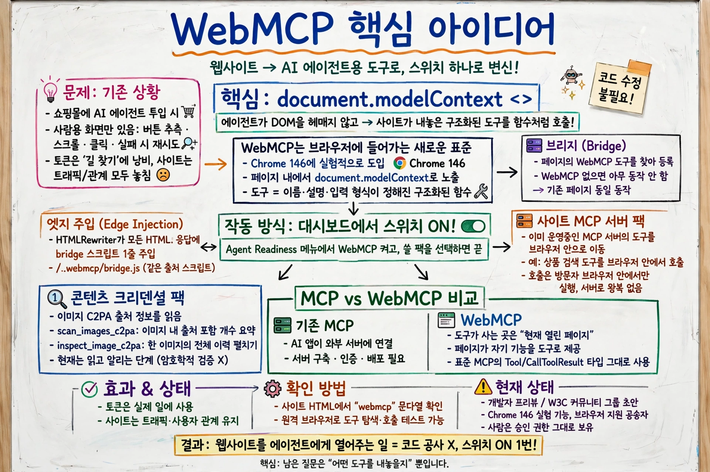
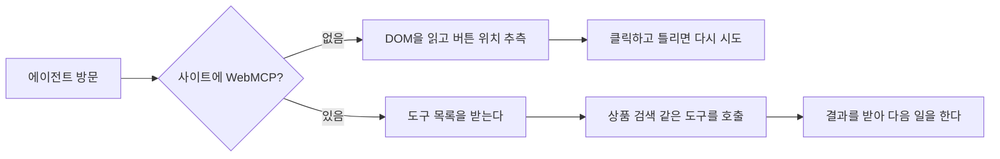
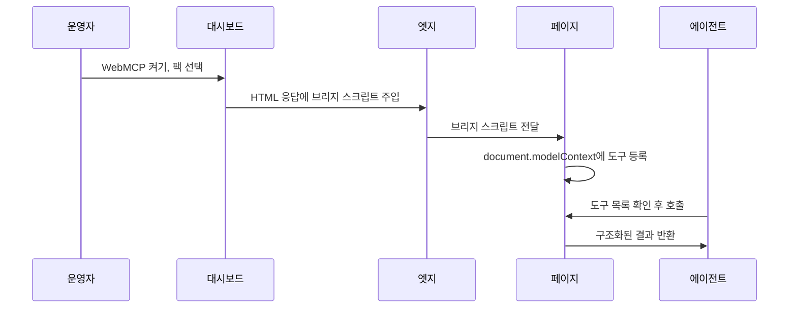

# WebMCP: 대시보드 스위치 하나로 웹사이트가 에이전트용 도구가 됩니다

> **Summary**
> WebMCP는 웹사이트가 대시보드 스위치 하나로 브라우저 AI 에이전트용 구조화된 도구를 제공하도록 하는 프리뷰 기능입니다. 코드를 수정하거나 별도 API 서버를 구축할 필요 없이 페이지의 기능을 에이전트가 직접 호출할 수 있으며, 콘텐츠 크리덴셜과 사이트 MCP 서버 연동 팩이 제공됩니다. 아직 개발자 프리뷰이자 표준 초안 단계로 브라우저 지원은 제한적입니다.

---

- 대시보드에서 스위치 하나만 켜면 기존 웹사이트가 브라우저 AI 에이전트용 도구가 됩니다. 코드 수정도, 새 API도 필요 없습니다.
- 핵심은 `document.modelContext`입니다. 에이전트가 DOM을 헤매며 클릭하는 대신, 사이트가 내놓은 구조화된 도구를 함수처럼 호출합니다.
- 이미지 출처를 읽는 콘텐츠 크리덴셜 팩과, 사이트 자체 MCP 서버를 연결하는 사이트 MCP 서버 팩이 먼저 들어갔습니다.

쇼핑몰에 AI 에이전트가 들어왔다고 상상해 보세요. 상품을 찾고, 장바구니에 담고, 결제까지 해야 합니다. 그런데 에이전트 앞에는 사람용 화면만 있습니다. 버튼 위치를 추측하고, 스크롤하고, 클릭하고, 틀리면 다시 시도합니다. 토큰은 길 찾기에 쓰이고, 사이트는 트래픽도 관계도 가져가지 못합니다. 이 장면이 익숙하시죠?

🎥 [동영상 보기](https://www.youtube.com/watch?v=mmUDU25isiA)

## WebMCP, 도대체 뭘까요?

WebMCP는 브라우저에 들어가는 새로운 표준입니다. Chrome 146에 실험적으로 들어갔고, 페이지 안에서는 `document.modelContext`라는 이름으로 나타납니다. 사이트가 에이전트용 도구를 등록해 두면, 브라우저에서 움직이는 에이전트가 그 도구 목록을 받아서 호출합니다. 이름·설명·입력 형식이 정해진 구조화된 함수입니다. 에이전트는 더 이상 사람용 페이지를 더듬지 않습니다. 토큰은 길 찾기가 아니라 일에 쓰입니다!

## MCP와 뭐가 다를까요?

MCP는 AI 앱이 바깥 서버에 연결되는 방식입니다. 서버를 따로 세우고, 인증을 붙이고, 배포해야 합니다. WebMCP는 그 아이디어를 브라우저 탭 안으로 가져왔습니다. 도구가 사는 곳이 서버가 아니라 지금 열려 있는 페이지입니다. 페이지가 자기 기능을 도구로 내놓고, 에이전트는 그 자리에서 바로 부릅니다. 표준 MCP의 `Tool`과 `CallToolResult` 타입을 그대로 쓰기 때문에, MCP를 말하는 에이전트라면 페이지도 특별히 배울 것 없이 다룰 수 있습니다. 서버 MCP가 앱 바깥의 도구라면, WebMCP는 페이지 안의 도구입니다!

## 웹사이트에는 어떻게 붙을까요?

대시보드에서 켜는 것이 전부입니다! Agent Readiness 메뉴에서 WebMCP를 켜고, 쓸 팩을 고르면 끝입니다. 원본 코드는 건드리지 않습니다. 엣지에서 일어나는 일은 두 가지입니다.

첫째, 엣지 주입입니다. 엣지에서 HTMLRewriter가 모든 HTML 응답에 브리지 스크립트 한 줄을 붙입니다. `/.webmcp/bridge.js`라는 같은 출처 스크립트입니다. 둘째, 브리지입니다. 페이지에서 WebMCP 화면을 찾아 도구를 등록합니다. 브라우저에 WebMCP가 없으면 브리지는 아무것도 하지 않고 돌아갑니다. 그래서 페이지는 이전과 똑같이 동작합니다! 정적 사이트든 단일 페이지 앱이든 방식은 같습니다.

## 먼저 들어간 도구 팩 두 가지

첫 번째는 콘텐츠 크리덴셜 팩입니다. 페이지 이미지의 C2PA 출처 정보를 읽습니다. `scan_images_c2pa`는 이미지들을 훑어 출처 정보가 있는 이미지가 몇 개인지 요약하고, `inspect_image_c2pa`는 한 이미지의 전체 이력을 펼쳐 보여줍니다. 지금은 읽고 알리는 단계라서, 서명을 암호학적으로 검증하지는 않습니다. 결과에는 `signatureVerified: false`가 붙습니다.

두 번째는 사이트 MCP 서버 팩입니다. 이미 MCP 서버를 운영하는 사이트라면, 그 서버가 내놓는 도구를 브라우저 안에 그대로 옮겨 옵니다. 예를 들어 상품 검색 도구가 있다면, 에이전트는 브라우저 안에서 그 도구를 부르고, 호출은 방문자의 출처와 세션으로 사이트 MCP 서버에 닿습니다. 이 프리뷰의 모든 도구는 방문자 브라우저 안에서만 돕니다. 서버로 왕복하지 않습니다.

## 켰는지 확인하는 방법은?

설정이 끝났는지 확인하는 방법은 간단합니다. 사이트 HTML을 받아 `webmcp`라는 글자가 있는지 보는 것입니다. 직접 에이전트를 굴릴 필요도 없습니다. 원격 브라우저가 URL을 향해 도구를 찾아내고 불러보는 것으로 전체 흐름을 확인할 수 있습니다. 브라우저는 사람의 노트북에 있든 클라우드에 있든 도구는 똑같이 동작합니다.

## 아직은 프리뷰입니다

기대만큼 조심할 점도 있습니다. WebMCP는 아직 개발자 프리뷰이고, 표준 자체도 W3C 커뮤니티 그룹의 초안 단계입니다. Chrome 146에서 실험적으로 들어갔고, 브라우저 지원도 넓지 않습니다. 도구를 직접 손으로 다는 일은 작은 프로젝트였는데, 이번 프리뷰는 그 일을 스위치 하나로 줄였다는 데 의미가 있습니다. 사람은 승인 권한을 그대로 쥐고, 사이트 운영자는 트래픽과 사용자 관계를 그대로 가져갑니다. 검색엔진을 위한 최적화를 넘어, AI가 읽고 고르고 직접 행동하는 웹을 위한 최적화가 인프라 단계로 들어오고 있습니다!

웹사이트를 에이전트에게 열어주는 일은 이제 코드 공사가 아니라 스위치 하나가 됐습니다. 남은 질문은 어떤 도구를 내놓을지, 그뿐입니다.

