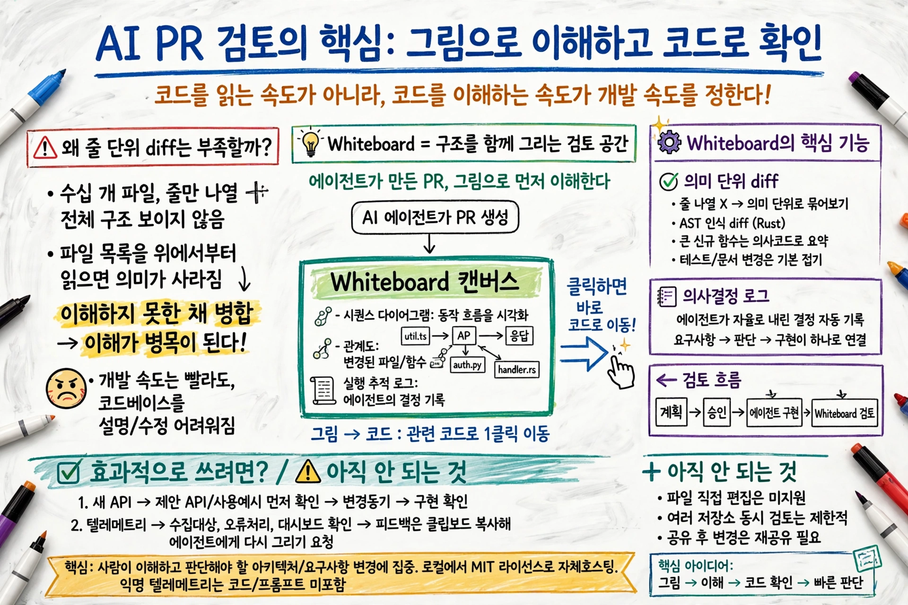
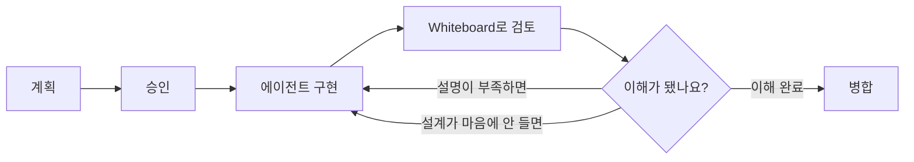
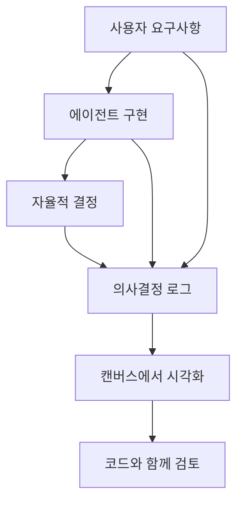

# Whiteboard: AI가 짠 코드, 줄줄 읽지 말고 그림으로 검토합니다

> **Summary**
> AI가 짠 PR을 줄 단위로 다 읽지 않아도 됩니다. Whiteboard는 에이전트가 만든 코드의 구조와 변경 이유를 캔버스 그림으로 보여줍니다. 그림을 클릭하면 바로 코드로 이동합니다. 시퀀스 다이어그램, 관계도, 에이전트 실행 기록이 코드와 이어져 있습니다. 줄 나열이 아니라 의미 단위로 diff를 보여주고, 에이전트가 스스로 내린 결정까지 로그로 남깁니다. 로컬에서 MIT 라이선스로 돌아갑니다.

---

- AI가 짠 PR을 줄 단위로 다 읽지 않아도 됩니다. Whiteboard는 에이전트가 만든 코드의 구조와 변경 이유를 캔버스 그림으로 보여줍니다.
- 그림을 클릭하면 바로 코드로 이동합니다. 시퀀스 다이어그램, 관계도, 에이전트 실행 기록이 코드와 이어져 있습니다.
- 줄 나열이 아니라 의미 단위로 diff를 보여주고, 에이전트가 스스로 내린 결정까지 로그로 남깁니다. 로컬에서 MIT 라이선스로 돌아갑니다.

에이전트에게 기능 하나를 맡겼습니다. 몇 분 뒤 PR이 올라왔고, 변경된 파일이 수십 개였습니다. 어디부터 봐야 할까요? 파일 목록을 위에서부터 읽어 내려가면, 구조는 안 보이고 줄만 보입니다.

🎥 [동영상 보기](https://www.youtube.com/watch?v=ChPn3ftULWE)

## 왜 줄 단위 diff로는 부족할까요?

에이전트가 만든 PR을 충분히 이해하지 못한 채 계속 병합하면 어떻게 될까요? 개발 속도는 빨라지지만, 정작 자신의 코드베이스를 설명하거나 고치기 어려워집니다. 이해가 병목이 된 것입니다!

Whiteboard는 동료와 화이트보드 앞에서 구조를 논의하듯, 에이전트의 구현을 이해하고 설계 판단에 참여하는 작업 공간입니다. 코드가 아니라 그림에서 시작합니다. 그림이 먼저 이해되고, 코드가 그 뒤를 받칩니다.

## 그림에서 코드로, 어떻게 이어질까요?

에이전트에게 현재 브랜치를 최신 main과 비교해 달라고 요청하면, 에이전트는 변경 내용을 캔버스에 시각화합니다. 시퀀스 다이어그램, 개체 관계 다이어그램, 실행 추적 인용문이 그려집니다. 그리고 그림을 클릭하면 관련 코드로 바로 이동합니다!

순수 HTML 도구는 명세나 다이어그램을 코드에 연결하기 어려웠습니다. 구현을 한 차례 진행한 뒤에야 절충점을 발견하는 경우라면 더 까다로웠습니다. Whiteboard는 그림과 코드를 한 화면에 묶었습니다. 코드 탐색에는 익숙한 편집기 키 바인딩과 언어 서버 지원이 그대로 들어갑니다.

주된 흐름은 **계획 → 승인 → 에이전트 구현 → Whiteboard로 코드 이해와 검토**입니다. 계획부터 캔버스에서 작성하는 기능은 아직 실험 중입니다. 자동 코드 리뷰로 처리하기 어려운 아키텍처나 요구사항 수준의 변경처럼, 사람이 직접 이해하고 판단해야 하는 작업에 초점을 맞췄습니다.

## diff도 의미 단위로 보여줍니다!

줄 단위 diff는 시끄럽습니다. 관련 없는 변경까지 줄줄이 나열되니까요. Whiteboard는 Rust로 만든 AST 인식 diff 뷰어를 씁니다. 사용자에게 관련 있는 코드 변경만 보여줍니다!

큰 신규 함수는 의사 코드로 요약합니다. 단위 테스트와 문서 변경은 기본적으로 접거나 숨깁니다. 표시 방식은 WASM 기반 플러그인 시스템으로 맞춤 설정할 수 있습니다. 보여줄 것과 숨길 것을 고르는 기준이, 곧 리뷰의 속도입니다.

## 에이전트가 혼자 정한 결정은 누가 알까요?

에이전트는 구현하면서 스스로 결정을 내립니다. 어떤 결정을 자율적으로 내렸는지, 그 결정이 변경 사항에 어떤 영향을 미쳤는지 알기 어려웠다면, 의사결정 로그가 답입니다!

에이전트가 자신의 실행 추적을 조회해 Whiteboard에 연결하면, 사용자가 정한 요구사항이 어떻게 구현됐는지, 에이전트가 어떤 판단을 자율적으로 내렸는지 한눈에 확인됩니다. 요구사항과 구현, 판단이 그림 하나로 이어집니다.

## 효과적으로 쓰려면 어떻게 해야 할까요?

프로젝트 팀의 경험상 지능, 비용, 속도의 균형 면에서 잘 맞는 모델 조합이 있습니다. 적절한 선택을 시스템 프롬프트의 기본 동작에 반영하는 작업을 진행 중이며, 이를 오픈소스로 만든 이유 중 하나로 삼았습니다.

새 API 변경을 검토할 때는 제안하는 API와 사용 예시를 먼저 확인하고, 문맥이나 저장소에 근거가 있다면 변경 동기도 확인한 뒤, 구현 세부사항과 동작 방식을 살펴보는 순서가 좋습니다. 텔레메트리 변경을 검토할 때는 수집 대상, 대시보드와 제품 워터폴 구성 방식, 응답 멈춤과 오류 및 충돌 처리 방식을 설명하도록 요청하면 됩니다. 마음에 들지 않는 부분을 선택해 클립보드로 복사한 뒤 에이전트에게 전달하면, 캔버스를 다시 그려 요구에 맞춥니다!

## 아직 안 되는 것은 무엇일까요?

파일 직접 편집은 아직 지원하지 않습니다. 하나의 검토에서 여러 저장소의 파일을 함께 다루는 기능도 충분히 지원되지 않습니다. 공유 버튼으로 검토 결과를 다른 컴퓨터와 나눌 수 있지만, 공유 이후 변경 사항은 상대방에게 반영되지 않으니 다시 공유해야 합니다.

그래도 방향은 분명합니다. 로컬 체크아웃을 대상으로 실행하고, 팀용 호스팅 제품을 계획하면서도 모든 기능은 앞으로도 자체 호스팅이 가능한 상태로 유지할 예정입니다. 익명 텔레메트리에는 코드, diff, Whiteboard 텍스트, 프롬프트, 모델 출력이 포함되지 않으며 언제든 수집을 끌 수 있습니다.

코드를 읽는 속도가 아니라, 코드를 이해하는 속도가 개발 속도를 정합니다. 그림으로 이해하고 코드로 확인하는 검토가, 에이전트 시대의 기본기가 됩니다!

