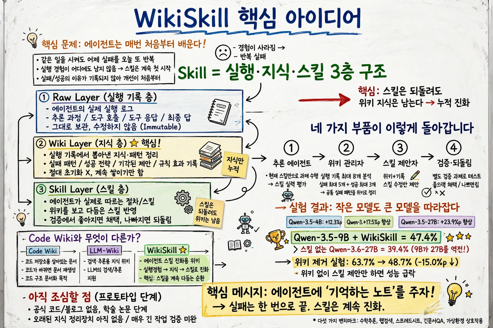
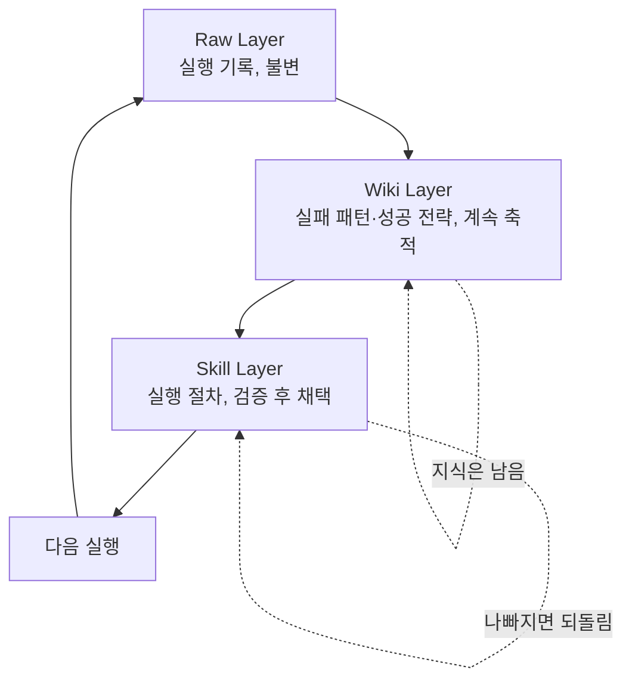
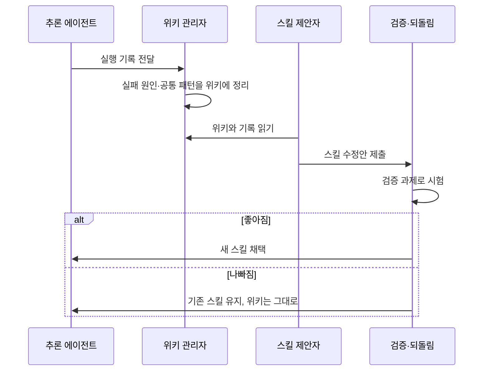

# WikiSkill: 에이전트가 실패를 기억하면, 작은 모델도 큰 모델을 이깁니다

> **Summary**
> WikiSkill은 에이전트의 실행 기록에서 성공·실패 경험을 위키에 축적하고, 이를 바탕으로 스킬을 수정한 뒤 검증을 거쳐 개선된 스킬만 채택하는 방법입니다. 실험에서 위키를 활용한 스킬은 성능을 높이고 작은 모델이 더 큰 모델을 앞서는 결과를 보였으며, 위키를 제거하면 성능이 크게 떨어졌습니다. 다만 오래된 지식을 정리하거나 매우 긴 작업을 처리하는 기능은 아직 검증되지 않았습니다.

---

- WikiSkill은 에이전트의 성공·실패 경험을 위키에 쌓아두고, 그 위키에서 스킬을 계속 다듬는 방법입니다.
- 실행 기록·지식·스킬을 세 층으로 나누고, 검증에서 좋아진 스킬만 남기니 작은 모델도 큰 모델을 따라잡았습니다.
- 코드 저장소용 살아있는 문서인 Code Wiki와는 다른 연구입니다. 스킬 진화용 위키라는 점이 핵심입니다.

에이전트한테 같은 일을 시켰는데, 어제 했던 실수를 오늘 또 하는 걸 본 적 있으시죠? 분명히 고쳤다고 생각했는데, 다음 세션에서는 아무 일도 없었던 것처럼 다시 틀립니다. 에이전트는 일을 할 때마다 경험을 쌓지만, 그 경험이 어디에도 남지 않기 때문입니다!

🎥 [동영상 보기](https://www.youtube.com/watch?v=oVthf0fUcFY)

## 스킬은 왜 매번 처음부터 배울까요?

지금까지 스킬을 자동으로 만드는 방법들은 비슷한 약점을 갖고 있었습니다. 실행하면서 얻은 통찰을 스킬에 반영하고 나면, 그 통찰이 어디서 왔는지, 왜 그렇게 바꿨는지는 버려졌습니다. 다음 개선은 또 처음부터 시작했습니다. 실패 패턴이 반복돼도, 성공한 요령이 있어도, 기록이 없으니 다시 겪어야 했습니다.

이 논문이 던진 질문은 단순합니다. 에이전트의 경험을 계속 쌓이는 지식으로 만들면, 스킬은 얼마나 더 잘 진화할까요? 답으로 나온 것이 WikiSkill입니다. 실행 경험과 스킬 사이에 위키라는 지식 층을 하나 더 둔 것입니다.

## 세 층으로 나눈 이유가 뭘까요?

WikiSkill은 에이전트의 작업 공간을 세 층으로 나눕니다. 각 층은 역할도, 쓰는 규칙도 다릅니다.

**Raw Layer**는 실행 기록 그 자체입니다. 추론 과정, 도구 호출, 도구 응답, 최종 답까지 전부 그대로 둡니다. 한 번 쓰면 고치지 않습니다. 역사를 지우지 않겠다는 뜻입니다.

**Wiki Layer**는 그 기록에서 뽑아낸 지식입니다. 실패 패턴, 성공한 전략, 기각된 제안, 각 규칙이 얼마나 효과가 있었는지까지 구조화된 형태로 정리합니다. 이 층은 절대 초기화하지 않습니다. 계속 쌓이기만 합니다.

**Skill Layer**는 에이전트가 실제로 따라 하는 절차입니다. 위키를 보고 다듬은 스킬이 여기에 들어갑니다. 검증에서 좋아지면 남기고, 나빠지면 되돌립니다. 스킬은 되돌려도 위키의 지식은 남습니다. 이게 핵심입니다!

세 층을 나누면 뭐가 달라질까요? 스킬만 고치던 기존 방법은 매번 흩어진 기록을 뒤져야 했습니다. 위키가 있으면 다음 개선은 이미 정리된 지식 위에서 시작합니다. 지식이 쌓일수록 스킬은 더 단단해집니다.

## 네 가지 부품은 어떻게 돌까요?

한 번의 반복은 네 가지 부품이 돌아가며 만듭니다.

먼저 **추론 에이전트**가 현재 스킬을 들고 과제를 풉니다. 이때는 위키를 보지 않습니다. 스킬만으로 풀게 해서, 스킬 자체의 실력을 재는 것입니다.

다음으로 **위키 관리자**가 실행 기록을 읽고 위키를 고칩니다. 한 번에 최대 8개의 기록을 봅니다. 실패 최대 5개, 성공 최대 3개입니다. 실패한 단계의 원인을 찾고, 여러 기록에 공통된 패턴을 위키에 정리합니다.

이어서 **스킬 제안자**가 위키와 기록을 보고 스킬 수정안을 냅니다. 마지막으로 **검증·되돌림 장치**가 수정안을 따로 떼어둔 검증 과제로 시험합니다. 좋아지면 채택하고, 나빠지면 버립니다. 스킬 파일은 트리거 조건, 금지 상황, 실행 단계를 적는 표준 형식을 따릅니다.

이 고리가 계속 돌면서 위키는 두꺼워지고 스킬은 날카로워집니다. 실패를 버리지 않고 재료로 쓰는 구조입니다!

## 숫자는 뭐라고 말할까요?

실험은 다섯 가지 벤치마크에서 진행했습니다. 수학 추론, 웹 검색, 스프레드시트 조작, 긴 문서 질문 답변, 가상 환경에서의 상호작용 과제입니다. 모델도 다섯 가지, Qwen·Gemma·Gemini 계열을 썼습니다.

결과는 분명했습니다. Qwen 계열에서 WikiSkill의 평균 개선폭은 4B 모델이 12.3%포인트, 9B 모델이 17.5%포인트, 27B 모델이 23.9%포인트였습니다. 모델이 클수록 스킬의 도움을 더 크게 받았습니다.

반대로 스킬은 모델 크기의 격차도 메웠습니다. Qwen-3.5-9B에 WikiSkill을 붙이면 평균 정확도 47.4%로, 스킬 없는 Qwen-3.6-27B의 39.4%를 앞질렀습니다. 작은 모델에 좋은 스킬을 주면, 훨씬 큰 모델을 이길 수 있다는 뜻입니다!

스킬은 다른 모델에게 건네줘도 잘 들었습니다. ALFWorld 과제에서 Qwen-3.5-9B는 27B 모델이 만든 스킬을 썼을 때 70.2%를 기록했고, 자기 스킬로는 63.4%였습니다. 남이 만든 스킬이 내 스킬보다 나을 수도 있다는 결과입니다. 스킬을 만드는 능력과 스킬을 쓰는 능력은 다른 능력이라는 뜻입니다.

위키가 정말 핵심일까요? 위키를 빼는 대조 실험이 답했습니다. 스킬 제안자가 위키를 못 보게 하자 평균 성능이 63.7%에서 48.7%로 떨어졌습니다. 15.0%포인트가 사라졌습니다. 지식을 쌓아두는 층이 없으면, 스킬 진화도 힘을 잃습니다.

## Code Wiki랑 같은 위키일까요?

이름이 비슷해서 헷갈리기 쉽습니다. Code Wiki는 코드 저장소용 살아있는 문서입니다. 저장소 전체를 스캔해 구조화된 위키를 만들고, 코드가 바뀌면 문서도 다시 만듭니다. 저장소를 잘 아는 채팅도 붙어 있습니다. 2025년 11월에 공개 프리뷰로 나왔습니다.

WikiSkill은 다릅니다. 코드 문서가 아니라 에이전트 스킬을 진화시키는 연구입니다. 위키에 쌓는 것도 코드 설명이 아니라 실행 경험입니다. 같은 '위키'라는 단어를 쓰지만, 쌓는 대상도 목적도 다릅니다.

P252에서 다룬 LLM-Wiki와도 다릅니다. LLM-Wiki는 검색과 추론을 위한 위키입니다. 에이전트가 검색 결과를 위키로 엮어 찾아가며 답을 찾습니다. WikiSkill은 검색이 아니라 스킬 진화용 위키입니다. 세 연구 모두 '에이전트에게 위키를 주자'는 방향은 같지만, 위키가 하는 일은 각각 다릅니다.

## 아직 조심할 점은요?

이 연구는 학술 논문 단계의 프로토타입입니다. 공식 코드 저장소나 공식 블로그 글은 없습니다. 바로 가져다 쓸 도구가 아니라, 방향을 보여주는 연구라는 뜻입니다.

한계도 분명합니다. 위키는 계속 쌓이기만 하고, 오래된 지식을 정리하는 장치가 아직 없습니다. 수백 번의 행동이 이어지는 아주 긴 작업도 검증하지 않았습니다. 그래도 메시지는 또렷합니다. 에이전트에게 더 똑똑한 두뇌만 줄 게 아니라, 실패와 성공을 기억하는 노트도 함께 줘야 합니다!

에이전트가 기억을 쌓기 시작하면, 실수는 한 번으로 끝납니다. 그게 WikiSkill이 보여준 가장 큰 변화입니다.

