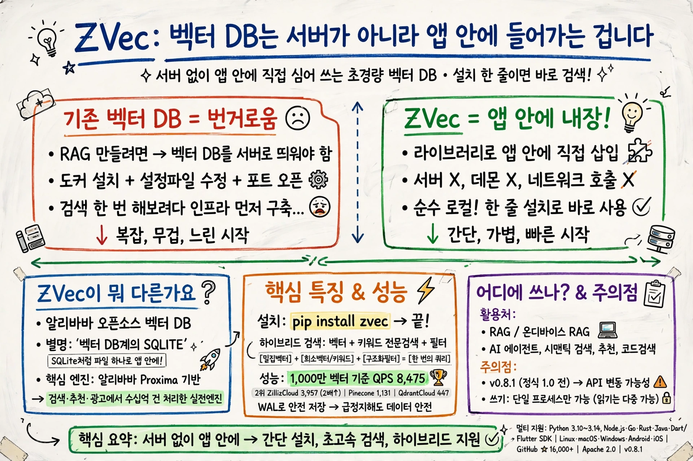
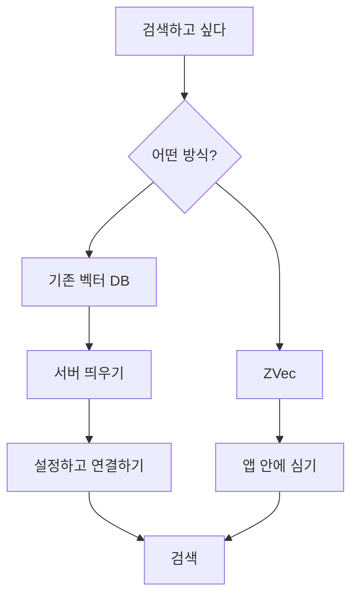
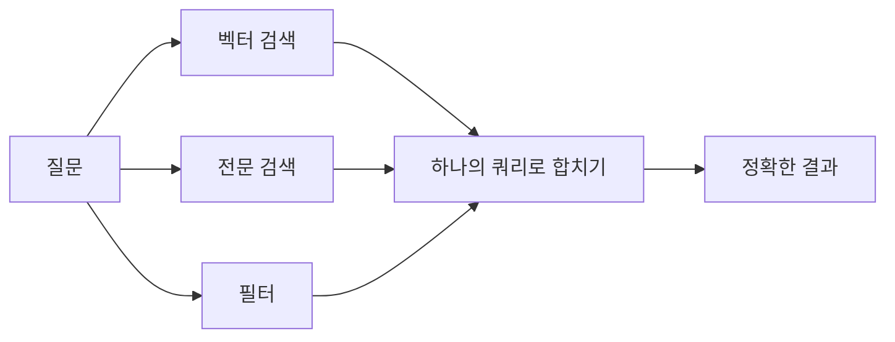
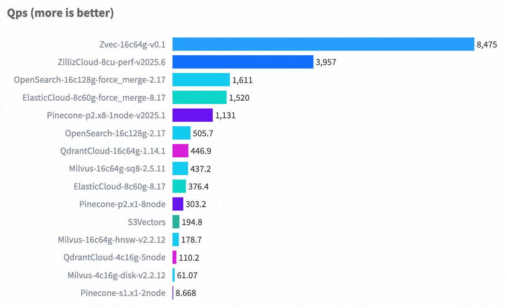
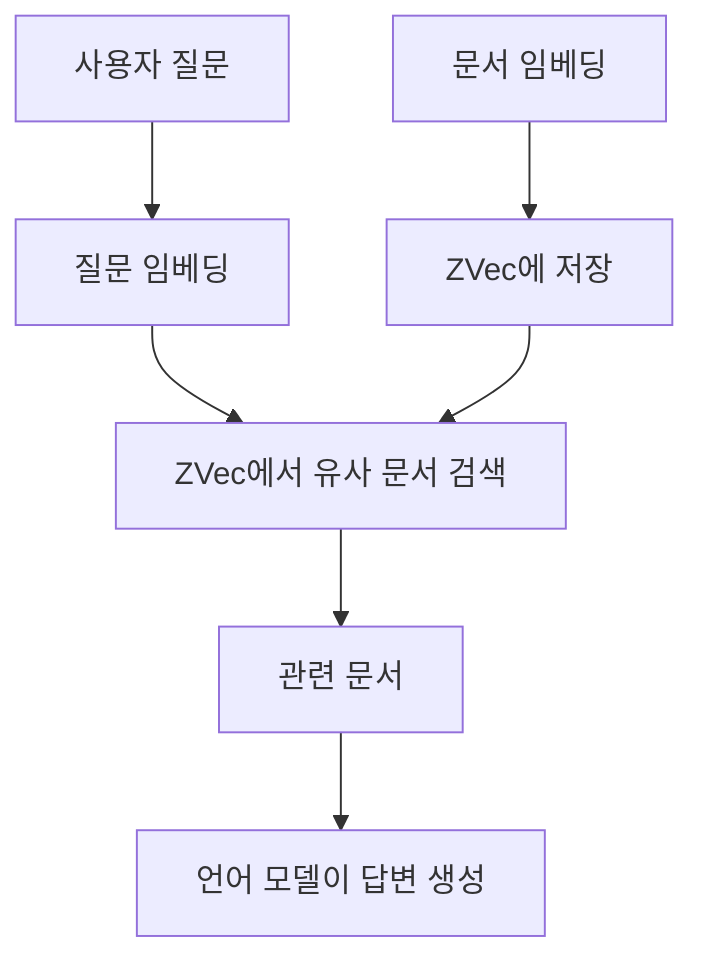

# ZVec: 벡터 DB는 서버가 아니라 앱 안에 들어가는 겁니다

> **Summary**
> ZVec은 알리바바의 Proxima 엔진을 기반으로 한 오픈소스 벡터 데이터베이스로, 서버 없이 앱에 내장해 벡터·전문 검색과 필터를 결합한 하이브리드 검색을 제공합니다. 설치와 사용이 간편하고 온디바이스 RAG 등에 적합하지만, 아직 1.0 이전 버전이며 쓰기는 한 번에 하나의 프로세스만 가능합니다.

---

- ZVec은 서버 없이 앱 안에 직접 심어 쓰는 초경량 벡터 DB입니다. 설치 한 줄이면 바로 검색이 시작됩니다.
- 알리바바의 실전 검색 엔진 Proxima를 기반으로, 수십억 개 벡터를 밀리초 단위로 찾습니다.
- 벡터 검색·전문 검색·필터를 한 번의 쿼리로 합치는 하이브리드 검색까지 되는데, 설정 파일도 서버도 필요 없습니다.


RAG를 만들어보려고 벡터 DB부터 띄우려니, 도커도 띄워야 하고 설정 파일도 만져야 하고 포트도 열어야 합니다. 검색 한 번 해보려고 인프라를 먼저 세우는 셈입니다. 이런 적 있으시죠? 이 순서를 뒤집은 데이터베이스가 있습니다. 벡터 DB를 서버로 띄우는 게 아니라, 앱 안에 직접 심어버리는 겁니다!

🎥 [동영상 보기](https://www.youtube.com/watch?v=KU2HvGpRjbE)

## ZVec, 뭐가 다른가요?

ZVec은 알리바바가 공개한 오픈소스 벡터 데이터베이스입니다. 별명이 '벡터 DB계의 SQLite'입니다. SQLite가 데이터베이스를 파일 하나로 만들어 앱 안에 넣듯, ZVec은 벡터 검색을 라이브러리로 만들어 앱 안에 넣습니다. 서버도, 데몬도, 네트워크 호출도 없습니다. 순수 로컬입니다!

핵심은 기반 엔진입니다. ZVec은 알리바바의 실전 검색 엔진 Proxima를 품고 있습니다. 알리바바 검색·추천·광고 시스템에서 수십억 건의 쿼리를 처리한 엔진입니다. 그래서 가볍지만 성능은 실전용입니다.



## 설치하고 바로 검색, 얼마나 간단한가요?

설치는 한 줄입니다! `pip install zvec` — 끝입니다. 설정 파일도 없고, 서버를 띄울 필요도 없습니다. Python 3.10부터 3.14까지 64비트 환경에서 돌아갑니다. Node.js·Go·Rust·Java·Dart/Flutter용 SDK도 있습니다.

1분이면 충분합니다. 컬렉션 스키마를 정하고, 컬렉션을 만들고, 문서를 넣고, 쿼리를 날립니다. 코드로 쓰면 이렇습니다.

```python
import zvec
collection = zvec.create_and_open(path="./zvec_example", schema=schema)
collection.insert([zvec.Doc(id="doc_1", vectors={"embedding": [0.1, 0.2, 0.3, 0.4]})])
results = collection.query(zvec.Query(field_name="embedding", vector=[0.4, 0.3, 0.3, 0.1]), topk=10)
```

데이터는 WAL(쓰기 전 로그)로 안전하게 저장됩니다. 프로세스가 갑자기 꺼지거나 전원이 나가도 데이터가 날아가지 않습니다. 읽기는 여러 프로세스가 동시에 할 수 있습니다.

## 벡터만 찾는 게 다가 아니죠?

ZVec은 벡터 검색만 하는 게 아닙니다. 조밀 벡터와 희소 벡터를 함께 쓰고, 키워드 기반 전문 검색도 네이티브로 지원합니다. 여기에 구조화된 필터까지, 이 세 가지를 하나의 쿼리로 합쳐서 결과를 냅니다. 이게 하이브리드 검색입니다. 의미로 찾고, 키워드로 찾고, 조건으로 거르는 걸 한 번에 합니다.



## 얼마나 빠른가요?

숫자가 말해줍니다. 공식 벤치마크에서 ZVec은 초당 8,475건의 쿼리를 기록했습니다. 2위인 ZillizCloud 3,957건의 두 배가 넘습니다! Pinecone 1,131건, QdrantCloud 446.9건과는 격차가 더 큽니다. 1,000만 개 벡터 규모에서의 측정입니다.

이 숫자 하나가 저는 가장 와닿았습니다. 8,475라는 QPS가, 서버 없이 앱 안에서 나온 숫자라는 점입니다.



게다가 이건 혼자 달린 결과가 아닙니다. GitHub에서 별 16,000개가 넘었고, 최신 버전은 v0.8.1입니다. Apache 2.0 라이선스로 열려 있습니다. Linux·macOS·Windows·Android·iOS에서 돌아가고, 노트북·서버·CLI 도구·엣지 기기까지 코드가 돌아가는 곳이면 어디서나 됩니다.

## 그래서 어디에 쓰면 좋을까요?

RAG가 첫 번째입니다. 문서 임베딩을 저장하고 질문과 비슷한 문서를 찾는 게 RAG의 심장인데, 그걸 앱 안에 넣으면 배포가 훨씬 가벼워집니다. AI 에이전트, 시맨틱 검색, 추천, 코드 검색도 같은 맥락입니다. 특히 온디바이스 RAG — 클라우드 없이 기기 안에서 돌아가는 검색 — 에 잘 맞습니다.



## 아쉬운 점은 없나요?

짚을 점도 있습니다. 아직 정식 1.0 전 버전(v0.8.1)이라 API가 바뀔 수 있습니다. 그리고 쓰기는 단일 프로세스만 독점합니다. 읽기는 여러 프로세스가 동시에 할 수 있지만, 쓰기는 한 번에 하나의 프로세스만 가능합니다. 여러 곳에서 동시에 쓰는 구조라면 이 제약을 먼저 확인해야 합니다.

벡터 DB는 서버가 아니라 앱 안에 들어가는 겁니다. ZVec은 그걸 가장 단순하게 만든 선택지입니다!

