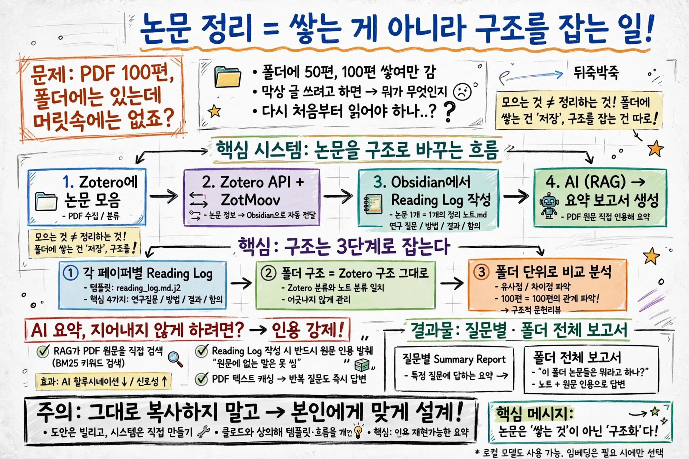
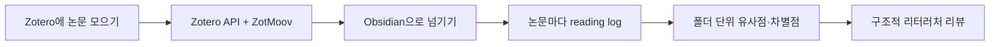
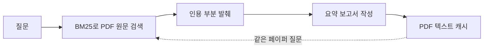

# Zotero + Obsidian: 논문은 폴더에 쌓는 게 아니라 구조를 잡는 겁니다

> **Summary**
> Zotero에 논문을 모으고 Obsidian에서 논문별 reading log를 작성해 폴더 단위로 유사점과 차이점을 파악하면, PDF를 쌓아두는 데 그치지 않고 구조적인 문헌 검토가 가능하다. AI 요약에는 PDF 원문 검색과 인용 발췌를 강제해 지어내기를 줄이고, 주제에 맞게 템플릿과 흐름을 조정해야 한다.

---

- 논문 정리는 PDF를 모아두는 게 아니라, 논문마다 reading log를 쓰고 폴더 단위로 유사점과 차이점을 찾는 일입니다.
- `Zotero`에 논문을 모으고 `Obsidian`에 reading log를 쌓으면, RAG가 PDF 원문을 직접 인용해 요약 보고서를 만듭니다.
- 핵심은 인용을 강제하는 것입니다. 인용 부분을 발췌하게 하면 AI가 지어내는 내용이 줄어듭니다.

## 논문 PDF 100편, 폴더에는 있는데 머릿속에는 없으시죠?

논문 PDF를 폴더에 차곡차곡 모아뒀습니다. 50편, 100편, 숫자는 늘어납니다. 그런데 정작 글을 쓸 때가 되면 막막합니다. 어느 논문이 뭐라고 했는지, 이 논문과 저 논문이 어떻게 다른지, 머릿속에서 뒤죽박죽입니다. 다시 처음부터 읽어야 할까요? 이런 적 있으시죠?

모으는 것과 정리하는 건 다른 일입니다. 폴더에 쌓는 건 저장이고, 구조를 잡는 건 따로 있습니다!

🎥 [동영상 보기](https://www.youtube.com/watch?v=hRCiuycpAIU)

## 이 시스템, 뭘 하는 걸까요?

이 시스템은 논문을 구조화하는 개인용 도안입니다. 준비물은 다섯 가지입니다. `Zotero`, `Zotero API`, `ZotMoov`, `Obsidian`, 그리고 `OpenAI API`입니다. 다른 API를 써도 되고, 로컬 모델은 느리다고 합니다.

흐름은 단순합니다. 논문은 `Zotero`에 모읍니다. `Zotero API`와 `ZotMoov`가 논문 정보를 `Obsidian`으로 넘깁니다. `Obsidian`에서는 논문마다 reading log를 씁니다. 그리고 AI가 PDF 원문을 직접 읽어 요약 보고서를 만듭니다.

이 장면이 저는 가장 인상 깊었습니다. 논문을 "읽고 저장하는" 게 아니라 "읽고 구조로 바꾸는" 흐름이라는 점입니다.

## 구조는 세 가지로 잡습니다

구조 잡기는 세 단계입니다. 첫째, 각 페이퍼별 reading log를 씁니다. 논문 하나마다 정리 노트를 만드는 겁니다. 템플릿은 `reading log md.j2`입니다. 연구 질문, 방법, 결과, 함의 같은 항목이 들어갑니다.

둘째, 폴더 구조는 `Zotero`를 따릅니다. `Obsidian`에서 마음대로 폴더를 만드는 게 아니라, `Zotero`의 구조를 그대로 가져옵니다. 논문 분류와 노트 분류가 어긋나지 않게 하는 방법입니다.

셋째, 페이퍼별·폴더별로 연구 유사점과 차이점을 찾습니다. 논문 하나하나를 따로 보는 게 아니라, 폴더 단위로 묶어서 비교합니다. 이게 구조적 리터러처 리뷰입니다. 논문 100편을 읽은 게 아니라, 100편 사이의 관계를 파악한 상태가 되는 겁니다!

## AI 요약, 지어내지 않게 하려면?

AI 요약에서 제일 무서운 건 그럴듯한 지어내기입니다. 이 시스템은 그걸 인용 강제로 막습니다. RAG가 PDF 텍스트를 직접 retrieval해서, reading log를 쓸 때 꼭 인용하는 부분을 발췌하게 합니다. 원문에 없는 말은 못 쓰게 하는 구조입니다!

검색은 `BM25Retriever`로 합니다. 키워드 검색 방식입니다. 임베딩은 꼭 필요할 때만 별도 API로 선택적으로 씁니다. 기능은 만들어뒀지만, 쓸 일은 별로 없었다고 합니다. 키워드 검색만으로 충분하다는 뜻입니다.

PDF 텍스트는 추출해서 캐시해둡니다. 같은 페이퍼에 질문이 생길 때마다 다시 추출하지 않습니다. 한 번 읽어두면 계속 질문할 수 있는 구조입니다.

## 질문별 보고서, 폴더 전체 보고서까지

질문이 생기면 보고서가 나옵니다. 질문별 summary report를 자동으로 만듭니다. 페이퍼 몇 개를 묶어서도, 폴더 전체로도 보고서를 만들 수 있습니다.

이게 reading log의 진짜 쓰임새입니다. 논문마다 정리한 노트가 쌓이면, 그 노트들이 모여 폴더 단위의 그림이 됩니다. "이 폴더의 논문들은 이 주제에 대해 뭐라고 하는가"라는 질문에, 노트와 원문 인용으로 답하는 겁니다.

## 그대로 복사하지 마세요, 본인에게 맞게 만드세요

주의할 점도 있습니다. 이 시스템은 만든 사람에게 너무 맞춰져 있어서 그대로 배포하기 어렵습니다. 그대로 가져다 쓰는 건 안 된다는 뜻입니다.

그래서 원문에서 제안하는 방법은 따로 있습니다. 클로드와 상의해서 본인에게 맞게 만드는 겁니다. 준비물과 구조는 참고하고, 템플릿과 흐름은 본인 연구 주제에 맞게 다듬는 방식입니다. 도안은 빌리되, 시스템은 직접 만드는 게 답입니다!

## 논문 정리는 쌓는 게 아니라 구조를 잡는 일입니다

논문을 모으는 데서 끝내지 마세요. 논문마다 reading log를 쓰고, 폴더 단위로 유사점과 차이점을 찾고, AI에게는 인용을 강제하세요. 그러면 PDF 100편이 폴더 속 파일이 아니라, 질문에 답하는 구조가 됩니다!

