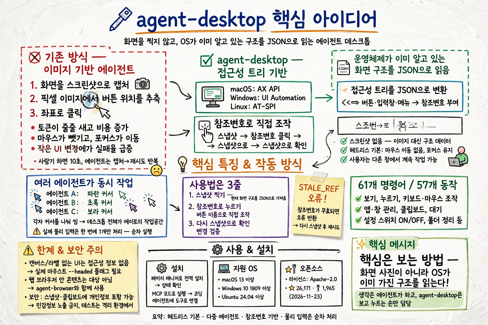
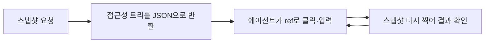
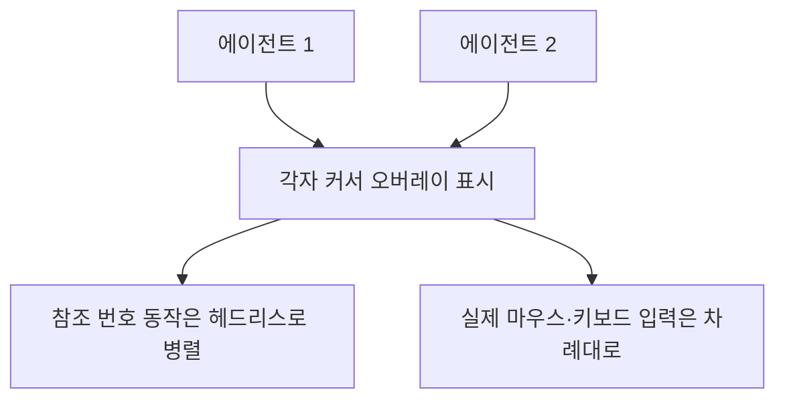

# agent-desktop: 마우스를 뺏지 않고 에이전트가 내 컴퓨터를 씁니다. 화면이 아니라 구조를 읽습니다

> **Summary**
> agent-desktop은 스크린샷 대신 운영체제의 접근성 트리를 읽어 UI 요소를 구조화하고, 참조 번호로 앱을 조작합니다. 기본적으로 마우스와 포커스를 빼앗지 않아 사용자가 다른 작업을 계속할 수 있으며, 여러 에이전트의 동시 작업도 지원하지만 실제 물리 입력은 차례대로 처리됩니다. 접근성 정보가 없는 앱이나 캔버스에는 한계가 있고, 스냅샷과 클립보드에 민감한 정보가 포함될 수 있어 주의가 필요합니다.

---

- agent-desktop은 스크린샷을 찍지 않습니다. 운영체제가 이미 알고 있는 화면 구조를 JSON으로 읽어, 에이전트가 버튼을 이름으로 눌렀습니다.
- 기본은 헤드리스입니다. 마우스가 움직이지 않고 포커스도 빼앗기지 않아, 에이전트가 일하는 동안 사용자는 다른 작업을 계속했습니다.
- 여러 에이전트가 각자 커서를 나눠 쓰는 구조라, 데스크톱 전체가 에이전트의 작업 공간이 됐습니다. 다만 실제 물리 입력은 한 번에 하나씩이라는 점은 알고 써야 합니다.

계산기 앱에서 숫자 하나 바꾸는 일, 직접 하면 10초면 끝납니다. 그런데 에이전트에게 시키면 어땠을까요? 화면을 찍어 보내고, 픽셀에서 버튼 위치를 추측하고, 틀리면 다시 찍는 식이었습니다. 토큰은 줄줄 새고, 마우스는 뺏기고, 작은 UI 변경에도 와르르 무너졌습니다. 이런 적 있으시죠?

그래서 나온 도구가 `agent-desktop`입니다. 웹 브라우저만 다루던 `agent-browser`의 뒤를 이어, 컴퓨터 전체를 다루는 도구로 공개됐습니다.

🎥 [동영상 보기](https://www.youtube.com/watch?v=iEhCLn9utDU)

## 스크린샷 대신 구조를 읽으면 뭐가 달라질까요?

핵심은 보는 방법입니다. 기존 컴퓨터 사용 방식은 화면을 이미지로 찍어 모델에게 보냈습니다. 모델은 이미지에서 버튼 위치를 짐작해 좌표를 찍었습니다. `agent-desktop`은 그 길을 버렸습니다!

운영체제는 이미 화면 구조를 알고 있습니다. 스크린 리더가 쓰는 접근성 트리입니다. 맥은 `AX API`, 윈도우는 `UI Automation`, 리눅스는 `AT-SPI`로 앱의 버튼·입력창·메뉴를 구조로 제공합니다. `agent-desktop`은 이 트리를 읽어 JSON으로 바꿨습니다. 버튼 하나하나에 참조 번호가 붙습니다.

사용법은 세 줄이면 됩니다. 스냅샷을 찍고, 참조 번호로 누르고, 다시 스냅샷으로 확인하는 순서입니다. 화면이 바뀌면 참조 번호가 무효가 됩니다. 낡은 번호로 엉뚱한 곳을 누르는 대신, `STALE_REF`라는 오류가 돌아옵니다. 다시 찍으면 됩니다.

## 마우스를 뺏지 않고 일한다는 건 무슨 뜻일까요?

기본 동작은 헤드리스입니다. 참조 번호로 누르는 동작은 접근성 API를 통해 일어나서, 실제 마우스 포인터가 움직이지 않습니다. 창 포커스도 빼앗기지 않습니다!

그래서 사용자는 다른 창에서 자기 일을 계속하고, 에이전트는 뒤에서 앱을 조작합니다. 장바구니를 정리하는 동안 사용자는 문서를 쓰는 식입니다. 실제 마우스와 키보드가 필요한 드래그나 캔버스 작업은 `--headed` 플래그를 따로 켜야 합니다. 그때는 마우스를 에이전트에게 내줘야 합니다.

## 여러 에이전트가 동시에 일한다는데, 정말일까요?

공개 발표에서는 여러 에이전트가 각자 커서를 갖고 동시에 일한다고 했습니다. 화면에는 에이전트마다 이름이 붙은 커서가 표시됩니다. 이 부분이 이 도구의 가장 눈에 띄는 약속입니다!

다만 한 가지는 짚고 넘어가야 합니다. 실제 물리 입력은 한 번에 하나의 에이전트만 처리한다는 지적이 있습니다. 커서는 화면 오버레이로 보여주는 것이고, 진짜 입력은 차례대로 돌아간다는 뜻입니다. 발표 문구 그대로 믿기보다, 이 차이를 알고 쓰는 것이 순서입니다.

## 어떤 일을 시킬 수 있을까요?

명령어는 61개 이름, 그중 57개가 실제로 동작합니다. 보기, 누르기, 키보드·마우스, 앱·창 관리, 알림, 클립보드, 대기, 세션, 샌드박스, 시스템까지 갈래가 나뉩니다. 계산기 앱을 열어 숫자를 바꾸고, 파일 탐색기에서 폴더를 정리하고, 설정 화면의 스위치를 켜는 식입니다.

설치는 두 줄이면 됩니다. 패키지 매니저로 전역 설치한 뒤 상태를 확인합니다. `MCP` 모드로 띄우면 코딩 에이전트에 도구로 붙고, 스킬을 설치하면 에이전트가 사용법을 스스로 읽습니다. 모델은 도구 안에 없습니다. 생각은 쓰는 에이전트가 하고, `agent-desktop`은 보고 누르는 손만 맡습니다.

| 항목 | 내용 |
| --- | --- |
| 지원 운영체제 | macOS 13 이상, Windows 10 1809 이상, Ubuntu 24.04 이상 |
| 설치 | 패키지 매니저 전역 설치 또는 Homebrew |
| 라이선스 | Apache-2.0, 무료 오픈소스 |
| 별·포크 | 별 26,171개·포크 1,965개 (2026-11-23 기준) |

## 어디까지 믿고 써야 할까요?

한계도 분명합니다. 캔버스처럼 접근성 정보를 내놓지 않는 앱에서는 참조 번호가 안 생깁니다. 라벨이 없는 전자 앱 UI도 마찬가지입니다. 그럴 땐 실제 마우스 입력으로 돌아가야 합니다. 웹 페이지 안쪽은 이 도구의 몫이 아닙니다. 브라우저 안 콘텐츠는 `agent-browser`와 함께 써야 합니다.

보안도 짚어야 합니다. 스냅샷과 클립보드에는 화면의 비공개 내용이 들어갈 수 있습니다. 공개 로그나 업로드에 그대로 올리면 안 됩니다. 시스템 수준 권한을 주는 도구라, 처음에는 민감한 정보가 없는 환경에서 시험하는 것이 순서입니다!

각도도 정리해 두겠습니다. 아이폰을 밖에서 조종하는 도구가 있고, 폰과 시계가 맥의 에이전트를 부르는 도구도 있습니다. 이 글은 그 둘과 다릅니다. 데스크톱 컴퓨터 전체를 에이전트가 직접 조작하는 도구입니다. 대상 기기가 다르고, 읽는 방법도 다릅니다. 화면 사진이 아니라, 운영체제가 이미 가진 구조를 읽는다는 점이 이 도구의 본질입니다!

