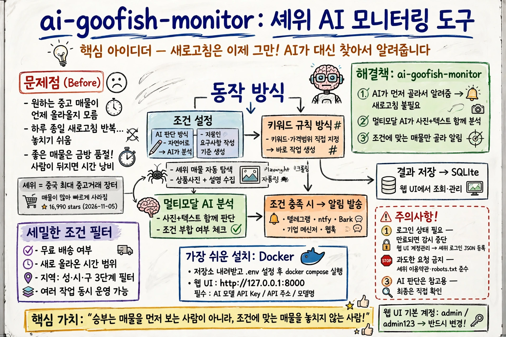
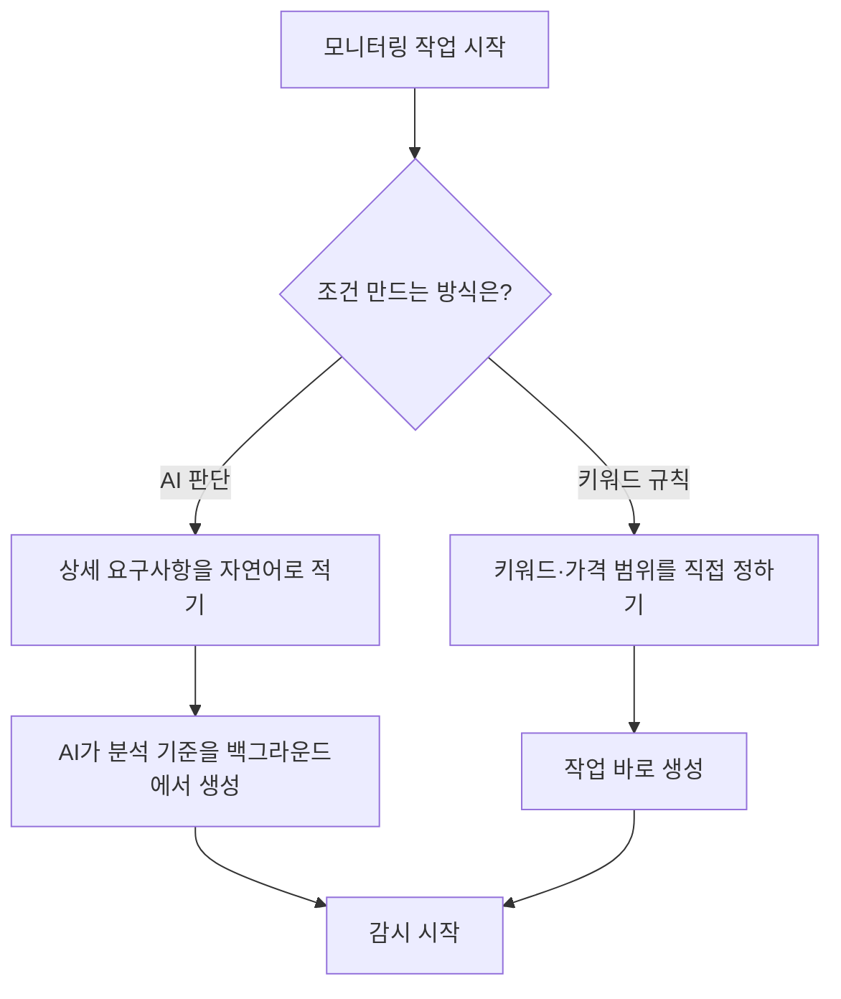
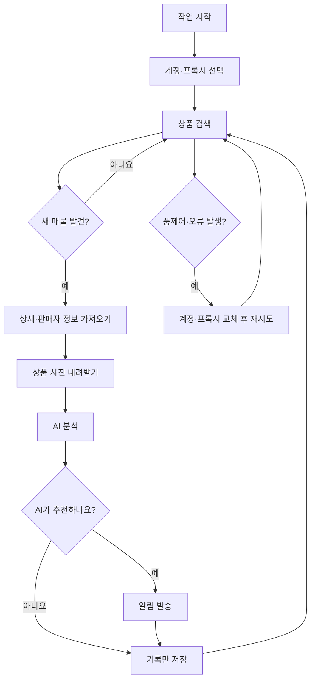

# ai-goofish-monitor: 원하는 중고 매물이 뜨자마자, AI가 골라서 알려줍니다

> **Summary**
> ai-goofish-monitor는 셴위에서 키워드·가격·지역 조건에 맞는 중고 매물을 자동 검색하고, 상품 사진과 설명을 AI로 분석해 새 매물을 알립니다. 도커와 웹 UI로 쉽게 관리할 수 있으며, 로그인 상태 만료와 과도한 요청에 따른 계정 제한, AI 판단의 오류에 주의해야 합니다.

---

- 셴위에서 원하는 매물이 뜨면, 새로고침 대신 AI가 먼저 골라서 알려줍니다.
- 키워드·가격·지역 조건을 걸고, 상품 사진까지 멀티모달 모델이 직접 봅니다.
- 도커로 띄우고 웹 UI에서 관리합니다. 다만 로그인 상태와 계정 제한 위험은 알고 써야 합니다.

희귀한 중고 매물을 노려본 적 있으시죠? 원하는 물건이 올라오는 순간이 언제일지 몰라서, 하루에도 몇 번씩 검색어를 치고 새로고침을 눌러보게 됩니다. 그런데 그 매물은 내가 안 보는 사이에 올라왔다가, 이미 팔려버리는 경우가 많습니다!

🎥 [동영상 보기](https://www.youtube.com/watch?v=anRmM8B7LmE)

## 셴위는 왜 직접 뒤지기 힘들까요?

셴위는 중국 최대 중고 거래 장터입니다. 물건이 워낙 많이 올라오고, 좋은 매물은 금방 사라집니다. 사람이 직접 뒤지면 시간은 시간대로 쓰고, 정작 원하는 매물은 놓치기 쉽습니다. 그래서 나온 도구가 바로 이번 글의 주인공입니다. 이름은 `ai-goofish-monitor`, 셴위 전용 AI 모니터링 도구입니다.

이 도구는 브라우저 자동화인 `Playwright`로 셴위를 직접 돌아다니며 매물을 살피고, 멀티모달 AI 모델이 상품 설명과 사진을 함께 보고 판단합니다. 조건에 맞는 매물이 새로 올라오면, 텔레그램 같은 알림 채널로 바로 알려줍니다. 수집 시점(2026-11-05) 기준으로 별이 16,990개나 찍힌, 꽤 주목받은 오픈소스 프로젝트입니다.

## AI는 매물을 어떻게 고를까요?

핵심은 조건을 만드는 방식이 두 가지라는 점입니다.

먼저 AI 판단 방식입니다. "상세 요구사항"을 자연어로 적으면, 백그라운드에서 AI가 분석 기준을 만들어줍니다. 예를 들어 "상태 좋은 중고 카메라 바디, 30만 원 이하, 배송 가능" 같은 문장을 적으면, 그 조건에 맞는지를 판단하는 기준이 자동으로 생깁니다.

다음은 키워드 규칙 방식입니다. 키워드와 가격 범위를 직접 정하면 AI 생성 과정을 거치지 않고 바로 작업이 만들어집니다. 빠르게 감시부터 시작하고 싶을 때 쓰기 좋습니다.

조건도 꽤 세밀합니다. 무료 배송 여부, 새로 올라온 시간 범위, 성·시·구 3단계 지역 필터까지 걸 수 있습니다. 지역 필터는 결과를 크게 줄여주니, 꼭 필요한 경우에만 쓰는 편이 좋습니다. 여러 작업을 동시에 돌릴 수 있고, 작업마다 키워드·가격·필터를 따로 정할 수 있습니다.

## 매물을 찾으면 그다음은 어떻게 될까요?

작업이 새 매물을 발견하면, 상품 상세와 판매자 정보를 가져오고 상품 사진도 내려받습니다. 그리고 AI가 사진과 설명을 함께 분석해, 조건에 맞는지 판단합니다. 맞으면 알림을 보내고, 아니면 기록만 남깁니다. 결과는 `SQLite`에 저장돼서, 웹 UI에서 나중에 다시 볼 수 있습니다.

알림 채널도 다양합니다. `ntfy`·기업용 메신저·`Bark`·텔레그램·웹훅까지 지원합니다. 원하는 채널 하나만 골라 연결하면 됩니다.

## 설치는 어떻게 할까요?

가장 쉬운 길은 도커입니다. 저장소를 내려받아 설정 파일을 복사하고, API 키 같은 필수 항목을 채운 뒤 컴포즈 명령으로 띄우면 됩니다. 도커 이미지 안에 `Chromium`이 들어 있어서, 따로 브라우저를 설치할 필요가 없습니다. 웹 UI는 기본적으로 `http://127.0.0.1:8000`에서 열립니다.

필수 설정은 세 가지입니다. 이미지 입력이 가능한 AI 모델의 API 키, 호환 API 주소, 모델 이름입니다. GPU도, 로컬 모델도 필요 없습니다. 분석은 전부 API로 돌아갑니다.

처음 쓸 때는 로그인 상태가 하나 필요합니다. 웹 UI의 계정 관리에서, 크롬 확장으로 내보낸 셴위 로그인 상태 `JSON`을 붙여넣으면 됩니다. 로그인 상태는 서버의 `state/` 폴더에 저장되고, 작업에 계정을 연결하면 감시가 시작됩니다. 웹 UI 기본 계정은 `admin/admin123`인데, 그대로 두면 안 됩니다. 처음 로그인한 뒤에 꼭 바꿔야 합니다!

## 쓰기 전에 뭘 조심해야 할까요?

세 가지만 짚어보겠습니다. 첫째, 로그인 상태가 필요합니다. 로그인 상태가 만료되면 감시가 멈추니, 로그 페이지에서 원인을 확인해야 합니다. 둘째, 너무 자주 요청하면 안 됩니다. 프로젝트 안내에도 셴위 이용약관과 `robots.txt`를 지키고, 과도한 요청으로 계정이 제한되지 않게 주의하라고 적혀 있습니다. 계정·프록시 교체와 재시도 기능이 있긴 하지만, 만능은 아닙니다. 셋째, AI 판단이 정답은 아닙니다. 사진과 설명을 보고 고른 매물이라도, 사기나 하자 가능성을 대신 확인해주지는 않습니다. 알림이 왔다고 바로 결제하지 말고, 매물을 직접 한 번 더 확인하는 게 순서입니다!

이 도구의 진짜 가치는 새로고침을 대신해준다는 데 있지 않습니다. 원하는 매물의 조건을 말로 적어두면, 그 조건에 맞는 것만 골라서 알려준다는 데 있습니다. 중고 거래에서 승부는 매물을 먼저 보는 사람이 아니라, 조건에 맞는 매물을 놓치지 않는 사람이 가져갑니다. 여러분은 이런 자동 알림, 중고거래에서 얼마나 써먹을 수 있을 것 같나요?

