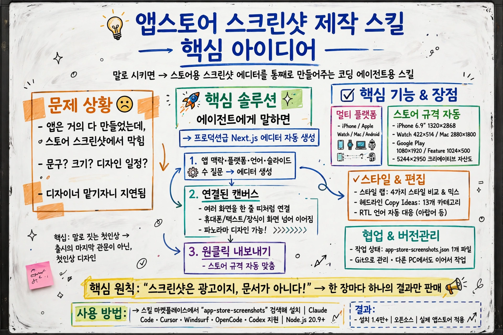
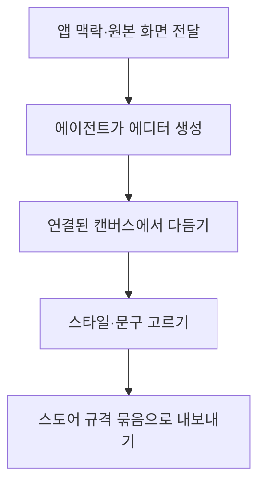
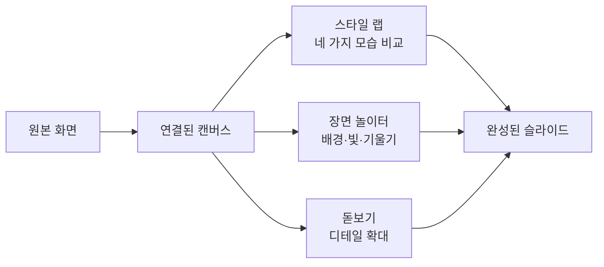
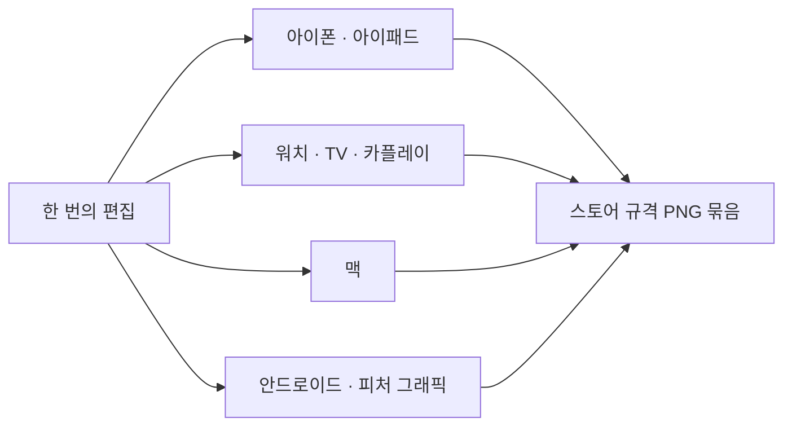

# app-store-screenshots: 앱스토어 스크린샷, 말로 시키면 에디터까지 만들어줍니다

> **Summary**
> 앱스토어 스크린샷 제작 스킬은 코딩 에이전트가 앱 맥락과 원본 화면을 바탕으로 편집 가능한 Next.js 에디터를 만들고, 연결된 캔버스에서 디자인과 문구를 다듬어 다양한 기기·언어별 스토어 규격 이미지 묶음으로 내보내도록 돕습니다. 작업 상태는 파일로 저장해 깃으로 관리하고 다른 컴퓨터에서도 이어갈 수 있습니다.

---

- 앱스토어 스크린샷 제작 스킬은 말로 시키면 스토어용 스크린샷 에디터를 통째로 만들어주는 코딩 에이전트용 스킬입니다.
- 원본 앱 화면을 광고 스타일 슬라이드로 바꾸고, 연결된 캔버스에서 화면을 넘나드는 디자인까지 다듬은 뒤 스토어 규격 그대로 묶음으로 내보냅니다.
- 아이폰부터 워치·맥·안드로이드까지 한 번에 다루고, 작업 상태는 파일 하나로 저장돼 깃으로 관리할 수 있습니다.

앱을 거의 다 만들었는데, 스토어에 올릴 스크린샷 앞에서 손이 멈춘 적 있으시죠? 화면은 있는데, 어떤 문구를 얹어야 할지, 크기는 어떻게 맞춰야 할지, 디자이너에게 맡기자니 일정이 안 맞습니다. 이 스킬은 그 지점에서 출발합니다!

🎥 [동영상 보기](https://www.youtube.com/watch?v=iJGoFLsSL_M)

## 스크린샷 한 장이 아니라 에디터 통째로 만든다고요?

스킬을 설치하고 에이전트에게 앱스토어 스크린샷을 만들어달라고 말하면, 에이전트는 정적인 이미지 한 장을 내놓지 않습니다. 대신 프로덕션 수준의 `Next.js` 에디터를 프로젝트 안에 통째로 세웁니다. 연결된 캔버스, 실제 기기 프레임, 인스펙터, 저장되는 프로젝트 상태, 한 번의 클릭으로 끝나는 내보내기 묶음까지 갖췄습니다.

에이전트는 만들기 전에 앱 맥락, 원본 스크린샷, 플랫폼, 언어, 시각 방향, 슬라이드 개수를 물어봅니다. 답만 해주면 에디터가 생깁니다.

## 연결된 캔버스가 뭐가 다른가요?

이 에디터의 핵심은 연결된 캔버스입니다. 스크린샷 여러 장을 하나의 긴 띠처럼 이어서 보고, 휴대폰·문구·장식 요소가 화면 경계를 넘어 이어지게 만들 수 있습니다. 파노라마처럼 이어지는 디자인이 가능합니다!

예전 방식으로 만든 덱은 격리 모드로 보호해서, 화면 밖 요소가 옆 화면 내보내기에 새지 않게 합니다. 화면 사이드바에서 화면을 추가·선택·순서를 바꾸고, 인스펙터에서 레이아웃·문구·이미지·쌓임 순서를 고칩니다. 헤드라인 옆 `Copy ideas` 메뉴는 검증된 문구 공식을 바로 넣어줍니다.

스타일 랩은 네 가지 완성된 모습을 나란히 보여주고, 마음에 드는 부분만 잠가서 섞을 수 있습니다. 장면 놀이터에서는 배경·그림자·빛·기울기를 한 번에 바꿉니다. 돋보기는 화면 속 디테일 하나를 확대해 보여줍니다.

## 스토어 규격은 어떻게 맞추나요?

규격 걱정은 에디터가 대신합니다. 아이폰 6.9인치 1320×2868부터 워치 울트라 422×514, 맥 2880×1800, 구글 플레이 휴대폰 1080×1920, 피처 그래픽 1024×500까지, 스토어가 요구하는 크기로 정확히 내보냅니다. 스토어 크리에이티브 자산 5244×2950도 만듭니다.

언어마다 따로 만들고, 아랍어 같은 RTL 언어는 레이아웃까지 오른쪽에서 시작하게 맞춥니다. 스타일은 이름 붙은 18가지가 준비돼 있고, 원하는 스타일을 말만 하면 전체 스펙이 적용됩니다. 헤드라인 문구집에는 슬라이드 역할별 공식과 13개 앱 카테고리용 문장이 들어 있습니다.

이 문장이 저는 가장 와닿았습니다. "스크린샷은 광고이지, 문서가 아니다!" 한 장마다 하나의 결과만 팔라는 기준이, 디자인 규칙의 전부였습니다.

## 어떻게 쓰면 되나요?

설치는 스킬 마켓플레이스에서 `app-store-screenshots`를 검색해 추가하면 됩니다. 클로드 코드, 커서, 윈드서프, 오픈코드, 코덱스에서 쓸 수 있습니다. `Node.js` 20.9 이상이 필요합니다.

에이전트에게 앱이 뭘 하는지 한 문장으로 말하고, 강점 3~5개, 플랫폼, 스타일, 슬라이드 수, 언어를 알려주면 됩니다. 작업 상태는 `app-store-screenshots.json` 파일 하나로 저장됩니다. 깃으로 관리할 수 있고, 다른 컴퓨터로 옮겨도 이어서 작업할 수 있습니다.

이 스킬로 만든 예시 스크린샷은 실제 앱스토어에 오른 앱의 페이지에도 쓰였습니다. 설치 수 1만 4천 회를 넘겼고, 오픈소스라서 누구나 쓸 수 있습니다!

스크린샷은 출시의 마지막 관문이 아니라, 앱을 처음 만나는 사람에게 건네는 첫인상입니다. 그 첫인상을 말로 짓는 시대가 왔습니다!

