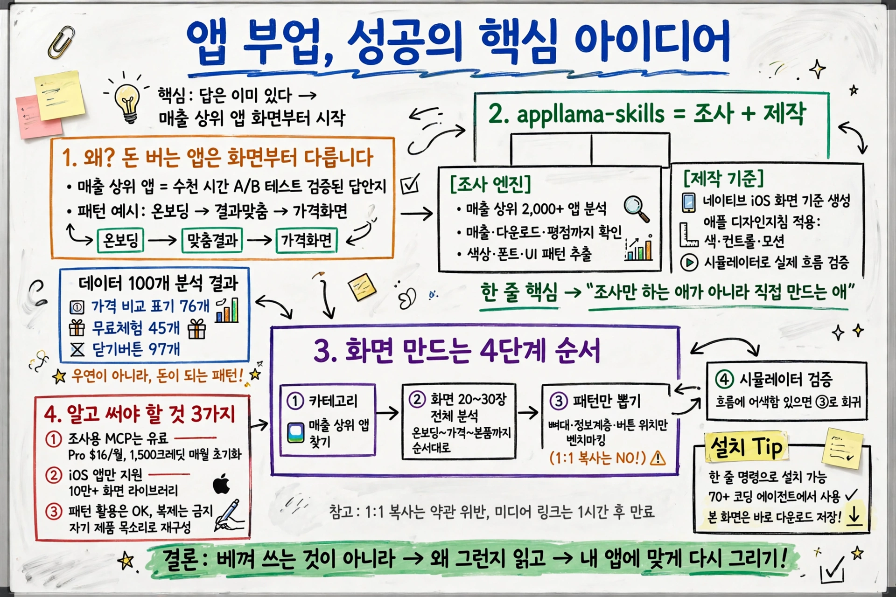
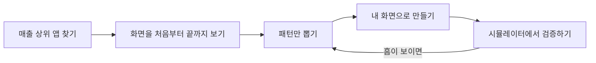
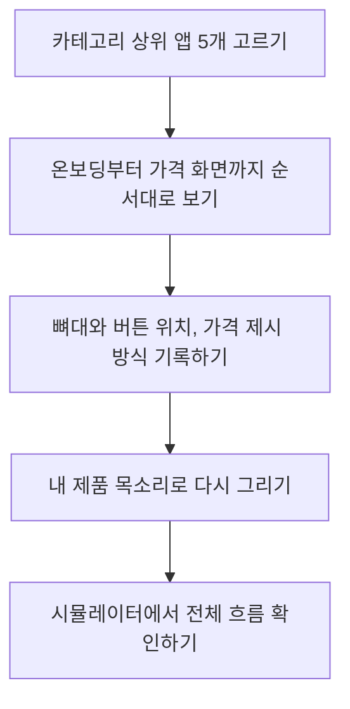

# appllama-skills: 매출 상위 앱 화면부터 가져옵니다. 조사만 하는 애가 아니라 직접 만드는 애입니다

> **Summary**
> appllama-skills는 매출 상위 iOS 앱의 화면과 성과 지표를 조사하고, 검증된 디자인 패턴을 네이티브 수준의 화면으로 구현·검증하도록 돕는 두 가지 스킬을 제공합니다. 앱의 온보딩부터 가격 화면까지 살펴 구조와 패턴만 참고하고 1:1 복사는 피해야 하며, 조사용 MCP는 유료이고 라이브러리는 iOS 앱만 지원합니다.

---

- 앱 부업을 한다면, 돈 버는 앱의 화면부터 가져오는 게 순서입니다. 매출 상위 앱의 화면은 이미 수천 시간의 테스트를 통과했기 때문입니다.
- appllama-skills는 그 화면을 조사만 하는 게 아니라, 에이전트가 직접 네이티브 수준의 모바일 화면으로 만들어주는 스킬 묶음입니다.
- 다만 조사용 MCP는 유료이고, 화면은 패턴만 가져오고 1:1 복사는 피해야 합니다.

"부업으로 앱 하나 만들어볼까?" 마음먹고 AI한테 화면을 만들어달라고 한 적 있으시죠? 그런데 나온 화면이 어딘가 어색합니다. 버튼 위치도, 가격 화면도, 뭔가 앱 같지가 않습니다. 그럴 때 돈 버는 앱은 어떻게 했는지 먼저 보면 됩니다. 이미 답이 나와 있는 곳에서 시작하는 게 빠릅니다!

🎥 [동영상 보기](https://www.youtube.com/watch?v=lkwX_kc0NS8)

## 돈 버는 앱은 화면부터 다릅니다

매출 상위 앱의 화면은 그냥 예쁜 그림이 아닙니다. 수천 시간의 디자인 반복과 A/B 테스트를 통과한 검증된 답안지에 가깝습니다. 온보딩을 길게 물어보는 퀴즈로 만들고, 그 끝에 가격 화면을 두는 패턴이 대표적입니다. 사용자가 몇 분을 투자해 자기 맞춤 결과를 받은 뒤라, 가격을 볼 때 이미 떠날 마음이 줄어듭니다.

가격 화면 100개를 분석한 한 조사에서는 이런 숫자가 나왔습니다. 가격을 다른 기준과 비교해 보여준 화면이 76개, 무료 체험을 내건 화면이 45개, 닫을 수 있는 화면이 97개였습니다. 연간 요금제를 먼저 보여주고 월 단위 가격으로 나눠 적는 방식도 상위 앱에서 반복됩니다. 우연이 아니라, 돈이 되는 패턴이 모인 결과입니다. 그럼 이 패턴, 어떻게 가져올까요?

이 글은 P262나 P353과 짝을 이룹니다. 그 글들이 왜 돈이 안 되는지, 된 사례가 뭐가 달랐는지를 봤다면, 이 글은 돈 버는 앱의 화면에서 무엇을 가져올지를 봅니다. 아이디어가 아니라 화면에서 배우는 순서입니다!

## 조사만 하는 애가 아닙니다: 두 개의 스킬

`appllama-skills`는 스킬이 두 개로 묶여 있습니다. 하나는 조사 엔진, 하나는 제작 기준입니다. 소개 문구가 딱 한 줄인데, 그 한 줄이 핵심을 찌릅니다. "조사만 하는 애가 아니라 직접 만드는 애"라는 말입니다.

먼저 조사 엔진입니다. 에이전트가 매출 상위 앱 2,000개가 넘는 라이브러리에서 앱을 찾고, 화면을 처음부터 끝까지 봅니다. 매출·다운로드·평점 같은 숫자도 함께 보여서, 예쁜 앱이 아니라 돈 버는 앱을 고를 수 있습니다. 화면마다 색상·폰트·UI 요소까지 읽어줍니다.

다음은 제작 기준입니다. 네이티브 느낌의 화면을 만드는 기준을 정해줍니다. 애플 디자인 지침에 맞는 색상·컨트롤·모션을 쓰고, 시뮬레이터에서 전체 흐름을 프레임 단위로 확인합니다. 스크린샷 한 장이 아니라, 실제 앱을 돌려보며 흠을 찾는 방식입니다.

## 화면을 만드는 순서, 어떻게 될까요?

순서는 네 단계입니다! 첫째, 내 카테고리에서 매출 상위 앱을 찾습니다. 둘째, 그 앱의 화면을 20~30장 정도 처음부터 끝까지 봅니다. 온보딩부터 가격 화면, 본품 화면까지 순서대로 보는 게 중요합니다. 셋째, 패턴만 뽑습니다. 뼈대·정보 계층·버튼 위치 같은 구조를 가져오고, 픽셀 그대로 복사하지는 않습니다. 넷째, 시뮬레이터에서 검증합니다. 흠이 보이면 패턴 단계로 돌아갑니다.

설치는 한 줄 명령으로 끝납니다. 프로젝트 폴더에서 스킬 설치 명령을 실행하면, 코딩 에이전트 70개 이상에서 쓸 수 있습니다. 조사용 MCP를 연결하면 에이전트가 라이브러리를 직접 뒤집니다. MCP 주소는 공식 안내에 나와 있습니다.

## 알고 써야 할 것들, 세 가지입니다

첫째, 조사용 MCP는 유료입니다. Pro 요금제는 월 16달러이고, 월 1,500크레딧이 매월 1일에 초기화됩니다. 호출 한 번에 1크레딧이 들고, 잔액 확인은 무료입니다. 무료 플랜은 모든 앱의 첫 화면과 최신 앱 2개 전체만 볼 수 있고, MCP는 연결할 수 없습니다.

둘째, 라이브러리는 iOS 앱만 다룹니다. 안드로이드 패턴은 없습니다. 화면 수도 계속 늘고 있는데, 10만 장이 넘는 화면이 들어 있다고 합니다.

셋째, 1:1 복사는 피해야 합니다. 패턴을 가져오되 자기 제품 목소리로 다시 그리는 게 원칙입니다. 라이브러리를 통째로 긁어가는 대량 수집은 약관 위반으로 서버에서 감지한다고 합니다. 미디어 링크는 한 시간 정도 지나면 만료되니, 본 화면은 바로 내려받아 두는 게 좋습니다.

별 개수도 눈에 띕니다! 클립 시점에는 5,126개였는데, 지금 확인하니 5,633개까지 늘었습니다. 공개된 지 석 달 만에 이 정도 관심이 모였다는 뜻입니다.

돈 버는 앱의 화면은 답안지가 아니라 교과서입니다. 베껴 쓰는 게 아니라, 왜 그렇게 만들었는지 읽고 자기 앱에 맞게 다시 그리는 게 순서입니다!

