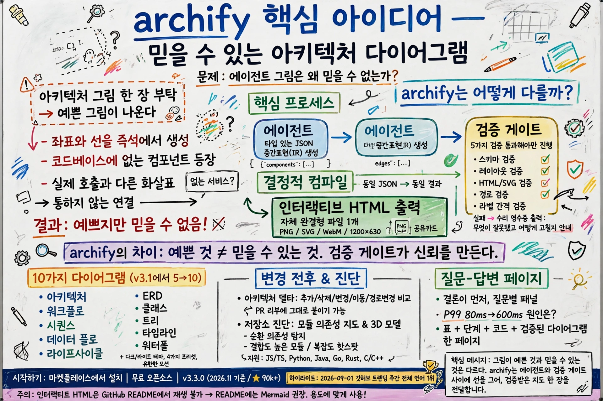
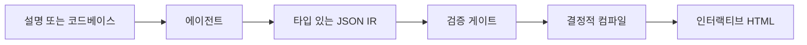

# archify: 예쁜 아키텍처 그림이 아니라, 검증받은 시스템 지도입니다

> **Summary**
> archify convierte descripciones o código en diagramas interactivos mediante una representación JSON tipada que pasa por validaciones antes de compilarse, evitando componentes y relaciones inventados. Ofrece diez tipos de diagramas, comparación de cambios y diagnósticos de repositorios en un archivo HTML exportable; es gratuito y de código abierto.

---

- 아키텍처 다이어그램을 에이전트에게 맡기면, 그럴듯하지만 실제로는 없는 컴포넌트가 슬쩍 끼어들 때가 있습니다.
- archify는 에이전트가 타입 있는 JSON 중간 표현을 만들고, 검증 게이트를 통과한 것만 결정적으로 컴파일해 인터랙티브 HTML로 바꿉니다.
- 다이어그램은 다섯 가지에서 열 가지로 늘었고, 변경 전후 비교와 저장소 진단까지 파일 하나에 담깁니다.

"아키텍처 그림 한 장 보여주세요." 에이전트에게 이렇게 부탁한 적 있으시죠? 몇 분 뒤 근사한 그림이 나옵니다. 그런데 자세히 보면 이상합니다. 없는 서비스가 있고, 실제로는 통하지 않는 화살표가 있습니다. 그림은 예쁜데, 믿을 수가 없는 겁니다!

🎥 [동영상 보기](https://www.youtube.com/watch?v=iuJszJuiuSg)

## 아키텍처 그림, 왜 믿기 어려울까요?

에이전트가 그림을 직접 그리면 좌표와 선을 즉석에서 만들어냅니다. 보기에는 그럴듯하지만, 코드베이스에 없는 컴포넌트가 생기고, 실제 호출과 다른 화살표가 그려집니다. 그림이 예쁠수록 속기가 쉽습니다. 문제는 그림이 아니라, 그림을 검증하는 과정이 없다는 점입니다!

## archify는 어떻게 다를까요?

archify는 에이전트 스킬입니다. 클로드 코드, 커서, 코덱스 CLI, 오픈코드에서 돌아갑니다. 에이전트가 그림을 직접 그리지 않습니다. 대신 타입이 정해진 JSON 중간 표현(IR)을 먼저 만듭니다. 그 JSON을 검증 게이트가 검사하고, 통과한 것만 결정적으로 컴파일해 자체 완결형 HTML로 바꿉니다. 같은 JSON이면 언제나 같은 그림이 나옵니다!

## "예쁘다"는 무슨 뜻일까요?

다이어그램은 다섯 가지에서 시작했습니다. 아키텍처, 워크플로, 시퀀스, 데이터 플로, 라이프사이클입니다. 3.1 버전에서 ERD, 클래스, 트리, 타임라인, 워터폴 다섯 가지가 더해져 열 가지가 됐습니다. 네 가지 프리셋, 다크·라이트 테마, 유한한 모션까지 갖췄습니다. 결과는 파일 하나입니다. PNG, SVG, WebM으로 내보내고, 1200×630 공유 카드도 만들 수 있습니다.

## "검증받았다"는 무슨 뜻일까요?

검증은 다섯 가지 검사를 한 번에 통과해야 합니다. 스키마, 레이아웃, HTML/SVG, 경로, 라벨 간격까지 확인합니다. 하나라도 틀리면 그림이 나가지 않습니다. 실패하면 수리 영수증이 나옵니다. 어떤 규칙에 걸렸는지, 어디를 어떻게 고치면 되는지가 적혀 있습니다. 미리보기 모드에서는 검증이 안 된 저장이 와도 마지막으로 검증된 그림을 그대로 보여줍니다. 노드를 눌러 상·하류를 따라가거나 경로를 추적할 때도, 그림에 적힌 관계만 씁니다. 없는 위상을 지어내지 않습니다.

## 변경 전후, 어떻게 비교할까요?

아키텍처 델타가 있습니다. 검증된 변경 전·후 스냅샷을 비교해 추가, 삭제, 변경, 이동, 경로 변경을 정확히 보여줍니다. 풀 리퀘스트 리뷰에 그대로 붙일 수 있습니다. 저장소 진단은 또 다른 기능입니다. 모듈 의존성을 별 지도와 3D 모델로 보여주고, 순환 의존성과 결합도가 높은 모듈, 복잡도 핫스팟을 짚어줍니다. 자바스크립트·타입스크립트, 파이썬, 자바, 고, 러스트, C, C++를 지원합니다.

## 질문에 답하는 페이지도 만듭니다

다이어그램만 만드는 게 아닙니다. 질문에 답을 한 페이지로 만들 수도 있습니다. 결론이 먼저 나오고, 질문마다 패널 하나씩 따라옵니다. "P99가 80ms에서 600ms로 뛰었는데, 원인이 뭘까요?" 같은 질문에 표와 단계, 코드, 검증된 다이어그램을 한 페이지에 담습니다. 짧은 답이나 텍스트만으로 충분한 질문에는 페이지를 만들지 않습니다.

## 써보기 전에 알아둘 점은요?

설치는 마켓플레이스에서 검색해 설치하거나, 에이전트에게 설치를 맡기면 됩니다. 무료 오픈소스입니다. 2026년 9월 1일에는 깃허브 트렌딩 주간 전체 언어 1위에 올랐고, 2026년 11월 기준 별이 9만 개를 넘었습니다. 현재 안정 버전은 3.3.0입니다.

한 가지, 주의할 점이 있습니다. 다이어그램이 인터랙티브 HTML이라 깃허브 README 안에서는 그대로 재생되지 않습니다. README에 넣을 그림이 필요하면 Mermaid가 여전히 편합니다. 용도에 맞게 고르면 됩니다!

그림이 예쁜 것과 그림을 믿을 수 있는 것은 다른 문제입니다. archify는 그 둘을 한 번에 잡으려고, 에이전트와 검증 게이트 사이에 선을 그었습니다. 다음에 아키텍처를 설명해야 할 때, 그림 한 장을 보여주는 대신 검증받은 지도 한 장을 건네보는 건 어떨까요?

