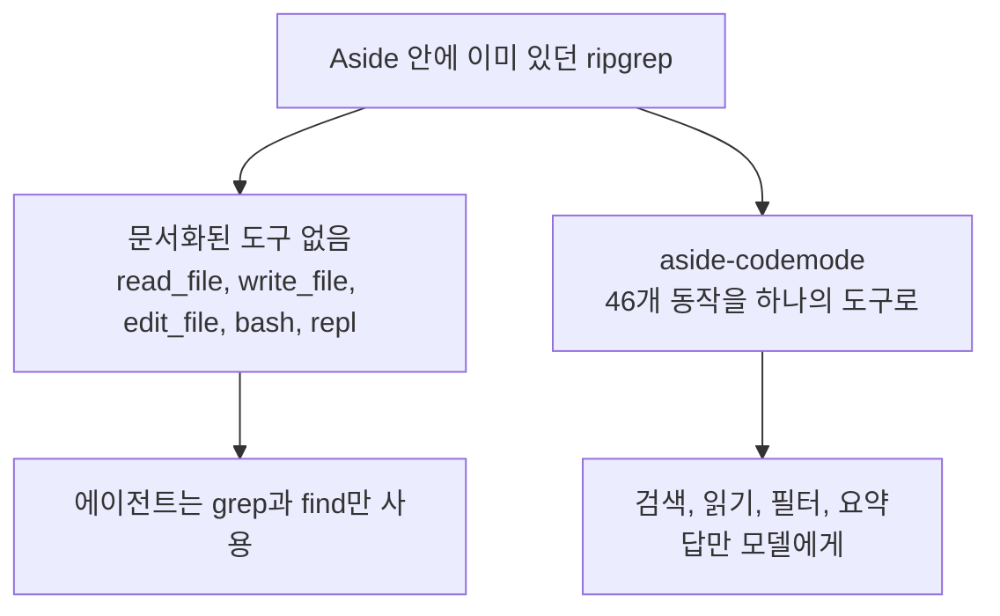

# aside-codemode: 55초 걸리던 검색이 1초로 줄었습니다. 이미 있던 엔진을 꺼내 쓴 것뿐입니다

> **Summary**
> aside-codemode는 Aside에 이미 포함된 ripgrep을 에이전트가 활용하도록 해 검색 결과만 전달해 모델의 읽기 부담과 불필요한 출력을 줄입니다. 운영자가 보고한 55초에서 1초로의 개선은 독립적으로 검증되지 않았으며, 통제된 비교에서도 대량 검색과 요약에 효율성을 보였습니다.

---

- 코딩 에이전트에게 파일 검색을 맡기면, 모델은 답이 아니라 파일 수십 개 분량을 통째로 읽습니다. `aside-codemode`는 이미 들어 있던 검색 엔진을 꺼내, 답만 골라서 돌려줍니다.
- 실제 개발 폴더에서 `find`와 `grep` 조합이 55초 걸리던 검색이 1초로 줄었습니다. 다만 이 51배 수치는 운영자 보고라서, 독립적으로 재현된 측정은 아닙니다.
- 웹페이지 다섯 장을 한 번에 읽을 때도 1.87MB짜리 원본 대신 4.4KB짜리 표만 모델에게 건넵니다. 빠른 검색 엔진이 아니라, 이미 있던 엔진을 쓸 수 있게 만든 도구입니다.


"이 함수, 어디서 쓰고 있지?" 에이전트에게 물으면 잠시 뒤 답이 옵니다. 그런데 그 답이 오기까지, 모델은 파일 수십 개를 통째로 읽었습니다. 찾는 건 한 줄인데, 읽는 건 수만 줄입니다. 이런 적 있으시죠?

🎥 [동영상 보기](https://www.youtube.com/watch?v=Qf0EzOEall8)

## 에이전트는 어떻게 코드를 찾을까요?

대부분의 코딩 에이전트는 결국 텍스트 검색으로 코드를 찾습니다. 이름을 물으면, 이름이 적힌 줄을 찾습니다. 문제는 찾은 줄이 수백 개일 때입니다. 에이전트는 그 줄들을 하나씩 열어보고, 또 열어보고, 다시 검색합니다. 턴은 늘어나고, 읽는 양은 불어납니다.

`Aside`는 데스크톱에서 돌아가는 코딩 에이전트입니다. 데몬이 떠 있고, 네이티브 REPL이 있고, MCP 클라이언트도 붙어 있습니다. 그런데 문서에 적힌 에이전트 도구는 파일 읽기·쓰기·편집·셸·REPL, 다섯 가지뿐입니다. 내용 검색 도구는 없습니다.

그래서 에이전트가 할 수 있는 일은 셸에서 `grep`과 `find`를 돌리는 것뿐이었습니다. 그런데 `Aside` 안에는 이미 빠른 검색 엔진이 들어 있었습니다. 번들로 실린 `ripgrep` 15.2.0버전입니다. 다만 그 엔진에 닿는 문서화된 방법이 없었을 뿐입니다!

## 55초가 1초가 된다는 말, 무슨 뜻일까요?

이 패키지가 내세우는 숫자부터 짚어보겠습니다. 실제 개발 폴더에서 `TODO`가 적힌 파일 50개를 찾는 일, `find`와 `grep` 조합은 55초가 걸렸고, 이 도구의 검색은 1초가 걸렸습니다. 약 51배입니다.

여기서 멈추고 한 가지는 분명히 해야 합니다. 이 51배는 운영자 보고입니다. 독립적으로 재현된 측정이 아니고, 측정 날짜도 없고, 폴더와 시계와 옵션도 기록되지 않았습니다. 그래서 "51배 빨라졌다"가 아니라 "한 번의 운영 보고에서 51배 차이가 났다"고 읽는 것이 맞습니다.


## 숫자가 더 말해주는 것은 무엇일까요?

2026년 9월 18일, 통제된 측정도 함께 공개됐습니다. 파일 12만 7천 개짜리 트리에서 `function`이 몇 개인지 세는 일, `grep`은 128초가 지나도록 끝나지 않았습니다. 3.23GB를 쏟아내고 370만 줄을 뱉은 뒤 중단됐습니다. 이 도구의 개수 세기는 2,966밀리초 만에 778바이트로 답했습니다. 맞는 줄 50만 2,963개, 파일 5만 7,403개라는 숫자입니다.

이건 속도 경쟁이 아닙니다! `grep`이 느려서가 아니라, 출력이 대화를 묻어버려서 에이전트가 아예 물을 수 없는 질문이기 때문입니다. 마크다운 파일 3만 9,831개의 목록을 뽑는 일은 `find` 5,467밀리초, 이 도구 2,063밀리초로 같은 답을 냈습니다.

웹페이지도 같은 방식으로 줄입니다. 페이지 다섯 장을 읽는 일, 가져오기 방식 도구는 HTML 1,865,043바이트를 모델에게 넘겼고, 이 도구는 제목과 첫 링크만 뽑은 4,430바이트짜리 표를 넘겼습니다. 원본 대비 421배, 에이전트가 직접 읽을 때 대비 16배가 줄었습니다. 다섯 장을 한 번에 처리하고 2.5초가 걸렸습니다.

## 빠른 엔진이 아니라, 이미 있던 엔진입니다!

이 부분은 개발자가 직접 밝혀둔 사실이라서, 그대로 옮기는 것이 맞습니다. 이 도구는 더 빠른 검색 엔진이 아닙니다. `Aside`가 이미 실어둔 `ripgrep`을 꺼내 쓸 수 있게 만든 것입니다. `ripgrep`을 직접 부르는 것과 속도는 같습니다. 달라진 것은 결과가 모델에게 닿기 전에 걸러진다는 점입니다.

그래서 숫자도 두 갈래로 읽어야 합니다. 폴더 전체를 한 번에 훑는 일에서는 차이가 큽니다. 하지만 낱개 검색 한 번만 놓고 보면, 예전 측정에서는 1.05배에서 1.81배 수준이었습니다. 폴더 단위 벽시계와 낱개 검색은 다른 이야기입니다!



## 설치는 어떻게 할까요?

설치는 세 명령으로 끝납니다. 패키지를 전역 설치하고, MCP 등록을 하고, 상태를 확인합니다.

```bash
npm install -g aside-codemode
codemode --install-mcp
codemode --doctor
```

연결 방법은 두 가지입니다. 첫 번째는 네이티브 MCP입니다. 에이전트가 `execute_code`라는 도구 하나를 직접 부릅니다. 도구 설명이 2,043바이트라서 매번 상주하는 부담도 작습니다. 두 번째는 CLI 방식입니다. MCP 서버를 붙이지 않는 환경이나, 셸 호출을 눈으로 보고 싶은 경우에 씁니다. 계정 안내 블록이 3,808바이트 상주합니다.

주의할 점도 있습니다. MCP 등록 명령은 다른 MCP 서버의 캐시된 도구 목록을 지울 수 있습니다. 그래서 다른 서버가 있으면 명령이 거부되고, 무엇이 위험한지 먼저 알려줍니다. 백업을 남기고 복원하는 `--force` 옵션도 있지만, 함부로 쓰면 안 됩니다. 상태는 `codemode --doctor` 명령으로 계정마다 확인할 수 있습니다. 운영체제는 macOS와 Windows만 지원하고, Node.js 18 이상이 필요합니다.

## 그래서, 무엇을 확인하고 쓰면 될까요?

이 도구가 주는 것은 속도가 아니라 질문의 모양입니다. "파일 50개를 다 읽고 골라줘"가 아니라 "파일 5개의 경로만 알려줘"라는 질문을 에이전트가 할 수 있게 됩니다. 모델이 읽는 양이 줄면, 턴이 줄고, 답이 또렷해집니다.

다만 51배라는 숫자는 운영자 보고라는 점을 잊지 않는 것이 좋습니다. 자기 폴더에서 직접 재보고, 그 수치가 내 작업에서도 나오는지 확인해 보는 것이 순서입니다. 엔진은 이미 컴퓨터 안에 있었습니다. 이제야 꺼내 쓸 수 있게 됐을 뿐입니다!

