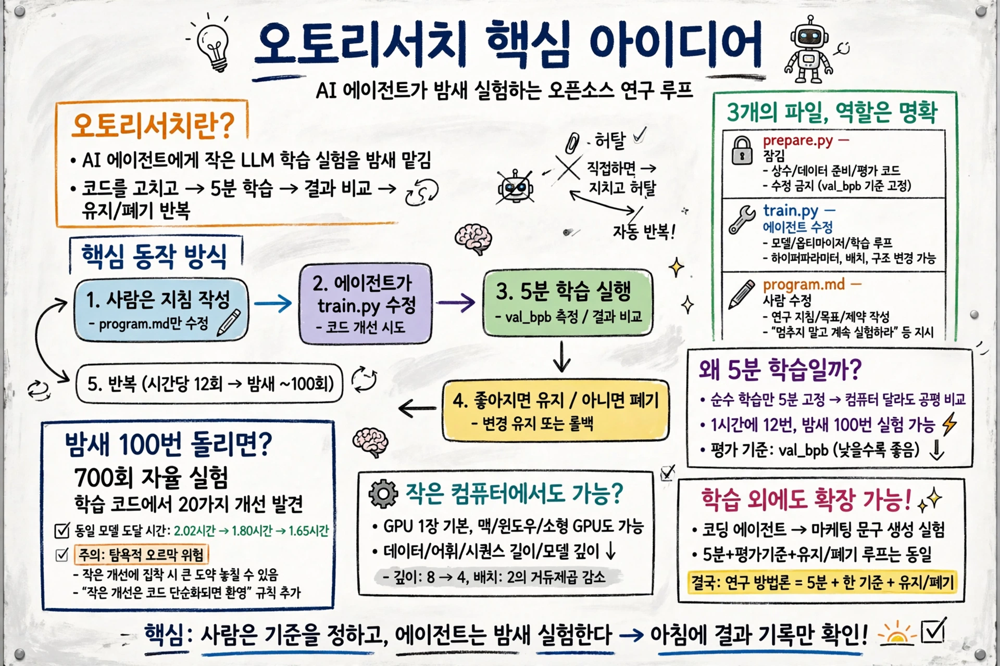
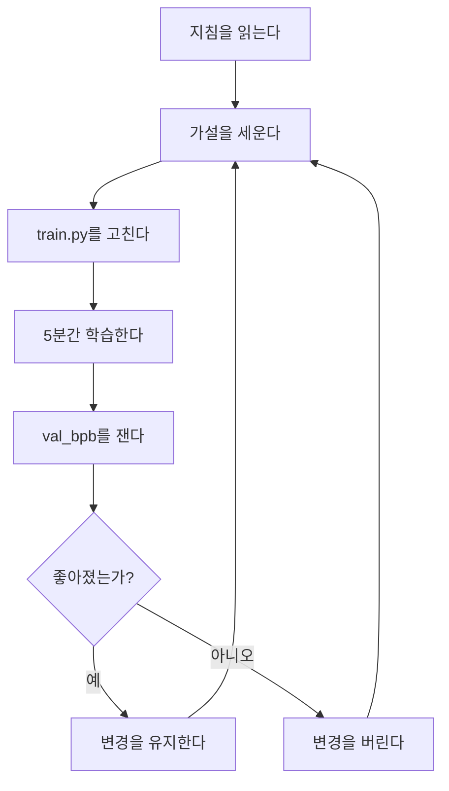
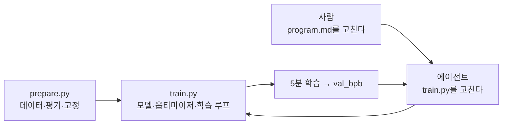

# autoresearch: 밤새 에이전트가 연구하면, 아침에는 더 나은 모델이 기다립니다

> **Summary**
> 오토리서치는 에이전트가 train.py만 수정하며 5분 학습과 val_bpb 평가를 반복해 모델을 개선하는 자동 연구 루프입니다. 사람은 program.md에 목표와 제약을 정하고, 에이전트는 개선된 변경만 유지해 밤새 수많은 실험을 수행합니다. 성과는 평가 기준과 지침의 품질에 달려 있으며, 이 실험·측정·유지 또는 폐기 방식은 모델 학습 외의 작업에도 적용할 수 있습니다.

---

- 오토리서치는 AI 에이전트에게 작은 언어 모델 학습 실험을 밤새 맡기는 오픈소스 연구 루프입니다. 코드를 고치고 5분 학습한 뒤 결과가 좋아졌는지 재서, 좋아지면 유지하고 아니면 버리는 과정을 반복합니다.
- 고치는 파일은 `train.py` 하나뿐이고, 평가 기준인 `val_bpb`와 준비 코드는 건드리지 못하게 잠가 둡니다. 사람은 지침 파일 `program.md`만 고치면 됩니다.
- 한 시간에 12번, 밤새 100번 가까이 돌릴 수 있어 사람이 직접 하던 연구 사이클을 에이전트가 대신 굴립니다.

밤새 학습을 돌려놓고 아침에 결과를 확인한 적 있으시죠? 그런데 다음 날 아침, 모델이 좋아진 게 아니라 "어제보다 조금 나빠졌다"는 숫자만 마주하면 허탈합니다. 바꿀 건 많은데, 하나하나 손으로 바꾸고 기다리는 일이 더 지치니까요. 그래서 나온 발상이 있습니다. 그 지치는 반복을 아예 에이전트에게 맡기는 겁니다!

🎥 [동영상 보기](https://www.youtube.com/watch?v=XXR0zZ0_16M)

## 오토리서치, 대체 뭐가 다른 걸까요?

연구는 원래 사람이 하는 일이었습니다. 가설을 세우고, 코드를 고치고, 학습을 돌리고, 결과를 보고, 다시 가설을 세우는 사이클 말입니다. 오토리서치는 이 사이클 통째로 에이전트에게 넘깁니다. 사람이 하는 일은 지침을 쓰는 것뿐입니다.

핵심 아이디어는 단순합니다. 작지만 진짜인 언어 모델 학습 환경을 하나 주고, 에이전트가 밤새 알아서 실험하게 두는 겁니다. 에이전트는 코드를 고치고, 5분간 학습을 돌리고, 결과가 좋아졌는지 확인합니다. 좋아지면 그 변경을 유지하고, 아니면 버립니다. 그리고 다시 반복합니다. 아침에 일어나면 실험 기록과, 운이 좋으면 더 나아진 모델이 기다리고 있습니다.

이 문장이 저는 가장 인상 깊었습니다. 사람이 코드를 만지는 게 아니라, "연구 조직의 코드"를 쓴다는 발상이요. 에이전트에게 주는 지침 파일이 곧 연구 조직의 설계도인 셈입니다!

## 5분 학습, 왜 하필 5분일까요?

학습 시간은 정확히 5분으로 고정돼 있습니다. 시작·컴파일 시간은 빼고, 순수 학습만 5분입니다. 컴퓨터가 달라도 시간은 같습니다. 덕분에 실험끼리 직접 비교가 됩니다. 어떤 변경이든 같은 5분이라는 잣대로 재니까요.

한 시간에 12번, 밤새 100번 가까이 실험이 돕니다. 사람이 한 번 돌릴 때 에이전트는 열 번 넘게 돌리는 셈입니다. 다만 다른 컴퓨터에서 돌린 결과끼리는 비교가 안 됩니다. 내 컴퓨터에서 가장 좋은 모델을 찾는 게 목표라서요.

평가 기준은 `val_bpb`, 검증 비트 수입니다. 낮을수록 좋습니다. 어휘 크기와 무관하게 잴 수 있어서, 구조를 바꿔도 공정하게 비교됩니다. 이 기준을 정하는 코드는 에이전트가 못 고치게 잠가 둡니다. 기준을 건드리면 실험이 자기 맘대로 좋아지니까요.

## 파일은 단 3개면 된다고요?

저장소는 일부러 작게 유지했습니다. 정말 중요한 파일은 3개뿐입니다.

- `prepare.py` — 상수, 데이터 준비, 토크나이저 학습, 평가 같은 실행 유틸리티. 고정돼 있고, 수정하지 않습니다.
- `train.py` — GPT 모델, 옵티마이저, 학습 루프가 들어 있는 파일. 에이전트가 고치는 유일한 파일입니다. 구조, 하이퍼파라미터, 옵티마이저, 배치 크기까지 전부 바꿀 수 있습니다.
- `program.md` — 에이전트에게 주는 지침. 사람이 고치는 파일입니다. 목표, 제약, 경계를 적습니다. "사람에게 물어보며 멈추지 말고, 멈출 때까지 계속하라"는 지시가 들어 있습니다.
역할이 깔끔하게 나뉩니다. 사람은 지침을 고치고, 에이전트는 코드를 고칩니다. 지침 파일이 일종의 가벼운 스킬인 셈입니다.

## 밤새 100번 돌리면 뭐가 달라지나요?

숫자가 말해줍니다. 한 번의 장기 실행에서는 700번 가까운 자율 실험을 돌려, 이미 손으로 다듬어진 학습 코드에서 20가지 정도의 개선을 찾아냈다고 합니다. 그 결과가 쌓여서, 같은 모델에 도달하는 시간이 2.02시간에서 1.80시간으로 줄었습니다. 두 번째로 돌렸을 때는 1.65시간까지 내려갔다고 합니다.

다만 주의할 점도 있습니다. 이 루프는 탐욕적인 오르막 등반기와 비슷합니다. 눈앞의 숫자만 보고 조금씩 오르다 보면, 더 큰 개선의 기회를 놓칠 수 있습니다. 또 숫자의 흔들림을 진짜 개선으로 착각할 수도 있습니다. 그래서 지침에 "작은 개선인데 코드를 복잡하게 만드는 변경은 버리고, 성능을 유지하면서 코드를 줄이는 변경은 언제나 환영"이라는 기준을 넣어 둡니다. 기준을 어떻게 적느냐가 연구의 질을 정합니다.

## 작은 컴퓨터에서도 돌릴 수 있을까요?

공식 설정은 GPU 한 장이 필요합니다. 큰 GPU에서 테스트됐습니다. 그런데 작은 컴퓨터용으로 다듬은 갈래도 여럿 나왔습니다. 맥, 윈도우, 다른 GPU용 갈래가 따로 있습니다.

작은 컴퓨터에서 돌리려면 기본값을 줄이는 게 요령입니다. 이야기가 단순한 작은 데이터셋을 쓰고, 어휘 크기를 줄이고, 시퀀스 길이를 줄이고, 모델 깊이를 낮추는 식입니다. 깊이의 기본값은 8인데, 작게는 4까지 낮춰볼 수 있습니다. 배치 크기도 2의 거듭제곱으로 줄입니다. 이 정도만 바꿔도 작은 컴퓨터에서 돌아가는 실험이 됩니다.

## 이 루프, 학습 말고 다른 일에도 쓸 수 있을까요?

이 글의 출발점이 된 사례가 흥미롭습니다. 같은 소스를 토대로 코딩 에이전트용 스킬을 만들어, 학습이 아닌 다른 작업에 돌려본 겁니다. 마케팅 문구를 만드는 실험을 네 번 돌리고, 최종 결과를 메신저로 받는 흐름이었습니다. 학습 코드가 아니라 문구였지만, 루프는 같았습니다. 해보고, 재고, 유지하거나 버리는 과정 말입니다!

그래서 오토리서치는 학습 도구라기보다 연구 방법에 가깝습니다. 5분이라는 시간 제한, 하나의 기준, 유지·폐기라는 판단. 이 세 가지만 갖추면, 다른 작업에도 같은 루프를 얹을 수 있습니다. 무엇을 재고, 무엇을 기준으로 삼을지 정하는 게 사람의 몫입니다.

## 직접 돌리려면 뭐가 필요할까요?

준비물은 세 가지입니다. GPU 한 장, 파이썬 3.10 이상, `uv` 패키지 관리자입니다. 의존성을 맞추고, 준비 스크립트로 데이터와 토크나이저를 한 번 만든 뒤, 학습 스크립트를 한 번 손으로 돌려보면 설정이 맞는지 알 수 있습니다. 준비는 2분, 한 번의 학습은 5분이면 됩니다.

그다음은 에이전트를 켜고 지침 파일을 보게 한 뒤, "새 실험을 시작하자"고 말하면 됩니다. 이때 에이전트의 권한은 꺼두는 게 좋습니다. 알아서 하라는 말의 의미가, 내 파일을 마음대로 건드려도 된다는 뜻은 아니니까요.

연구의 주인공이 바뀌고 있습니다. 사람이 밤새 코드를 붙잡고 있는 대신, 사람이 기준을 정하고 에이전트가 밤새 실험합니다. 아침에 확인할 건 실험 기록 한 줄이면 됩니다!

