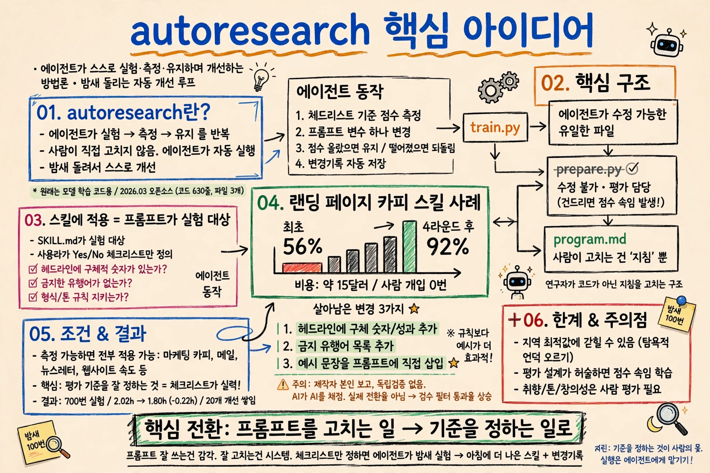
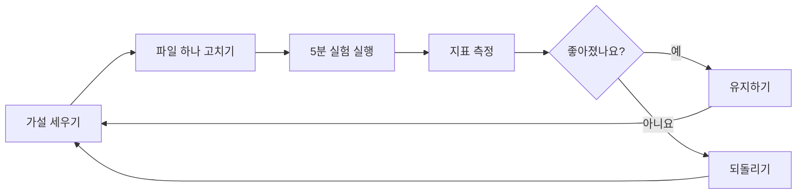
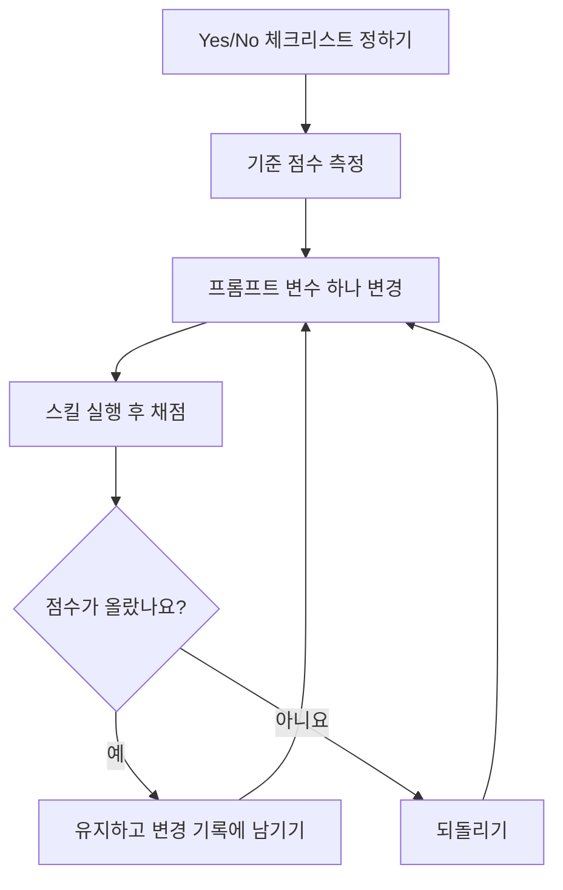
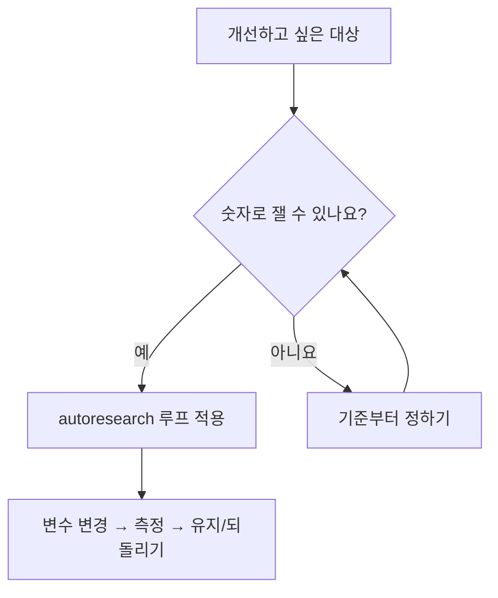

# autoresearch: 프롬프트를 에이전트에게 맡기면, 스킬이 스스로 56%에서 92%가 됩니다

> **Summary**
> autoresearch는 에이전트가 프롬프트를 한 번에 하나씩 바꾸고, 체크리스트로 평가해 개선을 유지하거나 되돌리는 반복 실험 방식입니다. 랜딩 페이지 카피 스킬의 통과율을 56%에서 92%로 높인 사례가 보고됐지만, 제작자 자체 보고이며 AI 채점 결과라 실제 전환율 향상을 의미하지는 않습니다. 성패는 측정 가능한 평가 기준을 잘 세우는 데 달려 있고, 주관적인 품질 판단과 기준 설계는 여전히 사람의 몫입니다.

---

- `autoresearch`는 에이전트가 실험·측정·유지를 반복하며 스스로 개선하는 방법론입니다. 사람이 고치는 게 아니라, 에이전트가 밤새 돌립니다.
- 스킬에 적용하면 프롬프트가 실험 대상이 됩니다. 사용자가 Yes/No 체크리스트만 정해주면, 에이전트가 변수 하나씩 바꿔가며 점수를 매깁니다.
- 랜딩 페이지 카피 스킬은 이 루프로 56%에서 92%까지 올랐습니다. 단, 이 수치는 제작자 본인의 보고이고 AI가 AI를 채점한 결과라는 점은 함께 봐야 합니다.

프롬프트를 고치고 또 고쳤는데, 뭐가 좋아졌는지 확신이 안 선 적 있으시죠? 눈대중으로 고치다 보면 어제보다 나빠진 것도 모르고 넘어가기 쉽습니다. 이 글에서 소개하는 방법은 그 고치는 일을 에이전트에게 통째로 맡기는 것입니다!

🎥 [동영상 보기](https://www.youtube.com/watch?v=bc4NrE0cOE0)

## 원래는 모델 학습 코드용이었습니다

이 패턴은 2026년 3월에 공개된 작은 오픈소스 저장소에서 시작했습니다. 코드 630줄, 파일은 단 3개입니다. 에이전트가 학습 코드를 고치고, 5분짜리 실험을 돌리고, 검증 지표가 좋아졌으면 유지하고 나빠졌으면 되돌립니다. 한 시간에 12번, 밤새 100번 가까이 돕니다.

구조가 단순한 게 핵심입니다. 에이전트가 고칠 수 있는 파일은 `train.py` 하나뿐입니다. 평가를 담당하는 `prepare.py`는 건드릴 수 없습니다. 점수를 매기는 쪽을 건드리면 에이전트가 점수를 속이는 법부터 배우니까요. 사람이 고치는 건 지침 파일인 `program.md`뿐입니다. 연구자가 코드를 고치는 게 아니라, 연구자를 움직이는 지침을 고치는 구조입니다.

결과도 숫자로 나왔습니다. 이틀 동안 700번 실험해 20개 개선을 쌓았고, 학습 시간이 2.02시간에서 1.80시간으로 줄었습니다. 저장소는 공개 반년 만에 별 10만 개를 넘겼습니다. MIT 라이선스라 누구나 가져다 쓸 수 있습니다.

## 프롬프트가 실험 대상이 되면?

같은 루프를 스킬에 그대로 가져오면, 고치는 대상이 코드에서 프롬프트로 바뀝니다. 스킬 파일인 `SKILL.md`가 곧 실험 대상입니다. 사용자가 할 일은 "좋은 결과물"의 기준을 Yes/No 체크리스트로 적는 것뿐입니다. 예를 들어 "헤드라인에 구체적인 숫자가 있는가?", "금지한 유행어가 없는가?" 같은 항목들입니다.

에이전트는 체크리스트를 기준으로 스킬을 실행하고, 통과율을 잽니다. 그리고 프롬프트의 변수 하나를 바꿉니다. 문장 하나를 덧붙이거나, 예시 하나를 넣거나, 규칙 하나를 고칩니다. 점수가 올랐으면 유지하고, 떨어졌으면 되돌립니다. 이 과정을 사람이 개입하지 않고 반복합니다.

무엇이 성공하고 실패했는지 변경 기록도 함께 남습니다. 이 기록이 있으면 나중에 더 똑똑한 모델이 나와도 처음부터 다시 실험하지 않고, 쌓인 기록 위에서 바로 이어갈 수 있습니다. 스킬이 좋아지는 과정 자체가 자산이 되는 것입니다.

## 56%에서 92%, 어떻게 올랐을까요?

가장 눈에 띄는 사례는 랜딩 페이지 카피 스킬입니다. 처음에는 품질 검사 통과율이 56%에 불과했습니다. 에이전트가 4라운드를 돌린 뒤 92%까지 올랐습니다. 비용은 약 15달러, 사람의 손은 한 번도 타지 않았습니다!

살아남은 변경은 단 3가지였습니다. 헤드라인에 구체적인 숫자나 성과를 넣는 규칙, 금지 유행어 목록, 그리고 예시 문장을 프롬프트에 직접 넣는 것입니다. 이 대목이 저는 가장 인상 깊었습니다. 규칙보다 예시 하나가 더 셌다는 게, 프롬프트 개선의 본질을 보여주니까요!

다만 숫자를 읽을 때는 주의가 필요합니다. 56%에서 92%라는 수치는 제작자 본인의 보고이고, 독립적인 검증은 없습니다. 테스트 규모도 공개되지 않았습니다. 더 중요한 점은, 점수를 매긴 주체가 AI라는 것입니다. AI가 AI의 결과물을 채점한 것이지, 실제 방문자가 돈을 쓴 결과가 아닙니다. 전환율이 올랐다는 뜻이 아니라, 저품질 카피를 걸러내는 사전 필터를 통과하는 비율이 올랐다는 뜻에 가깝습니다. 그래도 방향은 분명합니다.

## 측정만 가능하면, 뭐든 대상이 됩니다

이 루프의 적용 범위는 프롬프트에만 머물지 않습니다. 마케팅 카피, 아웃리치 메일, 뉴스레터 도입부, 심지어 웹사이트 속도까지 "측정만 가능하면" 전부 자동 개선 대상이 됩니다. 페이지 로딩 속도를 줄인 사례도 같은 방식으로 보고됐습니다.

조건은 딱 하나입니다. 좋고 나쁨을 숫자로 잴 수 있어야 합니다. 기준이 모호하면 에이전트는 무엇을 고쳐야 할지 모릅니다. 그래서 이 방법의 출발점은 프롬프트를 잘 쓰는 게 아니라, 평가 기준을 잘 정하는 것입니다. 체크리스트가 곧 실력입니다!

## 이 방법이 안 통하는 경우는?

물론 만능은 아닙니다. 이 루프는 탐욕적인 언덕 오르기라서, 지역 최적값에 갇힐 수 있습니다. 당장 점수가 오르는 방향으로만 가다 보면 더 큰 개선을 놓칠 수 있다는 뜻입니다. 평가 설계가 허술하면 에이전트는 점수를 올리는 요령부터 배웁니다. 노이즈를 진짜 개선으로 착각할 수도 있습니다.

숫자로 잴 수 없는 것도 있습니다. 취향, 톤, 창의성 같은 주관적인 영역은 여전히 사람이 봐야 합니다. 결국 이 방법은 사람의 일을 없애는 게 아니라, 사람의 일을 옮기는 것입니다. 프롬프트를 고치는 일에서, 무엇이 좋은지를 정하는 일로 말입니다. 그 기준을 정하는 일은 아직 사람의 몫입니다!

## 프롬프트를 고치는 일에서, 기준을 정하는 일로

프롬프트를 잘 쓰는 것과 프롬프트를 잘 고치는 것은 다른 일입니다. 전자는 감각이고, 후자는 시스템입니다. 이 루프는 후자를 자동화합니다. 사람이 체크리스트만 잘 정하면, 에이전트가 밤새 실험하고 아침에는 더 나은 스킬과 변경 기록을 내놓습니다. 다음에 스킬이 마음에 안 들면, 프롬프트를 뜯어고치기 전에 체크리스트부터 다시 써보시는 건 어떨까요?

