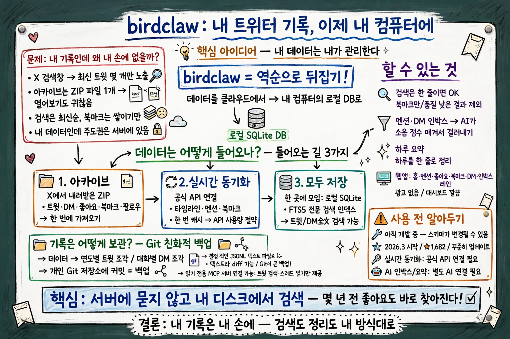
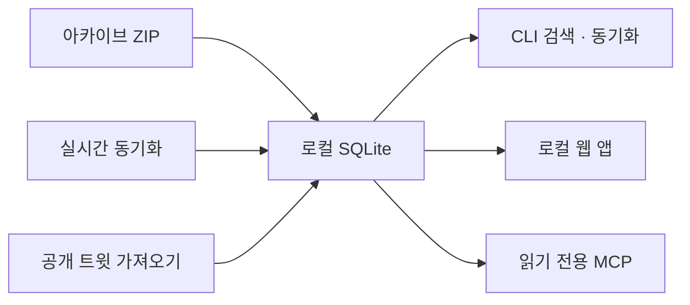
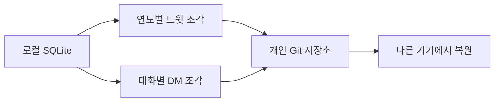

# birdclaw: 트위터 기록을 서버가 아니라 내 컴퓨터에 두면, 잊었던 트윗이 바로 찾아집니다

> **Summary**
> birdclaw는 트위터 아카이브와 실시간 데이터를 로컬 SQLite에 저장해 트윗, DM, 좋아요, 북마크를 검색·관리할 수 있게 합니다. AI로 멘션과 DM의 우선순위를 정하고 하루 요약을 만들며, Git에 보관할 수 있는 텍스트 백업과 읽기 전용 MCP도 지원합니다. 아직 개발 중이며 스키마 변경 가능성, API 비용, 별도 AI 연결이 필요하다는 점에 유의해야 합니다.

---

- 트위터 기록은 내 컴퓨터에 두는 게 맞습니다. birdclaw는 아카이브와 실시간 데이터를 로컬 SQLite에 모아 트윗·DM·좋아요·북마크를 한 곳에서 검색하게 만듭니다.
- 서버에 물어보지 않고 내 디스크에서 찾으니, 몇 년 전 좋아요도 바로 찾아집니다. AI가 멘션과 DM의 소음을 걸러주고 하루 요약까지 뽑아줍니다.
- 백업은 Git 친화적인 텍스트 파일로 나가니, 기록이 특정 서비스에 갇히지 않습니다. 아직 개발 중이라 스키마가 바뀔 수 있다는 점은 알고 써야 합니다.

몇 년 전에 좋아요를 눌렀던 트윗, 다시 보고 싶었던 적 있으시죠? X 검색창에 단어 하나를 쳐넣으면 최신 트윗 몇 개만 던져주고 마는 경우가 많습니다. 내 기록인데, 정작 내 손에 있는 게 아니라는 느낌을 받아보신 적 있으실 겁니다.

🎥 [동영상 보기](https://www.youtube.com/watch?v=VJ_GeNfZXrQ)

## 내 기록인데, 왜 내 손에 없을까요?

트위터는 내 트윗과 좋아요, DM을 들고 있지만, 그걸 내 방식으로 찾고 정리할 방법은 거의 주지 않습니다. 아카이브를 내려받아도 ZIP 파일 하나가 전부라, 열어보기도 전에 묵혀두게 됩니다. 검색은 최신순에 묶여 있고, 북마크는 쌓이기만 합니다. 내 데이터인데 주도권은 서버에 있습니다!

birdclaw는 이 순서를 뒤집습니다. 데이터를 클라우드에서 꺼내 내 컴퓨터의 데이터베이스에 쌓는 겁니다. 한 번 쌓이면, 그다음부터는 서버에 물어보지 않고 내 디스크에서 찾습니다!

## 데이터는 어떻게 들어오나요?

들어오는 길은 세 가지입니다. 먼저 아카이브입니다. X에서 내려받은 아카이브 ZIP을 가져오면 트윗·DM·좋아요·북마크·팔로우 관계까지 한 번에 들어옵니다. 필요한 부분만 골라서 가져오는 것도 됩니다.

다음은 실시간 동기화입니다. 타임라인·멘션·북마크를 가져올 때는 공식 API 연결을 씁니다. 한 번 읽은 데이터는 로컬에 캐시해 두니, 같은 내용을 다시 읽느라 API 사용량을 태우지 않습니다. 읽기는 요청할 때만 일어납니다. 꼭 필요한 공개 트윗 몇 개만 가져오는 방법도 있는데, 이건 별도 서비스를 거치는 선택 사항입니다.

모든 데이터는 하나의 로컬 SQLite 데이터베이스에 모입니다. `~/.birdclaw` 아래에 자리 잡고, FTS5 인덱스가 붙어 트윗과 DM을 전문 검색으로 찾습니다. 계정이 여러 개여도 하나의 데이터베이스에 함께 들어갑니다.

## 찾고, 걸러내고, 답장까지 한 곳에서 할 수 있을까요?

검색은 이렇게 한 줄이면 됩니다.

`birdclaw search tweets "local-first" --json`

북마크만 골라서, 품질이 낮은 결과는 빼고 찾는 것도 됩니다. 멘션과 DM은 인박스에서 AI 점수를 매겨 소음부터 걸러냅니다. 스팸 같은 저신호 항목은 뒤로 밀리고, 답해야 할 것이 앞으로 옵니다. 답장도 터미널에서 바로 보낼 수 있습니다.

하루를 마무리할 때는 `birdclaw today` 한 줄이면 됩니다. 오늘 있었던 일을 스트리밍 요약으로 뽑아줍니다. 어제나 이번 주 단위 요약도 됩니다. DM은 기본적으로 요약에서 빠집니다. 굳이 넣고 싶을 때만 켜면 됩니다.

웹 앱도 있습니다. `birdclaw serve`를 켜면 `localhost:3000`에서 홈·멘션·좋아요·북마크·DM·인박스 레인이 뜹니다. 광고도 없고, 대시보드 장식도 없습니다! 라이트·다크·시스템 테마가 됩니다. 팔로워와 팔로잉을 지도 위에 찍어보는 네트워크 보기, 링크를 모아보는 보기까지 들어 있습니다.

## 기록은 어떻게 보관되나요?

백업 방식이 이 도구의 성격을 잘 보여줍니다. 데이터베이스 내용을 연도별 트윗 조각과 대화별 DM 조각으로 나눠, 결정적인 JSONL 텍스트 파일로 뽑아냅니다. 이 파일들은 개인 Git 저장소에 그대로 커밋하면 됩니다. 텍스트라서 diff도 보이고, Git이 곧 백업이 됩니다!

에이전트와 연결할 때는 읽기 전용 MCP 서버를 씁니다. 로컬에 쌓인 트윗 검색과 스레드 읽기만 열어주고, DM과 쓰기·실시간 연결은 노출하지 않습니다. 내 기록을 에이전트가 읽게 하되, 함부로 건드리지 못하게 막아둔 겁니다!

## 써보기 전에, 뭐부터 확인하면 좋을까요?

먼저, 아직 완성된 도구가 아니라는 점을 알아야 합니다. 공식 안내도 "실제 쓸 수 있지만, 아직 완성된 상태는 아니다"라고 밝히고 있습니다. 스키마가 바뀔 수 있고, 전송 방식에 빈틈이 있을 수 있습니다. 2026년 3월에 시작해 별 1,682개를 받았고, 최근까지도 꾸준히 손질되고 있습니다.

둘째, 실시간 동기화에는 공식 API 연결이 필요합니다. 읽을 때마다 API 사용량이 나가니, 캐시가 있어도 처음 가져올 때는 비용이 듭니다. 아카이브만 쓰는 용도라면 로그인 없이도 됩니다.

셋째, AI 인박스와 요약은 별도 AI 연결이 필요합니다. 요약 품질은 모델에 달렸고, DM 요약은 기본적으로 꺼져 있습니다. 공개 트윗 가져오기는 별도 서비스를 거치니, 꼭 필요할 때만 쓰는 게 맞습니다.

내 트위터 기록이 내 컴퓨터에 있으면, 검색도 정리도 내 방식대로 됩니다. 그게 이 도구가 던지는 가장 단순한 제안입니다.

