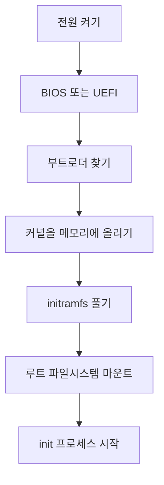
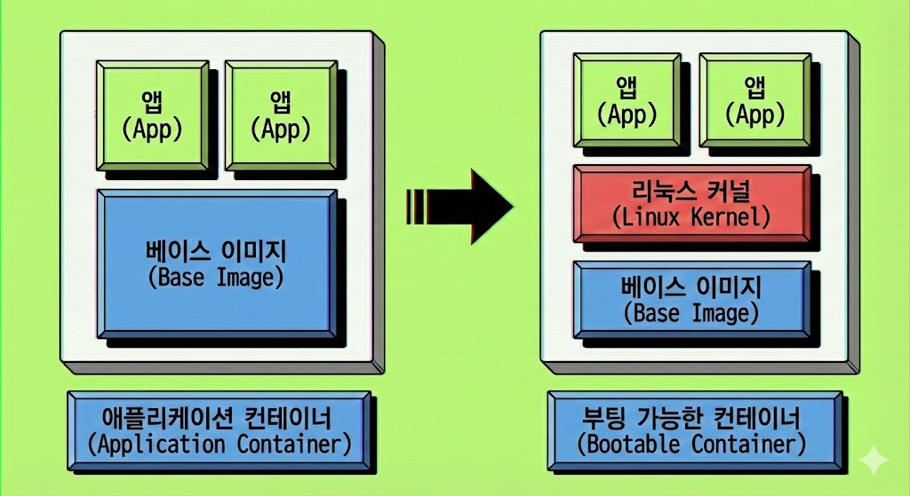
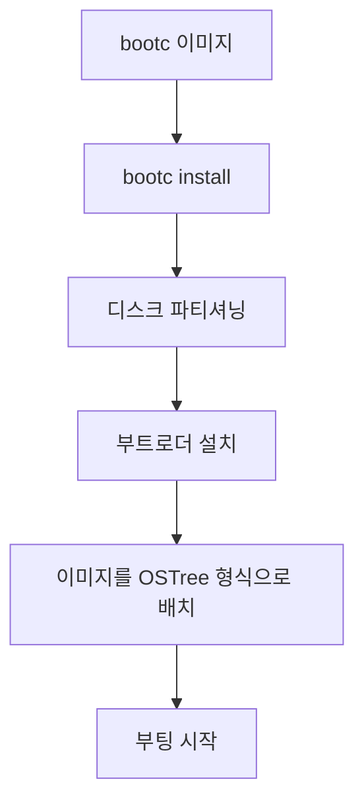

# bootc 이미지가 부팅되는 이유? 커널이 이미지 안에 있습니다

> **Summary**
> bootc 이미지는 커널과 initramfs를 포함해 부팅에 필요한 파일을 제공하지만, 이것만으로는 부팅되지 않습니다. bootc install이 디스크를 파티셔닝하고 부트로더를 설치한 뒤 이미지를 OSTree 형식으로 배치해야 독립적인 OS로 부팅할 수 있으며, podman run으로 실행하면 호스트 커널을 사용하는 일반 컨테이너로 동작합니다.

---

- bootc 이미지는 커널과 initramfs를 이미지 안에 포함하고 있어서 부팅이 가능합니다. 일반 컨테이너 이미지의 `/boot`은 비어 있습니다.
- 커널 파일이 있다고 바로 부팅되는 건 아닙니다. `bootc install`이 디스크를 파티셔닝하고 부트로더를 설치하고 이미지를 OSTree 형식으로 배치해야 부팅이 시작됩니다.
- 같은 이미지가 `podman run`으로는 일반 컨테이너처럼, 디스크에 설치하면 독립적인 OS로 동작합니다. 이 둘을 가르는 것이 `bootc install`입니다.

컨테이너 이미지를 USB에 구워서 재부팅했더니, 그 자체로 OS가 부팅된다고 하면 어떨까요? 평소 쓰던 컨테이너는 호스트 OS 위에서 돌아가는 격리된 프로세스였는데, 이 이미지는 호스트 없이도 부팅됩니다. 커널이 어디서 오는 걸까요?

🎥 [동영상 보기](https://www.youtube.com/watch?v=ERVyBc_fElY)

## 일반 컨테이너는 왜 부팅이 안 될까요?

일반 컨테이너는 호스트 OS의 커널을 빌려 씁니다. 컨테이너 안에서 `uname -r`을 실행하면 호스트의 커널 버전이 나옵니다. 리눅스 커널의 namespace와 cgroups가 격리를 담당합니다. namespace는 프로세스에게 독립적인 PID, 네트워크, 파일시스템 뷰를 제공하고, cgroups는 CPU나 메모리 같은 자원 사용을 제한합니다. 격리는 확실하지만, 이 모든 것이 호스트 커널 위에서 일어납니다.

그래서 일반 컨테이너 이미지의 `/boot` 디렉토리는 비어 있습니다. 커널도 없고, initramfs도 없습니다. 있을 필요가 없기 때문입니다. 호스트가 이미 커널을 제공하고 있으니까요.

컴퓨터가 켜지면 BIOS나 UEFI가 부트로더를 찾고, 부트로더가 커널을 메모리에 올리고, 커널이 initramfs를 풀어 루트 파일시스템을 마운트합니다. 그제서야 init 프로세스(보통 systemd)가 시작됩니다. 이 과정에서 커널은 필수입니다. 커널이 없으면 아무것도 시작되지 않습니다!

Debian 컨테이너 이미지를 예로 들어보겠습니다. 컨테이너 내부에서 `tree -L 1 /boot`를 실행하면 빈 디렉토리가 나옵니다. 부팅 파일 자체가 없습니다. 여기에 `linux-image-amd64` 패키지를 설치하면 약 230MB가 추가됩니다. `/boot/vmlinuz-*`에 커널이 들어가고, `/boot/initrd.img-*`에 initramfs가 들어가고, `/lib/modules`에 커널 모듈들이 들어갑니다. 그제서야 부팅의 기본 조건이 갖춰집니다.

## bootc 이미지는 뭐가 다를까요?

bootc 이미지는 컨테이너 내부에 Linux 커널이 들어 있습니다. 정확히 말하면 `/usr/lib/modules/$kver/vmlinuz`에 커널이, 같은 디렉토리의 `initramfs.img`에 초기 램디스크가 위치합니다. 이 파일들이 이미지의 일부로 포함됩니다.

베이스 이미지가 핵심입니다. `quay.io/centos-bootc/centos-bootc:stream10` 같은 베이스 이미지에는 부팅에 필요한 것이 미리 들어 있습니다. 커널, initramfs, 부트로더 설정(bootupd가 관리), OSTree 또는 composefs 구성, SELinux 레이블 메타데이터까지요. 베이스 이미지만 제대로 된 것을 쓰면, 나머지는 일반 컨테이너 빌드와 똑같습니다. `RUN dnf install`도 되고, `COPY`도 되고, 멀티스테이지 빌드도 됩니다!

여기서 OSTree가 등장합니다. bootc는 OCI 이미지를 가져와서 OSTree 커밋으로 변환합니다. OSTree는 Git과 유사한 파일시스템 버전 관리 시스템인데, 이를 통해 원자적 업데이트와 롤백이 가능해집니다.

## 커널이 있다고 바로 부팅될까요?

아닙니다. 커널 파일이 이미지 안에 있다고 해서, 그 자체로 부팅되는 건 아닙니다. 실제 부팅이 일어나려면 디스크에서 다음 작업들이 선행되어야 합니다. 파티션 레이아웃이 결정되어야 하고, 부트로더가 설치되어야 하고, 루트 파일시스템이 디스크에 펼쳐져야 합니다. 이 모든 걸 `bootc install`이 합니다!

`bootc install`은 다섯 가지 작업을 합니다. 대상 디스크를 파티셔닝하고, 각 파티션에 파일시스템을 생성하고, 부트로더(GRUB2 또는 systemd-boot)를 설치하고, 컨테이너 이미지를 OSTree 저장소 형식으로 체크아웃하고, 부트로더 설정에 OSTree 배포 정보를 기록합니다. 이 과정을 거쳐야 비로소 BIOS/UEFI가 부트로더를 찾고, 부트로더가 커널을 로드하고, 커널이 initramfs를 실행하고, initramfs가 루트 파일시스템을 마운트하는 표준 부팅 과정이 시작됩니다.

## 같은 이미지인데 왜 동작이 다를까요?

bootc 이미지는 두 가지 방식으로 실행할 수 있습니다. 컨테이너 모드에서는 `podman run`으로 돌리면 일반 컨테이너입니다. 호스트 커널을 빌려 쓰고, 이미지 안의 커널 파일은 무시됩니다. 개발하고 테스트할 때 이 모드를 씁니다. 부팅 모드에서는 `bootc install`로 디스크에 설치하고 재부팅하면, 이미지 안의 커널이 직접 하드웨어를 제어합니다. 호스트 의존성이 없는 독립 시스템입니다. 배포할 때 이 모드를 씁니다.

같은 이미지인데 동작이 다릅니다! 이 둘을 가르는 차이는 `bootc install`, 즉 디스크 설치 여부입니다. 레이어 하나 추가의 문제가 아닙니다. 호스트를 사용하는 게스트와, 스스로 하드웨어를 제어하는 독립 시스템의 차이입니다.

## 정리하면

bootc 이미지가 부팅되는 이유는 커널과 initramfs가 이미지 안에 포함되어 있기 때문입니다. 일반 컨테이너 이미지의 `/boot`은 비어 있습니다. 그리고 커널 파일이 있다고 자동으로 부팅되는 건 아닙니다. `bootc install`이 디스크를 파티셔닝하고, 부트로더를 설치하고, 이미지를 OSTree 저장소 형식으로 배치해야 비로소 부팅 시퀀스가 시작됩니다. OCI 이미지이면서 동시에 부팅 가능한 OS, 그 둘 사이를 연결하는 것이 `bootc install`입니다!

