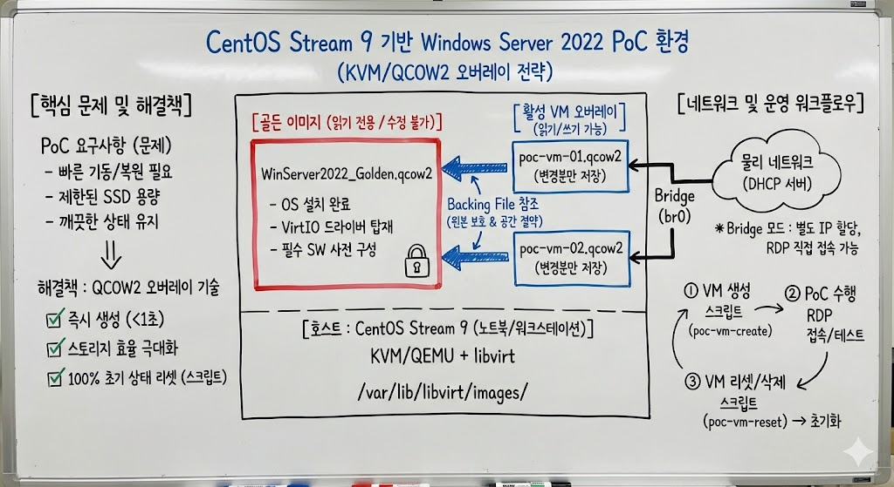

# centOS에서 windows server 를 구동시키자

> **Summary**
> CentOS Stream 9에서 Windows Server 2022를 가상화하는 방법을 다루며, KVM/QEMU와 libvirt를 사용한 최적의 설정을 제안한다. 세 가지 접근법을 비교하고, QCOW2 기반의 백킹 파일 전략을 통해 스토리지 효율성과 빠른 VM 생성을 강조한다. 또한, VirtIO 드라이버 설치, RDP 활성화, 및 PoC 환경 구축을 위한 스크립트 사용법을 제공하며, 성능 최적화 및 문제 해결 방법도 포함된다.

---




🎥 [동영상 보기](https://youtu.be/y1ic8lc8cn8?si=igkwOt2CiX6T3EpR)

# 3가지 방법 조사

| [https://gemini.google.com/share/af4bf420db16](https://gemini.google.com/share/af4bf420db16) | [https://claude.ai/public/artifacts/5c605d08-5c41-4dd7-bb09-eab8f4c7b803](https://claude.ai/public/artifacts/5c605d08-5c41-4dd7-bb09-eab8f4c7b803) | [https://chatgpt.com/s/t_696bab773550819198e9415c244b4e5a](https://chatgpt.com/s/t_696bab773550819198e9415c244b4e5a) |

## 세 문서 비교 분석

### 문서별 특성 요약

| 구분 | 문서 1 (심층 보고서) | 문서 2 (실용 가이드) | 문서 3 (종합 가이드) |
| --- | --- | --- | --- |
| **대상 독자** | 엔터프라이즈 인프라 엔지니어 | 개발자/시스템 관리자 | 중급 시스템 관리자 |
| **환경 규모** | 대규모 (수십~수백 VM) | 소규모 (1-2개 VM) | 중소규모 (다수 VM) |
| **핵심 초점** | 고빈도 라이프사이클 자동화 | 빠른 구축과 실용성 | 성능 최적화와 유연성 |
| **복잡도** | 높음 | 낮음 | 중간 |
| **자동화 수준** | Packer + Terraform + Vagrant | Virt-Manager GUI 중심 | CLI + 스크립트 + Cockpit |

---

### 공통점

세 문서 모두 동일한 기술 스택과 핵심 원칙을 공유한다.

**1. KVM/QEMU + libvirt가 최적의 선택**

모든 문서가 CentOS/RHEL 환경에서 VirtualBox나 VMware보다 KVM이 우월하다는 점에 동의한다. 커널 통합형 하이퍼바이저로서 성능 오버헤드가 최소화되고, 리눅스 생태계와의 호환성이 완벽하다.

**2. VirtIO 드라이버 필수**

Windows 게스트에서 VirtIO 드라이버(vioscsi, NetKVM, Balloon)와 QEMU Guest Agent 설치가 성능 최적화의 핵심이라는 점을 공통적으로 강조한다.

**3. QCOW2 기반 이미지 전략**

골든 이미지를 QCOW2로 만들고, 이를 기반으로 클론 또는 오버레이를 생성하는 방식이 효율적이라는 점에 합의한다.

**4. Bridge 네트워킹 권장**

RDP 접근성과 네트워크 편의성을 위해 NAT보다 Bridge 모드를 권장한다.

---

### 핵심 차이점

**1. 이미지 복제 전략**

| 문서 | 접근법 | 특징 |
| --- | --- | --- |
| 문서 1 | **QCOW2 Backing File (Overlay)** | 원본 읽기전용, 변경분만 별도 저장. 1초 미만 생성. |
| 문서 2 | **virt-clone (Full Clone)** | 전체 복사. 안전하지만 느리고 용량 소모. |
| 문서 3 | **백킹 파일 + 상태별 오버레이** | 문서 1과 유사하나 상태 전환 스크립트 제공. |

**2. 자동화 도구 선택**

문서 1은 Packer로 이미지 빌드 자동화 + Vagrant/Terraform으로 라이프사이클 관리라는 엔터프라이즈급 파이프라인을 제시한다. 문서 2는 Virt-Manager GUI와 수동 스냅샷을 기본으로 하고, 필요시 Vagrant/Ansible을 선택적으로 도입한다. 문서 3은 virsh CLI와 쉘 스크립트 기반 자동화를 중심으로 Cockpit 웹 UI를 보조 도구로 활용한다.

**3. Sysprep 처리 방식**

문서 1과 2는 Sysprep을 통한 이미지 일반화를 강조하지만, 문서 3은 Sysprep 후 복잡한 애플리케이션이 손상될 수 있다는 경고를 추가하고, 템플릿을 VM 형태로 유지하라고 조언한다.

**4. 성능 튜닝 깊이**

문서 1은 CPU Pinning, NUMA 인식, Hugepages, I/O 스케줄러 튜닝 등 하드웨어 레벨 최적화를 상세히 다룬다. 문서 3은 Hyper-V Enlightenments, IOThreads, 캐시 모드 등 VM 레벨 최적화에 집중한다. 문서 2는 기본 VirtIO 설치 외에 심층 튜닝을 다루지 않는다.

---

### 사용 사례에 대한 권장사항

노트북에서 CentOS Stream 9, PoC용 Windows Server 1-2개, 특정 소프트웨어가 설치된 골든 이미지가 필요한 환경이라면 **문서 3의 접근법을 기반으로, 문서 1의 QCOW2 Backing File 전략을 결합**하는 것이 최적이다.

**이유:**

**문서 1의 방식이 과한 이유**

- Packer, Terraform, Vagrant 도입은 1-2개 VM 관리에 오버엔지니어링
- CPU Pinning, Hugepages 등 하드웨어 튜닝은 노트북 환경에서 효과 제한적
- 학습 곡선이 높아 PoC 목적에 비해 초기 투자 시간이 과다
**문서 2의 방식이 부족한 이유**

- Full Clone 방식은 SSD 용량이 제한된 노트북에서 비효율적
- 스냅샷 의존적 접근은 "올렸다 내렸다" 반복 시 파일 비대화 문제
- GUI 중심 워크플로우는 반복 작업에 비효율
**문서 3의 방식이 적합한 이유**

- 백킹 파일 전략으로 빠른 생성/삭제와 스토리지 효율성 확보
- virsh CLI와 간단한 쉘 스크립트로 적절한 자동화 수준
- Cockpit으로 필요시 GUI 접근 가능
- CentOS Stream 9의 특성(SPICE deprecated 등)을 고려한 설정 제공
---

# CentOS Stream 9 기반 Windows Server 2022 PoC 가상화 환경 구축 가이드

## 문서 정보

| 항목 | 내용 |
| --- | --- |
| 작성일 | 2025년 1월 |
| 대상 환경 | CentOS Stream 9 (노트북/워크스테이션) |
| 게스트 OS | Windows Server 2022 |
| 용도 | PoC(Proof of Concept) 및 기술 검증 |

---

## 1. 서론: 가이드 작성 배경

### 1.1 문제 정의

Pre-Sales Engineer나 기술 컨설턴트가 고객에게 솔루션을 시연하거나 내부 기술 검증을 수행할 때, Windows Server 환경이 필수적으로 요구되는 경우가 빈번하다. 이러한 PoC 환경은 다음과 같은 특성을 갖는다.

**운영 패턴의 특수성:**

- 시연이나 테스트를 위해 VM을 빠르게 기동
- 작업 완료 후 즉시 종료 또는 삭제
- 다음 시연을 위해 "깨끗한 상태"로 신속하게 복원
- 특정 소프트웨어(데모용 애플리케이션, 에이전트 등)가 항상 사전 설치되어 있어야 함
**물리적 제약:**

- 노트북이라는 제한된 하드웨어 리소스
- SSD 용량의 효율적 활용 필요
- 이동 중에도 오프라인 환경에서 구동 가능해야 함
**관리 요구사항:**

- 동시에 운영하는 VM은 1-2개로 소규모
- 복잡한 자동화 파이프라인보다 빠른 구축과 간편한 운영 우선
- 필요시 CLI나 스크립트로 반복 작업 자동화
### 1.2 기존 접근법의 한계

이러한 요구사항을 충족하기 위한 기존 접근법들을 검토한 결과, 각각 한계점이 존재했다.

**엔터프라이즈급 자동화 (Packer + Terraform + Vagrant):**

- 학습 곡선이 높아 초기 구축에 수일 소요
- 1-2개 VM 관리에 과도한 오버엔지니어링
- 노트북 환경에서 불필요한 복잡성 증가
**GUI 중심 수동 관리 (Virt-Manager + Full Clone):**

- 매번 전체 디스크를 복제하므로 SSD 용량 낭비
- 스냅샷 누적 시 이미지 파일 비대화
- 반복 작업에 비효율적
**단순 스냅샷 의존:**

- 스냅샷 체인이 깊어질수록 I/O 성능 저하
- 72시간 이상 유지 시 권장되지 않음
- "깨끗한 복원"이 아닌 "시점 복원"에 가까움
### 1.3 본 가이드의 접근 방식

본 가이드는 **QCOW2 Backing File(오버레이) 전략**을 핵심으로 채택한다. 이 방식은 다음과 같은 이점을 제공한다.

| 이점 | 설명 |
| --- | --- |
| 즉시 생성 | 골든 이미지 기반 오버레이 생성에 1초 미만 소요 |
| 스토리지 효율 | 변경분만 저장하므로 SSD 용량 절약 |
| 완전한 복원 | 오버레이 삭제 후 재생성으로 100% 초기 상태 복원 |
| 원본 보호 | 골든 이미지는 읽기 전용으로 절대 변경되지 않음 |
| 적정 자동화 | 쉘 스크립트 수준의 간단한 자동화로 충분 |

---

## 2. 아키텍처 설계

### 2.1 전체 구조

```plain text
┌─────────────────────────────────────────────────────────────────┐
│                    CentOS Stream 9 Host                         │
│  ┌───────────────────────────────────────────────────────────┐  │
│  │                    KVM/QEMU + libvirt                     │  │
│  │  ┌─────────────────────────────────────────────────────┐  │  │
│  │  │              골든 이미지 (읽기 전용)                  │  │  │
│  │  │         WinServer2022_Golden.qcow2                  │  │  │
│  │  │    - Windows Server 2022 설치 완료                   │  │  │
│  │  │    - VirtIO 드라이버 설치                            │  │  │
│  │  │    - 필수 소프트웨어 사전 설치                        │  │  │
│  │  │    - RDP 활성화                                      │  │  │
│  │  └────────────────────┬────────────────────────────────┘  │  │
│  │                       │ Backing File 참조                 │  │
│  │         ┌─────────────┴─────────────┐                     │  │
│  │         ▼                           ▼                     │  │
│  │  ┌─────────────┐             ┌─────────────┐              │  │
│  │  │ poc-vm-01   │             │ poc-vm-02   │              │  │
│  │  │ .qcow2      │             │ .qcow2      │              │  │
│  │  │ (변경분만)   │             │ (변경분만)   │              │  │
│  │  └─────────────┘             └─────────────┘              │  │
│  └───────────────────────────────────────────────────────────┘  │
│                              │                                   │
│                    Bridge Network (br0)                          │
│                              │                                   │
└──────────────────────────────┼───────────────────────────────────┘
                               │
                        물리 네트워크
                    (DHCP로 IP 할당)

```

### 2.2 기술 선택 근거

**하이퍼바이저: KVM/QEMU**

| 비교 항목 | KVM | VirtualBox | VMware Workstation |
| --- | --- | --- | --- |
| 아키텍처 | Type 1 (커널 통합) | Type 2 | Type 2 |
| CentOS 호환성 | 완벽 (기본 제공) | 커널 모듈 의존 | 모듈 재컴파일 필요 |
| I/O 성능 | 최상 (VirtIO) | 보통 | 우수 |
| 오버레이 지원 | 네이티브 (QCOW2) | 제한적 | 링크드 클론 (유료) |
| 라이선스 | 오픈소스 | 무료 | 상용 |

KVM은 리눅스 커널의 일부로 작동하므로 CentOS Stream 9에서 추가 설치 없이 최적의 성능을 제공한다. 특히 QCOW2 포맷의 Backing File 기능은 본 가이드의 핵심 전략을 가능하게 한다.

**네트워크: Bridge 모드**

NAT 모드는 설정이 간편하지만, RDP 접속을 위해 포트 포워딩이 필요하고 호스트와 다른 서브넷에 위치하게 된다. Bridge 모드를 사용하면 VM이 물리 네트워크에서 독립적인 장치로 인식되어 별도의 IP를 DHCP로 할당받으며, 호스트나 다른 장치에서 직접 RDP 접속이 가능하다.

**GUI 접근: RDP 우선**

| 접근 방법 | 용도 | 성능 |
| --- | --- | --- |
| RDP | 일상 작업, 시연 | 최상 (네이티브급) |
| SPICE | USB 리다이렉션 필요 시 | 우수 |
| VNC | OS 설치, 부팅 문제 해결 | 보통 |

Windows Server 환경에서는 RDP가 가장 효율적이다. SPICE는 CentOS Stream 9에서 deprecated 추세이며, VNC는 콘솔 접근 용도로만 활용한다.

### 2.3 디렉토리 구조

```plain text
/var/lib/libvirt/images/
├── Templates/
│   └── WinServer2022_Golden.qcow2    # 골든 이미지 (읽기 전용)
├── Active/
│   ├── poc-vm-01.qcow2               # 활성 오버레이
│   └── poc-vm-02.qcow2               # 활성 오버레이
└── ISO/
    ├── Win2022_Eval.iso              # Windows 설치 ISO
    └── virtio-win.iso                # VirtIO 드라이버 ISO

```

---

## 3. 호스트 환경 구축 (CentOS Stream 9)

> 작업 환경: CentOS Stream 9 호스트

### 3.1 사전 요구사항 확인

```bash
# CPU 가상화 확장 지원 확인 (vmx: Intel, svm: AMD)
grep -E '(vmx|svm)' /proc/cpuinfo | head -1

# 출력 예시 (Intel):
# flags : ... vmx ...

# 출력이 없으면 BIOS/UEFI에서 가상화 기능 활성화 필요

```

노트북 BIOS에서 Intel VT-x 또는 AMD-V가 비활성화되어 있다면, 재부팅 후 BIOS 설정에서 활성화해야 한다.

### 3.2 KVM/QEMU 패키지 설치

```bash
# 핵심 가상화 패키지 설치
sudo dnf install -y qemu-kvm qemu-img libvirt virt-install libvirt-client

# GUI 관리 도구 (선택사항, 데스크톱 환경 필요)
sudo dnf install -y virt-manager

# 추가 유틸리티
sudo dnf install -y bridge-utils libguestfs-tools virt-top

# Cockpit 웹 관리 인터페이스 (선택사항)
sudo dnf install -y cockpit cockpit-machines

```

### 3.3 서비스 활성화 및 검증

```bash
# libvirtd 서비스 시작 및 부팅 시 자동 시작 설정
sudo systemctl enable --now libvirtd

# 서비스 상태 확인
sudo systemctl status libvirtd

# KVM 모듈 로드 확인
lsmod | grep kvm
# 출력 예시:
# kvm_intel             xxx  0
# kvm                   xxx  1 kvm_intel

# 현재 사용자를 libvirt 그룹에 추가 (sudo 없이 사용하려면)
sudo usermod -aG libvirt $(whoami)

# 그룹 변경 적용을 위해 재로그인 또는:
newgrp libvirt

```

### 3.4 Bridge 네트워크 구성

기본 NAT 네트워크(virbr0) 대신 Bridge 네트워크를 구성하여 VM이 호스트와 동일한 물리 네트워크에 연결되도록 한다.

```bash
# 현재 네트워크 인터페이스 확인
nmcli device status

# 출력 예시:
# DEVICE      TYPE      STATE      CONNECTION
# enp0s31f6   ethernet  connected  Wired connection 1
# wlp82s0     wifi      connected  MyWiFi
# virbr0      bridge    connected  virbr0
# lo          loopback  unmanaged  --

# 유선 인터페이스 이름 확인 (예: enp0s31f6)
# 주의: Wi-Fi 인터페이스는 브릿지로 사용할 수 없음

```

**중요:** Bridge 네트워크는 유선(Ethernet) 인터페이스에서만 정상 작동한다. Wi-Fi 환경에서는 NAT 모드를 사용하거나, USB 이더넷 어댑터를 연결해야 한다.

```bash
# Bridge 인터페이스 생성
sudo nmcli connection add type bridge con-name br0 ifname br0

# Bridge에 IP 설정 (DHCP 사용)
sudo nmcli connection modify br0 ipv4.method auto

# 물리 인터페이스를 Bridge 슬레이브로 추가
# (enp0s31f6를 실제 인터페이스 이름으로 교체)
sudo nmcli connection add type bridge-slave ifname enp0s31f6 master br0

# 기존 연결 비활성화 및 Bridge 활성화
sudo nmcli connection down "Wired connection 1"
sudo nmcli connection up br0

# 연결 확인
nmcli connection show --active
ip addr show br0

```

**libvirt에 Bridge 네트워크 등록:**

```bash
# Bridge 네트워크 정의 파일 생성
cat << 'EOF' | sudo tee /tmp/br0-network.xml
<network>
  <name>host-bridge</name>
  <forward mode="bridge"/>
  <bridge name="br0"/>
</network>
EOF

# 네트워크 정의 및 활성화
sudo virsh net-define /tmp/br0-network.xml
sudo virsh net-start host-bridge
sudo virsh net-autostart host-bridge

# 네트워크 목록 확인
sudo virsh net-list --all

```

### 3.5 디렉토리 구조 생성

```bash
# 이미지 저장 디렉토리 생성
sudo mkdir -p /var/lib/libvirt/images/{Templates,Active,ISO}

# SELinux 컨텍스트 설정 (CentOS Stream 9에서 필수)
sudo semanage fcontext -a -t virt_image_t "/var/lib/libvirt/images/Templates(/.*)?"
sudo semanage fcontext -a -t virt_image_t "/var/lib/libvirt/images/Active(/.*)?"
sudo restorecon -R -v /var/lib/libvirt/images/

# 권한 설정
sudo chown -R qemu:qemu /var/lib/libvirt/images/

```

### 3.6 VirtIO 드라이버 ISO 다운로드

```bash
# 안정 버전 다운로드
sudo wget -O /var/lib/libvirt/images/ISO/virtio-win.iso \
  https://fedorapeople.org/groups/virt/virtio-win/direct-downloads/stable-virtio/virtio-win.iso

# 다운로드 확인
ls -lh /var/lib/libvirt/images/ISO/virtio-win.iso

```

Windows Server 2022 설치 ISO는 Microsoft 평가 센터에서 다운로드하여 `/var/lib/libvirt/images/ISO/` 경로에 저장한다.

---

## 4. 골든 이미지 생성 (Windows Server 2022 설치)

이 단계에서는 Windows Server 2022를 설치하고, 필수 드라이버와 소프트웨어를 구성한 후, 골든 이미지로 변환한다.

### 4.1 임시 설치용 VM 생성

> 작업 환경: CentOS Stream 9 호스트

```bash
# 설치용 VM 디스크 생성 (60GB, 씬 프로비저닝)
sudo qemu-img create -f qcow2 /var/lib/libvirt/images/Templates/WinServer2022_Golden.qcow2 60G

# VM 생성 및 설치 시작
sudo virt-install \
  --name win2022-golden-setup \
  --memory 4096 \
  --vcpus 2 \
  --cpu host-passthrough \
  --disk path=/var/lib/libvirt/images/Templates/WinServer2022_Golden.qcow2,format=qcow2,bus=scsi \
  --controller type=scsi,model=virtio-scsi \
  --disk path=/var/lib/libvirt/images/ISO/Win2022_Eval.iso,device=cdrom \
  --disk path=/var/lib/libvirt/images/ISO/virtio-win.iso,device=cdrom \
  --network bridge=br0,model=virtio \
  --graphics spice,listen=127.0.0.1 \
  --video qxl \
  --os-variant win2k22 \
  --boot cdrom,hd

```

설치 화면이 자동으로 열린다. 열리지 않으면 다음 명령으로 콘솔 접속:

```bash
virt-viewer win2022-golden-setup

```

### 4.2 Windows Server 2022 설치

> 작업 환경: Windows 설치 화면 (SPICE 콘솔)

**4.2.1 언어 및 지역 설정**

1. "다음" 클릭
1. "지금 설치" 클릭
**4.2.2 에디션 선택**

"Windows Server 2022 Standard Evaluation (데스크톱 환경)" 선택 후 "다음"

**4.2.3 VirtIO 스토리지 드라이버 로드**

설치 유형 선택 화면에서 디스크가 보이지 않는다. VirtIO 드라이버를 로드해야 한다.

1. "사용자 지정: Windows만 설치(고급)" 선택
1. "드라이버 로드" 클릭
1. "찾아보기" 클릭
1. CD 드라이브에서 VirtIO ISO 탐색
1. `vioscsi\2k22\amd64` 폴더 선택
1. "Red Hat VirtIO SCSI controller" 드라이버 선택 후 "다음"
1. 이제 60GB 드라이브가 표시됨
1. 드라이브 선택 후 "다음"으로 설치 진행
**4.2.4 설치 완료 후 초기 설정**

1. 관리자 암호 설정 (PoC 환경에서는 기억하기 쉬운 암호 권장)
1. Ctrl+Alt+Del 후 로그인
### 4.3 VirtIO 드라이버 및 Guest Agent 설치

> 작업 환경: Windows Server 2022 게스트

**4.3.1 나머지 VirtIO 드라이버 설치**

1. 파일 탐색기에서 VirtIO CD 드라이브 열기 (보통 D: 또는 E:)
1. `virtio-win-gt-x64.msi` 실행
1. 설치 마법사 진행 (기본값 유지)
1. 완료 후 재부팅
이 MSI 패키지는 다음 드라이버를 자동으로 설치한다:

- VirtIO SCSI (vioscsi) - 디스크 I/O
- VirtIO Network (NetKVM) - 네트워크
- VirtIO Balloon - 메모리 관리
- QEMU Guest Agent - 호스트-게스트 통신
**4.3.2 드라이버 설치 확인**

1. 장치 관리자 열기 (Win+X → 장치 관리자)
1. "기타 장치"에 노란색 느낌표가 없는지 확인
1. 네트워크 어댑터에 "Red Hat VirtIO Ethernet Adapter" 확인
### 4.4 원격 데스크톱(RDP) 활성화

> 작업 환경: Windows Server 2022 게스트

PowerShell을 관리자 권한으로 실행하고 다음 명령 실행:

```powershell
# 원격 데스크톱 활성화
Set-ItemProperty -Path 'HKLM:\System\CurrentControlSet\Control\Terminal Server' -Name "fDenyTSConnections" -Value 0

# NLA(Network Level Authentication) 활성화
Set-ItemProperty -Path 'HKLM:\System\CurrentControlSet\Control\Terminal Server\WinStations\RDP-Tcp' -Name "UserAuthentication" -Value 1

# 방화벽 규칙 활성화
Enable-NetFirewallRule -DisplayGroup "Remote Desktop"

# 설정 확인
Get-ItemProperty -Path 'HKLM:\System\CurrentControlSet\Control\Terminal Server' -Name "fDenyTSConnections"

```

### 4.5 필수 소프트웨어 설치

> 작업 환경: Windows Server 2022 게스트

이 단계에서 PoC에 필요한 소프트웨어를 설치한다. 예를 들어:

- 데모용 애플리케이션
- 모니터링 에이전트
- 개발 도구
- 기타 필수 유틸리티
**권장 사항:**

- Windows Update를 최신 상태로 유지
- 불필요한 시작 프로그램 비활성화
- 디스크 정리로 임시 파일 제거
### 4.6 골든 이미지 최종화 (선택적 Sysprep)

> 작업 환경: Windows Server 2022 게스트

**Sysprep 필요 여부 판단:**

| 상황 | Sysprep 필요 | 이유 |
| --- | --- | --- |
| 단일 VM만 사용 | 불필요 | SID 충돌 없음 |
| 여러 VM 동시 운영, AD 미사용 | 선택적 | 대부분 문제 없음 |
| Active Directory 환경 | 필수 | SID/컴퓨터 이름 충돌 |
| 복잡한 소프트웨어 설치됨 | 주의 | Sysprep이 설정 손상 가능 |

**Sysprep을 실행하지 않는 경우:**

1. VM 정상 종료
1. 다음 단계(4.7)로 진행
**Sysprep을 실행하는 경우:**

```powershell
# Sysprep 실행 (일반화 + OOBE + 종료)
C:\Windows\System32\Sysprep\sysprep.exe /generalize /oobe /shutdown

```

Sysprep 완료 후 VM이 자동으로 종료된다.

### 4.7 골든 이미지 보호

> 작업 환경: CentOS Stream 9 호스트

```bash
# VM이 종료되었는지 확인
sudo virsh list --all | grep win2022-golden-setup

# 상태가 "shut off"인지 확인 후 진행

# 설치용 VM 정의 삭제 (디스크는 유지)
sudo virsh undefine win2022-golden-setup

# 골든 이미지 읽기 전용으로 변경
sudo chmod 444 /var/lib/libvirt/images/Templates/WinServer2022_Golden.qcow2

# 소유권 확인
sudo chown qemu:qemu /var/lib/libvirt/images/Templates/WinServer2022_Golden.qcow2

# 이미지 정보 확인
sudo qemu-img info /var/lib/libvirt/images/Templates/WinServer2022_Golden.qcow2

```

---

## 5. PoC VM 운영

### 5.1 PoC VM 생성 스크립트

> 작업 환경: CentOS Stream 9 호스트

```bash
# 스크립트 생성
cat << 'EOF' | sudo tee /usr/local/bin/poc-vm-create
#!/bin/bash
#
# PoC VM 생성 스크립트
# 사용법: poc-vm-create [VM이름]
#

set -e

# 설정
GOLDEN_IMAGE="/var/lib/libvirt/images/Templates/WinServer2022_Golden.qcow2"
ACTIVE_DIR="/var/lib/libvirt/images/Active"
NETWORK="host-bridge"  # Bridge 네트워크 사용
MEMORY=4096            # MB
VCPUS=2

# VM 이름 (기본값: poc-win2022)
VM_NAME="${1:-poc-win2022}"
OVERLAY_IMAGE="${ACTIVE_DIR}/${VM_NAME}.qcow2"

# 골든 이미지 존재 확인
if [ ! -f "$GOLDEN_IMAGE" ]; then
    echo "오류: 골든 이미지를 찾을 수 없음: $GOLDEN_IMAGE"
    exit 1
fi

# 이미 존재하는 VM 확인
if virsh dominfo "$VM_NAME" &>/dev/null; then
    echo "오류: VM이 이미 존재함: $VM_NAME"
    echo "삭제하려면: poc-vm-delete $VM_NAME"
    exit 1
fi

# 오버레이 이미지 생성 (Backing File 방식)
echo "오버레이 이미지 생성 중..."
qemu-img create -f qcow2 \
    -b "$GOLDEN_IMAGE" \
    -F qcow2 \
    "$OVERLAY_IMAGE"

# SELinux 컨텍스트 적용
restorecon -v "$OVERLAY_IMAGE"

# VM 생성
echo "VM 생성 중: $VM_NAME"
virt-install \
    --name "$VM_NAME" \
    --memory "$MEMORY" \
    --vcpus "$VCPUS" \
    --cpu host-passthrough \
    --disk path="$OVERLAY_IMAGE",format=qcow2,bus=scsi \
    --controller type=scsi,model=virtio-scsi \
    --network network="$NETWORK",model=virtio \
    --graphics spice,listen=127.0.0.1 \
    --video qxl \
    --os-variant win2k22 \
    --import \
    --noautoconsole

echo ""
echo "================================"
echo "VM 생성 완료: $VM_NAME"
echo "================================"
echo ""
echo "IP 주소 확인 (DHCP 할당 후):"
echo "  virsh domifaddr $VM_NAME"
echo ""
echo "콘솔 접속:"
echo "  virt-viewer $VM_NAME"
echo ""
echo "RDP 접속 (IP 확인 후):"
echo "  xfreerdp /v:<IP주소> /u:Administrator"
echo ""

EOF

# 실행 권한 부여
sudo chmod +x /usr/local/bin/poc-vm-create

```

### 5.2 PoC VM 삭제 스크립트

```bash
cat << 'EOF' | sudo tee /usr/local/bin/poc-vm-delete
#!/bin/bash
#
# PoC VM 삭제 스크립트
# 사용법: poc-vm-delete [VM이름]
#

set -e

ACTIVE_DIR="/var/lib/libvirt/images/Active"
VM_NAME="${1:-poc-win2022}"
OVERLAY_IMAGE="${ACTIVE_DIR}/${VM_NAME}.qcow2"

# VM 존재 확인
if ! virsh dominfo "$VM_NAME" &>/dev/null; then
    echo "오류: VM을 찾을 수 없음: $VM_NAME"
    exit 1
fi

# 실행 중이면 강제 종료
if virsh domstate "$VM_NAME" | grep -q "running"; then
    echo "VM 종료 중..."
    virsh destroy "$VM_NAME"
fi

# VM 정의 삭제
echo "VM 정의 삭제 중..."
virsh undefine "$VM_NAME"

# 오버레이 이미지 삭제
if [ -f "$OVERLAY_IMAGE" ]; then
    echo "오버레이 이미지 삭제 중..."
    rm -f "$OVERLAY_IMAGE"
fi

echo ""
echo "================================"
echo "VM 삭제 완료: $VM_NAME"
echo "================================"
echo ""
echo "새 VM 생성:"
echo "  poc-vm-create $VM_NAME"
echo ""

EOF

sudo chmod +x /usr/local/bin/poc-vm-delete

```

### 5.3 PoC VM 리셋 스크립트 (삭제 후 재생성)

```bash
cat << 'EOF' | sudo tee /usr/local/bin/poc-vm-reset
#!/bin/bash
#
# PoC VM 리셋 스크립트 (초기 상태로 복원)
# 사용법: poc-vm-reset [VM이름]
#

VM_NAME="${1:-poc-win2022}"

echo "VM 리셋 시작: $VM_NAME"
echo "이 작업은 VM의 모든 변경사항을 삭제하고 초기 상태로 복원합니다."
echo ""

# 삭제
poc-vm-delete "$VM_NAME"

# 재생성
poc-vm-create "$VM_NAME"

echo ""
echo "================================"
echo "VM 리셋 완료: $VM_NAME"
echo "================================"

EOF

sudo chmod +x /usr/local/bin/poc-vm-reset

```

### 5.4 스크립트 사용 예시

```bash
# 새 PoC VM 생성
poc-vm-create demo-vm

# VM IP 주소 확인 (DHCP 할당까지 몇 초 대기 필요)
virsh domifaddr demo-vm

# 콘솔 접속 (SPICE)
virt-viewer demo-vm

# RDP 접속 (리눅스에서)
xfreerdp /v:192.168.1.xxx /u:Administrator /p:비밀번호

# PoC 작업 수행...

# 작업 완료 후 VM 삭제
poc-vm-delete demo-vm

# 또는 초기 상태로 리셋
poc-vm-reset demo-vm

```

---

## 6. 일상 운영 가이드

### 6.1 VM 상태 확인

> 작업 환경: CentOS Stream 9 호스트

```bash
# 모든 VM 목록 및 상태
virsh list --all

# 특정 VM 상세 정보
virsh dominfo poc-win2022

# VM의 IP 주소 확인
virsh domifaddr poc-win2022

# DHCP 리스 전체 확인 (default NAT 네트워크)
virsh net-dhcp-leases default

# Bridge 네트워크의 경우 arp 스캔
arp -n | grep virbr

```

### 6.2 VM 시작/종료

```bash
# VM 시작
virsh start poc-win2022

# 정상 종료 (ACPI 신호)
virsh shutdown poc-win2022

# 강제 종료 (전원 차단과 동일)
virsh destroy poc-win2022

# 자동 시작 설정 (호스트 부팅 시)
virsh autostart poc-win2022

# 자동 시작 해제
virsh autostart --disable poc-win2022

```

### 6.3 콘솔 및 RDP 접속

**SPICE 콘솔 접속 (GUI 환경):**

```bash
virt-viewer poc-win2022

```

**RDP 접속 (권장):**

```bash
# IP 주소 확인
IP=$(virsh domifaddr poc-win2022 | grep -oE '([0-9]{1,3}\.){3}[0-9]{1,3}')

# FreeRDP로 접속
xfreerdp /v:$IP /u:Administrator /p:비밀번호 /size:1920x1080

# 또는 Remmina GUI 클라이언트 사용
remmina

```

### 6.4 Cockpit 웹 관리 (선택사항)

```bash
# Cockpit 서비스 시작 (설치되어 있다면)
sudo systemctl enable --now cockpit.socket

# 방화벽 개방
sudo firewall-cmd --permanent --add-service=cockpit
sudo firewall-cmd --reload

# 웹 브라우저에서 접속
# https://localhost:9090
# 시스템 계정으로 로그인 → "가상 머신" 메뉴

```

---

## 7. 문제 해결 (Troubleshooting)

### 7.1 VM이 시작되지 않음

**증상:** `virsh start` 실행 시 오류 발생

```bash
# 오류 상세 확인
virsh start poc-win2022 --console 2>&1

# libvirt 로그 확인
sudo journalctl -u libvirtd -n 50

```

**일반적인 원인과 해결:**

| 오류 메시지 | 원인 | 해결 방법 |
| --- | --- | --- |
| `Permission denied` | SELinux 컨텍스트 문제 | `restorecon -R /var/lib/libvirt/images/` |
| `Backing file not found` | 골든 이미지 경로 변경 | 오버레이 재생성 또는 경로 수정 |
| `Network 'host-bridge' not found` | Bridge 네트워크 미정의 | 3.4절 Bridge 설정 재수행 |

### 7.2 네트워크 연결 안 됨

**증상:** VM에서 네트워크 사용 불가

```bash
# Bridge 상태 확인
ip link show br0
nmcli connection show br0

# libvirt 네트워크 확인
virsh net-list --all
virsh net-info host-bridge

```

**VirtIO 드라이버 미설치 시:**

1. SPICE 콘솔로 VM 접속
1. 장치 관리자에서 네트워크 어댑터 확인
1. "기타 장치"에 이더넷 컨트롤러가 있으면 VirtIO 드라이버 설치 필요
### 7.3 RDP 접속 불가

**증상:** RDP 클라이언트에서 연결 실패

> 작업 환경: Windows Server 2022 게스트 (SPICE 콘솔 사용)

```powershell
# RDP 서비스 상태 확인
Get-Service -Name TermService

# 방화벽 규칙 확인
Get-NetFirewallRule -DisplayGroup "Remote Desktop" | Select-Object Name, Enabled

# RDP 포트 리스닝 확인
netstat -an | findstr 3389

```

### 7.4 오버레이 이미지 손상

**증상:** VM 부팅 실패, 디스크 오류

```bash
# 이미지 무결성 검사
qemu-img check /var/lib/libvirt/images/Active/poc-win2022.qcow2

# Backing file 체인 확인
qemu-img info --backing-chain /var/lib/libvirt/images/Active/poc-win2022.qcow2

```

**해결:** 오버레이가 손상된 경우, `poc-vm-reset` 스크립트로 초기화

### 7.5 SELinux 관련 문제

```bash
# SELinux 거부 로그 확인
sudo ausearch -m avc -ts recent

# 가상화 이미지 컨텍스트 확인
ls -Z /var/lib/libvirt/images/

# 컨텍스트 복구
sudo restorecon -R -v /var/lib/libvirt/images/

```

---

## 8. 성능 최적화 (선택사항)

노트북 환경에서 기본 설정으로도 충분하지만, 추가 성능이 필요한 경우 다음 최적화를 적용할 수 있다.

### 8.1 Hyper-V Enlightenments 적용

> 작업 환경: CentOS Stream 9 호스트

Windows 게스트가 KVM 위에서 더 효율적으로 작동하도록 하는 설정이다.

```bash
# VM이 종료된 상태에서 XML 편집
virsh shutdown poc-win2022
virsh edit poc-win2022

```

`<features>` 섹션을 다음과 같이 수정:

```xml
<features>
  <acpi/>
  <apic/>
  <hyperv mode='custom'>
    <relaxed state='on'/>
    <vapic state='on'/>
    <spinlocks state='on' retries='8191'/>
    <vpindex state='on'/>
    <synic state='on'/>
    <stimer state='on'>
      <direct state='on'/>
    </stimer>
    <frequencies state='on'/>
    <tlbflush state='on'/>
    <ipi state='on'/>
  </hyperv>
</features>

```

`<clock>` 섹션 수정:

```xml
<clock offset='localtime'>
  <timer name='hypervclock' present='yes'/>
  <timer name='hpet' present='no'/>
</clock>

```

### 8.2 디스크 I/O 최적화

```xml
<!-- iothreads 추가 (domain 태그 바로 아래) -->
<iothreads>1</iothreads>

<!-- disk 섹션 수정 -->
<disk type='file' device='disk'>
  <driver name='qemu' type='qcow2' cache='writeback' io='native' discard='unmap' iothread='1'/>
  <source file='/var/lib/libvirt/images/Active/poc-win2022.qcow2'/>
  <target dev='sda' bus='scsi'/>
</disk>

<!-- SCSI 컨트롤러에 iothread 연결 -->
<controller type='scsi' model='virtio-scsi'>
  <driver iothread='1' queues='2'/>
</controller>

```

**주의:** `cache='writeback'`은 호스트 전원 차단 시 데이터 유실 위험이 있다. 노트북 배터리 사용 환경에서는 `cache='none'`이 더 안전하다.

---

## 9. 백업 및 복구

### 9.1 골든 이미지 백업

골든 이미지는 모든 PoC VM의 기반이므로 반드시 백업해야 한다.

```bash
# 외부 저장소로 복사
cp /var/lib/libvirt/images/Templates/WinServer2022_Golden.qcow2 /backup/

# 압축 백업 (용량 절약)
gzip -c /var/lib/libvirt/images/Templates/WinServer2022_Golden.qcow2 > /backup/WinServer2022_Golden.qcow2.gz

```

### 9.2 특정 상태 저장 (오버레이 병합)

특정 PoC 작업 결과를 별도 이미지로 저장하고 싶은 경우:

```bash
# VM 종료
virsh shutdown poc-win2022

# 오버레이를 독립 이미지로 병합 (새 파일 생성)
qemu-img convert -O qcow2 \
  /var/lib/libvirt/images/Active/poc-win2022.qcow2 \
  /var/lib/libvirt/images/Templates/WinServer2022_WithTestData.qcow2

```

---

## 10. 부록

### 10.1 자주 사용하는 명령어 요약

| 작업 | 명령어 |
| --- | --- |
| VM 생성 | `poc-vm-create [이름]` |
| VM 삭제 | `poc-vm-delete [이름]` |
| VM 리셋 | `poc-vm-reset [이름]` |
| VM 시작 | `virsh start [이름]` |
| VM 종료 | `virsh shutdown [이름]` |
| VM 강제 종료 | `virsh destroy [이름]` |
| VM 목록 | `virsh list --all` |
| IP 확인 | `virsh domifaddr [이름]` |
| 콘솔 접속 | `virt-viewer [이름]` |
| RDP 접속 | `xfreerdp /v:[IP] /u:Administrator` |

### 10.2 권장 리소스 할당

| 용도 | vCPU | 메모리 | 디스크 |
| --- | --- | --- | --- |
| 기본 PoC | 2 | 4GB | 60GB |
| 무거운 애플리케이션 | 4 | 8GB | 100GB |
| 최소 사양 | 1 | 2GB | 40GB |

### 10.3 참고 문서

- Red Hat KVM 관리 가이드
- VirtIO 드라이버 프로젝트: https://github.com/virtio-win/virtio-win-pkg-scripts
- libvirt 공식 문서: https://libvirt.org/docs.html
- QEMU QCOW2 이미지 문서: https://qemu.readthedocs.io/en/latest/system/images.html
