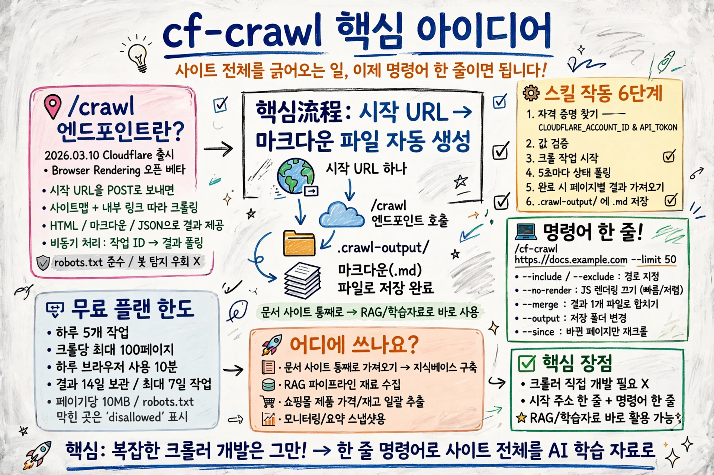
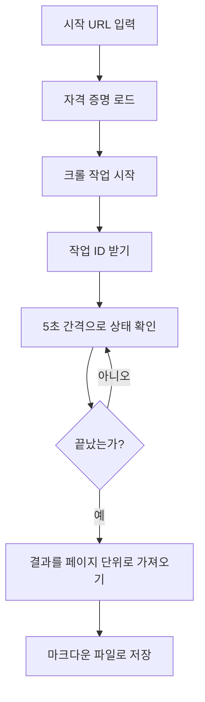
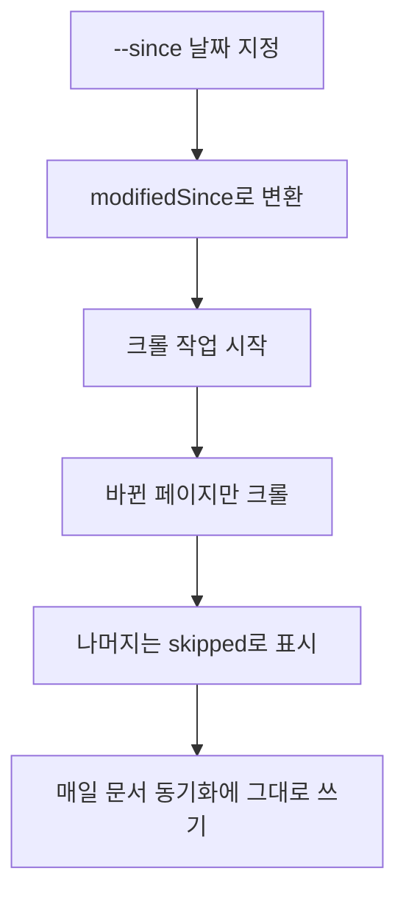
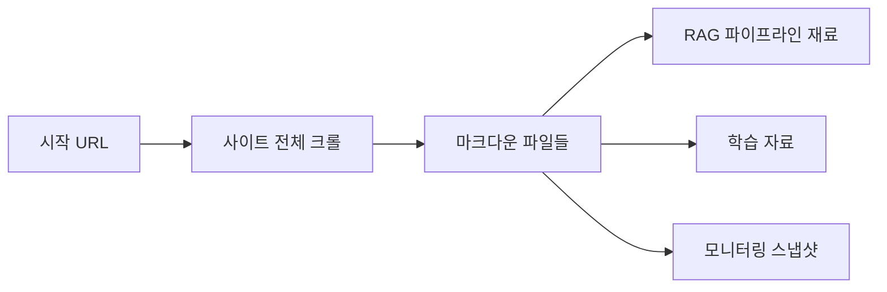

# cf-crawl: 사이트 전체를 긁어오는 일, 이제 명령어 한 줄이면 됩니다

> **Summary**
> Cloudflare의 /crawl 엔드포인트와 Claude Code 스킬 cf-crawl을 이용하면 시작 URL 하나로 사이트를 크롤링해 페이지별 마크다운 파일로 저장할 수 있습니다. 경로 필터, 렌더링 설정, 변경 페이지 재수집 등의 옵션을 지원하며, 문서 수집과 RAG 자료 구축, 모니터링 등에 활용할 수 있습니다.

---

- Cloudflare가 `/crawl` 엔드포인트를 열자마자, 사이트 전체를 마크다운으로 긁어오는 클로드 코드 스킬 `cf-crawl`이 나왔습니다.
- 시작 URL 하나만 주면 링크를 따라 페이지를 돌고, 결과를 마크다운 파일로 로컬에 저장합니다.
- 문서 사이트를 통째로 가져와 RAG나 학습 자료로 쓰는 흐름이, 크롤러를 직접 만들지 않고도 됩니다.


문서 사이트 하나를 통째로 AI에게 읽히고 싶었던 적 있으시죠? 페이지를 하나씩 열고, 복사하고, 붙여넣고. 열 페이지쯤 되면 손이 먼저 멈춥니다. 그런데 이제는 시작 주소 하나만 주면 됩니다!

🎥 [동영상 보기](https://www.youtube.com/watch?v=n_nW5qf4b1A)

## `/crawl` 엔드포인트, 뭐가 달라졌나요?

2026년 3월 10일, Cloudflare가 Browser Rendering에 `/crawl` 엔드포인트를 열었습니다. 아직 오픈 베타입니다. 시작 URL 하나를 POST로 보내면, 사이트맵과 내부 링크를 따라 페이지를 찾아내고, 헤드리스 브라우저로 렌더링한 뒤, 내용을 HTML·마크다운·JSON 중 원하는 형태로 돌려줍니다.

방식은 비동기입니다. 요청을 보내면 작업 ID가 오고, 결과를 폴링해서 가져옵니다. 검증된 봇이라 `robots.txt`를 지키고, 봇 탐지나 캡차를 우회하지는 않습니다. 데모에서는 공식 문서 사이트에 `--limit 50`을 걸었더니 29페이지가 마크다운 파일로 저장됐습니다!

## 스킬은 어떤 순서로 일하나요?

스킬은 6단계로 돕니다. 먼저 자격 증명을 찾습니다. 환경 변수, 프로젝트 `.env`, `.env.local`, 홈 디렉터리 `.env` 순서로 `CLOUDFLARE_ACCOUNT_ID`와 `CLOUDFLARE_API_TOKEN`을 읽습니다. 토큰에는 `Browser Rendering - Edit` 권한이 필요합니다.

다음으로 값을 검증하고, 크롤 작업을 시작합니다. 5초 간격으로 상태를 물어보다가, 끝나면 결과를 페이지 단위로 가져와 `.crawl-output/` 폴더에 마크다운 파일로 저장합니다. 파일명은 페이지 주소에서 따오고, 각 파일 맨 위에는 출처 주소가 주석으로 붙습니다.



## 명령어 한 줄이면 정말 끝인가요?

설치는 마켓플레이스에서 `cf-crawl`을 검색해 추가하면 됩니다.

```bash
npx claude-code-templates@latest --skill utilities/cf-crawl
```

쓰는 법은 한 줄입니다.

```bash
/cf-crawl https://docs.example.com --limit 50
```

옵션도 있습니다. `--include`와 `--exclude`로 가져올 경로를 고르고, `--no-render`로 자바스크립트 렌더링을 끄면 정적 사이트는 더 빠르고 저렴합니다. `--merge`는 결과를 파일 하나로 합치고, `--output`은 저장 폴더를 바꿉니다. `--since`는 바뀐 페이지만 다시 긁습니다.

바뀐 페이지만 다시 긁는 흐름은 이렇게 돕니다.



## 무료로는 어디까지 되나요?

무료 플랜은 하루 5개 작업, 크롤당 최대 100페이지, 하루 브라우저 시간 10분까지입니다. 유료 플랜은 한도가 훨씬 높고, 브라우저 시간은 시간당 약 0.09달러 수준으로 과금됩니다. 결과는 완료 후 14일 동안 보관되고, 작업은 최대 7일까지 돕니다. 페이지 하나는 10MB까지 받을 수 있습니다.

이 대목이 저는 가장 와닿았습니다. 무료로 시작해보고, 진짜 작업량이 생기면 그때 유료로 넘어가면 되는 구조라는 점이요!

한 가지 더, 막힌 페이지는 그냥 사라지지 않습니다. `robots.txt`에 막힌 주소는 결과에 `disallowed`로 표시됩니다. 조용히 빠지는 게 아니라, 무엇이 빠졌는지 알 수 있습니다!

## 어디에 쓰면 좋을까요?

가장 먼저 떠오르는 곳은 문서 사이트 통째로 가져오기, 지식 베이스 만들기, RAG 파이프라인 재료 모으기입니다. JSON 형태로 받으면 Workers AI가 프롬프트와 스키마대로 구조화 데이터를 뽑아주기도 합니다. 쇼핑몰 상품 수백 개의 가격과 재고를 한 번에 뽑는 식입니다. 모니터링이나 요약용 스냅샷으로도 쓸 수 있습니다.



크롤러를 직접 만드는 일은 이제 선택이 됐습니다. 시작 주소 하나, 명령어 한 줄. 문서 사이트 통째로 가져오는 일이 이렇게 가벼워진 적이 있었을까요?

