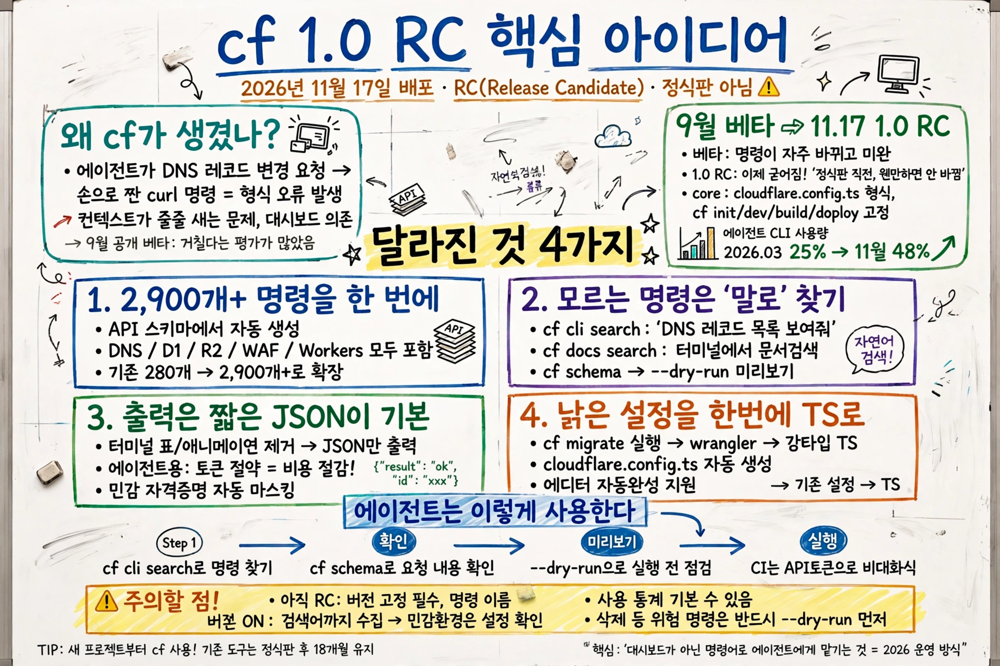
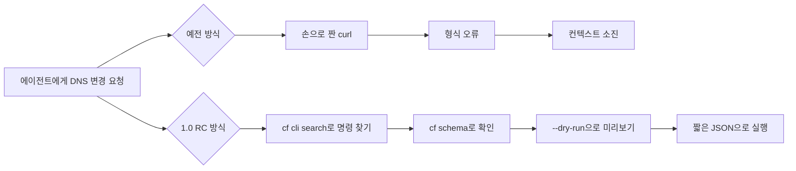
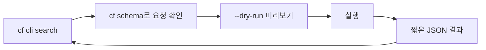

# cf: 1.0 RC가 나왔습니다. 명령어 2,900개, 에이전트가 더는 curl을 손으로 짜지 않습니다

> **Summary**
> cf 1.0 RC는 2,900개 이상의 Cloudflare API 명령, 자연어 기반 명령 검색, 간결한 JSON 출력, Wrangler 설정의 타입스크립트 마이그레이션을 제공해 에이전트가 대시보드나 직접 작성한 curl 없이 Cloudflare를 다루도록 돕습니다. 아직 정식판이 아니며 명령 변경 가능성과 기본 활성화된 검색어 포함 사용 통계에 유의하고, 버전을 고정해 검색·스키마 확인·dry-run 후 실행하는 것이 좋습니다.

---

- `cf` 1.0 RC가 나왔습니다. 2026년 11월 17일 배포된 후보판입니다. 에이전트가 대시보드를 열지 않고 Cloudflare 전체를 명령어로 다룹니다.
- 달라진 건 네 가지입니다. API 2,900개 이상을 한 번에, 모르는 명령은 말로 찾아서, 출력은 토큰을 아끼는 짧은 JSON으로, 낡은 설정은 한 번에 타입스크립트로 바꿉니다.
- 다만 아직 정식판이 아닙니다. 명령 이름이 바뀔 수 있고, 검색어까지 포함한 사용 통계가 기본으로 켜져 있습니다.

에이전트에게 DNS 레코드 하나 바꿔 달라고 했는데, 손으로 짠 `curl` 명령이 형식 오류를 내뱉고 컨텍스트가 줄줄 새는 걸 본 적 있으시죠? 그 장면이 바로 `cf`가 태어난 이유입니다. 9월에 공개 베타로 나왔을 때는 아직 거칠다는 평가가 많았습니다. 그런데 11월 17일 1.0 RC가 나오면서 분위기가 완전히 달라졌습니다. X 원문은 로그인 뒤에 있어 공개 미러를 통해 내용을 확인했고, 숫자와 기능은 공식 문서와 발표 글로 교차 확인했습니다.

🎥 [동영상 보기](https://www.youtube.com/watch?v=TmTTtuzvqiI)

## 베타 때 써 본 분, 다시 깔아 보셨나요?

9월 28일 공개 베타 때 `cf`는 이미 야심이 컸습니다. Cloudflare API 전체를 한 도구로 묶겠다는 선언이었으니까요. 그런데 베타판은 말 그대로 베타였습니다. 명령이 자주 바뀌고, 다듬어지지 않은 구석이 보였습니다.

1.0 RC는 그 다음 단계입니다. RC는 "정식판 직전, 이건 웬만하면 안 바뀐다"는 약속이 붙은 판본입니다. 공식 발표 기준으로 이번 RC에서 굳어지는 건 `cloudflare.config.ts` 형식, 빌드 결과물, `cf init`·`cf dev`·`cf build`·`cf deploy` 같은 핵심 명령, 그리고 API에서 자동 생성된 대부분의 명령입니다. 에이전트가 쓰던 CLI 사용량 비중이 2026년 3월 25%에서 발표 직전 주 48%까지 올랐다는 숫자도, 왜 이 도구가 에이전트부터 겨냥했는지 보여줍니다.

## 무엇이 달라졌을까요? 네 가지입니다

**첫째, 명령어 2,900개 이상을 한 번에 씁니다.** 공식 문서 기준 2,900개가 넘는 명령이 API 스키마에서 자동 생성됩니다. 발표 글은 3,000개가 넘는 API 동작을 말하는데, 세는 단위가 달라서 생긴 차이입니다. DNS, D1 데이터베이스, R2, WAF, Workers까지 한 도구 안에 들어갑니다. 기존 도구가 280개 수준의 동작만 가졌던 것과 비교하면, 범위가 통째로 달라졌습니다.

**둘째, 모르는 명령은 말로 찾습니다.** 에이전트에게 가장 큰 문제는 "명령이 존재는 하는데 이름을 모른다"는 것이었습니다. 그래서 `cf cli search`가 있습니다. "DNS 레코드 목록을 보여줘" 같은 말로 명령을 찾습니다. 터미널 안에서 문서를 찾는 `cf docs search`도 있습니다. `--help` 최상단에는 에이전트용 안내 블록이 붙어 있습니다. 중첩된 `--help`를 돌지 말고 검색부터 하라는 내용입니다. 명령을 찾았으면 `cf schema`로 요청 내용을 확인하고, `--dry-run`으로 미리보기까지 합니다. 에이전트가 명령을 지어내는 일이 줄어드는 구조입니다!

**셋째, 출력은 짧은 JSON이 기본입니다.** 터미널 표와 애니메이션을 걷어내고 결과만 JSON으로 냅니다. 사람에게는 보기 좋게, 에이전트에게는 압축해서 보여줍니다. 토큰이 아까운 에이전트에게는 이 차이가 곧 돈입니다! 민감한 자격 증명은 출력에서 자동으로 가려집니다.

**넷째, 낡은 설정은 한 번에 바꿉니다.** `cf migrate`를 실행하면 기존 `wrangler` 설정을 강타입 타입스크립트 설정으로 올려줍니다. 에디터 자동완성이 따라오니, 설정 파일을 손으로 고치던 수고가 줄어듭니다.

## 에이전트는 어떻게 쓰면 될까요?

순서는 단순합니다. 검색하고, 확인하고, 미리 본 뒤에 실행합니다. 에이전트용 설정 파일에 "Cloudflare를 다룰 때는 `cf` CLI를 쓴다"는 한 줄을 넣어 두면, 에이전트가 대시보드가 아니라 명령어부터 찾습니다. CI에서는 API 토큰으로 비대화식으로 돌립니다. 예측 가능한 동작이 CI의 생명줄이니까요.

## 조심할 점도 있습니다!

**아직 정식판이 아닙니다.** RC에서 이미 별칭 없이 이름이 바뀐 명령이 있습니다. 버전을 고정해 두고 쓰는 편이 안전합니다. **사용 통계가 기본으로 켜져 있습니다.** 검색어까지 포함된 통계가 수집되니, 민감한 환경에서는 설정을 확인하는 것이 좋습니다. **삭제처럼 위험한 명령은 **`**--dry-run**`**부터 확인하는 습관이 필요합니다.** 중단된 삭제 명령이 성공으로 보고될 수 있다는 지적도 있습니다. 마지막으로, 기존 도구는 `cf` 정식판 이후 최종 메이저 버전이 나온 뒤 18개월간 유지보수될 예정입니다. 당장 갈아탈 필요는 없습니다. 새 프로젝트부터 `cf`로 시작하면 됩니다.

## 다른 한 손은요?

원문 글쓴이는 오라클용 CLI와 짝을 지어 "양손에 하나씩"이라는 표현을 썼습니다. 핵심은 같습니다. 자주 쓰는 클라우드는 대시보드가 아니라 명령어로 에이전트에게 맡기는 쪽이 2026년의 운영 방식이라는 겁니다. 한쪽은 데이터베이스와 터널을, 다른 한쪽은 오라클 자원을 맡기는 식입니다.

이 글은 P319와 각도가 다릅니다. P319가 `cf`의 첫 공개, 즉 출시 소식 자체를 다뤘다면, 이 글은 1.0 RC 업데이트 이후 무엇이 달라졌는지를 다룹니다. 베타 때 써 보고 거칠다고 느꼈다면, 지금이 다시 깔아 볼 때입니다!

