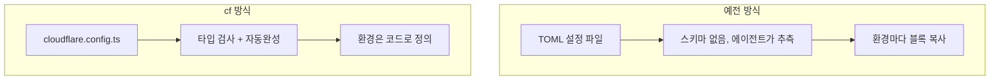

# cf: 대시보드를 여는 대신, 에이전트에게 말로 시키면 됩니다

> **Summary**
> Cloudflare의 새 cf CLI는 에이전트를 주요 사용자로 설계해 3,000개 이상의 API 작업을 지원하고, JSON 출력과 자연어 명령 검색을 제공합니다. 타입스크립트 설정과 Vite를 기본으로 하며, cf migrate로 기존 프로젝트를 옮길 수 있습니다. CLI와 MCP 서버를 통해 에이전트가 대시보드 없이 인프라를 관리할 수 있도록 합니다.

---

- 에이전트가 기존 CLI 사용량의 절반을 차지하게 되자, Cloudflare는 에이전트를 첫 번째 사용자로 삼은 새 CLI `cf`를 공개했습니다.
- `cf`는 API 전체 3,000개 넘는 작업을 명령어로 다루고, 기본 출력은 JSON이며, 모르는 명령어는 자연어로 검색해 찾습니다.
- 설정은 타입스크립트 파일로 바뀌었고 Vite가 기본 개발 서버가 됐습니다. 기존 프로젝트는 `cf migrate` 한 줄로 옮깁니다.

DNS 레코드 하나 바꾸려고 대시보드 탭을 몇 개나 오가셨나요? 에이전트에게 "큐에 막힌 메시지 확인해줘"라고 말했는데, 에이전트는 대시보드를 클릭할 손이 없어서 멈춰 섰던 적 있으시죠? 그 손이 이제 터미널에 생겼습니다!

🎥 [동영상 보기](https://www.youtube.com/watch?v=QU2-eIPvL0Y)

## 왜 새 CLI가 필요했을까요?

숫자부터 보겠습니다. 작년만 해도 에이전트는 기존 CLI 사용량의 한 자릿수에 불과했습니다. 그런데 2026년 3월에는 25%, 발표 직전 주에는 48%까지 치솟았습니다.

에이전트는 사람보다 훨씬 부지런하게 도구를 씁니다. 하루에 쓰는 명령 종류가 사람의 거의 2배, 6개 이상 명령을 이어 쓰는 비율은 4배에 가깝습니다. 그런데 기존 CLI가 다루는 작업은 280개 남짓, API가 제공하는 작업은 수천 개였습니다. 에이전트가 할 수 있는 일이 CLI의 좁은 문 앞에서 막혀 있었던 겁니다.

> 대시보드를 여는 건 사람에게는 익숙한 일이지만, 에이전트에게는 없는 손을 달라는 요구였습니다.

그래서 새 도구를 아예 처음부터 다시 만들었습니다. 기존 도구를 조금씩 고치는 대신, 에이전트가 한 번도 본 적 없는 새 CLI를 내놓는 편이 덜 헷갈린다는 판단이었습니다. 이미 학습된 습관과 싸우는 것보다, 깨끗한 새 이름으로 시작하는 게 낫다는 겁니다!

## `cf`는 뭐가 다른가요?

핵심은 네 가지입니다. 하나씩 살펴보겠습니다.

**첫째, API 전체를 다룹니다.** 3,000개가 넘는 API 작업을 명령어로 쓸 수 있습니다. Worker를 만들고, 배포하고, 모니터링하고, 접근 제어로 보호하고, 도메인을 사고, 방화벽 앞에 두는 일을 한 도구로 이어서 할 수 있습니다. 대시보드로 왔다 갔다 할 필요가 없어졌습니다.

**둘째, 기본 출력이 JSON입니다.** 사람은 보기 좋게, 에이전트는 압축해서 받습니다. 에이전트가 표를 읽고 필터링하느라 컨텍스트를 낭비하지 않도록, JSON을 기본값으로 삼았습니다. 에이전트가 결과를 걸러서 원하는 형식으로 돌려주는 편이 낫다는 판단입니다!

**셋째, 모르는 명령어는 검색하면 됩니다.** 3,000개나 되는 명령어를 어떻게 다 외울까요? 외울 필요가 없습니다. `cf cli search`에 자연어로 물으면 됩니다. "큐에 막힌 메시지 확인해줘"처럼 말하면, API 설명과 매개변수를 바탕으로 맞는 명령어를 골라줍니다. 처음 `--help`를 실행하면 에이전트에게 이 검색 명령이 있다는 사실부터 알려줍니다.

**넷째, 설정이 타입스크립트가 됐습니다.** 새 설정 파일 `cloudflare.config.ts`는 사람이 읽기도 쉽고, 에이전트가 파싱하기도 쉽습니다. 에디터의 자동완성과 타입 검사가 그대로 따라옵니다.

## 설정 파일, 왜 타입스크립트일까요?

예전 설정 파일은 TOML이었습니다. 스키마가 없어서 에이전트가 구조를 추측해야 했습니다. JSONC는 스키마가 있긴 했지만 에이전트가 거의 쓰지 않았습니다. 타입스크립트는 다릅니다. 에디터가 바로 알려줍니다.

설정 안에서는 `bindings`라는 도우미가 환경 변수부터 저장소, 데이터베이스, 큐까지 자동완성으로 보여줍니다. `triggers`라는 블록에는 라우트, 스케줄, 큐, 이메일 같은 실행 조건을 한곳에 모읍니다. 설정이 여기저기 흩어지지 않습니다.

효과는 숫자로도 확인됐습니다. 내부 설정 파일 가운데 5,000줄이 넘던 파일이, 환경을 코드로 정의하는 방식으로 바꾸자 40%나 줄었습니다. 복사해서 붙여넣던 설정 블록이 사라진 덕분입니다.

## 옮기는 건 어렵지 않을까요?

기존 프로젝트를 옮기는 방법은 간단합니다. `cf migrate` 한 줄이면 됩니다. Vite 기반으로 빌드하던 프로젝트는 설정 파일까지 자동으로 변환해 줍니다. 아직 esbuild나 Rust, Python으로 빌드하는 Worker는 기존 도구에 위임을 이어가니, 당장 다 옮길 필요는 없습니다.

개발 서버도 바뀌었습니다. Vite가 기본이 되면서 빠른 개발 서버와 핫 리로딩, Rust 기반 번들러의 빠른 빌드를 그대로 쓸 수 있게 됐습니다. 새 프로젝트는 `cf init`으로 시작하면 설정 파일까지 만들어줍니다.

한 가지 짚고 넘어갈 점이 있습니다. 지금은 공개 베타라서, 명령어와 설정, 빌드 출력이 정식 출시 전에 바뀔 수 있습니다. 베타가 끝나면 기존 도구는 최종 메이저 버전을 내고 `cf`로 안내한 뒤, 18개월 동안 유지보수만 이어갑니다. 서두를 필요는 없지만, 방향은 정해졌습니다!

터미널 말고도 전체 API를 지원하는 MCP 서버가 함께 제공돼, 에이전트가 대시보드를 돌아다니지 않고 관리할 수 있는 선택지가 더 늘어났습니다. CLI와 MCP, 둘 다 같은 방향을 가리킵니다. 에이전트가 인프라를 다루는 통로를 터미널과 도구 안에 마련해 주는 겁니다.

대시보드를 여는 대신 말로 시키면 됩니다. 터미널이 에이전트의 손이 됐습니다!

