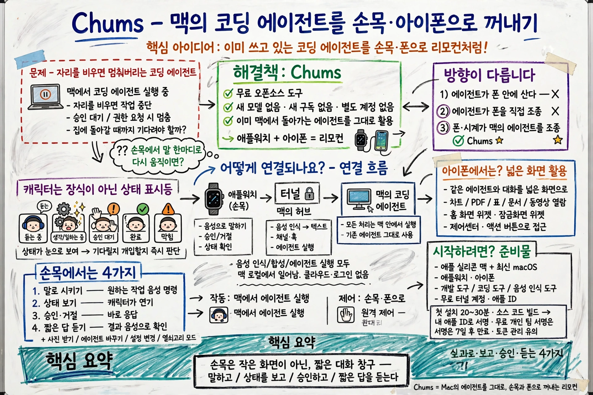
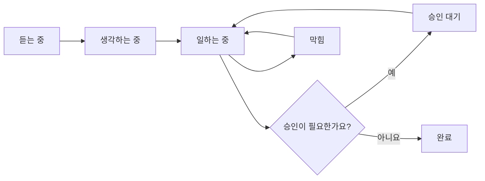
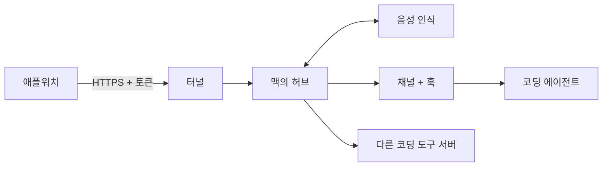

# chums: 손목에서 에이전트에게 말하면, 맥이 대신 일합니다

> **Summary**
> chums는 맥에서 이미 돌아가는 코딩 에이전트를 애플워치와 아이폰으로 꺼내 쓰는 무료 오픈소스 도구입니다. 새 모델도, 새 구독도, 별도 계정도 필요 없습니다. 화면을 누르고 말하면 맥이 음성을 글로 바꿔 에이전트에게 넘기고, 에이전트마다 붙은 캐릭터가 듣는 중인지, 일하는 중인지, 승인을 기다리는지 몸으로 보여줍니다. 손목에서는 말하기·상태 보기·승인·짧은 답 듣기가 되고, 아이폰에서는 차트·PDF·문서를 직접 열어 봅니다. 방향은 분명합니다. 폰이 에이전트를 조종하는 것입니다.

---

- 코딩 에이전트가 맥에서 일하고 있는데, 자리를 비우면 그 작업은 멈춰 서 있습니다. 손목에서 말 한마디로 다시 움직이게 할 수 있다면 어떨까요?
- chums는 맥에서 이미 돌아가는 코딩 에이전트를 애플워치와 아이폰으로 꺼내 쓰는 무료 오픈소스 도구입니다. 새 모델도, 새 구독도, 별도 계정도 필요 없습니다.
- 에이전트마다 캐릭터가 하나씩 붙습니다. 캐릭터가 지금 듣고 있는지, 일하는 중인지, 승인을 기다리는지 몸으로 보여줍니다.

코딩 에이전트를 쓰다 보면 이런 순간이 있습니다. 맥에 일을 맡기고 나왔는데, 중간에 에이전트가 멈춰 섰습니다. 권한을 물어보고 있거나, 뭔가 막힌 겁니다. 집에 돌아갈 때까지 기다려야 할까요? 손목에 찬 시계로 답을 줄 수 있다면, 이야기가 달라집니다!

🎥 [동영상 보기](https://www.youtube.com/watch?v=wtVmx5ylWic)

## 새 비서가 아니라, 이미 쓰는 에이전트를 손목으로 꺼냅니다

요즘 나오는 AI 비서 앱은 대개 새 구독을 팝니다. 새 모델, 새 계정, 새 회사가 데이터를 들고 가는 구조입니다. chums는 정반대로 갔습니다. 이미 맥에서 돌아가는 코딩 에이전트를 그대로 두고, 손목과 폰을 리모컨으로 붙인 겁니다!

이 선택이 주는 것은 세 가지입니다. **새 모델이 없습니다.** 에이전트는 맥의 코딩 도구 위에서 그대로 돕니다. **새 구독이 없습니다.** 무료 오픈소스이고, 이미 내는 AI 구독이 일을 합니다. **별도 계정이 없습니다.** 로그인도, 클라우드도 없습니다. 시계와 폰은 내 맥에 있는 허브하고만 이야기합니다.

> 이미 내는 돈으로, 이미 쓰는 에이전트를, 이미 가진 기기에서 꺼내 쓰는 것. 그게 이 도구의 출발점입니다!

## 손목에서는 어떻게 말하나요?

방법은 단순합니다. 화면을 누르고, 원하는 것을 말하고, 손을 뗍니다. 맥이 음성을 글로 바꿔 에이전트에게 넘깁니다. 키보드가 없어도 됩니다. 손목에서 할 수 있는 일은 생각보다 많습니다.

- **말로 시킵니다.** 화면을 누르고 말하면 됩니다. 긴 문장을 칠 필요가 없습니다.
- **지금 상태를 봅니다.** 캐릭터가 에이전트의 상태를 연기합니다. 듣는 중인지, 생각하는 중인지, 일하는 중인지, 답을 기다리는지, 끝났는지, 막혔는지 한눈에 보입니다. 도구 호출이 하나씩 화면에 뜹니다.
- **승인하고 거절합니다.** 에이전트가 권한을 물으면 카드가 뜹니다. 카드를 누르고 있으면 허용, 엑스 표시를 누르면 거절입니다.
- **짧은 답을 듣습니다.** 에이전트는 한 문장으로 짧게 답합니다. 캐릭터 목소리로 시계에서 바로 들립니다.
- **사진을 받습니다.** 화면 스크린샷을 달라고 하면, 확대해서 볼 수 있는 사진으로 도착합니다.
- **에이전트를 바꿉니다.** 에이전트마다 세션과 캐릭터가 따로 있습니다. 왼쪽 위 얼굴을 누르면 다른 에이전트로 갈아탑니다. 다른 에이전트 소식이 오면 진동으로 알려줍니다.
- **에이전트를 고칩니다.** 이름, 맡은 일, 말투를 바꾸고 저장할 수 있습니다. 어떤 도구로 도는지, 모델은 뭔지, 권한은 어떤지, 목소리는 어떤지도 손목에서 바꿉니다.
손목에서 안 쓰는 동안에도 에이전트는 맥에서 계속 일합니다. 열쇠고리에 시계를 걸어 두는 모드까지 있습니다. 시계를 차지 않아도 화면이 켜진 채로 에이전트 일을 이어갑니다.

## 아이폰에서는요? 넓은 화면은 다르게 씁니다

아이폰 앱은 같은 에이전트와 대화를 넓은 화면으로 옮긴 겁니다. 말하거나 타이핑하고, 사진과 파일을 보내고, 승인을 누르고, 에이전트 설정을 바꿉니다. 여기까지는 시계와 같습니다. 차이는 결과물을 다루는 방식입니다.

에이전트가 만든 것을 그냥 글로 받지 않습니다. 차트를 달라고 하면 상호작용하는 HTML 페이지가 열립니다. 드래그해서 살펴보고, 보여주는 항목을 바꿉니다. 웹 페이지는 그대로 열리고, PDF는 한 장씩 넘기고, 표는 스크롤하고, 동영상은 재생하고, 문서 파일은 미리보기로 엽니다. 홈 화면과 잠금 화면 위젯에서 에이전트 상태를 보고 승인을 답할 수도 있습니다. 제어 센터나 액션 버튼으로 앱을 바로 열어 듣기 상태로 들어갈 수도 있습니다.

## 캐릭터는 장식이 아닙니다. 상태 표시등입니다

에이전트마다 캐릭터가 하나씩 있습니다. 실시간 3D로 계산되는 캐릭터, 렌더링 클립으로 움직이는 캐릭터, 벡터로 그린 캐릭터, 한 줄로 그린 캐릭터, 스프링 위의 선, 눈만 있는 캐릭터, 픽셀 아트까지. 만드는 방법이 전부 다릅니다. 브랜드가 정한 얼굴이 아니라, 각자 다른 방식으로 그려진 겁니다.

캐릭터의 역할은 예쁜 얼굴이 아닙니다. 에이전트 상태를 몸으로 보여주는 표시등입니다. 듣는 중, 생각하는 중, 일하는 중, 하위 에이전트 실행 중, 말하는 중, 답이 필요한 상태, 승인 요청, 완료, 막힘, 잠듦까지. 상태는 에이전트가 직접 보고한 신호에서 옵니다. 한 도구는 훅으로, 다른 도구는 앱 서버 프로토콜로 상태를 전합니다.

상태가 눈에 보이면, 기다릴지 개입할지 바로 정할 수 있습니다. 이게 캐릭터를 둔 이유입니다!

## 어떻게 연결되나요?

구조는 네 조각입니다. 시계 앱이 목소리를 녹음하고 캐릭터를 그립니다. 맥에 있는 허브가 세션을 관리하고, 말을 글로 바꾸고, 답을 음성으로 만듭니다. 채널과 훅이 코딩 에이전트 세션을 허브에 연결합니다. 시계 앱은 집 네트워크 주소에 직접 닿기 어려워서, 허브의 시계용 API를 터널로 공개하고 토큰으로 지킵니다.

음성 인식도, 음성 합성도, 에이전트 실행도 전부 맥 안에서 일어납니다. 데이터가 바깥 서버로 나가지 않는 구조입니다. 다만 토큰을 가진 쪽은 시계가 할 수 있는 일을 그대로 할 수 있습니다. 토큰 관리는 보안 문서에 따로 정리돼 있으니, 쓰기 전에 읽어보는 것이 순서입니다.

## 방향이 다릅니다. 폰이 에이전트를 조종합니다

폰과 AI를 엮는 방법은 한 가지가 아닙니다. 방향이 세 갈래로 나뉩니다.

첫째, **에이전트가 폰 안에 사는 방법**입니다. 폰 위에서 돌아가는 런타임이 앱이 꺼져도 작업을 이어갑니다. 모델이 아니라 런타임이 주인공입니다. 둘째, **에이전트가 폰을 직접 조종하는 방법**입니다. 밖에서 폰 화면을 보고 탭하고 타이핑합니다. 폰이 조종 대상입니다. 셋째, 이 글의 방법입니다. **폰과 시계가 에이전트를 조종합니다.** 에이전트는 맥에 그대로 두고, 손목과 폰은 명령과 승인을 주고받는 리모컨입니다.

어느 쪽이 낫다고 정할 수는 없습니다. 무엇을 맡길 것인가가 다르기 때문입니다. 맥에서 이미 돌아가는 코딩 에이전트를 밖에서도 이어서 쓰고 싶다면, 세 번째 방향이 맞습니다.

## 시작하려면 무엇이 필요할까요?

준비물은 조금 많습니다. 애플 실리콘 맥, 최신 운영체제, 개발 도구, 애플워치와 아이폰, 코딩 도구, 음성 인식 도구, 무료 터널 계정, 애플 ID까지. 무료 애플 ID로도 되고, 처음 설치는 20~30분 정도 걸립니다. 개발 도구가 시계를 준비하고, 새 터널 주소가 인터넷에 퍼지는 데 최대 30분이 더 걸릴 수 있습니다.

앱 스토어에서 받는 앱이 아닙니다. 소스 코드로 받아서 개발 도구로 직접 빌드하고, 내 애플 ID로 서명합니다. 설치가 어렵게 느껴진다면, 코딩 에이전트에게 한 줄로 시키는 방법도 있습니다. 에이전트가 설정을 대신하고, 손이 필요한 순간에만 멈춰서 알려줍니다. 설치 상태를 확인하는 진단 명령도 따로 있습니다.

주의할 점도 있습니다. 무료 개인 팀으로 서명하면 설치가 7일 뒤에 만료됩니다. 다시 빌드해야 합니다. 그리고 토큰이 노출되면 시계 권한 그대로 바깥에서 에이전트를 조종할 수 있으니, 토큰과 터널 설정은 조심해서 다뤄야 합니다.

## 손목은 작은 화면이 아니라, 짧은 대화 창구입니다

코딩 에이전트는 맥에서 일합니다. 손목은 그 일을 밖에서도 이어주는 창구입니다. 말하고, 상태를 보고, 승인하고, 짧은 답을 듣는 것. 이 네 가지가 손목에서 하는 일의 전부입니다. 그리고 그 전부만으로, 자리를 비운 시간도 작업 시간이 됩니다!

