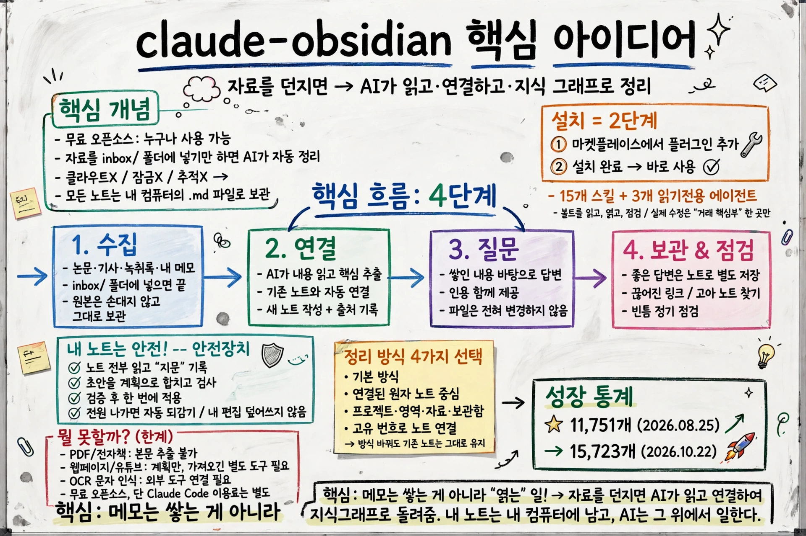
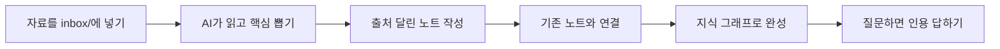
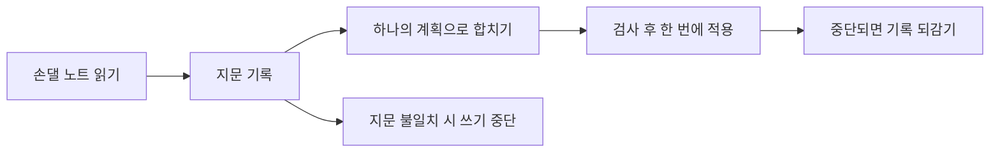

# claude-obsidian: 자료만 던지면 AI가 읽고 엮어 지식 그래프로 만듭니다

> **Summary**
> claude-obsidian은 inbox 폴더에 자료를 넣으면 AI가 출처를 기록하고 기존 노트와 연결해 지식 그래프로 정리하는 무료 오픈소스 도구입니다. 읽기 전용 질문과 링크 점검을 지원하며, 변경 전 검증과 복구 기능으로 노트를 보호하고 파일은 사용자의 컴퓨터에 마크다운으로 남습니다. PDF·전자책 추출과 자동 웹 콘텐츠 가져오기 등은 지원하지 않습니다.

---

- `claude-obsidian`은 자료를 `inbox/`에 던지기만 하면 AI가 읽고, 연결하고, 지식 그래프로 정리해주는 무료 오픈소스입니다.
- 설치는 마켓플레이스에서 플러그인을 추가하는 두 단계로 끝나고, 15개 스킬과 3개 읽기 전용 에이전트가 볼트를 읽고 엮고 점검합니다.
- 모든 노트는 내 컴퓨터의 평범한 마크다운 파일로 남습니다. 클라우드도, 잠금도, 추적도 없습니다!


메모 앱에 자료를 쌓아만 두신 적 있으시죠? 읽은 논문, 저장한 기사, 회의 녹취록, 떠오른 아이디어까지, 폴더는 계속 늘어나는데 정작 필요할 때 찾지 못하는 경우가 많았습니다. 검색은 되는데, 정리는 안 되는 상태 말입니다. 이 글에서 소개하는 도구는 그 지점을 정면으로 파고들었습니다. 자료를 던지면 AI가 알아서 읽고 엮어주는 방식입니다!

🎥 [동영상 보기](https://www.youtube.com/watch?v=tgVUYC3l4UQ)

## 자료를 던지면, AI가 뭘 해줄까요?

핵심 흐름은 네 단계입니다. 먼저 **수집**입니다. 논문, 기사, 녹취록, 내 메모를 `inbox/` 폴더에 넣으면 됩니다. 원본은 손대지 않고 그대로 보관합니다. 그래서 요약이 어디서 왔는지 나중에 언제든 되짚을 수 있습니다.

다음은 **연결**입니다. AI가 자료를 읽고, 핵심 내용을 뽑아, 기존 노트와 연결된 새 노트를 씁니다. 주장은 출처와 함께 기록합니다. 근거가 약하거나 서로 충돌하는 내용은 매끈하게 다듬지 않고 그대로 보이게 둡니다.

그 다음은 **질문**입니다. 볼트에 이미 쌓인 내용을 바탕으로 답합니다. 인용을 달아주고, 파일을 하나도 바꾸지 않습니다. 마지막으로 **보관과 점검**입니다. 마음에 드는 답변은 노트로 따로 저장하고, 정기 점검으로 끊어진 링크와 고아 노트, 빈틈을 찾아냅니다.



이 흐름이 도는 이유는 설계가 단순하기 때문입니다. 아이디어는 한 연구자의 공개 메모에서 가져왔습니다. AI가 블랙박스처럼 답을 내놓는 대신, 읽을 수 있는 위키를 직접 유지하게 하자는 발상입니다. 그래서 결과물은 평범한 `Obsidian` 볼트입니다. AI 없이 열어도 그대로 쓸 수 있습니다!

## 설치는 어떻게 할까요?

준비물은 세 가지입니다. `Claude Code`, 파이썬 3.11 이상, 그리고 화면으로 볼 때 쓰는 `Obsidian`입니다. 설치는 `Claude Code` 안에서 마켓플레이스에 플러그인을 추가하고 설치하는 두 단계면 됩니다. 명령어 두 줄이면 끝납니다.

설치가 끝나면 볼트로 쓸 폴더에서 `Claude Code`를 열고, 설정 명령을 실행합니다. 미리보기를 먼저 보여주고, 승인한 뒤에만 볼트를 만듭니다. 이미 쓰던 볼트가 있어도 됩니다. 노트를 옮기지 않고 그대로 이어서 쓸 수 있습니다.

볼트가 준비되면 쓰는 명령은 다섯 가지입니다.

```bash
/claude-obsidian:wiki          # 볼트 설정, 미리보기 후 승인
/claude-obsidian:wiki-ingest   # inbox/ 자료를 연결된 노트로
/claude-obsidian:wiki-query    # 볼트 내용으로 질문, 읽기 전용
/claude-obsidian:save          # 좋은 답변을 노트로 보관
/claude-obsidian:wiki-lint     # 끊긴 링크와 고아 노트 점검
```

## 15개 스킬, 3명의 읽기 전용 일꾼이 돕습니다

플러그인 안에는 스킬 15개가 들어 있습니다. 핵심 5개는 위에서 본 설정·수집·질문·보관·점검이고, 확장 7개는 웹 조사, 캔버스 보드, 검색, 정리 방식 설정 등을 맡습니다. 나머지 3개는 `Obsidian` 마크다운과 표, 어려운 결정을 검토하는 참고용 스킬입니다.

뒤에서는 에이전트 3개가 일합니다. 수집 에이전트는 자료 하나를 읽고 노트 초안을 건네고, 점검 에이전트는 볼트 건강 보고서를 만들고, 검증 에이전트는 바뀔 내용을 미리 시험합니다. 세 에이전트 모두 읽기 전용입니다. 실제로 쓰는 곳은 따로 있습니다. 거래 핵심부라는 한 곳만 볼트에 씁니다.

## 내 노트를 망가뜨리지 않을까요?

이 질문이 가장 중요합니다. AI가 내 파일을 직접 고친다고 하면, 누구나 먼저 걱정합니다. 이 도구의 답은 "조심스럽게 저장한다"입니다.

먼저 손댈 노트를 전부 읽고 지문(SHA-256 해시)을 기록합니다. 그 다음 초안들을 하나의 계획으로 합치고, 검사한 뒤 한 번에 적용합니다. 쓰는 도중에 전원이 나가면 기록을 되감아 되돌립니다. 내가 `Obsidian`에서 노트를 고치는 동안 AI가 계획을 세우고 있었다면 어떻게 될까요? 지문이 맞지 않아서 쓰기가 멈춥니다. 내 편집을 덮어쓰지 않습니다!



웹 조사, 깃 체크포인트, 데이터를 밖으로 보내는 일은 모두 별도 단계입니다. 매번 먼저 허락을 받습니다. 기본값은 내 컴퓨터 안에 머무는 것입니다.

## 내 방식대로 정리할 수 있을까요?

정리 방식은 네 가지 중 고릅니다. 기본 방식은 자료·개념·인물·세션으로 나누고, 연결된 원자 노트 중심의 방식, 프로젝트·영역·자료·보관함으로 나누는 방식, 고유 번호로 노트를 잇는 방식이 있습니다. 방식을 바꿔도 이미 있는 노트는 움직이지 않습니다. 새로 들어오는 노트만 바뀐 방식대로 정리됩니다.

`Claude Code` 말고 다른 AI 도구에서도 쓸 수 있습니다. 스킬이 공개 형식을 따르기 때문입니다. `Codex`, `OpenCode`, `Gemini`, `Cursor` 등에서도 같은 스킬을 연결할 수 있습니다.

## 뭘 못할까요?

만능은 아닙니다. PDF와 전자책은 아직 본문 추출이 안 됩니다. 메타데이터와 크기 정도만 읽습니다. 웹페이지와 유튜브 영상은 계획까지만 세우고, 가져오는 일은 별도 도구가 필요합니다. 문자 인식도 외부 도구를 따로 연결해야 합니다. 자동 녹취기도 아니고, 클라우드 동기화도 아니고, 백업을 대신하지도 않습니다. 무료 오픈소스(MIT 라이선스)이지만, `Claude Code` 이용료는 별도입니다.

숫자도 짚어보겠습니다. 게시글이 올라온 2026년 8월 25일 기준으로 별 11,751개, 그 주에만 272개가 늘었습니다. 그 뒤로도 계속 늘어 2026년 10월 22일 기준 15,723개를 기록했습니다. 별 숫자가 품질을 보증하지는 않습니다. 다만 메모 앱의 판도가 바뀌고 있다는 말에, 많은 사람이 고개를 끄덕였다는 뜻은 됩니다.

메모는 쌓는 게 아니라 엮는 일입니다. 자료를 던지면 AI가 읽고, 연결하고, 그래프로 돌려주는 이 도구는 그 엮는 일을 대신해줍니다. 내 노트는 내 컴퓨터에 남고, AI는 그 위에서 일합니다. 메모 앱의 판도가 바뀌었다는 말, 이제는 조금 실감이 납니다!

