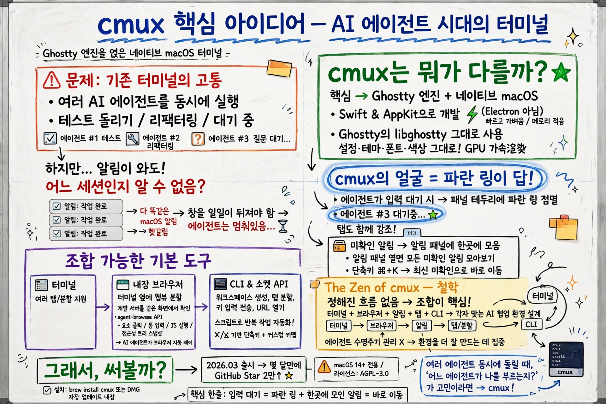
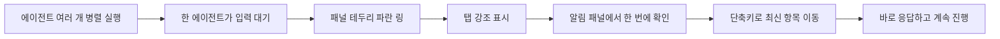
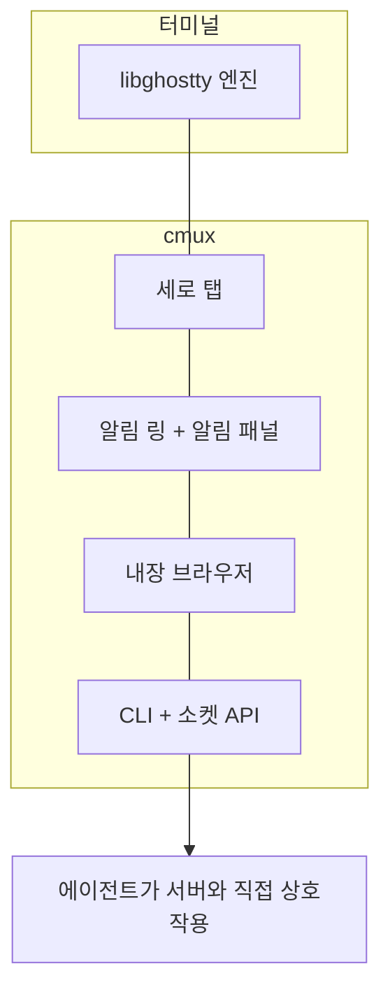
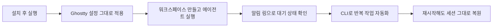

# cmux: 에이전트 여러 개를 동시에 돌린다면, 누가 나를 부르는지 한눈에 보입니다

> **Summary**
> cmux는 Ghostty 엔진을 사용하는 네이티브 macOS 터미널로, 여러 AI 코딩 에이전트의 입력 대기 상태를 파란 링과 알림 패널로 한눈에 보여줍니다. 내장 브라우저와 CLI·소켓 API로 에이전트 작업을 자동화하고, 터미널·브라우저·알림 등을 자유롭게 조합해 협업 환경을 구성할 수 있습니다. macOS 14 이상에서 사용할 수 있으며 AGPL-3.0으로 공개되어 있습니다.

---

- cmux는 Ghostty 엔진을 얹은 네이티브 macOS 터미널로, 여러 AI 코딩 에이전트를 동시에 돌릴 때 누가 나를 부르는지 바로 보여줍니다.
- 에이전트가 입력을 기다리면 패널 테두리에 파란 링이 뜨고 탭이 강조되며, 미확인 알림은 알림 패널 한곳에 모입니다.
- 터미널·브라우저·알림·탭·CLI를 조합 가능한 기본 도구로 제공해, 정해진 흐름 대신 각자 AI 협업 환경을 설계하게 합니다.

클로드 코드 세션을 세 개 띄워놓고 작업한 적 있으시죠? 하나는 테스트를 돌리고, 하나는 리팩터링을 하고, 하나는 멈춰서 질문을 기다리고 있습니다. 그런데 알림이 울려도 어느 세션인지 알 수가 없습니다. macOS 알림은 죄다 똑같이 생겼거든요!

🎥 [동영상 보기](https://www.youtube.com/watch?v=i-WxO5YUTOs)

### 왜 터미널이 문제였을까요?

에이전트 시대의 터미널은 예전과 다릅니다. 예전에는 터미널 창 하나에 명령어 하나면 충분했습니다. 이제는 에이전트 여러 개를 동시에 돌리는 게 일상이 됐습니다. 문제는 알림이었습니다. 어느 에이전트가 나를 부르는지, 알림만 봐서는 알 수 없었습니다. 창을 일일이 뒤져야 했습니다. 그 사이 에이전트는 멈춰 서 있습니다.

### cmux는 뭐가 다를까요?

cmux는 macOS용 네이티브 터미널 앱입니다. `Swift`와 `AppKit`으로 만들었고, `Electron`을 쓰지 않았습니다. 그래서 실행이 빠르고 메모리도 적게 씁니다. 터미널 엔진은 Ghostty의 `libghostty`를 그대로 씁니다. Ghostty를 쓰던 분이라면 설정이 그대로 이어집니다. 테마·폰트·색상을 다시 맞출 필요가 없습니다. 렌더링은 GPU 가속으로 돌아가 출력이 부드럽습니다.

> 핵심은 이겁니다. cmux는 Ghostty를 흉내 낸 게 아니라, Ghostty 엔진을 빌려온 전혀 다른 앱입니다!

### 파란 링이 뜨면, 그게 답입니다

cmux의 얼굴은 세로 탭입니다. 사이드바에는 워크스페이스마다 Git 브랜치, 연결된 PR 상태와 번호, 작업 디렉터리, 수신 포트, 최신 알림이 한눈에 들어옵니다. 에이전트가 사용자 입력을 기다리면 해당 패널 테두리에 파란 링이 뜹니다. 탭도 함께 강조됩니다. 알림 패널을 열면 미확인 알림이 전부 모여 있고, 단축키 한 번이면 최신 미확인 항목으로 바로 이동합니다. 이 장면이 가장 인상 깊었습니다. "어느 에이전트냐"는 질문 자체가 사라지니까요!

### 브라우저까지 터미널 안에?

cmux에는 내장 브라우저가 있습니다. 터미널 옆에 웹뷰를 분할해서 띄웁니다. 개발 서버를 띄워놓고 브라우저로 확인하는 흐름이, 창을 오갈 필요 없이 한 화면에서 이어집니다. 더 눈에 띄는 건 `agent-browser API`입니다. 요소 클릭, 폼 입력, JS 실행, 접근성 트리 스냅샷까지 자동화를 지원합니다. 그래서 AI 에이전트가 개발 서버와 직접 상호작용할 수 있습니다. 터미널에서 일하던 에이전트가, 브라우저에서 결과를 직접 확인하는 셈입니다.

### 스크립트로 조종하면 뭐가 달라질까요?

cmux는 CLI와 소켓 API로 완전히 조종할 수 있습니다. 워크스페이스 생성, 탭 분할, 키 입력 전송, URL 열기까지 명령으로 처리합니다. 반복되는 준비 과정을 스크립트 한 번으로 끝낼 수 있습니다. 단축키도 중심입니다. 워크스페이스·탭·분할·브라우저·알림을 `⌘`·`⌃` 기반 단축키로 제어하고, 사용자 지정 키맵도 지원합니다. 앱을 껐다 켜도 창·워크스페이스·탭 레이아웃·스크롤백·브라우저 히스토리가 그대로 복원됩니다!

### 정해진 흐름이 없다는 게 장점일까요?

cmux의 철학은 "The Zen of cmux"라는 말에 담겼습니다. 특정 워크플로우를 강요하지 않고, 조합 가능한 기본 도구만 건넵니다. 터미널, 브라우저, 알림, 탭, 분할, CLI를 각자 입맛대로 조합하는 방식입니다. 오케스트레이터처럼 에이전트 수명 주기를 관리하지 않습니다. 대신 에이전트가 돌아갈 환경을 더 잘 만드는 데 집중했습니다. 이 구분이 저는 가장 와닿았습니다. 도구가 흐름을 정하는 게 아니라, 개발자가 환경을 설계하는 쪽입니다.

### 그래서, 써볼 만할까요?

설치는 간단합니다. Homebrew로 받거나 DMG를 받아 설치하면 됩니다. 자동 업데이트도 내장됐습니다. 2026년 3월 출시 이후 몇 달 만에 저장소 별이 2만 개를 넘겼습니다. 다만 macOS 전용이라는 점은 분명합니다. `macOS 14` 이상에서만 돌아가고, 윈도우나 리눅스는 지원하지 않습니다. 라이선스는 `AGPL-3.0`으로 공개됐습니다. 여러 에이전트를 동시에 돌리는데, "어느 에이전트가 나를 부르는지"가 매번 궁금했다면, 터미널부터 바꿔볼 만합니다!

