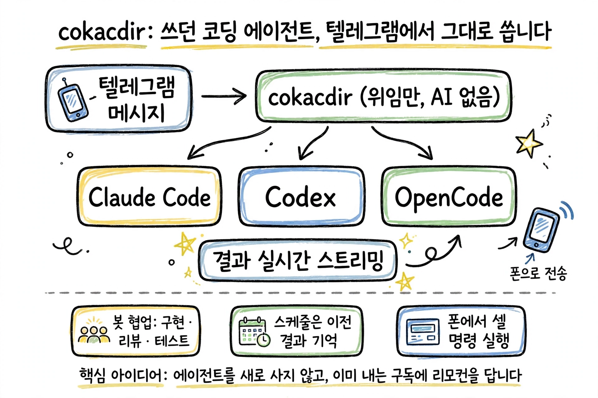
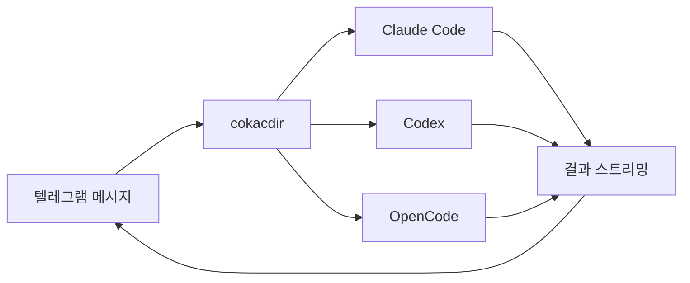
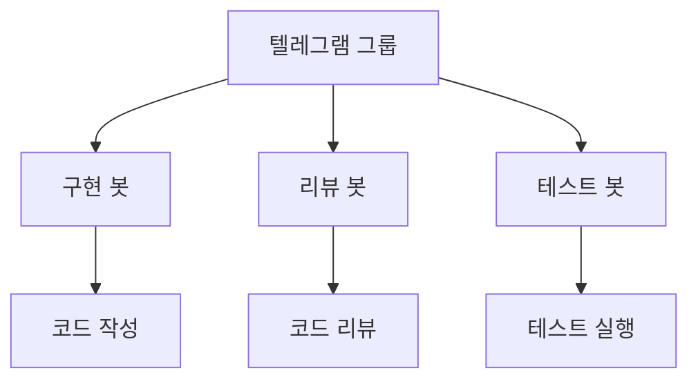
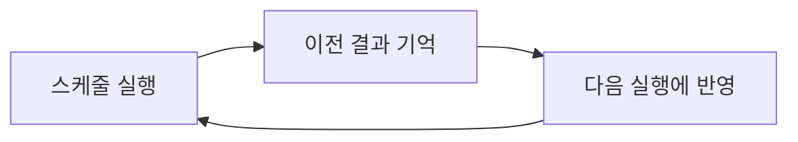

# cokacdir: 코딩 에이전트는 새로 살 필요 없습니다. 텔레그램에서 쓰던 구독 그대로 씁니다

> **Summary**
> cokacdir은 자체 AI 에이전트가 없는, 텔레그램에서 코딩 에이전트를 부리는 오픈소스 도구입니다. Claude Code·Codex·Gemini CLI·OpenCode에 일을 위임하므로, API 추가 과금 없이 이미 내는 구독 안에서 씁니다. 여러 봇을 한 그룹에 넣어 협업시키고, 스케줄 실행과 셸 명령까지 폰에서 굴릴 수 있습니다.

---

- cokacdir은 자체 AI 에이전트가 없는, 텔레그램에서 코딩 에이전트를 부리는 오픈소스 도구입니다.
- Claude Code·Codex·Gemini CLI·OpenCode에 일을 위임하므로, API 추가 과금 없이 이미 내는 구독 안에서 씁니다.
- 여러 봇을 한 그룹에 넣어 협업시키고, 스케줄 실행과 셸 명령까지 폰에서 굴릴 수 있습니다.


지하철에서 빌드가 깨졌다는 알림이 떴습니다. 노트북은 집에 있고, 손에는 폰만 있습니다. 이럴 때 폰으로 "로그 보고 고쳐줘"라고 말할 수 있다면 어떨까요?

🎥 [동영상 보기](https://www.youtube.com/watch?v=jGuzXshuFrQ)

## cokacdir, 도대체 뭘까요?

cokacdir은 AI 에이전트 자체가 아닙니다. LLM도, 추론 엔진도 들어 있지 않습니다. 대신 이미 쓰고 있는 코딩 에이전트에 일을 넘기고, 그 결과를 텔레그램에서 주고받는 창구 역할을 합니다.

그래서 구조가 가볍습니다. Rust로 만든 바이너리 하나가 돌아가고, 무게는 15~20MB 수준입니다. 텔레그램뿐 아니라 디스코드와 슬랙에서도 같은 방식으로 쓸 수 있습니다.

핵심은 위임입니다. 메시지를 보내면, 실행·파일 편집·셸 명령은 에이전트가 맡고, 진행 상황은 실시간으로 스트리밍돼서 폰으로 돌아옵니다. 에이전트는 이미 구독 중인 플랜 안에서 돌아가기 때문에, 별도 API 비용이 붙지 않습니다!



## OpenClaw랑 뭐가 다를까요?

차이는 구조에 있습니다. OpenClaw는 자체 에이전트를 내장합니다. 그래서 LLM API 키와 토큰 과금이 따라옵니다. 컨텍스트가 길어질수록 비용도 커질 수 있습니다.

반면 cokacdir은 에이전트를 직접 품지 않습니다. Claude Code·Codex·Gemini CLI·OpenCode에 위임만 합니다. 이미 내고 있는 구독료 안에서 해결되는 구조입니다. 에이전트를 새로 사는 게 아니라, 쓰던 에이전트에 텔레그램이라는 리모컨을 다는 셈입니다!

또 하나 차이가 있습니다. 에이전트 구동을 위해 별도 OAuth 인증정보를 직접 다루지 않기 때문에, 그 과정에서 생길 수 있는 정책 리스크로부터 자유롭다는 점입니다. 구독 계정을 제3자 도구에 맡기는 구조가 아니라는 뜻입니다.

## 봇 여러 개를 한 방에 넣으면 어떻게 될까요?

여러 봇을 같은 텔레그램 그룹에 넣어 역할을 나눌 수도 있습니다. 예를 들어 한 봇이 구현하고, 다른 봇이 리뷰하고, 또 다른 봇이 테스트를 돌리는 식입니다.

봇끼리 메시지를 주고받으며 협업하는 구조라서, 혼자 일하는 에이전트 한 명보다 흐름이 넓어집니다! 세션도 제한 없이 병렬로 굴릴 수 있고, CLI에서 하던 작업을 텔레그램에서 이어받는 것도 가능합니다.



## 스케줄은 기억까지 합니다

스케줄 작업은 이전 실행 결과를 기억합니다. 그래서 "매일 아침 분석" 같은 자동화도 누적 맥락을 바탕으로 이어서 수행할 수 있습니다.

매일 처음부터 다시 설명하지 않아도 됩니다. 어제 본 내용을 오늘 이어서 보는 구조라서, 반복 작업이 쌓일수록 맥락이 두꺼워집니다. cron 표현식이나 절대 시간으로 스케줄을 걸 수 있습니다.



## 폰에서 셸 명령까지 됩니다?

`!git status`, `!docker ps` 같은 셸 명령도 텔레그램에서 바로 실행할 수 있습니다. 폰으로 로그 확인·재시작·배포 같은 작업도 가능하다는 뜻입니다.

파일을 올리면 다음 AI 컨텍스트에 자동으로 반영되고, 채팅별로 설정도 따로 둘 수 있습니다. 진행 상황은 실시간으로 공유됩니다. 상시 실행은 `systemd`, `launchd`, 윈도우 작업 스케줄러 기반으로 돌릴 수 있습니다.

## 설치는 어떻게 할까요?

코딩 에이전트가 설치된 머신에서 실행하면 됩니다. macOS와 Linux에서는 한 줄 명령으로 관리 도구를 받고, 윈도우에서는 관리자 권한 PowerShell에서 한 줄로 받습니다. 실행 후 서비스 매니저 화면에서 텔레그램 봇 토큰을 등록하고 시작하면 끝입니다.

```plain text
curl -fsSL https://cokacdir.cokac.com/manage.sh | bash && cokacctl
```

텔레그램에서 해당 봇에게 `/start`를 보내면 바로 사용할 수 있습니다. 참고로 OpenCode는 macOS와 Linux만 지원합니다. 지원하는 에이전트 목록은 계속 바뀌고 있으니, 설치 전에 공식 문서에서 확인하는 게 안전합니다.

## 이런 분께 맞습니다

Claude Code나 Codex를 이미 구독 중인 분께 가장 잘 맞습니다. 코딩 에이전트를 스마트폰에서도 쓰고 싶은 분, 여러 에이전트를 협업시켜 보고 싶은 분, OpenClaw의 토큰 비용이 부담스러운 분, 반복 작업을 자동화하고 싶은 분께도 맞습니다.

다만 한 가지는 짚고 넘어가야 합니다. 실제 작업은 폰이 아니라 에이전트가 설치된 머신에서 돌아갑니다. 텔레그램은 리모컨이고, 머신이 꺼지면 봇도 멈춥니다. 상시 실행 설정을 해두는 게 먼저입니다. 그리고 셸 명령까지 되는 봇인 만큼, 봇 대화는 나만 쓸 수 있게 잠그는 게 먼저입니다!

에이전트를 새로 사는 시대는 지났습니다. 이미 내는 구독에 텔레그램 리모컨 하나 다는 것만으로, 코딩 에이전트는 주머니 안으로 들어옵니다.

