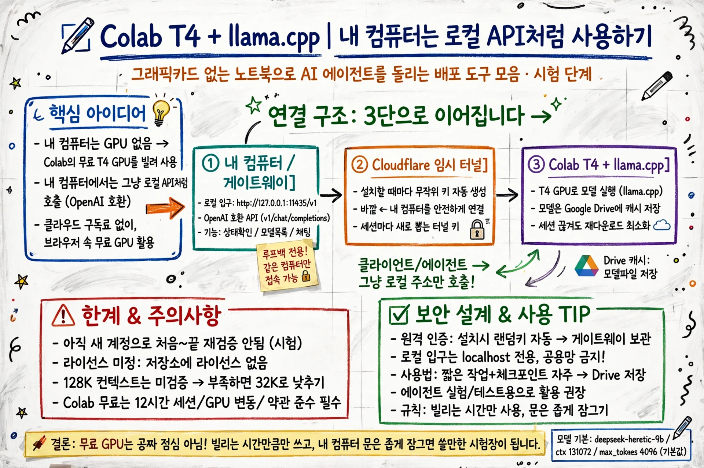
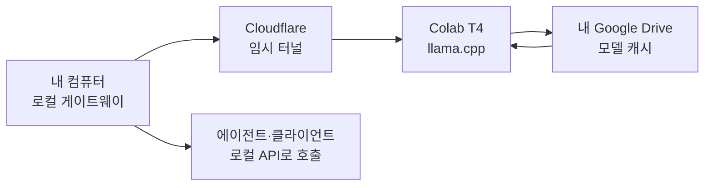
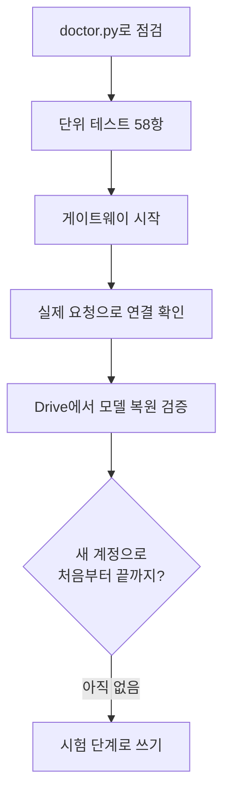

# colab-t4-local-api: 그래픽카드 없이, Colab T4를 내 컴퓨터의 로컬 API로 씁니다

> **Summary**
> Colab T4에서 llama.cpp로 모델을 실행하고 로컬 게이트웨이를 통해 OpenAI 호환 API로 사용하는 도구 모음입니다. 모델은 Google Drive에 캐시되고 임시 터널과 설치별 인증 키로 연결을 보호하지만, 새 계정에서의 전체 검증과 라이선스가 아직 확정되지 않아 시험용으로 사용해야 합니다. Colab 제한을 준수하고 로컬 API를 루프백에만 열어 두는 것이 중요합니다.

---

- Colab T4를 빌려 `llama.cpp`로 모델을 돌리고, 내 컴퓨터에서는 `OpenAI` 호환 API로 부르는 배포 도구 모음입니다. 그래픽카드는 내 컴퓨터에 없어도 됩니다.
- 모델은 내 `Google Drive`에 캐시되고, 터널은 설치마다 새로 뽑은 키로 잠그며, 로컬 입구는 같은 컴퓨터에서만 여는 구조입니다.
- 다만 아직 새 계정으로 처음부터 끝까지 검증된 적이 없고, 라이선스도 정해지지 않았으니, 시험 단계로 쓰는 것이 맞습니다.

그래픽카드 없는 노트북으로 AI 에이전트를 돌리고 싶으신 적 있으시죠? 클라우드 구독료를 매달 내자니 아깝고, 내 컴퓨터는 모델 한 개 올릴 힘도 부족합니다. 그런데 브라우저 속 무료 GPU를 빌려, 내 컴퓨터에서는 그냥 로컬 API처럼 부르는 방법이 있습니다. 이 글은 그 연결을 묶어 주는 배포 도구 모음을 소개합니다!

🎥 [동영상 보기](https://www.youtube.com/watch?v=OhWEKvYj-UE)

## 빌리는 GPU, 내 컴퓨터의 API?

핵심 구조는 세 단으로 이어집니다. 내 컴퓨터의 게이트웨이가 먼저 열리고, `Cloudflare` 임시 터널이 그 게이트웨이를 바깥과 잇고, `Colab` 위의 T4가 `llama.cpp`로 모델을 돌립니다. 모델 파일은 내 `Google Drive`에 캐시되니, 세션이 끊겨도 다시 받는 일이 줄어듭니다.

왜 이렇게까지 우회할까요? `Colab`은 노트북 환경이라 바깥에서 바로 API로 부를 수 없습니다. 그래서 터널이 필요하고, 터널 끝에는 내 컴퓨터의 게이트웨이가 서서 요청을 중계합니다. 클라이언트 입장에서는 그냥 로컬 주소 하나만 보면 됩니다!

## 내 컴퓨터에서는 뭐가 보이나요?

로컬 입구는 `http://127.0.0.1:11435/v1`입니다. `OpenAI` 호환 형식이라, 에이전트나 클라이언트는 원격 주소를 몰라도 됩니다. 기본 모델은 `deepseek-heretic-9b`, 컨텍스트는 131072, 생성 상한을 안 적으면 게이트웨이가 `max_tokens=4096`을 넣어 줍니다. 열리는 기능은 딱 세 가지입니다. 상태 확인, 모델 목록, 채팅입니다.

보안 설계도 눈에 띕니다. 원격 인증은 설치할 때마다 무작위 키를 새로 뽑아 게이트웨이가 자동으로 들고 다닙니다. 로컬 입구는 루프백 전용이라 같은 컴퓨터의 프로그램만 닿습니다. 이 부분을 공용망이나 집 안 네트워크로 넓히면 안 됩니다. 편의를 위해 문을 넓히는 순간, 내 API가 남의 API가 되니까요!

## 어디까지 믿을 수 있나요?

솔직한 한계부터 짚겠습니다. 이 도구는 아직 새 계정으로 처음부터 끝까지 다시 검증된 적이 없습니다. 원래 환경에서 한 번 잘 돌았다는 기록이 있지, 이번에 다듬은 코드로 처음부터 다시 돌렸다는 증거는 아닙니다. 기본값인 128K 컨텍스트도 현행 버전에서 실제 메모리 정점을 다시 재지 않았습니다. 메모리가 모자라면 32768로 낮춰 다시 배포하라는 안내가 붙어 있습니다.

라이선스도 아직 정해지지 않았습니다. 저장소에 라이선스 파일이 없어, 공개됐다고 해서 마음대로 가져다 쓸 수 있는 것은 아닙니다. `Colab`의 자원·자격·제한도 수시로 바뀝니다. 무료로 오래 켜 두는 서버가 아니라, 그때그때 빌리는 시험장이라는 점을 전제로 써야 합니다.

그래도 검증의 흔적은 있습니다. 깨끗한 `Python 3.13` 가상환경에서 의존성 설치가 됐고, 단위 테스트 58항이 전부 통과했으며, 배포 전 검사와 파일 목록 대조까지 돌렸습니다. 테스트가 전부는 아니지만, 손으로만 돌린 것과는 다릅니다!

## 그래서 어떻게 쓰면 좋을까요?

먼저 `Colab` 공식 FAQ를 확인하고, 내 계정 조건과 용도가 맞는지부터 봅니다. 무료 티어의 한계는 공개되지 않았고, 세션은 최대 12시간까지만 이어지며, GPU 종류도 그때그때 달라집니다. 여러 계정으로 제한을 우회하거나, 꺼지지 않게 붙잡아 두는 꼼수는 쓰면 안 됩니다. 계정이 멈추면 그걸로 끝입니다!

다음으로, 이 도구는 시험 단계로 씁니다. 에이전트 실험이나 작은 작업부터 돌려 보고, 긴 작업은 체크포인트를 나눠 `Drive`에 자주 저장합니다. `Drive`에 내려오는 토큰은 단기 토큰이라, 아주 긴 작업은 유효기간을 넘겨 실패할 수 있습니다. 한 번에 몰아치는 긴 작업보다, 끊겼다가 이어지는 짧은 작업이 잘 맞습니다!

한 가지 더 짚겠습니다. 원문 게시물은 직접 읽지 못했습니다. 로그인 벽 뒤에 있어 본문을 확인할 수 없었고, 노션에 남은 것도 임베드 한 줄뿐이라 공개 저장소의 설명서·배포 문서·검토 기록을 1차 원본으로 삼아 재구성했습니다. 같은 날 같은 작성자가 올린 다른 게시물들도 같은 사정이라, 이 글은 그 프로젝트 자체의 구조와 한계를 다루는 글로 독립적으로 썼습니다.

무료 GPU는 공짜 점심이 아닙니다. 빌리는 시간만큼만 쓰고, 내 컴퓨터의 문은 좁게 잠그는 것, 그 선을 지키면 꽤 쓸 만한 시험장이 됩니다!

