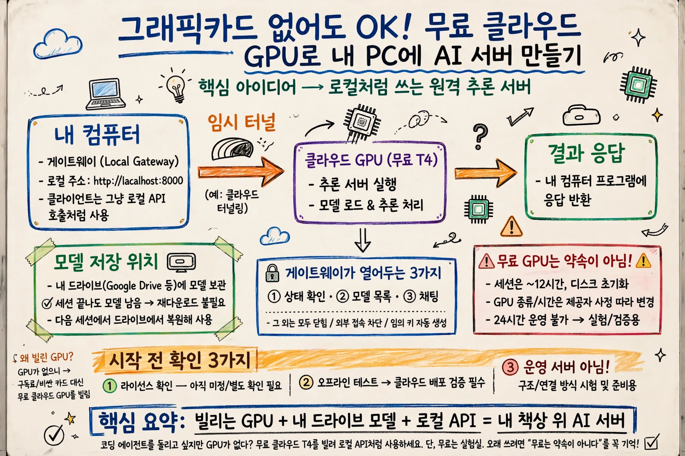
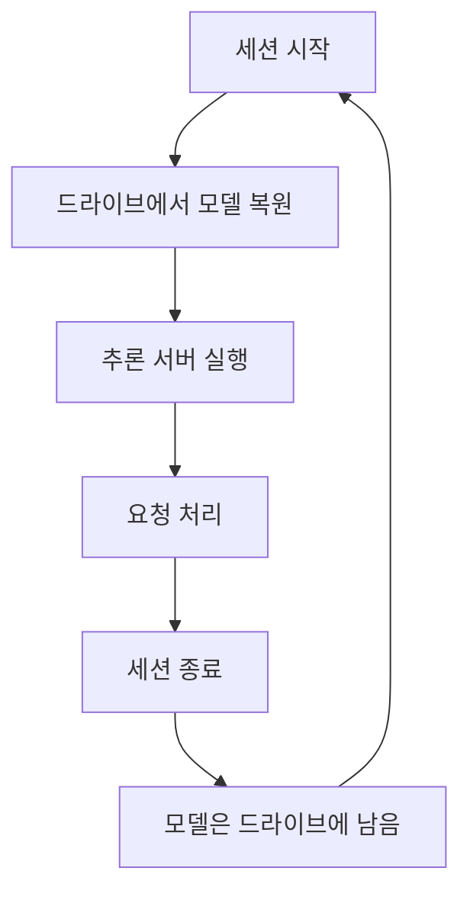

# colab-t4-local-api: 그래픽카드가 없어도 됩니다. 무료 클라우드 GPU가 내 컴퓨터의 AI 서버가 됩니다

> **Summary**
> 그래픽카드가 없어도 무료 클라우드 GPU에 추론 서버를 올리고, 로컬 게이트웨이와 임시 터널을 통해 내 컴퓨터에서 로컬 API처럼 사용할 수 있습니다. 모델은 드라이브에 저장해 세션 종료 후에도 복원할 수 있지만, 무료 자원은 사용 시간과 이용 가능성이 보장되지 않으므로 실험과 테스트 용도로 활용해야 합니다.

---

- 그래픽카드가 없어도 됩니다. 무료 클라우드 GPU를 빌려 내 컴퓨터에 AI 서버를 두는 방법이 있습니다.
- 로컬 게이트웨이와 임시 터널, 클라우드 GPU 위의 추론 서버가 한 줄로 이어지면, 내 컴퓨터의 프로그램은 그냥 로컬 API를 부르는 것처럼 씁니다.
- 모델은 내 드라이브에 보관해 세션이 끝나도 다시 내려받지 않습니다. 다만 무료 자원은 약속이 아니라 빌리는 것이라는 점이 전제입니다.

코딩 에이전트에게 일을 맡기고 싶은데, 내 컴퓨터에 그래픽카드가 없다고요? 구독료를 내는 것도, 비싼 카드를 사는 것도 답이 아닐 수 있습니다. 빌릴 수 있는 GPU가 이미 있습니다. 무료 클라우드 노트북의 T4 말입니다.

🎥 [동영상 보기](https://www.youtube.com/watch?v=Qb-C1MWYkV4)

## 왜 내 컴퓨터가 아니라 빌린 GPU일까요?

에이전트가 일하려면 모델이 계속 돌아가야 합니다. 내 컴퓨터에 그래픽카드가 없으면 선택지가 세 가지밖에 없습니다. 구독료를 내고 클라우드 모델을 쓰거나, 비싼 카드를 사거나, 빌리는 겁니다. 이 글의 방법은 세 번째입니다. 무료 티어의 클라우드 GPU를 빌려 추론 서버로 쓰고, 내 컴퓨터에서는 그 서버를 로컬 API처럼 부릅니다.

> GPU를 사는 것과 빌리는 것, 무엇이 먼저일까요?

## 세 조각이 한 줄로 이어집니다

구조는 단순합니다. 내 컴퓨터의 게이트웨이, 임시 터널, 클라우드 GPU 위의 추론 서버, 이렇게 세 조각입니다.

내 컴퓨터의 프로그램은 게이트웨이가 열어 둔 로컬 주소만 봅니다. 게이트웨이가 터널을 타고 클라우드 GPU까지 요청을 전달합니다. 클라이언트 입장에서는 그냥 로컬 API를 부르는 것과 같습니다. 원격 주소도, 키도 클라이언트는 모릅니다.

## 모델은 어디에 두나요? 내 드라이브에 둡니다

무료 클라우드 노트북의 약점은 세션이 끝나면 디스크가 날아간다는 점입니다. 모델을 매번 다시 내려받으면 시간도, 인내심도 다 떨어집니다. 그래서 모델은 내 드라이브에 보관합니다. 세션이 끝나도 모델은 남고, 다음 세션에서는 보관해 둔 복사본을 다시 가져옵니다. 이 보관과 복원까지 직접 확인한 것이 이 방법의 뼈대입니다.

## 무엇을 열고, 무엇을 닫나요?

게이트웨이는 세 가지만 엽니다. 상태 확인, 모델 목록, 채팅입니다. 그 외에는 닫혀 있습니다. 로컬 주소는 같은 컴퓨터 안에서만 듣고, 외부에서 들어오는 요청은 받지 않습니다. 설치할 때마다 바뀌는 임의의 키를 게이트웨이가 자동으로 챙깁니다. 공용 네트워크에 열어 두는 설정은 애초에 하지 않는 것이 맞습니다.

기본 문맥 길이는 128K로 잡혀 있지만, 이 숫자는 설정값일 뿐입니다. 아무 프롬프트 길이나 T4 메모리 안에서 돌아간다는 보장은 없습니다. 긴 문맥은 메모리를 더 먹습니다. 숫자를 보고 안심하지 말고, 내 프롬프트 길이로 직접 재보는 것이 맞습니다!

## 무료라는 말의 전제를 확인하셨나요?

무료 클라우드 GPU는 약속이 아닙니다. 어떤 GPU가 배정될지, 얼마나 오래 쓸 수 있을지, 무료 티어의 한도가 어떻게 바뀔지는 제공 쪽 사정에 달려 있습니다. 세션은 길어야 12시간 남짓이고, 끝나면 디스크가 지워집니다. "무료니까 계속 된다"는 보장은 어디에도 없습니다!

그래서 이 방법은 실험실에 가깝습니다. 에이전트를 시험하고, 연결 방식을 검증하고, 내 컴퓨터에 GPU가 생겼을 때 바로 옮겨갈 준비를 하는 용도입니다. 24시간 돌아가는 운영 서버로 쓰면 안 됩니다!

## 시작하기 전에 확인할 세 가지

첫째, 라이선스가 아직 정해지지 않았다는 점입니다. 공개된 코드라고 해서 마음대로 써도 되는 것은 아닙니다. 라이선스가 정해지기 전에는 어떤 조건으로 쓸 수 있는지 확정할 수 없습니다.

둘째, 오프라인 테스트와 클라우드 배포는 다릅니다. 내 컴퓨터에서 돌아갔다고 해서 새 계정의 클라우드 환경에서도 똑같이 돌아간다는 뜻은 아닙니다. 실제 요청을 보내 보고, 드라이브에서 모델을 통째로 복원해 보는 확인까지 마쳐야 합니다.

셋째, 같은 날 올라온 같은 작성자의 다른 글들과 주제가 겹칠 수 있습니다. 이 글은 구조 자체, 즉 무료 GPU를 내 API 서버로 쓰는 발상에 초점을 맞췄습니다.

이 글의 원문은 직접 읽지 못했습니다. 소셜 게시물이 로그인 벽 뒤에 있고, 노션에 남은 것은 임베드 한 줄뿐이라 원문의 정확한 문장은 확인할 수 없었습니다. 그래서 이 글은 작성자의 공개 프로젝트 문서와 같은 방식을 다룬 공개 가이드를 바탕으로 재구성했습니다. 원문의 표현이 아니라, 확인 가능한 공개 자료가 근거입니다.

그래픽카드가 없다고 에이전트를 못 쓰는 시대는 지났습니다. 빌릴 수 있는 GPU, 내 드라이브에 남는 모델, 내 컴퓨터에서 부르는 로컬 API, 이 세 가지가 모이면 내 책상 위에도 AI 서버가 섭니다. 다만 무료라는 말 뒤에 숨어 있는 전제까지 함께 들고 가는 것이, 이 방법을 오래 쓰는 비결입니다!

