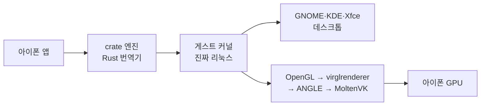
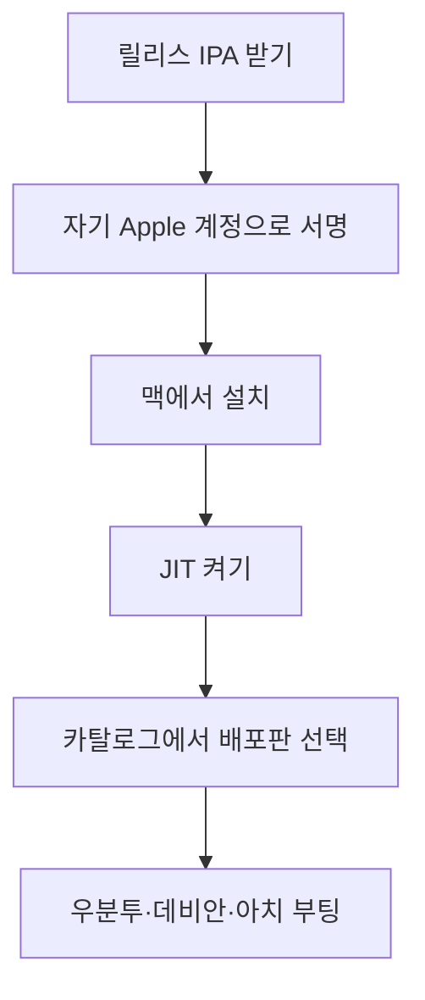

# crate: 아이폰이 진짜 컴퓨터가 됩니다. 우분투 데스크톱이 주머니 안에서 돌아갑니다

> **Summary**
> crate는 아이폰과 아이패드에서 우분투·데비안·아치 리눅스의 전체 데스크톱을 가상 머신으로 직접 실행하는 도구입니다. Rust 기반 Arm64 번역과 GPU 가속으로 성능을 높였으며, 오프라인 사용과 개발 작업을 지원합니다. 다만 앱스토어에서 제공되지 않아 직접 서명하고 JIT를 활성화해야 하며, 일부 기능은 아직 개선 중입니다.

---

- 아이폰이 진짜 컴퓨터가 됩니다. 우분투 데스크톱이 주머니 안에서 돌아갑니다.
- 리눅스 배포판 통째로, 커널까지 진짜로 부팅합니다. 원격 접속도, 클라우드도 아닙니다.
- 다만 앱스토어에는 없습니다. 직접 서명해 설치하고, JIT를 켜야 쓸 만합니다.

카페에서 노트북을 펼치려는데 콘센트도, 자리도 없을 때가 있습니다. 그럴 때 주머니 속 아이폰으로 우분투 데스크톱을 켜서 코드를 짠다면 어떨까요? 원격 데스크톱이 아닙니다. 클라우드 컴퓨터를 빌리는 것도 아닙니다. 아이폰 안에서 리눅스가 직접 돌아갑니다!

🎥 [동영상 보기](https://www.youtube.com/watch?v=KQmL2Bqgbbo)

## 아이폰에서 리눅스를 돌린다고요?

아이폰에서 리눅스를 쓴다는 말, 들어보셨나요? 지금까지 방법은 대충 세 가지였습니다. 가벼운 셸만 돌리는 앱, 느린 에뮬레이터, 아니면 탈옥입니다. `crate`는 네 번째 길을 택했습니다. 진짜 가상 머신을 아이폰 안에서 직접 돌리는 것입니다.

이름부터 뜻이 있습니다. `crate`는 Compact Runtime for Arm64 Translation and Emulation의 줄임말입니다. Arm64를 Arm64로 번역해 실행하는 작은 런타임이라는 뜻입니다. 아이폰과 아이패드에서 리눅스 배포판 전체를, 데스크톱까지 통째로, 가상 머신으로 돌립니다. 기기 안에서만 돌아가고, 오프라인에서도 됩니다. 파일도 기기 안에 남습니다.

## 무엇이 돌아가나요?

설치 탭에서 고르는 배포판은 세 가지입니다. 우분투 26.04 LTS는 GNOME 데스크톱과 함께, 데비안 13은 KDE Plasma나 Xfce와 함께, 아치 리눅스 ARM도 KDE Plasma나 Xfce와 함께 돌아갑니다. 모두 정식 arm64 리눅스라서, 패키지 관리자로 설치하는 소프트웨어가 그대로 돌아갑니다. 브라우저, 개발 도구, 코딩 에이전트, CAD 앱까지요!

디스크 크기는 설치할 때 정하고, 메모리 상한은 나중에 바꿀 수 있습니다. 터치는 태블릿처럼 동작하고, 키보드 위쪽 키 행에는 Esc, Ctrl, Super, Tab, 기능키, 방향키가 있습니다. 아이패드에서는 마우스와 트랙패드도 됩니다. 휠 스크롤, 오른쪽 클릭, 가운데 클릭까지요.

외부 모니터를 연결하면 모니터가 VM의 화면이 되고, 아이폰이나 아이패드가 트랙패드가 됩니다. 데스크톱 옆 탭에서는 VM의 시리얼 콘솔도 볼 수 있습니다. 접는 폰에서는 데스크톱이 접히는 형태를 따라갑니다.

## 어떻게 이렇게 빠를까요?

속도의 비결은 엔진에 있습니다. `crate` 엔진은 처음부터 Rust로 새로 쓴 arm64-to-arm64 번역기입니다. 게스트 명령어 대부분을 호스트 코드로 그대로 옮기고, 기계를 건드리는 부분만 다시 씁니다. 만든 쪽이 공개한 측정에서는, 맥에서 한 벤치마크 구간이 QEMU의 TCG로는 130.5초, `crate`로는 24.5초가 걸렸습니다. 만든 쪽 자체 측정이라는 점은 알아두셔야 합니다!

그래픽도 빠릅니다. 게스트의 OpenGL이 아이폰 GPU에서 직접 돕니다. `virglrenderer`와 ANGLE, MoltenVK를 거치는 구조입니다. 데스크톱이 하드웨어로 합성되고, 3D 앱도 GPU로 그려집니다. VM 안의 크롬에서 확인 페이지를 열면 캔버스, 합성, WebGL, WebGPU가 하드웨어 가속으로 표시됩니다. 갤러리에는 VM 안에서 코딩 에이전트가 3D CAD 앱으로 의자를 만드는 장면도 있습니다.

## 설치, 왜 이렇게 복잡할까요?

여기서 한 가지 짚고 넘어가야 합니다. `crate`는 앱스토어에 없습니다. 이유가 있습니다. 빠른 실행에 필요한 JIT를 iOS는 디버거가 붙은 앱에만 허용하기 때문입니다. 그래서 릴리스마다 서명되지 않은 IPA 파일이 제공되고, 자기 Apple 계정으로 직접 서명해 맥에서 설치합니다. JIT는 내장된 StikJIT이나 StikDebug로 켭니다. 설치 안내에는 코딩 에이전트에게 그대로 붙여넣으면 단계를 대신 해주는 요청문도 들어 있습니다.

설치가 끝나면 카탈로그에서 배포판을 골라 받습니다. 이미지는 검증된 목록에서 오고, 파일마다 SHA-256으로 확인합니다. 디스크는 32GB까지 자라나고, 계정은 설치할 때 만든 계정으로 들어갑니다. 개발은 접는 폰과 iOS 27.1에서 이뤄지고 있습니다. 저장소는 2026년 11월 13일에 공개됐고, 별 494개·포크 28개(2026-11-23 기준)를 모았습니다. 라이선스는 MPL-2.0입니다.

## 무엇이 아직 안 되나요?

아직 다듬어지는 단계라는 점도 알아두셔야 합니다. 게스트가 자기 커널을 업데이트할 수는 없습니다. 커널과 초기 램디스크를 디스크 밖에서 부팅하는 구조라, 게스트가 설치한 커널은 부팅되지 않습니다. Xfce는 화면 크기가 바뀌면 배경화면이 옛 크기로 남습니다. GNOME은 외부 모니터에 맞게 크기가 안 잡힐 때가 있어, VM 안에서 해상도를 직접 골라야 합니다.

앱 안에도 아직 자리 표시자가 몇 군데 남아 있습니다. 로드맵은 속도가 먼저입니다. 부팅부터 앱 실행, 코드 빌드까지 아이폰에서 직접 재는 시간을 기준으로 엔진을 빠르게 만드는 것이 1순위입니다. 다음은 모니터와 주변기기, 그 다음은 더 많은 시스템입니다. Omarchy와 직접 만든 이미지도 준비 중입니다.

## 게임 에뮬레이션과는 뭐가 다를까요?

비슷한 주제의 글과 구분해 보겠습니다. 아이폰에서 PC 게임을 돌리는 도구는 게임을 실행 파일로 바꾸거나 번역 계층으로 돌리는 방식입니다. `crate`는 다릅니다. 게임이 아니라 운영체제 자체를 가상 머신으로 부팅합니다. 진짜 커널, 진짜 패키지 관리자, 진짜 데스크톱입니다. 리눅스 사용자 공간만 올리는 가벼운 방식과도 다릅니다. 커널까지 부팅하니까, 커널이 필요한 일도 그대로 할 수 있습니다!

그래서 이 도구의 진짜 쓸모는 어디일까요? 노트북이 없을 때 주머니 속 컴퓨터로 코드를 짜고, 서버와 같은 환경에서 테스트하고, 오프라인에서도 파일을 손에 쥐는 것입니다. 아이폰이 전화기를 넘어 컴퓨터가 되는 순간, 그 경계가 어디까지 가는지 직접 확인해 보시면 어떨까요?

