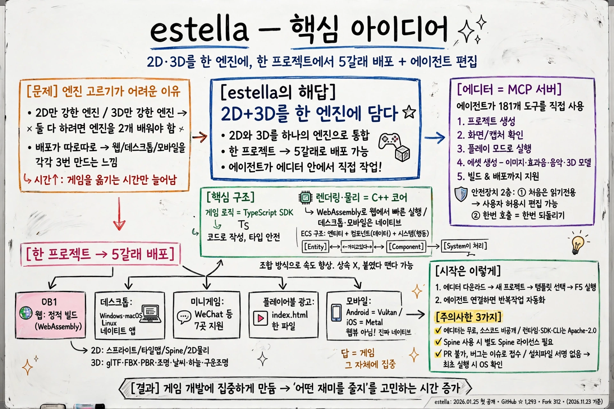
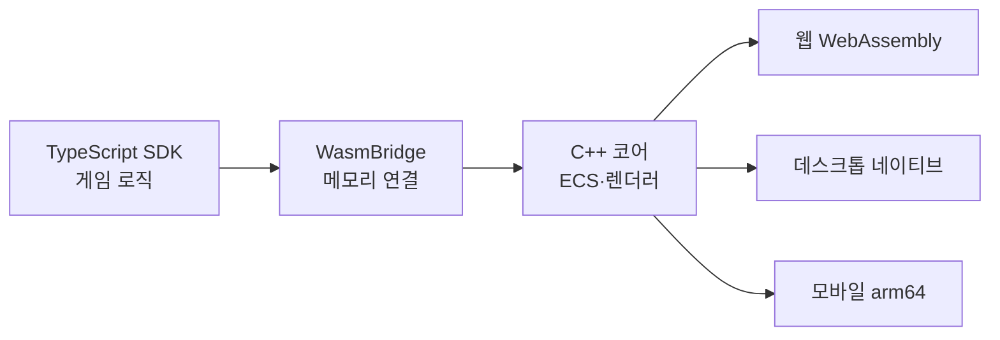
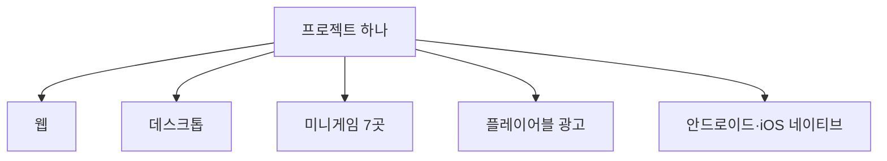

# estella: 2D와 3D를 한 엔진에 담고, 에이전트가 직접 게임을 만듭니다

> **Summary**
> estella는 2D와 3D를 한 엔진에 담은 빠른 게임 엔진입니다. TypeScript SDK로 게임 로직을 쓰고, C++ 코어가 WebAssembly로 빠르게 그립니다. 에디터 자체가 MCP 서버라서, 에이전트가 181개 도구를 직접 써서 게임을 만들고 확인하고 배포까지 돕습니다. 호출 한 번이 실행 취소 한 번이라 안전합니다. 프로젝트 하나가 웹·데스크톱·미니게임·플레이어블 광고·네이티브 모바일까지 나갑니다. 런타임과 SDK는 Apache-2.0이지만, 에디터 소스는 비공개이고 Spine은 별도 라이선스가 필요합니다.

---

- estella는 2D와 3D를 한 엔진에 담았습니다. `TypeScript`로 게임 로직을 쓰고, `C++` 코어가 `WebAssembly`로 빠르게 그립니다.
- 에디터 자체가 MCP 서버입니다. 에이전트가 에디터의 181개 도구를 직접 써서 게임을 만들고, 확인하고, 배포까지 돕습니다.
- 프로젝트 하나가 웹·데스크톱·미니게임·플레이어블 광고·네이티브 모바일까지 나갑니다. 런타임과 SDK는 `Apache-2.0`입니다.


게임 하나 만들어보고 싶으시죠? 그런데 막상 엔진을 고르려 하면 질문이 끝없이 늘어납니다. 2D만 할까요, 3D까지 할까요? 웹으로 낼까요, 앱으로 낼까요? 에디터는 또 따로 배워야 할까요?

estella는 이 질문을 줄이는 쪽을 택했습니다. 2D와 3D를 한 엔진에 담고, 한 프로젝트에서 다섯 갈래로 내보냅니다. 거기에 에이전트까지 에디터 안에서 일합니다!

🎥 [동영상 보기](https://www.youtube.com/watch?v=JxI3Eu5DPwE)

## 왜 엔진 고르기가 어려울까요?

게임 엔진은 보통 둘 중 하나입니다. 2D에 강한 엔진이거나, 3D에 강한 엔진이거나요. 둘 다 하려면 엔진을 두 개 배우거나, 한쪽을 억지로 끼워 맞춰야 했습니다.

배포도 마찬가지입니다. 웹용 빌드, 데스크톱용 빌드, 모바일용 빌드가 따로 놀면, 같은 게임을 세 번 만드는 기분이 듭니다. 플랫폼마다 손질할 곳이 따로 생기니까요.

> 게임을 만드는 시간이 줄고, 게임을 옮기는 시간이 늘어나는 것, 그게 문제였습니다.

## estella는 무엇이 다를까요?

estella는 빠른 2D·3D 게임 엔진입니다. 게임 로직은 `TypeScript` SDK로 쓰고, 렌더링과 물리는 `C++` 코어가 맡습니다. 웹에서는 코어가 `WebAssembly`로 돌아가고, 데스크톱과 모바일에서는 네이티브로 돌아갑니다.

핵심 구조는 ECS입니다. 엔티티에 컴포넌트를 붙이고, 시스템이 조건에 맞는 엔티티를 골라 처리합니다. 상속으로 얽히지 않고, 조합으로 만듭니다. 움직임 하나를 예로 들면 이렇습니다.

```typescript
const Speed = defineComponent('Speed', { value: 200 });

addSystem(defineSystem(
    [Res(Time), Query(Mut(LocalTransform), Speed)],
    (time, query) => {
        for (const [entity, transform, speed] of query) {
            transform.position.x += speed.value * time.delta;
        }
    }
));
```

컴포넌트는 데이터만 담고, 시스템이 행동을 정합니다. 그래서 같은 부품을 여러 캐릭터에 붙였다 뗐다 할 수 있습니다. 이 구조가 estella의 속도 비결 중 하나입니다!



## 에이전트가 에디터를 직접 움직입니다?

estella의 가장 눈에 띄는 특징은 에디터입니다. 에디터가 MCP 서버라서, 에이전트가 에디터의 도구를 직접 씁니다. 도구는 181개입니다. 노션에 담은 2026년 11월 13일 시점의 소개글에는 65개로 적혀 있었는데, 지금은 181개까지 늘었습니다. 빠르게 커지고 있다는 뜻입니다.

에이전트는 다섯 가지 일을 합니다. 프로젝트를 만들고, 화면을 보고, 플레이 모드로 게임을 돌리고, 이미지·효과음·음악·3D 모델 같은 에셋을 만들고, 배포까지 돕습니다. 화면을 캡처해서 만든 결과를 직접 확인하고, 프레임을 한 장씩 되짚어보기도 합니다.

그런데 에이전트에게 맡긴다는 말이 무섭지 않으신가요? estella는 안전장치를 두 겹으로 뒀습니다. 첫째, 에디터는 처음에 읽기 전용으로 시작합니다. 편집은 사용자가 허용한 뒤에만 열립니다. 둘째, 에이전트의 호출 한 번은 실행 취소 한 번입니다. 여섯 개 엔티티를 만들고 파일 두 개를 써도, 되돌리기는 한 번이면 됩니다!

## 한 프로젝트, 다섯 갈래 배포?

estella의 배포 범위는 넓습니다. 웹은 정적 빌드로 나가고, 데스크톱은 `Windows`·`macOS`·`Linux` 네이티브 앱으로 나갑니다. 브라우저를 끼워 넣지 않았습니다. 미니게임은 `WeChat`을 포함해 일곱 곳을 지원하고, 플레이어블 광고는 `index.html` 한 파일로 묶여 나갑니다. 안드로이드는 `Vulkan`, 아이폰은 `Metal`로 그리는 진짜 네이티브 앱입니다. 웹뷰가 아닙니다!



2D 기능도 3D 기능도 한 자리에서 씁니다. 2D에는 스프라이트·타일맵·`Spine` 애니메이션·2D 물리가 있고, 3D에는 `glTF`·`FBX` 가져오기, `PBR` 재질, 그림자 있는 조명, 시간과 날씨가 흐르는 하늘, 구워낸 조명과 반사가 있습니다. 한 장면 안에서 2D와 3D가 함께 돕니다.

실제 결과물도 있습니다. 한 장면이 아침 안개부터 정오의 햇살, 저녁 비와 밤의 가로등까지 하루를 그려내는 장면이 있고, 우주선이 게이트를 통과해 다른 항성계로 나가는 게임도 이 엔진으로 만들었습니다. 에이전트가 에디터 안에서 직접 만든 격투 장면도 있습니다.

## 시작은 어떻게 할까요?

시작은 가볍습니다. 에디터를 내려받아 새 프로젝트를 만들고, 템플릿을 고른 뒤 시스템을 쓰고 `F5`를 누르면 됩니다. 에이전트에게 맡기고 싶으면 연결만 하면 됩니다. 에디터가 설정까지 써줍니다.

그런데 쓰기 전에 확인할 것이 세 가지 있습니다. 첫째, 비주얼 에디터는 무료로 쓸 수 있지만 소스가 공개된 제품이 아닙니다. 엔진 런타임과 SDK, 파이프라인, `CLI`가 `Apache-2.0`이고, 에디터는 별도 제품입니다. 둘째, `Spine` 통합을 쓰려면 별도의 `Spine` 라이선스가 필요합니다. 함께 들어 있는 `Spine` 런타임은 오픈소스가 아닙니다. 셋째, 이 프로젝트는 풀 리퀘스트를 받지 않습니다. 버그와 기능 요청은 이슈로 받습니다.

설치할 때 한 가지만 더 알아두면 좋습니다. 설치 파일에 아직 서명이 없어서, 처음 실행할 때 운영체제가 한 번 물어봅니다. 놀라지 마시고 확인하고 진행하시면 됩니다.

## 그래서, 무엇을 만들까요?

엔진은 결국 도구입니다. estella가 던지는 질문은 이것입니다. 게임 로직은 타입이 안전한 언어로 쓰고, 렌더링은 빠른 코어에 맡기고, 반복 작업은 에이전트에게 넘기면, 사람은 무엇에 집중할까요?

답은 게임 그 자체입니다. 어떤 장면을 만들고, 어떤 재미를 줄지 정하는 일 말입니다. 엔진이 무거운 일을 덜어줄수록, 그 질문에 답할 시간이 늘어납니다!

estella는 2026년 1월 25일에 처음 공개되었습니다. 2026년 11월 23일 기준으로 별 1,293개와 포크 312개를 받았습니다. 아직 젊은 엔진입니다. 그래서 지금 시작하면, 엔진이 크는 과정을 함께 볼 수 있습니다. 게임 하나, 지금 시작해 보시겠어요?

